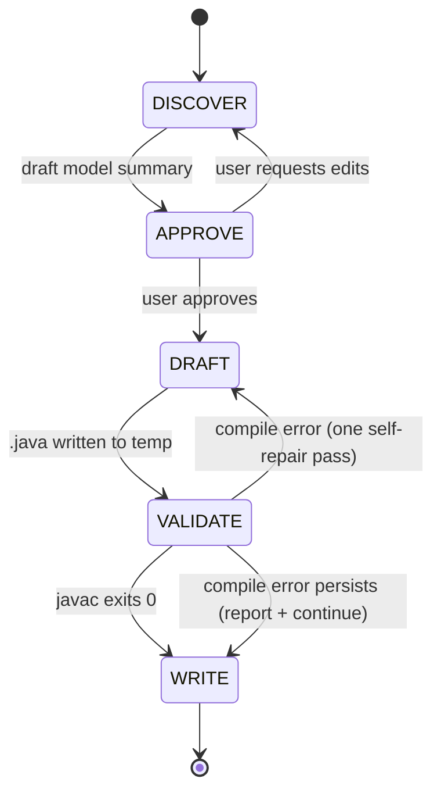

# closure-devs-atomic

## What This Skill Does

Takes a description and/or supporting artifacts (text in the prompt, Markdown/TXT files, PDFs, or predefined source code to convert) and produces a single compilable Closure-DEVS atomic model as a `.java` file, accompanied by a Mermaid state diagram and a one-page README.

Two model families are supported and the user is **always asked** which one applies:

- **Deterministic** → generated class extends `com.ms4systems.devs.core.model.impl.Atomic`.
- **Markov / stochastic** → generated class extends `com.ms4systems.devs.markovmodel.ContinuousTimeMarkov`.

The skill narrows scope to atomic models only. For coupled models, hierarchical composition, or MS4ME deployment, use the broader `devs-builder` skill instead.

## Workflow Overview



## Stages

### Stage 1 — DISCOVER

**Inputs (any combination):**

- Plain-text description in the prompt.
- Markdown or plain-text files (e.g. output of `devs-model-outline`).
- PDF documents (read via the `Read` tool).
- Predefined source code the user wants converted into a DEVS atomic. When this is the input, consult `resources/patterns/legacy-code-mapping.md` for the state/event/timing extraction heuristic.

**Extract into a draft Model Context:**

- `class_name` (CamelCase Java identifier; default `FooAtomic` when converting from a class `Foo`)
- `package` (if user specified, or inferable from an existing project layout)
- `input_ports[]` and `output_ports[]` with `name` and `type` (default `Serializable.class`)
- `phases[]` (deterministic) **or** a rate table of `{from, successor, rate}` rows (Markov candidate)
- `initial_phase` / `initial_state`
- `internal_transitions[]` (`from`, `to_phase`, `to_sigma`, `action`) and `external_transitions[]` (`from_phase`, `port`, `to_phase`, `to_sigma`, `action`)
- `output_rules[]` (`when_phase`, `port`, `data_expr`)
- `markov_cues` — any mention of rates, exponential waits, probabilistic transitions, MTTR/MTBF. These **don't decide** the det/Markov choice; they inform the question at Stage 2.

**Do NOT write any files in this stage.**

### Stage 2 — APPROVE

Ask the user explicitly, using the exact wording:

> **"Is this model deterministic or Markov (stochastic)?** Deterministic models extend `Atomic` and use fixed time advances via `holdIn(phase, sigma)`. Markov models extend `ContinuousTimeMarkov` and use exponential hold times driven by a rate matrix."

If the DISCOVER stage picked up Markov cues, mention them: *"The description mentions exponential failure rates, which usually indicates a Markov model — confirm?"*

Then present a compact model summary for approval:

```
Model: {class_name}   (extends {Atomic | ContinuousTimeMarkov})
Package: {package or "(default)"}

Input ports:
  - {name} : {type}
  ...
Output ports:
  - {name} : {type}
  ...

Phases / states:
  - {name} — {notes}
  ...

Transitions:
  [deterministic] {from} --(σ={sigma})--> {to}   on internal
  [deterministic] {from} --on {port}--> {to}      on external
  [markov]        {from} --λ={rate}--> {successor}

Time-advance rule: {either sigma values per phase, or "exponential from rate matrix"}
```

Wait for the user to approve, edit, or replace sections. Only proceed to DRAFT after explicit approval.

### Stage 3 — DRAFT

Select template:

- Deterministic → `resources/templates/atomic-deterministic.java.tmpl`
- Markov → `resources/templates/atomic-markov.java.tmpl`

Fill placeholders from the approved Model Context. For deterministic models, also emit the phase/sigma helper methods verbatim (they are not inherited — see `resources/patterns/phase-sigma-idiom.md`).

Also render the state diagram via `resources/output-templates/state-diagram.md.tmpl` and the README via `resources/output-templates/README.md.tmpl`.

Write all three artifacts to a **temp location** (e.g. `/tmp/closure-devs-atomic-{class_name}/`) — not yet to the final output directory.

### Stage 4 — VALIDATE

Validate every artifact, not just the `.java` file. Three checks, run in order:

**4a. Java compile.**

```bash
javac -cp ~/.m2/repository/com/ms4systems/Closure-DEVS/1.0.0/Closure-DEVS-1.0.0.jar \
      /tmp/closure-devs-atomic-{class_name}/{class_name}.java
```

If the user has set a different JAR location (via a `CLOSURE_DEVS_JAR` environment variable, or by passing a path in the prompt), honor it.

**4b. Mermaid render.**

Run every `.md` file in the bundle through the shipped validator:

```bash
resources/scripts/validate-mermaid.sh \
    /tmp/closure-devs-atomic-{class_name}/{class_name}-state-diagram.md \
    /tmp/closure-devs-atomic-{class_name}/README.md
```

The script extracts each ` ```mermaid ``` ` fenced block and pipes it through `mmdc` (via `npx --yes --package=@mermaid-js/mermaid-cli@latest`). Exit 0 iff every block in every file rendered. On failure, the script prints the offending block and the parser error. See `resources/reference/mermaid-label-safety.md` for the portability rules that templates follow to avoid common renderer gotchas (GitHub, VS Code preview).

**4c. Self-repair.**

For either compile or Mermaid failures: perform **exactly one** self-repair pass — fix the reported error in the generated source or Markdown and retry the corresponding check. If it still fails, continue to WRITE but surface the errors clearly in the user-facing summary. Do **not** run `AtomicSimulator` — this skill stops at compile + Mermaid-render validation.

### Stage 5 — WRITE

Resolve the output directory using this policy (first match wins):

1. **User-specified path** in the prompt → always honored.
2. **Inside the `devs-skills-claude` project** (detected by walking up from cwd and matching the path prefix `/home/chris/DEVS/devs-skills-claude/`, or finding a `CLAUDE.md` that names the repo): `test/closure-devs-atomic/{class_name}/`.
3. **Inside a Maven project** (`pom.xml` at or above cwd): `src/main/java/{package/path}/{class_name}/` — with `.java`, state diagram, and README co-located.
4. **Inside a Gradle project** (`build.gradle` or `build.gradle.kts`): same as Maven.
5. **Fallback** (no project markers): `./{class_name}/` under cwd.

Show the resolved path to the user *before* writing. Move the three files from the temp location into the final directory, then report:

- Absolute paths of the three written files
- Compile status (`javac` exit code and any remaining diagnostics)
- The det/Markov choice that was used
- A one-line suggestion for next steps (e.g., "integrate into a Coupled via `devs-builder`")

## Prerequisites

- `javac` on PATH (OpenJDK or Oracle JDK 8+).
- The Closure-DEVS JAR available at `~/.m2/repository/com/ms4systems/Closure-DEVS/1.0.0/Closure-DEVS-1.0.0.jar`, OR an alternate path passed in the prompt, OR the `CLOSURE_DEVS_JAR` env var.
- `node` and `npx` on PATH (Node.js 18+). The VALIDATE stage invokes `mmdc` via `npx --yes --package=@mermaid-js/mermaid-cli@latest`, which auto-installs on first use. No global install required.

## Reference Library

| Path under `resources/` | Purpose |
|---|---|
| `templates/atomic-deterministic.java.tmpl` | Deterministic atomic skeleton — extends `Atomic`, includes locally-defined phase/sigma helpers |
| `templates/atomic-markov.java.tmpl` | Markov atomic skeleton — extends `ContinuousTimeMarkov`, populates `TransitionInfoList` via `addTransitionInfo` |
| `patterns/phase-sigma-idiom.md` | Required helper methods (holdIn, phaseIs, passivate) for deterministic subclasses |
| `patterns/port-message-idiom.md` | `addInputPort` / `addOutputPort` / `MessageBag` / `Port.createMessage` usage |
| `patterns/transition-methods.md` | Exact signatures of `initialize` / `internalTransition` / `externalTransition` / `confluentTransition` / `getTimeAdvance` / `getOutput` |
| `patterns/markov-state-matrix.md` | Populating `TransitionInfoList` for continuous-time Markov |
| `patterns/legacy-code-mapping.md` | Heuristic for converting predefined source code into DEVS atomic |
| `examples/Genr.java` | Minimal deterministic example (no phases, raw sigma) |
| `examples/CallGenerator.java` | Phase-based deterministic example with `PhaseBased`/`StateVariableBased` |
| `output-templates/state-diagram.md.tmpl` | Mermaid state diagram scaffold — follows the label-safety rules |
| `output-templates/README.md.tmpl` | Output-side README scaffold |
| `reference/closure-devs-api-cheatsheet.md` | Compact API reference for Atomic + ContinuousTimeMarkov + ports/messages |
| `reference/mermaid-label-safety.md` | Portability rules for Mermaid transition labels (ASCII, no `;`, no `:=`, notes for non-phase-changing reactions) |
| `scripts/validate-mermaid.sh` | Extracts every ` ```mermaid ``` ` block from a .md and validates via `mmdc`; used by Stage 4b |

## Portability note

The skill runs end-to-end with stock Claude Code tools (`Read`, `Write`, `Bash`, and the `AskUserQuestion` interactive prompt) plus a local `javac` and `npx` (for `mmdc`-based Mermaid validation; auto-installs on first use). It does **not** depend on AgentDB, `mcp__claude-flow__*` tools, or any swarm coordination. If your environment has those configured, they can be layered on externally (e.g., for pattern persistence) — but they are not part of the documented workflow.

## Related skills

- `devs-builder` — fuller 6-phase workflow that also generates coupled models and deploys to MS4ME. Use this when your target is a full DEVS system, not just one atomic.
- `devs-model-outline` — produces formal DEVS outline documentation. Its Markdown output is a natural input to this skill's DISCOVER stage.
- `generate-ef-sut` — experimental-frame / system-under-test scaffolding, useful alongside this skill when validating the generated atomic against test scenarios.
