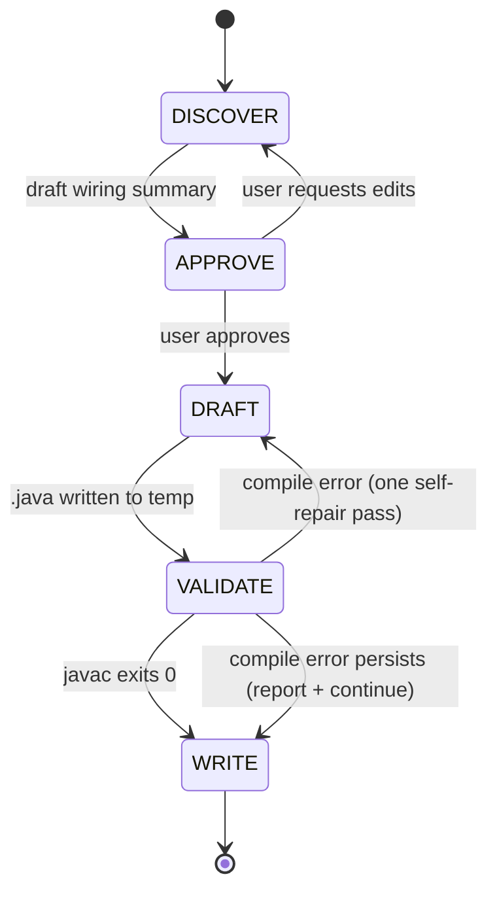

# closure-devs-coupled

## What This Skill Does

Takes a description plus a set of **already-defined** Closure-DEVS component models (atomic or coupled, supplied as `.java` source or as a class listing) and produces a single compilable coupled Java file (`extends com.ms4systems.devs.core.model.impl.Coupled`), accompanied by a Mermaid block diagram and a one-page README.

This skill deliberately does **not** generate the component models. If you need those, run `closure-devs-atomic` (or the broader `devs-builder`) first, then come back here for the composition layer.

## Workflow Overview



## Stages

### Stage 1 — DISCOVER

**Inputs (any combination):**

- Plain-text description of the composition (what wires to what, and why).
- Paths to the child component `.java` files (atomic or coupled). When present, the skill reads them to extract the public port declarations — see `resources/patterns/child-port-discovery.md`.
- A previously generated `devs-model-outline` coupled spec (Markdown with flow / sequence diagrams).
- An existing coupled `.java` the user wants re-expressed, refactored, or re-wired.

**Extract into a draft Coupled Context:**

- `class_name` (CamelCase Java identifier; default derived from description)
- `package` (if user specified or inferable from child source paths)
- `external_input_ports[]` and `external_output_ports[]` with `name` and optional `type` (stored on the Port; if omitted, the port is type-unqualified). May be empty for a closed top-level system.
- `children[]`, each with:
  - `var_name` (local field / local variable name — lowerCamelCase)
  - `class_name` (FQCN or simple name of the child)
  - `constructor_args[]` (if the child class has non-default constructors)
  - `input_ports[]` and `output_ports[]` (inferred from source if available; otherwise asked)
  - `kind` (`atomic` or `coupled`) — determines whether the child is added via `addChildModel(DEVS)` (either kind) or the dedicated `addCoupledChildModel(Coupled)` (only for coupled children)
- `couplings[]`, each tagged with its kind:
  - `EIC` (external input → child input): `{ from: "this", from_port, to_child, to_port }`
  - `IC`  (child output → child input):  `{ from_child, from_port, to_child, to_port }`
  - `EOC` (child output → external output): `{ from_child, from_port, to: "this", to_port }`
- `coupling_style` — `port` (use `addCoupling(Port, Port)` with field-access) or `string` (use the dedicated `addExternalInputCoupling` / `addInternalCoupling` / `addExternalOutputCoupling` string-based methods). Default `port` if the children expose public port fields; otherwise `string`. See `resources/patterns/coupling-kinds.md`.
- `generate_main` — whether to emit the `CoupledCoordinator`-based simulation harness. Default: `true` if no external ports; otherwise ask.
- `unresolved[]` — things the skill couldn't infer: missing port types, ambiguous wiring, ports referenced in the description but absent from the component source, etc.

**Do NOT write any files in this stage.**

### Stage 2 — APPROVE

Present a compact wiring summary for approval:

```
Coupled: {class_name}   (extends com.ms4systems.devs.core.model.impl.Coupled)
Package: {package or "(default)"}
Coupling style: {port | string}

External ports:
  in:  {name} : {type}                       # (omit section if none)
  out: {name} : {type}

Children:
  - {var_name} : {ClassName}  [{atomic | coupled}]
      in:  {port}:{type}, ...
      out: {port}:{type}, ...
  ...

Couplings:
  EIC (this.in -> child.in):
    this.{port} -> {child_var}.{child_port}
    ...
  IC  (child.out -> child.in):
    {child_a_var}.{port_a} -> {child_b_var}.{port_b}
    ...
  EOC (child.out -> this.out):
    {child_var}.{port} -> this.{port}
    ...

Simulation harness (main): {yes / no}
```

If the Coupled Context has an `unresolved[]` list, surface each item as a question **before** asking for approval — don't silently pick defaults for missing types or ambiguous wiring. Likewise, if port-type inference flagged a potential mismatch (e.g., `Job` wired to a port typed `String`), call it out explicitly and reference `resources/patterns/port-compatibility.md`.

Wait for the user to approve, edit, or add/remove couplings. Only proceed to DRAFT after explicit approval.

### Stage 3 — DRAFT

Fill `resources/templates/coupled.java.tmpl` from the approved Coupled Context:

- Always `extends com.ms4systems.devs.core.model.impl.Coupled`.
- External ports, children, and couplings are optional blocks in the template — emit only the sections that apply.
- Each child is registered via `addChildModel(child)` (accepts any `DEVS` — atomic or coupled). Children whose `kind == coupled` may alternately use the more specific `addCoupledChildModel(child)` for clarity.
- Couplings use the style selected at APPROVE:
  - `port` style — `addCoupling(childA.outPort, childB.inPort)` / `addCoupling(this.inPort, childA.inPort)` / `addCoupling(childA.outPort, this.outPort)`. Requires children to expose public `Port` fields.
  - `string` style — `addExternalInputCoupling("inPort", "childName", "inPort")` for EIC, `addInternalCoupling("childA", "outPort", "childB", "inPort")` for IC, `addExternalOutputCoupling("childA", "outPort", "outPort")` for EOC. Works regardless of field exposure; typos surface at simulation time.
- The main method, when `generate_main` is true, uses `CoupledCoordinator` directly — no `SimulationImpl` / `SimViewer` / `SimulationOptionsImpl` (those live in separate MS4ME jars, not in the Closure-DEVS jar).

Also render the block diagram via `resources/output-templates/block-diagram.md.tmpl` and the README via `resources/output-templates/README.md.tmpl`.

Write all three artifacts to a **temp location** (e.g. `/tmp/closure-devs-coupled-{class_name}/`) — not yet to the final output directory.

### Stage 4 — VALIDATE

Validate every artifact, not just the `.java` file. Three checks, run in order:

**4a. Java compile.**

The coupled references its children by type, so the children must be on the classpath. Two supported modes:

```bash
# (a) Children live as source — compile both together:
javac -cp "$CLOSURE_DEVS_JAR" \
      -d /tmp/closure-devs-coupled-{class_name}/build \
      /tmp/closure-devs-coupled-{class_name}/{class_name}.java \
      {space-separated paths to each child .java}

# (b) Children are already compiled (.class or .jar) — add them to -cp:
javac -cp "$CLOSURE_DEVS_JAR":{children_classpath} \
      /tmp/closure-devs-coupled-{class_name}/{class_name}.java
```

`$CLOSURE_DEVS_JAR` resolves in this order: (1) explicit path in the prompt, (2) the `CLOSURE_DEVS_JAR` environment variable, (3) the default `~/.m2/repository/com/ms4systems/Closure-DEVS/1.0.0/Closure-DEVS-1.0.0.jar`. If no child source is available and no classpath is given, stop and ask — do **not** fabricate stubs.

**4b. Mermaid render.**

Run every `.md` file in the bundle through the shipped validator:

```bash
resources/scripts/validate-mermaid.sh \
    /tmp/closure-devs-coupled-{class_name}/{class_name}-block-diagram.md \
    /tmp/closure-devs-coupled-{class_name}/README.md
```

The script extracts each ```` ```mermaid ``` ```` fenced block and pipes it through `mmdc` (via `npx --yes --package=@mermaid-js/mermaid-cli@latest`). Exit 0 iff every block in every file rendered. On failure, the script prints the offending block and the parser error. See `resources/reference/mermaid-label-safety-flowchart.md` for the flowchart-specific portability rules that templates follow.

**4c. Self-repair.**

For either compile or Mermaid failures: perform **exactly one** self-repair pass — fix the reported error in the generated source or Markdown and retry the corresponding check. If it still fails, continue to WRITE but surface the errors clearly in the user-facing summary. Do **not** instantiate a `CoupledCoordinator` and run iterations — this skill stops at compile + Mermaid-render validation.

### Stage 5 — WRITE

Resolve the output directory using this policy (first match wins):

1. **User-specified path** in the prompt → always honored.
2. **Inside the `devs-skills-claude` project** (detected by walking up from cwd and matching the path prefix `/home/chris/DEVS/devs-skills-claude/`, or finding a `CLAUDE.md` that names the repo): `test/closure-devs-coupled/{class_name}/`.
3. **Inside a Maven project** (`pom.xml` at or above cwd): `src/main/java/{package/path}/{class_name}/` — with `.java`, block diagram, and README co-located.
4. **Inside a Gradle project** (`build.gradle` or `build.gradle.kts`): same as Maven.
5. **Fallback** (no project markers): `./{class_name}/` under cwd.

Show the resolved path to the user *before* writing. Move the three files from the temp location into the final directory, then report:

- Absolute paths of the three written files
- Compile status (`javac` exit code and any remaining diagnostics)
- A one-line summary of the wiring (N children, N EIC + N IC + N EOC couplings)
- A one-line suggestion for next steps (e.g., "embed into an outer coupled" or "hand to `devs-builder` for MS4ME packaging")

## Prerequisites

- `javac` on PATH (OpenJDK or Oracle JDK 8+).
- The Closure-DEVS JAR available at `~/.m2/repository/com/ms4systems/Closure-DEVS/1.0.0/Closure-DEVS-1.0.0.jar`, OR an alternate path passed in the prompt, OR the `CLOSURE_DEVS_JAR` env var.
- The already-defined child models reachable as `.java` source **or** as compiled `.class`/`.jar` on the classpath. If neither is available the skill stops at APPROVE and asks.
- `node` and `npx` on PATH (Node.js 18+). The VALIDATE stage invokes `mmdc` via `npx --yes --package=@mermaid-js/mermaid-cli@latest`, which auto-installs on first use.

## Reference Library

| Path under `resources/` | Purpose |
|---|---|
| `templates/coupled.java.tmpl` | Coupled skeleton — `extends Coupled`, optional external-port block, optional `main()` that drives `CoupledCoordinator` |
| `patterns/coupling-kinds.md` | EIC / IC / EOC definitions and the two Closure-DEVS APIs for each: generic `addCoupling(Port, Port)` vs. dedicated `addExternalInputCoupling` / `addInternalCoupling` / `addExternalOutputCoupling` |
| `patterns/child-port-discovery.md` | How to extract public port declarations from a child `.java` and reconcile them with the user's description |
| `patterns/port-compatibility.md` | Payload-type rules: Closure-DEVS ports are raw `Port` with an optional `Class` qualifier, not generic `Port<T>`; what the skill checks |
| `patterns/hierarchical-composition.md` | Nesting: `addChildModel(DEVS)` accepts atomics and coupleds uniformly; `addCoupledChildModel(Coupled)` is the dedicated coupled variant |
| `examples/Ef.java` | Embeddable coupled — declares external input/output ports, no `main()` |
| `examples/Efp.java` | Top-level coupled — no external ports, ships a `main()` driven by `CoupledCoordinator` |
| `output-templates/block-diagram.md.tmpl` | Mermaid `flowchart LR` scaffold showing children as nodes and couplings as labeled edges |
| `output-templates/README.md.tmpl` | Output-side README scaffold |
| `reference/closure-devs-coupled-cheatsheet.md` | Compact API reference: `Coupled`, `addChildModel` / `addCoupledChildModel` / `addCoupling` / `addExternal*Coupling` / `addInternalCoupling`, and `CoupledCoordinator` |
| `reference/mermaid-label-safety-flowchart.md` | Portability rules for flowchart edge labels (ASCII, no `;`, no `:=`, keep labels terse) |
| `scripts/validate-mermaid.sh` | Extracts every ```` ```mermaid ``` ```` block from a `.md` and validates via `mmdc`; used by Stage 4b |

## Portability note

The skill runs end-to-end with stock Claude Code tools (`Read`, `Write`, `Bash`, and the `AskUserQuestion` interactive prompt) plus a local `javac` and `npx` (for `mmdc`-based Mermaid validation; auto-installs on first use). It does **not** depend on AgentDB, `mcp__claude-flow__*` tools, or any swarm coordination. If your environment has those configured, they can be layered on externally (e.g., for pattern persistence) — but they are not part of the documented workflow.

## Related skills

- `closure-devs-atomic` — upstream companion. If the child models don't exist yet, generate them there first, then return here for the composition layer.
- `devs-builder` — fuller 6-phase workflow that also generates atomics and deploys to MS4ME. Use it when your target is a full DEVS system *and* you need the MS4ME pipeline, not just the coupled Java file.
- `devs-model-outline` — produces formal DEVS outline documentation. Its coupled-diagram output is a natural input to this skill's DISCOVER stage.
- `ses-designer` — produces SES/PES artifacts that a coupled can be derived from (pair with this skill to convert SES → runnable DEVS).
