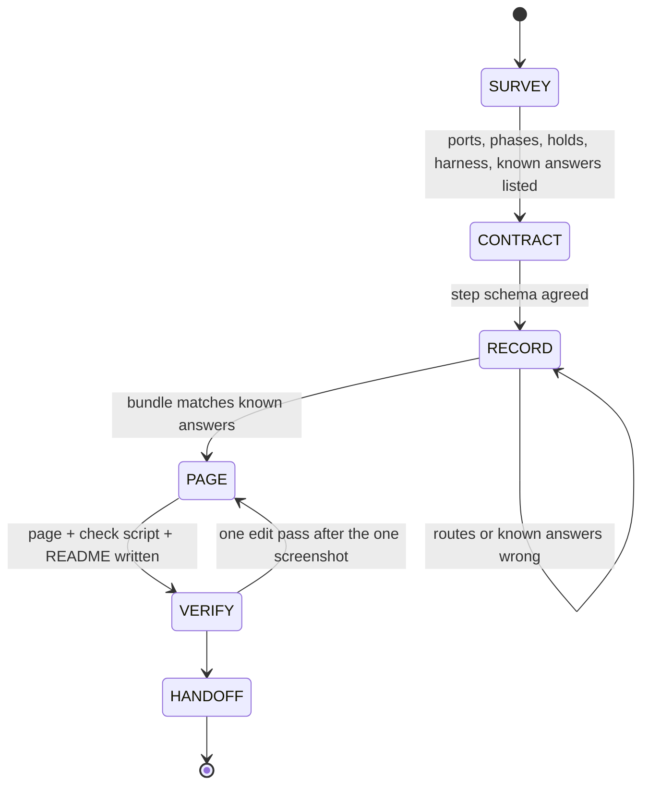

# devs-demo

## What This Skill Does

Converts a running Closure-DEVS model into a visual demo in three parts, each verified against known answers before the next starts:

1. **Recorder and harness (Java).** A `SimulationEventListener` that logs every leaf transition with the phase before it, routes every output message to its leaf destinations through a coupling table flattened across pruned `ClosureToAtomic` boundaries, and snapshots the post-transition state once per root step. A harness wraps the project's existing run loop, runs N replications per scenario for statistics and one traced replication for the animation, and writes `demos/data/demo-data.{json,js}`. A gradle task runs it.
2. **Bundle (data contract).** One JSON object: `meta`, `instances` (parameters per scenario family), `topology` (leaf models with roles and routes), `scenarios` (result, statistics, trace of steps), optional `legacy` data. The `.js` file assigns it to `window.NTN_DEMO`-style global so a page opened over `file://` can load it with a script tag.
3. **Page (one HTML file).** Animated topology with message tokens and phase-coloured nodes, event-stepped replay with a step log in DEVS terms (δint / δext / δcon, σ, ports), phase lanes for two variants on the same input, statistics with log axes, and a project panel (for example the morphism table). Built to the Artifact page contract but kept local and unpublished, zero dependencies, light and dark, phone width. A node script runs the page's pure functions against the bundle.

The demo replays real simulation runs. It never re-implements the model in JavaScript.

## Prerequisites

- A Java 21 gradle project using `com.ms4systems:Closure-DEVS:1.0.0` (the facts in `docs/CLOSURE_DEVS_TRACING.md` were verified with `javap` on that jar; re-verify for another version).
- A harness that can build the coupled model and run it (a `SimulateModel` subclass with a per-event loop, or a plain `CoupledCoordinator` loop).
- Node 18+ for the check script; Firefox or Chromium for the one screenshot.
- Skills to load along the way: `devs-model-outline` (optional, to survey the models), `dataviz` (before any chart code), `artifact-design` (before writing the page).

## Workflow

### Stage 1: SURVEY

Read, do not guess:

- The coupled model(s): every coupling (`addCoupling` calls or the `.ses` file), which ports cross coupled boundaries, which leaf is the source and which the sink of the thing being transported.
- Every leaf atomic: phase names, holds per phase, what `getOutput()` emits in which phase, which external events change parameters without changing phase (a flare, a disruption), and whether `getOutput()` is pure (it will be called a second time from the listener).
- The harness: how the model is built (hand-coupled or SES-pruned), where parameters are applied, how many iterations, `maxSimulationTime`, whether Markov RNGs are reseeded per replication and how.
- Existing results: CSVs, docs, reports. Write down three or four **known answers** (a delivery time, a path, a never-delivers case, a reroute) before writing code. Every later stage is checked against them.

Ask the user, in one round, only what changes the work materially: which branch or worktree the demo lands in; replay only or replay plus a statistics panel; which project-specific panel (parameters, morphism, KPIs) belongs on the page. Default answers: current checkout, replay plus statistics, the parameter table. Data source is always traces of real runs. Output location is `demos/` at the repo root. Nothing is published.

### Stage 2: CONTRACT

Fix the bundle shape before writing either side (`docs/BUNDLE_SCHEMA.md`). The rules that matter:

- `msgs` are leaf-to-leaf (flattened in Java); the page never resolves couplings.
- Each event carries `phaseBefore`; message kind is decided from the sender's phase before its transition, because one port can carry different meanings in different phases.
- `after` holds only the models that transitioned in that step; the page folds it onto the previous state.
- Infinity and `Double.MAX_VALUE` holds become `null`; the page treats `sigma == null || sigma >= 1e300` as passive.
- Step time is the root simulation time, not an inner coordinator's time.
- Statistics keep the sorted sample of successful outcomes, plus `n`, `successes`, `mean`, `std`.

### Stage 3: RECORD

Start from `resources/templates/TraceRecorder.java` and `resources/templates/DemoDataRunner.java` (or `scripts/scaffold.sh`). The facts the recorder depends on, all in `docs/CLOSURE_DEVS_TRACING.md`:

- Under a coordinator Closure-DEVS 1.0.0 never fires `MESSAGE_SENT`; read outputs by calling `getOutput()` on `TRANSITION_INTERNAL` and `TRANSITION_CONFLUENT`, which fire **before** the model transitions (`getPhase()` is then the phase before).
- External and confluent events carry the receiver's input bag in `getMessage()`; `portsWithMessages()` names the receiver's ports.
- `CoupledCoordinator.addSimulationEventListener(l, true)` does not reach a `ClosureToAtomic`'s `internalCoord`; attach to each leaf simulator through each nested coordinator, never to wrappers or the root.
- A `ClosureToAtomic` shares the same `Port` objects as its `CModel`, and `Coupling.getSource()/getDestination()` return `port.getModel()`, so routes flatten by Port identity with no name matching.
- Sigma is `atomic.getTimeAdvance()`; the simulator executes the first event past `maxSimulationTime`, so drop events with `t > tEnd`.
- Model-specific state (a link budget, a Markov `nextState`) goes through the recorder's `details()` hook, kept in the project's package so protected fields are reachable.

Harness choice: if the project already has a `SimulateModel` subclass with a per-event loop (as `RunMorphismQuality` in sda-pwsa), extend it and add two no-op hooks, `afterStart()` and `afterStep()`; otherwise use the standalone loop in the template. Reuse the project's seeding and closure-reset code rather than re-deriving it.

Run small first (one instance, five replications). Check: the flattened route count equals the hand count from the couplings; the traced run equals the untraced replication with the same seed; every input port of an ext/con event is explained by a routed message in the same step (the recorder counts `unexplained`); the known answers match. Then run the full set. If a smoke run of an existing task overwrote committed outputs, restore them with `git checkout --`.

### Stage 4: PAGE

Load `artifact-design` and `dataviz`, then start from `resources/examples/ntn-flare/ntn-flare-demo.html` and adapt the marked sections (`docs/PAGE_DESIGN.md` lists them): the phase category map `CAT`, `kindOf`, the `pathTaken` root and terminal, the topology geometry in `renderRing`, and the project panel. Everything else (loader, validator, replay engine, log, lanes, strip chart, small multiples, tooltip, theme) is model-agnostic.

Contract for a local, unpublished artifact: the file keeps its own doctype, charset, viewport (`viewport-fit=cover`) and a 2-4 word `<title>`; every colour is a token first defined on bare `:root`, redefined under `@media (prefers-color-scheme: dark) { :root:not([data-theme="light"]) }` and again under `:root[data-theme="dark"]`, both with `color-scheme: dark`; `body` has an explicit token background; no external scripts, stylesheets or fonts (system stacks only, it must work offline); 16px side gutter; no page-level horizontal scroll, wide tables and the lanes panel own their `overflow-x: auto`; `tabular-nums` where digits align; `prefers-reduced-motion` disables token motion; stable ids on form controls; visible focus. Charts take their colours from the dataviz reference palette, text wears text tokens, a legend is present for two or more series, log axes where values span decades.

Replay is event-stepped (one DEVS imminent set per step, several steps may share a `t`), never proportional to simulation time. The pure functions sit first in the inline script and are exposed on a global so the check script can run them without a DOM.

### Stage 5: VERIFY

- `node demos/test/check-demo.js` (template in `resources/templates/check-demo.js`): bundle validates; every message maps to a drawn link or a declared exception; `pathTaken` reproduces the known paths; the delivery step's `t` equals the recorded result; the page's re-derived physics (if any) matches the Java values; `describeStep` names every event; formatting edge cases; no `http(s)://` in the page apart from the SVG namespace; both dark blocks present; title in the first 8 KB.
- Existing gradle tasks still run after the hook was added.
- One screenshot per width (`firefox --headless --no-remote --new-instance --profile <scratch dir> --window-size=1400,2700 --screenshot out.png file://...`, then 390 wide), one pass of edits for what it shows, no second loop. Headless Firefox cannot drive the controls; replay, drop-loading and dark mode stay manual checks listed in the README.

### Stage 6: HANDOFF

Write `demos/README.md`: how to open (double-click, offline, not published), how to regenerate (`gradle` task and flags), what each panel shows, what is computed in the page, caveats that come from the model rather than the page (one replication traced, holds of `Double.MAX_VALUE`, inputs that arrive after delivery), and the verification commands. Report the known-answer table in the final message. Do not commit or publish unless asked.

## Pitfalls

- Calling `getOutput()` on a `ClosureToAtomic` is not side-effect free (it runs the inner `computeOutput`). Only query leaves.
- A wrapper that is both imminent and a receiver runs an inner leaf twice in one root step: `events` keeps both, `after` keeps the final state; the page must play `events` in order.
- Time scales: delivery times can span 1e-5 to 1e3; log axes in charts, event-stepped replay, `fmtT` with exponent formatting.
- Markov models: holding times are drawn from an unseeded sampler unless the harness re-points it (see `RunMorphismQuality.seedSamplers` in sda-pwsa); a traced rerun must use the same seed as the sampled replication it claims to be.
- `getSimulator(leaf) == null` means the coordinator was not rebuilt after a closure reset; attach in the hook that runs after `startSimulation`.
- Firefox headless silently writes nothing when another Firefox instance is running; use an isolated profile.
- `git merge -F -` does not read stdin; write the message to a file.

## Files in this skill

| Path | Purpose |
|---|---|
| `docs/CLOSURE_DEVS_TRACING.md` | Verified Closure-DEVS 1.0.0 facts, the listener, attach, flatten, snapshot, step loop, live-mode sketch |
| `docs/BUNDLE_SCHEMA.md` | The data contract with field semantics and a worked step |
| `docs/PAGE_DESIGN.md` | Panel designs, geometry recipes (ring, chain, grid, generic), category and kind rules, lanes math, charts, adaptation points |
| `resources/templates/TraceRecorder.java` | Generic recorder with a `details()` hook |
| `resources/templates/DemoDataRunner.java` | Standalone harness skeleton with the JSON writer |
| `resources/templates/check-demo.js` | Node check skeleton with a known-answers table to fill |
| `resources/templates/build.gradle.snippet` | The gradle task |
| `resources/examples/ntn-flare/` | The sda-pwsa implementation: page, recorder, harness, check, README, trimmed bundle |
| `scripts/scaffold.sh` | Copies the templates into a repo with the package name substituted |

## Related skills

`devs-model-outline` (survey the models first), `closure-devs-atomic` and `closure-devs-coupled` (if the model must change), `dataviz` and `artifact-design` (page), `simulation-report-builder` (when the deliverable is a report rather than a demo).
