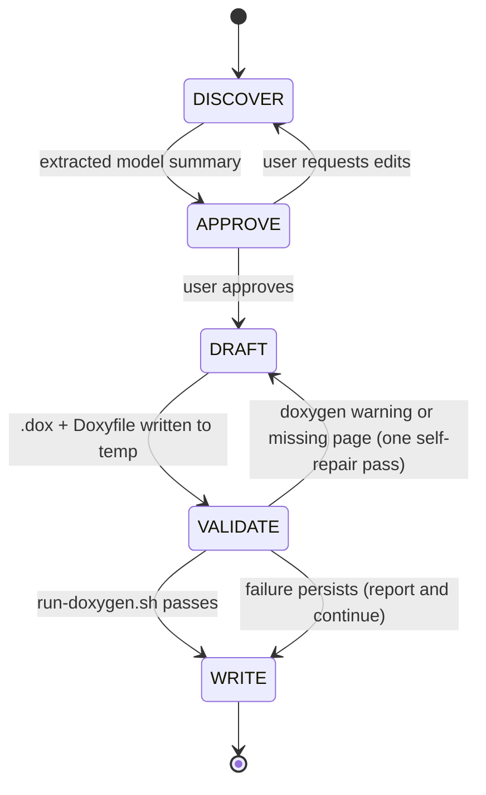

# devs-doxygen

## What This Skill Does

Takes a preexisting DEVS model (one file or a directory of files in Java, C++,
Julia or Python), reads the source to recover its formal specification, and
writes a Doxygen documentation bundle:

- `{Model}.dox` per model: a Doxygen page with the formal tuple, port tables,
  phases and state variables, transition / output / time-advance tables, a
  Graphviz state diagram (atomic) or coupling diagram plus mscgen interaction
  sketch (coupled), and a table mapping each DEVS element to the implementing
  member in the source.
- `index.dox` when the bundle holds more than one model (main page with the
  model list and a composition-hierarchy graph).
- `Doxyfile` tuned for the language, listing the `.dox` files and the model
  source so `doxygen Doxyfile` produces HTML with both the specification pages
  and the API pages extracted from the code.
- `julia-doxygen-filter.py` next to the Doxyfile for Julia sources (Doxygen
  has no Julia parser; the filter exposes modules, structs, fields, functions
  and docstrings as Python-style pseudo-source).

The user's source files are never modified. Diagrams use Graphviz `\dot` and
mscgen `\msc` because Doxygen renders those offline; it does not render Mermaid.

## Workflow Overview



## Stages

### Stage 1 — DISCOVER

**Inputs:** a path to a model file or directory (required); optionally a
system name, an output directory, and background documents (Markdown, PDF,
the output of `devs-model-outline`) that explain intent the code does not.

1. Run the detector to find candidate files, language, framework and kind:

   ```bash
   python3 resources/scripts/detect-devs-model.py <path> [<path> ...]
   ```

   It prints a table (file, language, framework, kind, models) and a summary.
   Treat it as a seed: it is regex-based and marks guesses with `?`.

2. Read every DEVS source file in full. Use
   `resources/reference/framework-signatures.md` to locate each element for the
   detected framework (or the generic fallback), and fill a **Model Context**:

   - `system_name`, `language`, `framework`, `formalism` (Parallel DEVS when a
     confluent function exists, Classic DEVS otherwise), `source_root`
   - per **atomic** model: `class_name`, `source_file`, `description`,
     `parameters`, `input_ports[]` / `output_ports[]` (`name`, `type`,
     `description`), `phases[]` (`name`, `sigma`, `meaning`),
     `state_variables[]` (`name`, `type`, `initial`, `description`),
     `initial_phase`, `ta_rule`, `internal_transitions[]` (`from`, `to`,
     `action`), `external_transitions[]` (`from`, `port`, `condition`, `to`,
     `action`), `confluent_rule`, `outputs[]` (`phase`, `port`, `value`),
     the implementing member for each element, `notes`
   - per **coupled** model: `class_name`, `source_file`, `description`,
     `parameters`, external `input_ports[]` / `output_ports[]`,
     `components[]` (`name`, `model`, `kind`, `parameters`), `eic[]`, `ic[]`,
     `eoc[]`, `select_rule` (if the framework has one), a short typical
     interaction (`sequence_steps[]`), `notes`
   - `hierarchy`: which model contains which; the root is the model no other
     model contains (several roots are allowed)

3. Decide the `\ref` qualification for the language (cheat sheet section 4),
   whether Graphviz is available (`command -v dot` sets `HAVE_DOT`), and the
   Doxyfile language settings (cheat sheet section 10).

Record anything you had to infer (implicit phases, unknown port types,
unreachable branches, a missing confluent function) as **open questions**.
Do **not** write any files in this stage.

### Stage 2 — APPROVE

Present a compact summary and wait for explicit approval before drafting:

```
System: {system_name}   ({language} / {framework}, {formalism})
Source: {source_root}
Output: {resolved output directory}   (see Stage 5 policy)

Models:
  - {ClassName}  atomic   in {file}
      ports:  in = {names}   out = {names}
      phases: {name} (ta = {sigma}), ...
      delta_int: {n} rows   delta_ext: {n} rows   lambda: {n} rows
      delta_con: {overridden | framework default}
  - {ClassName}  coupled  in {file}
      components: {name : Model}, ...
      EIC {n}   IC {n}   EOC {n}
Hierarchy: {root} -> {children} ...
Doxygen: pages = index + {n} model pages, HAVE_DOT = {YES|NO}

Open questions:
  - {anything inferred or ambiguous}
```

Only proceed to DRAFT after the user approves, edits, or answers the open
questions. If the user runs the skill non-interactively, state the assumptions
you are proceeding under in the final report instead.

### Stage 3 — DRAFT

Write everything to a temp directory first (the session scratchpad or
`/tmp/devs-doxygen-{system_name}/`).

1. **Slugs and pages.** `slug` = class name lower-cased with non-alphanumerics
   replaced by `_`; page id `devs_{slug}`; section labels `{slug}_*`. With one
   model, its page directive is `\mainpage {Model} DEVS {atomic|coupled} model`
   and there is no index. With several, each model page is
   `\page devs_{slug} {Model} DEVS {atomic|coupled} model` and `index.dox` is
   the `\mainpage`.
2. **Fill the templates** (`{{placeholder}}` and `{{#each}}` blocks are filled
   by you, there is no template engine):
   - `resources/templates/atomic.dox.tmpl` per atomic model
   - `resources/templates/coupled.dox.tmpl` per coupled model
   - `resources/templates/index.dox.tmpl` when more than one model
   - `resources/templates/Doxyfile.tmpl`
   Follow `resources/reference/dox-cheatsheet.md`: ASCII-only diagram labels,
   sanitised dot ids, quoted labels, one `\subpage` parent per page, a
   `(none)` row rather than an empty table, module-qualified `\ref` targets
   for Python and Julia, no `\ref` to framework classes that are not in INPUT.
3. **Doxyfile.** `INPUT = . {source paths relative to the Doxyfile}`;
   `RECURSIVE = YES` only when the source directory has subdirectories to include; language block and
   file patterns from cheat sheet section 10; `HAVE_DOT` from Stage 1. For
   Julia, copy `resources/scripts/julia-doxygen-filter.py` next to the
   Doxyfile.
4. Keep the source mapping honest: every row names the member that implements
   the element, or says `inherited from {Base} (framework default)`.

`resources/examples/expected/GenProc/` is a complete worked bundle (Python,
one coupled model with two atomics) to pattern-match against.

### Stage 4 — VALIDATE

Run Doxygen on the temp bundle and check the result:

```bash
resources/scripts/run-doxygen.sh /tmp/devs-doxygen-{system}/Doxyfile \
    --expect-page devs_{slug} [--expect-page devs_{slug} ...]
```

The script runs `doxygen`, then checks: exit code 0, `html/index.html`
present, every expected page rendered, every `\dot` and `\msc` block rendered
(when `HAVE_DOT = YES`), and no warning in `doxygen-warnings.log` that points
at a `.dox` file or at dot. Warnings about the user's own source are listed as
informational and never fail the run.

On failure, perform **exactly one** self-repair pass using the warning table in
cheat sheet section 11 (typically: qualify a `\ref`, change a duplicate
`\subpage` to `\ref`, quote a dot label), then re-run. If it still fails,
continue to WRITE and surface the remaining errors in the report. Never edit
the user's source files to silence a warning.

### Stage 5 — WRITE

Resolve the output directory (first match wins):

1. **User-specified path** in the prompt.
2. **Inside the `devs-skills-claude` project** (cwd under
   `/home/chris/DEVS/devs-skills-claude/`, or a `CLAUDE.md` naming the repo
   found walking up): `test/devs-doxygen/{system_name}/`.
3. **Inside a project with a build marker** at or above cwd (`pom.xml`,
   `build.gradle[.kts]`, `CMakeLists.txt`, `pyproject.toml`, `setup.py`,
   `Project.toml`): `{project_root}/docs/doxygen/{system_name}/`.
4. **Fallback:** `./{system_name}-doxygen/` under cwd.

Show the resolved path before writing. Move the whole temp bundle there
(`.dox` files, `Doxyfile`, the filter if any, `doxygen-warnings.log`, and the
generated `html/` so the result can be opened immediately), re-check that the
`INPUT` paths in the Doxyfile are still correct relative to the final
location, and report:

- the written files with absolute paths and the `html/index.html` to open
- validation status (pass, or the remaining warnings verbatim)
- assumptions made and open questions left
- how to regenerate: `cd {dir} && doxygen Doxyfile`

## Prerequisites

- `doxygen` on PATH (1.9 or newer; verified with 1.13).
- `dot` (Graphviz) on PATH for the state and coupling diagrams. Without it the
  skill sets `HAVE_DOT = NO`, the pages still build, and the graphs appear as
  dot source.
- `python3` for the detector and the Julia filter.
- No compiler or interpreter for the model's language is needed: Doxygen
  parses Java, C++ and Python source directly, and Julia through the filter.

## Reference Library

| Path under `resources/` | Purpose |
|---|---|
| `templates/atomic.dox.tmpl` | Atomic model page: tuple, ports, phases, variables, ta, transitions, lambda, dot state diagram, source mapping |
| `templates/coupled.dox.tmpl` | Coupled model page: tuple, external ports, components, EIC / IC / EOC, dot coupling diagram, msc interaction, source mapping |
| `templates/index.dox.tmpl` | Main page for multi-model bundles: model table, hierarchy graph, regeneration note |
| `templates/Doxyfile.tmpl` | Minimal Doxyfile with placeholders for input, language settings and `HAVE_DOT` |
| `reference/framework-signatures.md` | Where ports, state, ta, transitions, lambda and couplings live per language and framework, plus the generic fallback |
| `reference/dox-cheatsheet.md` | Doxygen commands used, id and label rules, `\ref` qualification per language, dot and msc rules, text pitfalls, DEVS-to-section map, per-language Doxyfile settings, warning fixes |
| `scripts/detect-devs-model.py` | Regex detector: language, framework, kind and model names per file |
| `scripts/julia-doxygen-filter.py` | Doxygen input filter turning Julia into Python-style pseudo-source |
| `scripts/run-doxygen.sh` | Runs doxygen and checks pages, graphs and `.dox` warnings; used by Stage 4 |
| `examples/java/JobProcessor.java` | Closure-DEVS atomic sample |
| `examples/cpp/JobProcessor.h` | adevs atomic sample |
| `examples/python/gen_proc.py` | PythonPDEVS sample: two atomics and one coupled model |
| `examples/julia/JobProcessor.jl` | Plain-struct Julia atomic sample |
| `examples/expected/GenProc/` | Worked output bundle for the Python sample (index, three pages, Doxyfile) |

## Portability note

The skill runs end-to-end with stock Claude Code tools (`Read`, `Write`,
`Bash`, `AskUserQuestion`) plus `doxygen`, `dot` and `python3`. It does not
depend on AgentDB, `mcp__claude-flow__*` tools, or any swarm coordination.

## Related skills

- `devs-model-outline` — Markdown specification with Mermaid diagrams, created
  from a description or from source. Use it when the target is a Markdown
  document rather than a Doxygen site; its output is also a good background
  input to this skill's DISCOVER stage.
- `closure-devs-atomic`, `closure-devs-coupled`, `devs-builder` — generate the
  models this skill documents.
- `devs-demo` — animated browser replay of a simulation run, complementary to
  static reference documentation.
