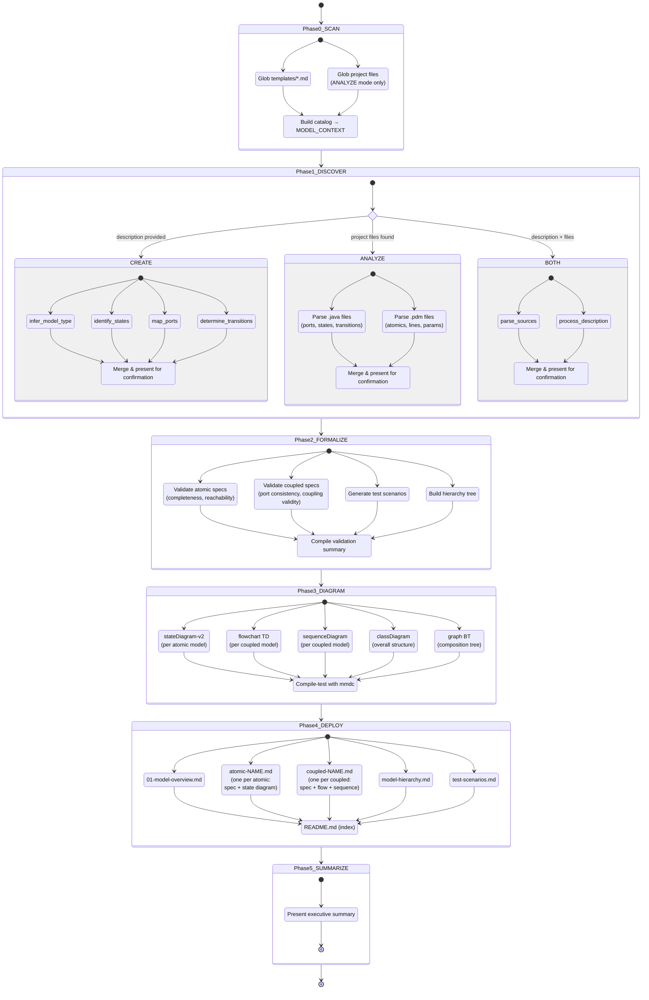
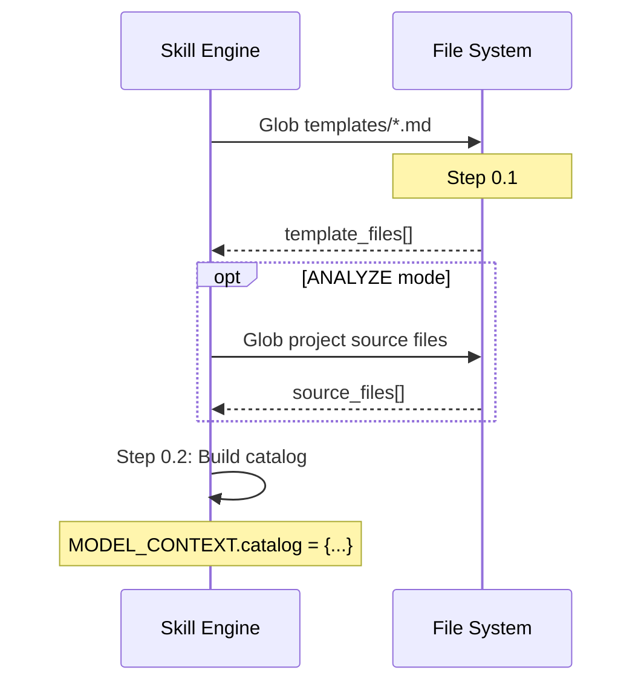
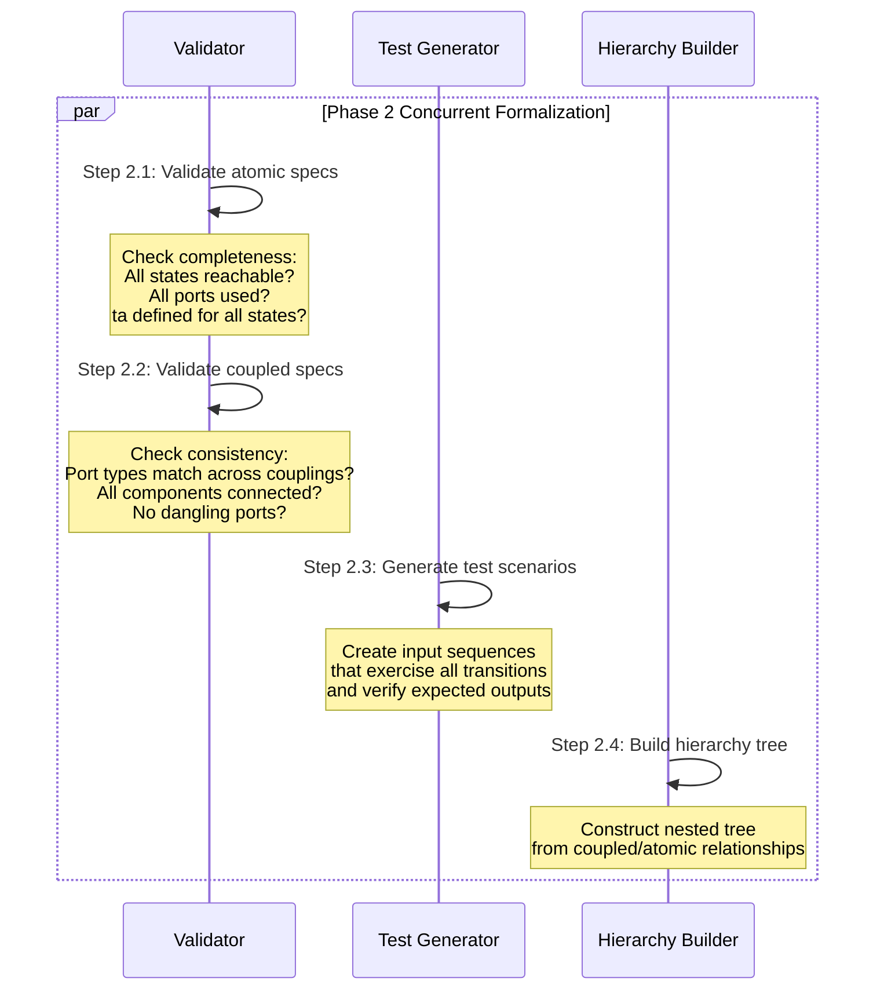
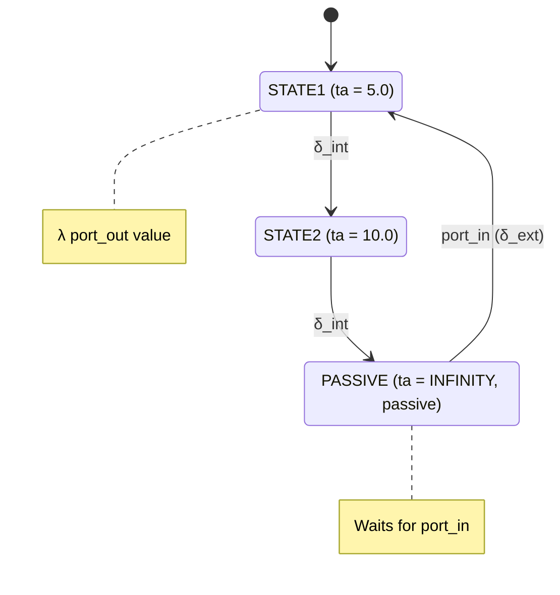
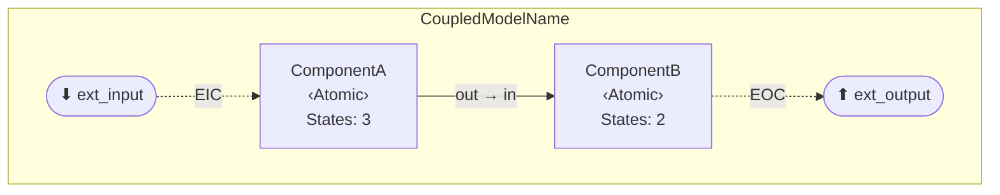
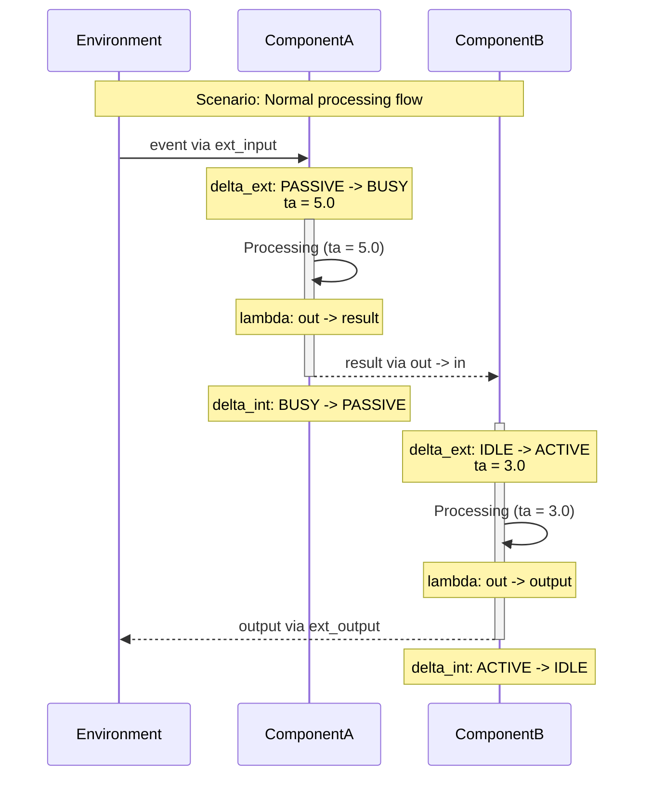
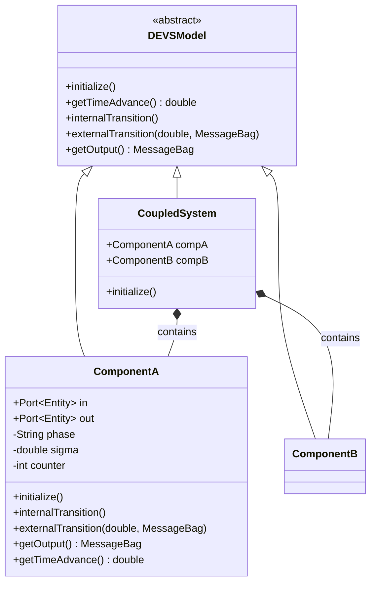
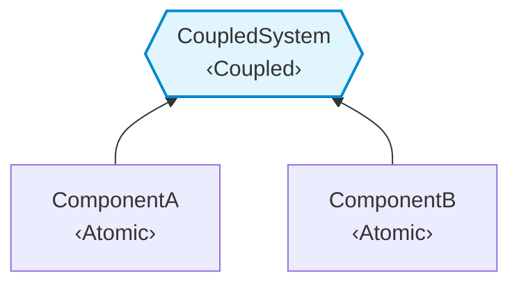

# DEVS Model Outline

## What This Skill Does

Produces comprehensive DEVS (Discrete Event System Specification) model documentation as a suite of Markdown files with embedded Mermaid UML diagrams. Operates in two modes:

- **CREATE mode**: Given a system description or requirements documentation, autonomously infers the complete DEVS model structure — states, ports, transitions, time advances, couplings — and generates formal specification documents with visual diagrams.
- **ANALYZE mode**: Given a project containing existing DEVS model source files (`.java` MS4Systems Basic-DEVS or `.pdm` PowerDEVS), parses the code to extract the model structure and generates equivalent documentation.

Both modes produce the same output: a set of interlinked Markdown files — a model overview, one self-contained specification per atomic model (formal spec **and** its state diagram), one self-contained specification per coupled model (formal spec **and** its coupling-flow and interaction-sequence diagrams), a model hierarchy, and test scenarios. The per-model layout keeps each model's spec and diagrams together in a single file, modular and independently navigable.

## Workflow Overview



## Model Context Object

All phases read from and write to a shared **Model Context** that maintains semantic consistency:

```
MODEL_CONTEXT = {
  // ── Mode Selection ──
  mode: "CREATE" | "ANALYZE" | "BOTH",
  source: {
    type: "description" | "files" | "both",
    description: "",               // User-provided text (CREATE mode)
    project_path: "",              // Path to project with model files (ANALYZE mode)
    documentation_paths: [],       // Paths to ingested docs (CREATE mode)
    source_files: []               // Discovered source files (ANALYZE mode)
  },

  // ── From Phase 0 (Reference Scan) ──
  catalog: {
    templates: [                   // Output templates
      { name: "", path: "", placeholders: [] }
    ]
  },

  // ── From Phase 1 (Discovery) ──
  system: {
    name: "",                      // System/model name
    description: "",               // Purpose statement
    goal: "",                      // Expected behavior / modeling objective
    formalism: "",                 // "Basic DEVS", "Parallel DEVS", etc.
    type: "atomic" | "coupled" | "hierarchical"
  },

  atomic_models: [                 // One entry per atomic model
    {
      id: "AM1",
      name: "",                    // Model class name
      source_file: "",             // Source path (ANALYZE mode only)
      formal_spec: {
        X: [                       // Input set
          { port_name: "", event_type: "", description: "" }
        ],
        Y: [                       // Output set
          { port_name: "", event_type: "", description: "" }
        ],
        S: [                       // State set
          { name: "", description: "", sigma: "", is_passive: false }
        ],
        delta_int: [               // Internal transition function
          { from_state: "", to_state: "", description: "" }
        ],
        delta_ext: [               // External transition function
          { current_state: "", input_port: "", event: "", to_state: "", description: "" }
        ],
        lambda: [                  // Output function
          { state: "", output_port: "", value: "", description: "" }
        ],
        ta: [                      // Time advance function
          { state: "", duration: "", description: "" }
        ]
      },
      confluent_transition: "",    // Confluent transition strategy
      state_variables: [           // Additional state variables beyond phase/sigma
        { name: "", type: "", initial: "", description: "" }
      ]
    }
  ],

  coupled_models: [                // One entry per coupled model
    {
      id: "CM1",
      name: "",
      source_file: "",
      formal_spec: {
        X: [                       // External input set
          { port_name: "", event_type: "", description: "" }
        ],
        Y: [                       // External output set
          { port_name: "", event_type: "", description: "" }
        ],
        D: [],                     // Component set (list of model IDs)
        M_d: {},                   // Component model references
        I_d: {},                   // Influencees for each component
        Z_ij: {                    // Coupling specifications
          EIC: [                   // External Input Couplings
            { source_port: "", dest_component: "", dest_port: "" }
          ],
          IC: [                    // Internal Couplings
            { source_component: "", source_port: "", dest_component: "", dest_port: "" }
          ],
          EOC: [                   // External Output Couplings
            { source_component: "", source_port: "", dest_port: "" }
          ]
        },
        Select: ""                 // Tie-breaking function description
      }
    }
  ],

  hierarchy: {                     // Model composition hierarchy
    root: "",                      // Root model ID
    depth: 0,                      // Hierarchy depth
    tree: {}                       // Nested tree { id, name, type, children: [] }
  },

  // ── From Phase 2 (Formalization) ──
  formalization: {
    atomic_specs_valid: [],        // Validated atomic spec IDs
    coupled_specs_valid: [],       // Validated coupled spec IDs
    issues: [],                    // Detected issues
    test_scenarios: [
      {
        id: "TS1",
        name: "",
        target_model: "",          // Model ID being tested
        initial_state: "",
        input_sequence: [
          { time: 0, port: "", event: "" }
        ],
        expected_outputs: [
          { time: 0, port: "", value: "" }
        ],
        expected_final_state: "",
        description: ""
      }
    ]
  },

  // ── From Phase 3 (Diagram Generation) ──
  diagrams: {
    state_diagrams: [              // One per atomic model
      { model_id: "", mermaid_code: "" }
    ],
    flow_diagrams: [               // One per coupled model
      { model_id: "", mermaid_code: "" }
    ],
    sequence_diagrams: [           // Interaction patterns
      { model_id: "", mermaid_code: "" }
    ],
    class_diagram: "",             // Single overall class/hierarchy diagram
    hierarchy_diagram: ""          // Model composition tree
  },

  // ── From Phase 4 (Deployment) ──
  deployment: {
    deployed: false,
    output_dir: "",                // docs/devs-outline/[system-name]/
    files: [],                     // List of written file paths
    timestamp: ""
  },

  // ── From Phase 5 (Summary) ──
  summary: {
    executive_summary: "",
    metrics: {
      atomic_model_count: 0,
      coupled_model_count: 0,
      total_states: 0,
      total_ports: 0,
      total_couplings: 0,
      total_transitions: 0,
      test_scenario_count: 0
    }
  }
}
```

## Prerequisites

- A system to document — either:
  - A description of the system to model (text, requirements, design docs) for **CREATE mode**
  - A project directory containing DEVS model source files (`.java` MS4Systems or `.pdm` PowerDEVS) for **ANALYZE mode**
- No compilation or runtime dependencies — this skill produces documentation only

## Reference Library

This skill includes output templates with Handlebars-style placeholders and embedded Mermaid diagram blocks.

### Resource Paths (Relative to Skill Directory)

```
devs-model-outline/
└── resources/
    └── templates/              # 6 Markdown output templates
        ├── model-overview.md          # System identification & inventory
        ├── atomic-model.md            # Per atomic model: formal M = <X,Y,S,δ_int,δ_ext,λ,ta> + embedded state diagram
        ├── coupled-model.md           # Per coupled model: formal N = <X,Y,D,{M_d},{I_d},{Z_ij},Select> + embedded flow & sequence diagrams
        ├── model-hierarchy.md         # Mermaid classDiagram + graph BT
        ├── test-scenarios.md          # Test scenario specifications
        └── index-readme.md            # Index/README linking all outputs

The `atomic-model.md` and `coupled-model.md` templates are **single-model** templates: the skill renders one output file per model by populating the template with that model's data. This keeps each model's formal spec and its diagrams together in one self-contained, independently navigable document.
```

---

## Phase 0: Reference Library Scan (Automatic)

**Purpose:** Catalog output templates and search for prior DEVS outline patterns.

**Executes:** Automatically on skill invocation, BEFORE user interaction.

### Concurrent Execution



**Step 0.1:**

| Step | Tool | Action |
|------|------|--------|
| 0.1 | `Glob` | `resources/templates/*.md` → `template_files[]` |

**Step 0.2 (Sequential, depends on 0.1):**

For each template file, extract:
- Template name (from filename)
- Handlebars placeholder names (scan for `{{...}}` patterns)
- Mermaid diagram types present

Build catalog:

```
MODEL_CONTEXT.catalog = {
  templates: [
    { name: "model-overview", path: "resources/templates/model-overview.md",
      placeholders: ["system_name", "system_description", ...] },
    { name: "atomic-model", path: "resources/templates/atomic-model.md",
      placeholders: ["name", "id", "port_name", "event_type", "initial_state", ...] },
    { name: "coupled-model", path: "resources/templates/coupled-model.md",
      placeholders: ["name", "id", "source_port", "dest_component", ...] },
    ...
  ]
}
```

### Phase 0 → Phase 1 Handoff

```
HANDOFF_0_TO_1 = {
  catalog: MODEL_CONTEXT.catalog
}
```

---

## Phase 1: System Discovery (Mode-Dependent)

**Depends on:** `HANDOFF_0_TO_1`

### Mode Determination

Determine the operating mode from the user's input:

| Condition | Mode |
|-----------|------|
| User provides system description or requirements text | `CREATE` |
| User provides a project path containing `.java` or `.pdm` files | `ANALYZE` |
| User provides both description AND project path | `BOTH` |
| Neither provided | Ask the user via `AskUserQuestion` |

Set `MODEL_CONTEXT.mode` accordingly.

---

### Phase 1 — CREATE Mode

**Purpose:** Infer DEVS model structure from the user's system description.

**Step 1.1: Collect System Description**

If the user's initial input contains a system description, use it directly. Otherwise, ask:
- What system or process should be modeled?
- What is the modeling goal or expected behavior?

**Steps 1.2a-1.2e (CONCURRENT):**

Autonomously infer the DEVS structure from the description. Execute these analysis steps in parallel:

| Step | Analysis | Output |
|------|----------|--------|
| 1.2a | Determine model type (atomic vs coupled vs hierarchical) | `system.type` |
| 1.2b | Identify states and state variables — discrete phases the system passes through | `atomic_models[].formal_spec.S` |
| 1.2c | Map input and output ports — what events enter and leave the system | `atomic_models[].formal_spec.X`, `Y` |
| 1.2d | Determine transitions (δ_int, δ_ext), output function (λ), and time advances (ta) | `delta_int`, `delta_ext`, `lambda`, `ta` |
| 1.2e | Identify coupled model structure if applicable — components and couplings (EIC, IC, EOC) | `coupled_models[]` |

**Inference Guidelines:**

For each atomic model, self-answer these questions:
1. What are the distinct behavioral phases? → States (S)
2. What external events can arrive? → Input ports (X)
3. What events does this model produce? → Output ports (Y)
4. When no external event occurs, what happens after the time advance expires? → Internal transition (δ_int)
5. When an external event arrives, how does the state change? → External transition (δ_ext)
6. What output is produced before an internal transition? → Output function (λ)
7. How long does the model stay in each state? → Time advance (ta)
8. Which states are passive (waiting indefinitely for input)? → ta = INFINITY

For coupled models, additionally determine:
9. What atomic components make up this system?
10. How do external inputs reach internal components? → EIC
11. How do components communicate with each other? → IC
12. How do internal outputs reach the system boundary? → EOC
13. When multiple components have simultaneous events, what is the priority? → Select

**Step 1.3: Present Analysis for Confirmation**

Present the inferred model structure to the user in a readable format:

```
INFERRED DEVS MODEL: [SystemName]
──────────────────────────────────
Type:        [Atomic / Coupled / Hierarchical]
Formalism:   Basic DEVS (Zeigler, 2000)

ATOMIC MODELS:
  [ModelName]:
    States:      [state1], [state2], ...
    Input Ports: [port1] (Type), [port2] (Type), ...
    Output Ports:[port1] (Type), ...
    Transitions: [count] internal, [count] external
    
COUPLED MODELS (if applicable):
  [SystemName]:
    Components:  [comp1], [comp2], ...
    Couplings:   [count] EIC, [count] IC, [count] EOC

Please confirm or provide corrections.
```

**Step 1.4: Apply User Corrections**

If the user provides corrections, update the MODEL_CONTEXT accordingly.

---

### Phase 1 — ANALYZE Mode

**Purpose:** Parse existing DEVS model source files to extract the model structure.

**Step 1.1: Scan Project Files**

If not already done in Phase 0, scan the project directory:

```
// CONCURRENT:
Glob: [project_path]/**/*.java    → java_files[]
Glob: [project_path]/**/*.pdm     → pdm_files[]
```

**Step 1.2: Parse Java Files (CONCURRENT per file)**

For each `.java` file, apply these extraction patterns:

| Element | Pattern to Search | Extraction |
|---------|-------------------|------------|
| **Model name** | `class (\w+) extends` | Class name |
| **Model type** | `extends PhaseAtomic` / `extends CoupledModelImpl` | Atomic vs Coupled |
| **Input ports** | `addInputPort\("([^"]+)",\s*(\w+)\.class\)` | Port name, event type |
| **Output ports** | `addOutputPort\("([^"]+)",\s*(\w+)\.class\)` | Port name, event type |
| **States** | `holdIn\("([^"]+)",\s*(.+?)\)` | Phase name, sigma value |
| **States** | `passivateIn\("([^"]+)"\)` | Phase name (sigma = INFINITY) |
| **States** | `passivate\(\)` | PASSIVE state (sigma = INFINITY) |
| **State checks** | `phaseIs\("([^"]+)"\)` | Referenced phase names |
| **δ_int** | Method body of `internalTransition()` | Transition logic |
| **δ_ext** | Method body of `externalTransition(double, MessageBag)` | Transition logic |
| **λ** | Method body of `getOutput()` | Output mappings |
| **ta** | Method body of `getTimeAdvance()` | Time advance logic |
| **Coupled components** | `addChildModel\((.+?)\)` | Child model instances |
| **Couplings** | `addCoupling\((.+?),\s*"([^"]+)",\s*(.+?),\s*"([^"]+)"\)` | Source, srcPort, dest, destPort |

**Step 1.3: Parse PowerDEVS .pdm Files**

For each `.pdm` file:

| Element | Pattern | Extraction |
|---------|---------|------------|
| **Root model** | `Coupled\s*\{[^}]*Name\s*=\s*([^;]+)` | Coupled model name |
| **Atomic blocks** | `Atomic\s*\{[^}]*Name\s*=\s*([^;]+)` | Component name |
| **Ports** | `Ports\s*=\s*(\d+)\s*;\s*(\d+)` | Input count, output count |
| **Connections** | `Line\s*\{[^}]*\}` | Connection topology |
| **Parameters** | `Parameters\s*=\s*"([^"]*)"` | Model parameters |

**Step 1.4: Merge Parsed Data**

Combine all parsed elements into `MODEL_CONTEXT.atomic_models[]` and `MODEL_CONTEXT.coupled_models[]`.

**Step 1.5: Present Discovered Structure**

Display the discovered model structure to the user for confirmation (same format as CREATE mode Step 1.3).

**Step 1.6: Apply User Corrections**

Same as CREATE mode Step 1.4.

---

### Phase 1 — BOTH Mode

Combines ANALYZE (parse files first) then enriches with CREATE (augment from description). The parsed source files take precedence; the description fills gaps or provides semantic context not derivable from code.

---

### Phase 1 → Phase 2 Handoff

```
HANDOFF_1_TO_2 = {
  ...HANDOFF_0_TO_1,
  mode: MODEL_CONTEXT.mode,
  system: MODEL_CONTEXT.system,
  atomic_models: MODEL_CONTEXT.atomic_models,
  coupled_models: MODEL_CONTEXT.coupled_models,
  user_confirmed: true
}
```

---

## Phase 2: Formalize and Validate

**Depends on:** `HANDOFF_1_TO_2`

**Purpose:** Validate the discovered/inferred DEVS specifications for completeness and consistency. Generate test scenarios. Build the model hierarchy tree.

### Concurrent Execution



**Steps 2.1, 2.2, 2.3, 2.4 (CONCURRENT):**

| Step | Input | Validation/Action | Output |
|------|-------|--------------------|--------|
| 2.1 | `atomic_models[]` | For each atomic: all states reachable via transitions? All ports referenced in δ_ext/λ? ta defined for every state? At least one passive state? | `formalization.atomic_specs_valid[]`, `issues[]` |
| 2.2 | `coupled_models[]`, `atomic_models[]` | For each coupled: all component ports connected? EIC source ports exist on coupled model? IC port types compatible? EOC dest ports exist on coupled model? No orphaned components? | `formalization.coupled_specs_valid[]`, `issues[]` |
| 2.3 | `atomic_models[]`, `coupled_models[]` | Generate at least 2 test scenarios per model: (1) nominal path exercising primary transitions, (2) edge case with passive state or timeout | `formalization.test_scenarios[]` |
| 2.4 | `coupled_models[]`, `atomic_models[]` | Build `hierarchy.tree` from parent-child relationships. Compute `hierarchy.depth`. Identify `hierarchy.root`. | `hierarchy` |

**Step 2.5 (Sequential, depends on 2.1-2.4): Compile Validation Summary**

Present any issues found. If critical issues exist (e.g., unreachable states, dangling ports), ask the user to resolve before proceeding.

### Phase 2 → Phase 3 Handoff

```
HANDOFF_2_TO_3 = {
  ...HANDOFF_1_TO_2,
  formalization: MODEL_CONTEXT.formalization,
  hierarchy: MODEL_CONTEXT.hierarchy
}
```

---

## Phase 3: Mermaid Diagram Generation

**Depends on:** `HANDOFF_2_TO_3`

**Purpose:** Generate all Mermaid UML diagrams from the formalized model specifications.

### Concurrent Execution

Execute Steps 3.1 through 3.5 **in parallel**:

| Step | Diagram Type | Scope | Output Field |
|------|-------------|-------|--------------|
| 3.1 | `stateDiagram-v2` | One per atomic model | `diagrams.state_diagrams[]` |
| 3.2 | `flowchart TD` | One per coupled model | `diagrams.flow_diagrams[]` |
| 3.3 | `sequenceDiagram` | One per coupled model | `diagrams.sequence_diagrams[]` |
| 3.4 | `classDiagram` | One overall | `diagrams.class_diagram` |
| 3.5 | `graph BT` | One overall | `diagrams.hierarchy_diagram` |

---

### Step 3.1: State Diagrams (`stateDiagram-v2`)

Generate one state diagram per atomic model. For each atomic model in `MODEL_CONTEXT.atomic_models[]`:



**Construction rules:**

1. **Initial state**: `[*] --> {first state from S where is_passive=false, or first state listed}`
2. **State nodes**: For each state in `formal_spec.S`:
   - Label: `{name} : {name} (ta = {sigma})` — append `, passive` for passive states
   - **NEVER** use `\n` in state labels — it renders as literal text. Use the `: description` syntax instead.
3. **Internal transitions**: For each entry in `formal_spec.delta_int`:
   - Arrow: `{from_state} --> {to_state} : δ_int` or `{from_state} --> {to_state} : δ_int, {brief description}`
4. **External transitions**: For each entry in `formal_spec.delta_ext`:
   - Arrow: `{current_state} --> {to_state} : {input_port} (δ_ext)`
5. **Output function notes**: For each entry in `formal_spec.lambda`:
   - Use **inline** notes only: `note right of {state} : λ {output_port} {value}`
   - **NEVER** use multi-line `note ... end note` blocks — they fail in many renderers.
6. **Passive state indicators**: States with `is_passive=true` should NOT have outgoing δ_int arrows (they wait for external input)

**Label safety rules (apply to ALL diagram types):**

- **No `\n`**: Never use `\n` in any label or description — it renders as literal backslash-n, not a newline
- **No `[brackets]`**: Avoid `[text]` in transition labels — use `(parentheses)` or plain text instead
- **No multiple colons in transitions**: Use at most one `:` per transition label (the separator between arrow and label)
- **Inline notes only for stateDiagram**: Use `note right of STATE : text` not multi-line blocks
- **Line breaks via `<br/>`**: When a multi-line label is needed, use `<br/>` (never `\n`) — supported in `flowchart`/`graph` node labels and `sequenceDiagram` notes. In `stateDiagram-v2`, prefer the `STATE : description` syntax instead of line breaks.

---

### Step 3.2: Coupling Flow Diagrams (`flowchart TD`)

Generate one flow diagram per coupled model. For each coupled model in `MODEL_CONTEXT.coupled_models[]`:



**Construction rules:**

1. **Subgraph**: Wrap in `subgraph CM["{coupled_model_name}"]` with `direction LR`
2. **External input ports**: For each port in `formal_spec.X`:
   - Node: `EXT_IN_{port_name}(["⬇ {port_name}"])`
3. **External output ports**: For each port in `formal_spec.Y`:
   - Node: `EXT_OUT_{port_name}(["⬆ {port_name}"])`
4. **Components**: For each component ID in `formal_spec.D`:
   - Look up the atomic model by ID to get state count
   - Node: `{component_id}["{component_name}<br/>‹Atomic›<br/>States: {state_count}"]`
5. **EIC arrows** (dashed): For each EIC entry:
   - `EXT_IN_{source_port} -.->|"EIC"| {dest_component}`
6. **IC arrows** (solid): For each IC entry:
   - `{source_component} -->|"{source_port} → {dest_port}"| {dest_component}`
7. **EOC arrows** (dashed): For each EOC entry:
   - `{source_component} -.->|"EOC"| EXT_OUT_{dest_port}`

---

### Step 3.3: Interaction Sequence Diagrams (`sequenceDiagram`)

Generate one sequence diagram per coupled model showing a representative message passing scenario. For each coupled model in `MODEL_CONTEXT.coupled_models[]`:



**Construction rules:**

1. **Participants**: Environment first, then each component in coupling order
2. **Scenario**: Use the first test scenario from `formalization.test_scenarios[]` that targets this coupled model, or construct a nominal path scenario
3. **External input**: `ENV->>{first_component}: {event} via {port_name}`
4. **δ_ext notes**: `Note over {component}: delta_ext: {from} -> {to}<br/>ta = {sigma}`
5. **Activation bars**: `activate {component}` when entering a non-passive state, `deactivate` after δ_int returns to passive
6. **λ outputs**: Dashed arrows `{source}-->>{dest}: {value} via {port} -> {port}`
7. **δ_int notes**: `Note over {component}: delta_int: {from} -> {to}`
8. **Concurrent events**: Use `par` blocks when multiple components have simultaneous transitions

> **sequenceDiagram label convention:** Use ASCII inside participant messages and notes — `delta_int`, `delta_ext`, `lambda`, `sigma`, and `->` (not Greek δ/λ/σ or the `→` arrow), and `<br/>` (never `\n`) for line breaks. The Greek symbols render reliably in `stateDiagram-v2` but are an unnecessary risk in `sequenceDiagram`; the validated house style keeps sequence diagrams ASCII-only.

---

### Step 3.4: Class Diagram (`classDiagram`)

Generate one overall class diagram showing model structure:



**Construction rules:**

1. **Abstract base**: Always include `DEVSModel` with the 5 core DEVS methods
2. **Atomic models**: For each `atomic_models[]`:
   - List ports with generic types: `+Port~{event_type}~ {port_name}`
   - List state variables: `-{type} {name}`
   - Include the 5 DEVS methods
3. **Coupled models**: For each `coupled_models[]`:
   - List component references: `+{ComponentType} {componentName}`
   - Include `+initialize()`
4. **Inheritance**: `DEVSModel <|-- {ModelName}` for all models
5. **Composition**: `{CoupledModel} *-- {AtomicModel} : contains` for each component relationship

---

### Step 3.5: Hierarchy Diagram (`graph BT`)

Generate one bottom-up hierarchy diagram:



**Construction rules:**

1. **Atomic models**: Rectangle nodes `{id}["{name}<br/>‹Atomic›"]`
2. **Coupled models**: Hexagon nodes `{id}{{"{name}<br/>‹Coupled›"}}`
3. **Edges**: `{child_id} --> {parent_id}` from component to containing coupled model
4. **Root styling**: `style {root_id} fill:#e1f5fe,stroke:#0288d1,stroke-width:2px`
5. **Layout**: Bottom-to-top (`graph BT`) so atomics are at the bottom, root coupled at top

---

### Step 3.6 (Sequential): Validate Mermaid Compilation

**Compile-test every diagram** using `mermaid-cli` (`mmdc`) to catch rendering failures before deployment. This is mandatory — do not skip.

**Validation procedure:**

1. Extract every `` ```mermaid `` block from the generated content into a temporary `.mmd` file
2. For each `.mmd` file, run:
   ```bash
   npx --yes @mermaid-js/mermaid-cli -i {file}.mmd -o {file}.svg --quiet
   ```
3. Check the result:
   - **SVG file exists** → compilation succeeded
   - **SVG file missing** → parse/render error — fix and re-validate
4. For each generated SVG, verify:
   - No `class="error"` markers: `grep -c 'class="error"' {file}.svg` must be 0
   - No literal `\n` text: `grep -c '\\n' {file}.svg` must be 0 (indicates broken labels)
   - File size > 1000 bytes (very small SVGs may be error placeholders)

**If any diagram fails:**
- Read the mmdc error output to identify the exact syntax issue
- Apply the label safety rules from Step 3.1
- Re-generate and re-validate the failing diagram
- Repeat until all diagrams pass

**Common fixes:**
| Error Pattern | Cause | Fix |
|---------------|-------|-----|
| Literal `\n` in SVG text | `\n` in label | Remove `\n`, use inline descriptions |
| Parse error on `[text]` | Brackets in transition labels | Replace with parentheses or plain text |
| Duplicate state ID | Same alias used in two states | Use unique aliases |
| Missing `end` keyword | Unclosed `note` or `par` block | Use inline notes instead |

**Acceptance criteria:** ALL extracted mermaid blocks must produce valid SVGs with zero errors before proceeding to Phase 4.

### Phase 3 → Phase 4 Handoff

```
HANDOFF_3_TO_4 = {
  ...HANDOFF_2_TO_3,
  diagrams: MODEL_CONTEXT.diagrams
}
```

---

## Phase 4: Deploy Output Files

**Depends on:** `HANDOFF_3_TO_4`

**Purpose:** Write all Markdown output files using templates, populating placeholders with MODEL_CONTEXT data.

### Output Directory

```
docs/devs-outline/{system_name}/
├── README.md                      # index linking every document
├── 01-model-overview.md           # system identification, inventory, hierarchy graph
├── atomic-{model-name}.md         # one per atomic model: formal spec + embedded state diagram
├── coupled-{model-name}.md        # one per coupled model: formal spec + embedded flow + sequence diagrams
├── model-hierarchy.md             # classDiagram + composition tree
└── test-scenarios.md              # test scenario specifications
```

`{system_name}` and each `{model-name}` are derived from the corresponding `MODEL_CONTEXT` name converted to kebab-case (e.g. `GameController` → `atomic-game-controller.md`, `BaseballGame` → `coupled-baseball-game.md`). The total file count is `1 (overview) + N (atomic models) + M (coupled models) + 1 (hierarchy) + 1 (tests) + 1 (README)`.

> **Modularity rule:** Each model gets exactly one self-contained file. An atomic model's file embeds its formal spec **and** its `stateDiagram-v2`. A coupled model's file embeds its formal spec **and** both its `flowchart TD` (coupling/flow) and its `sequenceDiagram` (interaction). Never split a model's spec and diagrams across files, and never group multiple models into one file.

### Per-file Rendering

For each output file:

1. Read the template from `resources/templates/`
2. Replace all `{{placeholder}}` tokens with values from MODEL_CONTEXT
3. Expand `{{#each collection}}...{{/each}}` blocks by iterating over the corresponding arrays
4. Write the populated file to the output directory

| Step | Template | Output File(s) | Primary Data Source |
|------|----------|----------------|---------------------|
| 4.1 | `model-overview.md` | `01-model-overview.md` | `system`, `atomic_models[]`, `coupled_models[]`, `hierarchy` |
| 4.2 | `atomic-model.md` | `atomic-{name}.md` (one per atomic model) | `atomic_models[i].formal_spec` + matching `diagrams.state_diagrams[]` |
| 4.3 | `coupled-model.md` | `coupled-{name}.md` (one per coupled model) | `coupled_models[i].formal_spec` + matching `diagrams.flow_diagrams[]` + `diagrams.sequence_diagrams[]` |
| 4.4 | `model-hierarchy.md` | `model-hierarchy.md` | `diagrams.class_diagram`, `diagrams.hierarchy_diagram` |
| 4.5 | `test-scenarios.md` | `test-scenarios.md` | `formalization.test_scenarios[]` |

Steps 4.1–4.5 are independent and may run concurrently. Steps 4.2 and 4.3 each expand into one file *per model* — match each model to its diagrams by `model_id` and embed the diagram's fenced `mermaid` code block directly in that model's file.

**Step 4.6 (Sequential, depends on 4.1–4.5):** Write README.md

Use the `index-readme.md` template. The README's document list is built dynamically: a link to `01-model-overview.md`, one link per generated `atomic-*.md` file, one link per generated `coupled-*.md` file, then `model-hierarchy.md` and `test-scenarios.md`. Include the quick-stats summary.

**Step 4.7 (Sequential):** Verify all files exist

```
// Expected count = 4 fixed files (overview, hierarchy, tests, README) + one per model:
Glob: docs/devs-outline/{system_name}/*.md
  → verify count = 4 + atomic_models.length + coupled_models.length
```

Update deployment status:

```
MODEL_CONTEXT.deployment = {
  deployed: true,
  output_dir: "docs/devs-outline/{system_name}/",
  files: [list of all written file paths],
  timestamp: <current ISO timestamp>
}
```

### Phase 4 → Phase 5 Handoff

```
HANDOFF_4_TO_5 = {
  ...HANDOFF_3_TO_4,
  deployment: MODEL_CONTEXT.deployment
}
```

---

## Phase 5: Summarize

**Depends on:** `HANDOFF_4_TO_5`

**Purpose:** Present results and compute metrics.

### Sequential Execution

**Step 5.1: Compute Metrics**

```
MODEL_CONTEXT.summary.metrics = {
  atomic_model_count: atomic_models.length,
  coupled_model_count: coupled_models.length,
  total_states: sum(atomic_models[].formal_spec.S.length),
  total_ports: sum(atomic_models[].formal_spec.X.length + Y.length)
               + sum(coupled_models[].formal_spec.X.length + Y.length),
  total_couplings: sum(coupled_models[].formal_spec.Z_ij.EIC.length
                       + IC.length + EOC.length),
  total_transitions: sum(atomic_models[].formal_spec.delta_int.length
                         + delta_ext.length),
  test_scenario_count: formalization.test_scenarios.length
}
```

**Step 5.2: Present Executive Summary**

```
DEVS MODEL OUTLINE COMPLETE
════════════════════════════

System:      {system.name}
Mode:        {mode}
Formalism:   {system.formalism}
Output:      {deployment.output_dir}

╔══════════════════════════════════════════╗
║  METRICS                                 ║
╠══════════════════════════════════════════╣
║  Atomic Models:    {atomic_model_count}  ║
║  Coupled Models:   {coupled_model_count} ║
║  Total States:     {total_states}        ║
║  Total Ports:      {total_ports}         ║
║  Total Couplings:  {total_couplings}     ║
║  Total Transitions:{total_transitions}   ║
║  Test Scenarios:   {test_scenario_count} ║
╚══════════════════════════════════════════╝

FILES GENERATED:
  ✓ README.md
  ✓ 01-model-overview.md
  ✓ atomic-{name}.md        (one per atomic model — spec + state diagram)
  ...
  ✓ coupled-{name}.md       (one per coupled model — spec + flow + sequence)
  ...
  ✓ model-hierarchy.md
  ✓ test-scenarios.md
```

List the actual generated per-model file names (one line each) in place of the `{name}` placeholders.

---

## Parallelization for Complex Models

For large systems (e.g. more than 5 atomic models or 3 coupled models), parallelize the independent work with the built-in `Task` tool by spawning concurrent subagents — no external orchestration service is required. Each subagent returns its result to the main thread, which merges the results into `MODEL_CONTEXT`. This keeps the skill self-contained and portable.

**Phase 1 ANALYZE — parse source files in parallel:**

Spawn one `general-purpose` subagent per source file, each instructed to parse a single `.java`/`.pdm` file using the extraction patterns in Phase 1 and return the structured model data. Launch them in a single message so they run concurrently, then merge the returned specs into `MODEL_CONTEXT.atomic_models[]` / `coupled_models[]`.

**Phase 4 DEPLOY — render per-model files in parallel:**

Because the output is one self-contained file per model, rendering is naturally parallel. Spawn one subagent per model file — each renders its `atomic-model.md` or `coupled-model.md` template with that model's data and embedded diagrams — plus the overview, hierarchy, and test-scenario files. Keep the per-model files independent so they can be generated and validated in isolation; write the README last, once the full per-model file list is known.

---

## Conditional Sections

### Atomic-Only Systems

If `MODEL_CONTEXT.system.type === "atomic"` (no coupled models):
- Write no `coupled-*.md` files at all — there are no coupled models to document
- Each atomic model still gets its own `atomic-{name}.md` containing its formal spec and embedded state diagram
- The class diagram and hierarchy diagram show only the atomic model(s)
- In the README and overview, omit (or mark as empty) the coupled-models section

### Coupled-Only Documentation

If the user only wants to document a single coupled model's topology (no deep atomic specs):
- Still write one `atomic-{name}.md` per component, but with abbreviated specs
- Put the depth into the `coupled-{name}.md` file's coupling-flow and interaction-sequence diagrams

### Hierarchical Models

If `hierarchy.depth > 2` (nested coupled models):
- Each coupled model at every level still gets its own `coupled-{name}.md` with its own flow and sequence diagrams
- The hierarchy diagram uses multiple layers in the `graph BT`
- Sequence diagrams may need `box` blocks to group components by their parent coupled model
