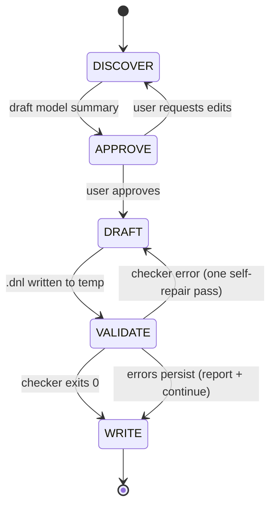

# dnl-writer

## What This Skill Does

Takes a description and/or supporting artifacts (prompt text, a `devs-model-outline` Markdown spec, a PDF, a state table, or a prior `.dnl` the user wants revised) and produces **one `.dnl` file per atomic model**, written in the MS4 Me DEVS Natural Language exactly as the MS4 Me User's Guide (Appendix 1, pp. 170–172) and the corpus under `~/DEVS` use it.

A `.dnl` file declares, in free statement order, each ending with `!`:

- **ports** — `accepts input on M [with type T]!`, `generates output on M [with type T]!`
- **states** — `passivate in S!`, `hold in S for time T!`, exactly one prefixed with `to start`
- **internal transitions and outputs** — `from S go to N!`, `after S output M!`
- **external transitions** — `when in S and receive M go to N [eventually]!`
- **variables and message classes** — `use V with type T [and default "E"]!`, `C has f1, f2 and f3!`, `range of C's f1 is int!`
- **tag blocks** — Java between `<%` and `%>` for `initialize variables`, `internal event for S`, `output event for S`, `external event [for S] with M`, `add library`, `add additional code`

The skill is a text-artifact generator. It does not run MS4 Me or a simulator. It validates with the `ms4me` CLI from the `devs-vscode-extensions` repo and can generate the Java the extension would produce, then compile it against the Closure-DEVS jar.

**Scope boundary.** Deterministic (finite-deterministic) DEVS only. Markov models (CTM, DTM, MM, FP-DEVS) are recognised, never broken when revising, but not generated; see `resources/patterns/markov.md`.

## Workflow Overview



## Model Context Object

All stages read from and write to one shared Model Context:

```
MODEL_CONTEXT = {
  model_name: "",                     // file base name = Java class name; [A-Za-z_][A-Za-z0-9_]*, not a Java reserved word
  purpose: "",                        // one sentence
  markov: false,                      // true -> out of scope for generation (see patterns/markov.md)

  inputs:  [ { name: "", type: null } ],   // message name M -> port inM; type is a Java type or null (Serializable)
  outputs: [ { name: "", type: null } ],   // message name M -> port outM

  states: [
    { name: "", kind: "passive|hold", time: null,   // time: number literal, or a quoted Java expr such as "serviceTime"
      initial: false,
      internal: null,                                // target state of `from S go to N` (hold states only)
      outputs: [""],                                 // message names for `after S output M` (hold states only)
      externals: [ { input: "", target: "", eventually: false } ] }
  ],

  variables: [ { name: "", type: "", default: null } ],          // use V with type T [and default "E"]
  classes:   [ { name: "", fields: [ { name: "", type: "" } ] } ], // C has ...! + range of C's f is T!

  tags: [                             // Java tag blocks, in the order they will be written
    { kind: "initialize|internal|output|external|external-any|library|additional",
      state: null, port: null, code: "" }
  ],

  output_plan: { file: "", resolved_output_dir: null }
}
```

## Prerequisites

- `node` (18+) and a built checkout of `devs-vscode-extensions` (`npm install && npm run build` once). The checker script looks for it at `$MS4ME_EXT_DIR`, default `~/DEVS/devs-vscode-extensions`.
- Optional, for the compile step: `javac` and the Closure-DEVS jar at `~/.m2/repository/com/ms4systems/Closure-DEVS/1.0.0/Closure-DEVS-1.0.0.jar` or `$CLOSURE_DEVS_JAR`.
- No MS4 Me install required.

## Reference Library

| Path under `resources/` | Purpose |
|---|---|
| `reference/dnl-grammar.md` | Every statement form: shape, regex, meaning, example, guide page |
| `reference/tag-blocks.md` | The seven tag heads, where the Java lands, what is in scope, the API to call |
| `reference/semantics.md` | DNL → DEVS → generated Java, event ordering, port naming |
| `reference/validity-rules.md` | The rules and the checker's diagnostic codes with fixes |
| `reference/identifier-rules.md` | Identifier regex, Java reserved words, keywords usable as names, case rules |
| `patterns/idioms.md` | The ten shapes almost every DNL model is built from |
| `patterns/markov.md` | How to recognise CTM/DTM/MM/FP-DEVS files and what not to touch |
| `templates/atomic-skeleton.dnl.tmpl` | The statement order the DRAFT stage follows |
| `examples/*.dnl` | HelloWorld, ProcessorOfJobs, GeneratorOfJobs, Transducer verbatim from the User's Guide (their uncast `getData()` lines fail `--compile` under Closure-DEVS, which is the point of the cast rule) and Relay, which passes check, generate and compile |
| `scripts/check-dnl.sh` | Runs `ms4me check`; with `--generate DIR` also writes the Java; with `--compile` also runs `javac` |

## Stage 1 — DISCOVER

**Inputs (any combination):** prompt text; Markdown/TXT (for example a `devs-model-outline` atomic spec); PDFs via `Read`; a state table; a prior `.dnl` to revise (parse it into the Model Context with `reference/dnl-grammar.md`; keep every tag block's Java verbatim unless the user asks to change it).

**Infer first, ask second.** Fill every Model Context field you can derive from the inputs. Then ask only for what is missing, in one `AskUserQuestion` call where possible, in this order:

1. **Name and purpose.** Model name (becomes the Java class and the SES entity name). Is the behaviour deterministic? If probabilistic or Markov, say that generation is out of scope and offer the deterministic skeleton or `closure-devs-atomic`.
2. **Inputs and outputs.** Message names and payload Java types. Untyped ports carry `Serializable`. A message that is both received and sent (`Job` in, `Job` out) is fine; the ports become `inJob` and `outJob`.
3. **States.** For each: passive (waits for input) or hold (fires after a time)? Hold time as a number, or a variable name (`"serviceTime"`)? Which one is initial?
4. **Per hold state.** Where does it go when the time elapses (`from S go to N`)? What does it output first (`after S output M`)? Several outputs are allowed.
5. **Per state.** Which inputs does it react to and where does each lead? Should the timer keep running (`eventually`, hold states only) or restart?
6. **Variables.** Name, Java type, default expression.
7. **Message classes.** Only when the class does not already exist as Java in the project: `C has f1, f2!` plus one `range of C's f is T!` per field.
8. **Tag code.** Which of these does the model need: store a payload on input, compute a hold time from a payload, build an output payload, count or accumulate, imports, helper methods? Draft the Java now, into `tags`.

**Apply the rules at prompt time** (`reference/validity-rules.md`): exactly one initial state; every hold state has exactly one `from`; passive states never output; `go to` targets exist; output "in response to input" always goes through a zero-time hold state (`patterns/idioms.md` §1).

**Do NOT write any files in this stage.**

## Stage 2 — APPROVE

Present the summary below and wait for `yes` / `edit` / `cancel`.

```
DNL: {model_name}.dnl — {purpose}
Initial state: {S0} ({passive | hold T})

Ports:
  in  {M} : {type | Serializable}
  out {M} : {type | Serializable}
Variables:
  {V} : {T} = {default | Java default}
Classes declared here:
  {C} has {f1} ({T1}), {f2} ({T2})

States:
  {S}   passive
  {S}   hold {T}   -> {N}   outputs {M1}, {M2}
External transitions:
  {S} --{M}--> {N}
  {S} --{M}--> {S} (eventually: timer keeps running)
Tag blocks:
  external event for {S} with {M} : {one-line intent}
  output event for {S}            : output.add(out{M}, ...)

Output: {resolved_output_dir}/{model_name}.dnl
Proceed? [yes / edit / cancel]
```

Only proceed to DRAFT after explicit approval. On `edit`, loop back to DISCOVER and keep the unaffected fields.

## Stage 3 — DRAFT

Write `/tmp/dnl-writer-{model_name}/{model_name}.dnl` following `templates/atomic-skeleton.dnl.tmpl`. Statement order (free in the language, fixed here for readability):

1. Ports: inputs, then outputs.
2. Classes, each followed by its `range of` lines.
3. Variables.
4. The initial state, then the other states in flow order. Keep each state's lines together: `hold`/`passivate`, then `after`, then `from`, then its `when in` lines.
5. Tag blocks: `initialize variables`; then per state in the same order: `external event`, `internal event`, `output event`; then `add library`; then `add additional code`.

Style:

- One statement per line, `!` directly after the last word, a blank line between the groups above, `//` comments for intent.
- Keywords lower-case (`to start`, `hold in`); the language is case-insensitive for keywords and case-sensitive for names.
- Tag blocks: head on its own line, `<%` on the next, Java indented, `%>!` on its own line.
- In tag code refer to ports as `inM` / `outM`, never `M`. Cast payloads: `WorkToDo job = (WorkToDo) messageList.get(0).getData();` (required by Closure-DEVS, harmless in MS4 Me).
- Every port used in tag code (`output.add(outX, …)`) has a `generates output on X!` line.
- Hold time from a variable: `hold in S for time "serviceTime"!` with a matching `use serviceTime with type double …!`.

## Stage 4 — VALIDATE

**4a. Checker.**

```bash
resources/scripts/check-dnl.sh /tmp/dnl-writer-{model_name}/{model_name}.dnl
```

Exit 0 iff no errors. Read the warnings and infos too (`reference/validity-rules.md` maps each code to its fix). `dnl.tag-only-port` and `dnl.unknown-time-variable` are almost always real mistakes.

**4b. Generate and compile (recommended when the file has tag code).**

```bash
resources/scripts/check-dnl.sh --generate /tmp/dnl-writer-{model_name}/java --compile \
    /tmp/dnl-writer-{model_name}/{model_name}.dnl
```

Writes `{model_name}.java` (plus one `.java` per declared class) and compiles them against the Closure-DEVS jar. A compile error inside a `//ID:…` … `//ENDID` region is an error in your tag code; fix the `.dnl`, not the Java.

**4c. Self-repair.** Perform exactly one repair pass per failure class, then re-run the failed check. If it still fails, continue to WRITE and show the remaining diagnostics verbatim in the summary.

## Stage 5 — WRITE

Resolve the output directory (first match wins):

1. A path given by the user.
2. An MS4 Me project: a `src/Models/dnl/` directory at or above cwd (or a sibling of a `src/Models/ses/` directory). Write there; that is where MS4 Me and the VS Code extension look.
3. Inside `devs-skills-claude`: `test/dnl-writer/{model_name}/`.
4. Fallback: cwd.

Show the resolved path before writing. Never overwrite an existing `.dnl` without saying so; when revising, the user's file is the target. Then report: the absolute path, checker result (clean, or the remaining diagnostics), compile result if run, and a one-line next step (compose it in an SES with `ses-designer`; or open it in the extension and run **Generate Java**).

## Pitfalls the checker cannot catch

- `when in S and receive M go to S!` restarts `S`'s timer. Use `eventually` to keep it running (hold states only; on a passive state it changes nothing).
- The first `when in S and receive …` whose port has a message wins; later ones in the same bag are ignored. Record-every-port behaviour needs phase-less `external event with M` blocks (`patterns/idioms.md` §5).
- `holdIn("N", t)` / `passivateIn("N")` in an event tag overrides the automatic transition; `"N"` must be a declared state spelled exactly.
- An `external event for S with M` whose `S` has no `when in S and receive M` line never runs.
- `use V with type T and default "E"`: `E` is pasted into Java twice (field and `initialize()`), so it must be a complete expression (`"new ArrayList<>()"`, `"0"`, `"Double.POSITIVE_INFINITY"`).
- A quoted default or hold time cannot contain a double quote (the token is `"[^"]*"`), so a String default such as `""` or `"none"` is impossible. Declare `use V with type String!` and assign it in `initialize variables`.
- Message names in SES couplings are written without `in`/`out`; keep names identical across the `.dnl` and the `.ses`.

## Portability note

Runs with stock Claude Code tools (`Read`, `Write`, `Bash`, `AskUserQuestion`) plus `node` and the `devs-vscode-extensions` checkout. `javac` and the Closure-DEVS jar are optional. No AgentDB, claude-flow or swarm dependencies.

## Related skills

- `ses-designer` — composes the atomic models written here into an SES/PES.
- `devs-model-outline` — its atomic-model Markdown spec is the ideal DISCOVER input.
- `closure-devs-atomic` — hand-written Closure-DEVS Java, including Markov models; the alternative when DNL cannot express the behaviour.
- `devs-builder` — the end-to-end DEVS system workflow.
