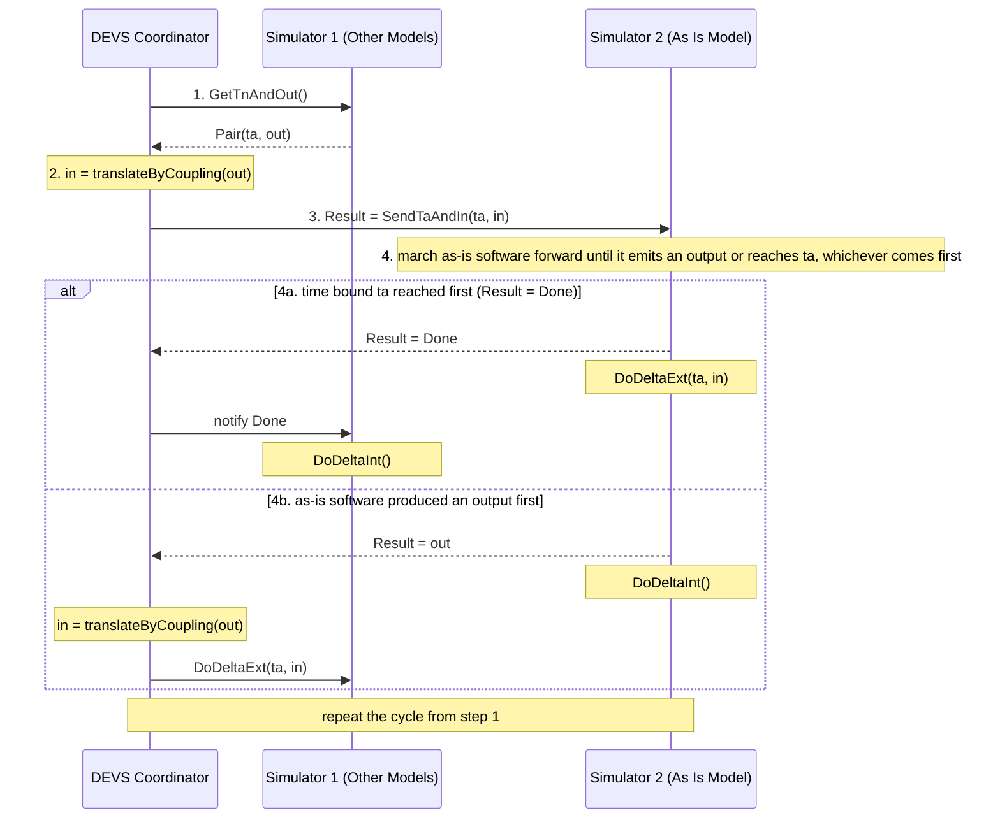
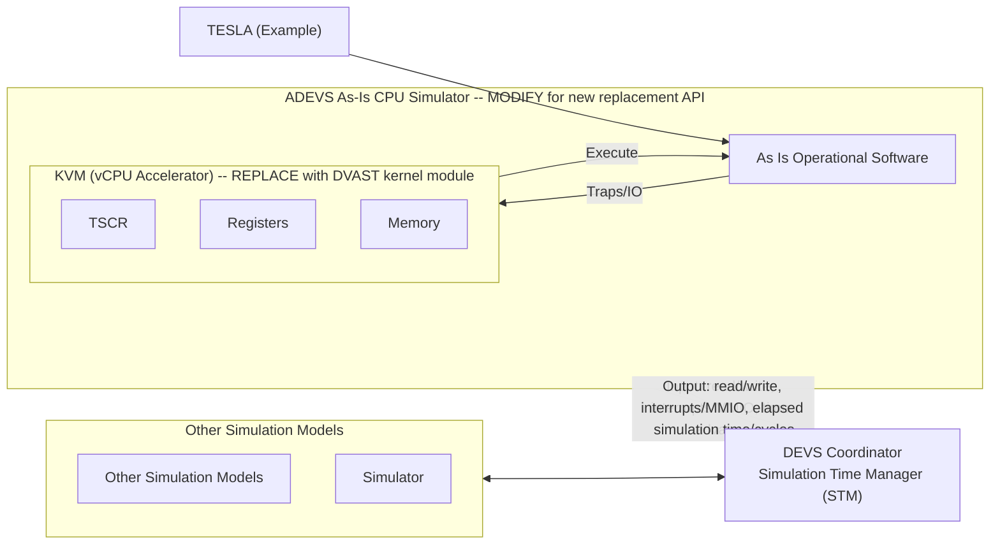
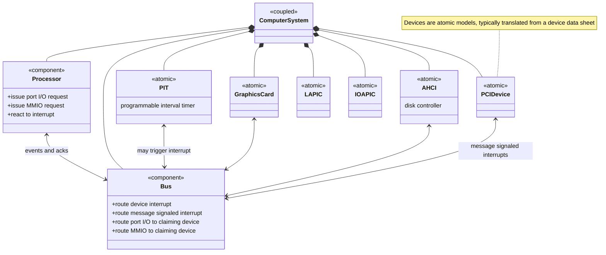
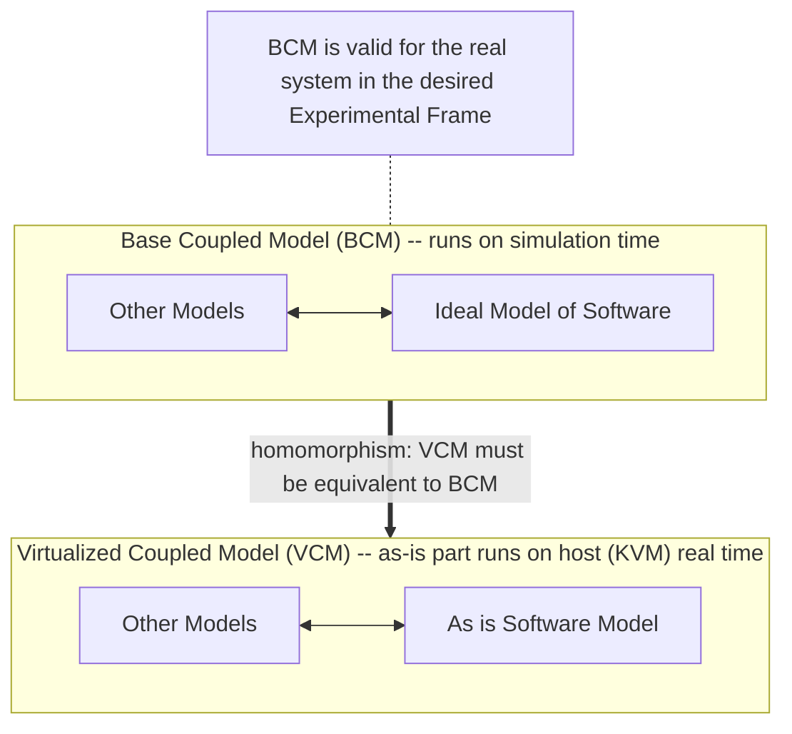
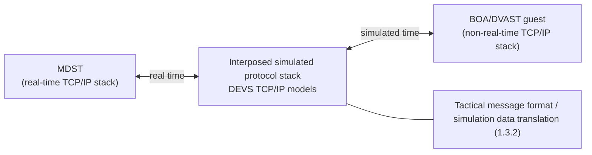
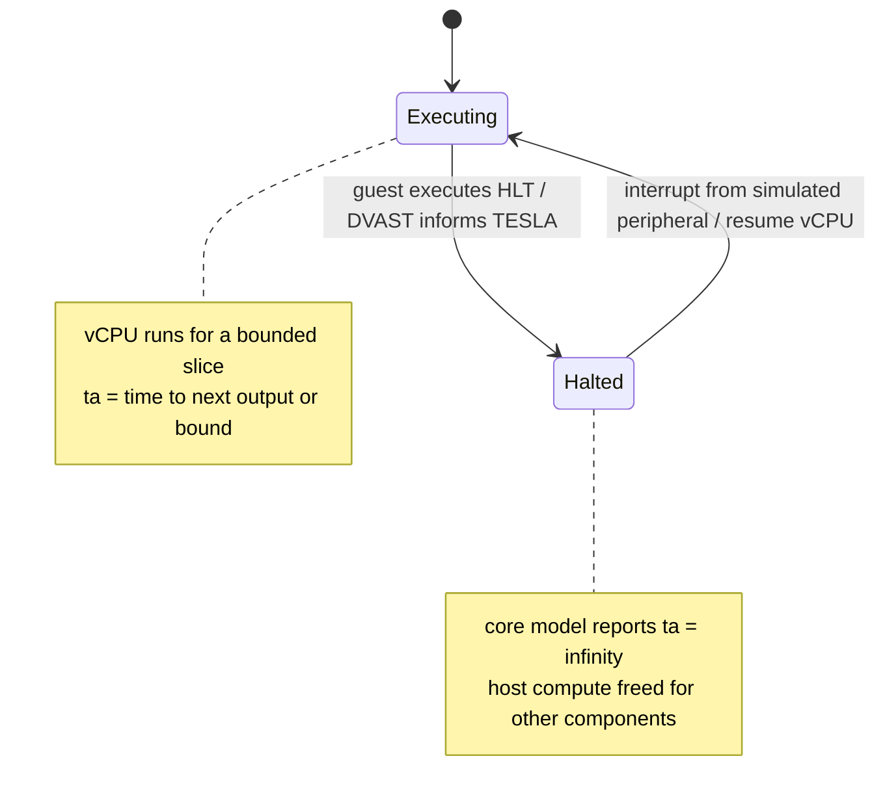

# DVAST Technical Architecture

What DVAST is, how it keeps "as is" software in step with DEVS simulation time, and the formal argument behind it. Each diagram below is a Mermaid redrawing of a figure in the proposal. The original PNGs are in `../source/figures/`. Task and subtask numbers here are **proposal** IDs. For the revised IDs, and for what has actually been built since award (the lwIP NetworkProxy, PCI_VFIO, NUMA mapping, the completed HLT feature), see `revised-plan.md` §3 and §7.

---

## 1. The problem in one paragraph

MDA wants simulations that include **unmodified operational ("as is") tactical software** running on **models of hardware**, inside a **non-real-time** discrete event simulation (faster or slower than wall clock) that is managed by a simulation time manager. Stock hypervisors such as KVM assume that the guest must see real wall-clock time. That assumption fails in two ways:

1. There is no mechanism to control how much computation a virtual core gets relative to a non-real-time clock.
2. The virtualized **Time Stamp Counter (TSC)**, the preferred time source of modern operating systems, is keyed to wall-clock time.

DVAST solves both. A DEVS coordinator bounds each slice of virtual-core execution with a time advance, and a simulation-specific kernel module exposes simulation time through the TSC. Source: (1) Significance, Appendix 2.

---

## 2. DEVS foundations the design relies on

These points are taken from the proposal's Background section.

- DEVS rests on Wymore-style mathematical systems theory. A DEVS model specifies inputs, states and outputs like an automaton, and adds a **time-advance function**.
- The formalism is **universal** for discrete event systems. Any system that takes events as input over time and produces events as output over time is equivalent to a DEVS model.
- There are **atomic** models (component dynamics) and **coupled** models (components plus couplings). **Closure under coupling** makes every coupled model behave like an atomic one, and that is what allows the hierarchical construction.
- A technology-free **abstract simulator** executes the models, so desktop and HPC runs produce the same behavior.
- Experimentation and simulation-control parameters are *not* part of a DEVS model.

---

## 3. Sequential simulation protocol (Figure 1)

A DEVS coordinator manages two simulators. **Simulator 1** runs every other DEVS model. **Simulator 2** runs the as-is software under the hypervisor. In the *sequential* version, "Simulator 2 does not have to remember the state of its model as it marches the model state forward". The proposal names this as the main advantage, because it "greatly simplifies the implementation of DVAST by reducing the interactions required with the hypervisor platform".

**Legend (from Fig. 1):** ta = time advance, tn = time of next event, in = input, out = output, DoDeltaInt = internal transition function, DoDeltaExt = external transition function.

**What each case means:**
- **4a.** The other models' next internal event (at `ta`) happens before the as-is software produces anything. Simulator 1 performs its internal transition. Simulator 2 applies the translated input as an external event at `ta`.
- **4b.** The as-is software produces an output first. Simulator 2 performs its internal (output) transition. The coordinator routes the output through the coupling, and Simulator 1 applies it as an external event.

"The appropriate state transitions are implemented in Steps 4a and b by both Simulators so that the end result is the correct global transition specified by the DEVS simulation protocol." The proposal also notes that the proof-of-concept of this design was built in **MS4 Me** to verify its behavior. Source: (1) Background, Fig. 1.

---

## 4. Integrated DVAST platform (Figure 2)

This is what the second Phase II assembles. It uses TESLA as the example host framework.

**Where the callouts point:** the proposal overlays two callouts on Figure 2. From the drawing coordinates in the .docx, **"Replace"** points at *KVM (vCPU Accelerator)* and **"Modify for new replacement API"** points at the *ADEVS As-Is CPU Simulator*. This matches the text, which says the custom module will "use a similar interface to KVM in order to reduce complexity of migrating between solutions."

---

## 5. Why a custom kernel module instead of modified KVM

The decision was made in Phase I (Appendix 2) and restated in (1).

| Factor | Modify KVM | Custom simulation kernel module (chosen) |
|--------|------------|-------------------------------------------|
| Scope | A full virtualization stack, "close to 100k source lines of code". More capability than simulation needs. | Only the vCPU features plus DEVS interfaces for injecting simulation time into the TSC. |
| Time handling | KVM's time handling is "much more complicated than needed" and keyed to wall-clock time. | The simulation coordinator tracks time and informs components, which removes the wall-clock complexity. |
| Architecture coupling | Components are tightly integrated. An API change ripples into every architecture-specific implementation. | Only the architectures in use are supported, and others can be added later. |
| Upstream and maintenance | Changes "would likely be difficult to upstream and not be supported by the virtualization community", so long-term maintenance is costly. | "More economical and risk-adverse", with the interface kept KVM-like to ease migration. |

The module's two components are (1) a **minimal virtual hardware model** for running unmodified software, and (2) a **custom scheduling mechanism** that controls overall execution time.

---

## 6. The two proof-of-concept time controls (First Phase II)

| | User space timer | DVAST kernel module (VMX) |
|---|---|---|
| Mechanism | A high-precision user-space timer evicts the virtual core from the physical core. | Uses "the Intel time out instruction from the Intel VMX instruction set" to (a) expose the TSC with simulation time and (b) evict the virtual core "with the greatest precision possible". |
| Needs a kernel module or admin rights | No. It can run without administrative permissions. | Yes. |
| Guest TSC shows simulation time | No. "Sufficient for simulations that do not require access to the time stamp counter". | Yes. |
| Status at the end of the First Phase II | Integrated into TESLA and demonstrated. A rudimentary HLT-based speedup was shown (faster than real time when every core is idle). | Viability confirmed. It reused some KVM functionality with limited scope, and "requires additional development to be a complete solution". |
| Second Phase II role | Remains an alternative. | Becomes the complete solution (proposal T1.1), integrated into TESLA (proposal T1.2), and extended for HLT (proposal T2.1). In the revised plan this is T3, "Complete the DVAST kernel module" (see `revised-plan.md`). |

---

## 7. DEVS model of a computer system (Figure 6, Appendix 1)

At the top level of resolution, the processor is one entity that issues port I/O and memory-mapped I/O requests and reacts to interrupts. A bus routes events and acknowledgements between the processor and the devices. The UML component view below adds the device atomics listed in Appendix 1.

Figure 6 itself shows only Processor, Bus, PIT, Graphics Cards and "Another Device". LAPIC, IOAPIC, AHCI and PCI come from the Appendix 1 list of ADEVS atomics. The proposal says the processor "is presented as monolithic entity" but does not say whether the processor or the bus is atomic or coupled. The diagram therefore marks both as `<<component>>`.

**Three features that set this model apart** (Appendix 1):
1. It runs on top of established M&S environments.
2. Several computer-system models can coexist in one OS process.
3. **Everything except the execution of machine instructions runs in simulation time.**

**Further features that DEVS makes possible:** hierarchical models of several computers in a cluster, which allows parallel and distributed simulation without inter-process communication overhead, and intrinsic support for federated simulation when the other models are DEVS compliant.

**Hypervisor options examined:** (1) native hypervisor (Fig. 4: hardware, hypervisor, several guest OSes), (2) hosted hypervisor (Fig. 5: hardware, host OS, then a hypervisor process hosting a guest OS), and (3) a DEVS model of a computer system.

---

## 8. Correctness argument: the BCM → VCM homomorphism (Figure 7, Appendix 1)

- **BCM:** a coupled model of two components. *Other Models* combines every other component, all assumed to be DEVS, and by closure under coupling that composition is itself a DEVS model. It is coupled to an **ideal model of the software**, meaning one that behaves exactly as the software does on a fielded tactical system.
- **VCM:** the same *Other Models* coupled to the **as-is software component**.
- **The requirement:** "the timing of events and exchange of inputs and outputs are the same as they would be when interacting with the ideal model". It is stated formally as a homomorphism between the two coupled models, both simulated by the DEVS Simulation Protocol.
- **What it produced:** conditions on (a) how to map between the two time bases and (b) the correct occurrence of events. This also gives a way to *measure departure from exact replication* when only an approximation is achievable.
- **The DEVS-like view of the as-is system:** input and output are discrete event streams. The system responds to an external event by changing state immediately, then follows an input-free trajectory until the next event (another external input, or an output). That translates into DEVS elements, and a specialized homomorphism then gives the conditions under which the virtualized execution faithfully represents the as-is model.

---

## 9. Timing gap in the tactical interface (Subtask 1.3)

In the QEMU-based TESLA, the extent to which non-real-time simulation could be supported was limited by **TCP's transmit retry timer**. The protocol stack inside virtualized BOA runs in *non-real time*, while the stack inside MDST and the host Linux kernel runs in *real time*. The proposal traces the problem to "the disparity in perceived time" between the two. ORNL's earlier fix interposes a **simulated protocol stack** that immediately accepts data from the real-time side and handles every interaction with the non-real-time side in simulated time. The second Phase II turns this into **DEVS implementations of the TCP/IP protocols** used by BOA and MDST, plus translators between simulation data and tactical message formats.

---

## 10. How Task 2 gets its speed

- **HLT as an infinite time advance (Subtask 2.1):** when the guest executes HLT, DVAST tells TESLA, and the processor-core DEVS model reports an **infinite time advance** until a peripheral (clock, disk controller, and so on) interrupts it. Operational systems are overprovisioned, with up to 50% of cores idle under the anticipated load, which suggests "at least 2x reduction in simulation time".
- **Parallel DEVS in TESLA (Subtask 2.2):** (a) a multi-threaded *standard* parallel DEVS algorithm that parallelizes output and state-transition computation, and (b) a *conservative* parallel DEVS variant with lookahead, which gives near-linear speedup in ideal cases. Graph algorithms assign atomic models to logical processes based on lookahead. References [16] Zeigler, Muzy and Kofman 2018, and [17] Nutaro 2011.

