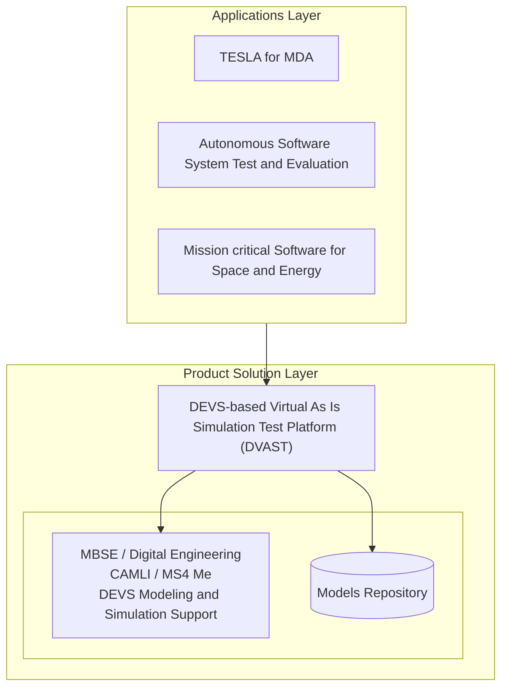

# DVAST Commercialization, Market and IP

From section (10) of the accepted proposal. The figures are RTSync's own estimates as the proposal states them. They are not independently verified.

## a) Product positioning

- RTSync will commercialize DVAST for MDA and other government and private-sector customers. During the second Phase II it will **approach the MDA TESLA program office to propose a DVAST demonstration**.
- TESLA is "a time management framework that synchronizes perceived real time of tactical software on a virtual machine with the simulation time of a high fidelity simulation framework". TESLA was applied to **BOA** to build a representation for **EDISS**, which the proposal calls "an ideal target program for the DVAST support".
- **Integration with CAMLI:** DVAST will be integrated with CAMLI (MBSE and Digital Engineering), and this will be demonstrated during the second Phase II.
- **Dual-use layers** (Figure 3):

- **Commercial sectors named:** aerospace, automotive (including self-driving cars), energy and manufacturing, all of which are adopting MBSE and digital twins. The DoD could use DVAST to test new weapon systems, since "almost all new weapons systems are computerized".

## b) Customers and market size

**Target MDA organizations:** the M&S Directorate (DES, "responsible for developing the current TESLA program"), the Sensors Directorate (SN), THAAD, GMD and Aegis BMD (AB).

**Claimed value:** detection and prediction of faulty behavior in new software before commissioning, with cost and time "significantly reduced up to 95% on virtual machines computing infrastructure".

**Context given:** global defense spending of $2.7 trillion in 2024, and AI-driven simulation for tactical planning and system testing growing at a 9.4% CAGR.

**Table 3, market size:**

| Market | Customer orgs | % needing | Potential market | Annual budget per customer | Total expenditure | Initial ~1% penetration |
|--------|---------------|-----------|------------------|----------------------------|-------------------|-------------------------|
| Defense | 30 | 100% | 30 | $20M | $600M | $6.0M |
| Engineering | 50 | 80% | 40 | $3M | $120M | $1.2M |
| Cybersecurity | 30 | 50% | 15 | $800K | $12M | $120K |
| Space | 90 | 40% | 36 | $1M | $36M | $360K |

## c) Funding and acquisition strategy

- Minimize first-year resources at launch, then use direct sales in Year 2.
- **Partner primes for MDA market access:** Raytheon, Lockheed Martin, Northrop Grumman, Jacobs, and Davidson Technologies.
- **Revenue pathways (as written):** SaaS and licensing on AWS or Azure; enterprise and institutional licensing; consulting and training; partnerships. Some of this wording names fintech clients, hedge funds and banks. See `source-notes.md`.

**Table 4, five-year forecast:**

| | Year 1 | Year 2 | Year 3 | Year 4 | Year 5 |
|---|---|---|---|---|---|
| Revenues | $350,000 | $650,000 | $1,200,000 | $2,500,000 | $3,700,000 |
| Costs | $650,000 | $400,000 | $300,000 | $250,000 | $250,000 |
| Profit | ($300,000) | ($250,000) | $900,000 | $2,250,000 | $3,450,000 |
| Investment | $400,000 | $250,000 | 0 | 0 | 0 |

## d) Marketing

- RTSync will hire skills in digital marketing, social media and analytics.
- It will approach defense and non-defense targets through IEEE, SISO and defense-contractor networks, and consult marketing specialists within three months of award.

## e) Competitors and advantages

- **Competitors:** developers of software and hardware performance-testing tools and analytics services, such as Siemens, GE and IBM.
- **Advantage claimed:** current tools "cannot be generalized with simulation time management approaches". DVAST's systems-theory M&S basis gives **composability, reusability, and flexible virtual as-is software testing** across the MBSE and Digital Engineering life cycle.

## Intellectual property

- **Planned:** a new patent filing for DVAST innovations **by June 2026**.
- **Granted patents** cited as existing IP. The proposal says "Securing IP protection for core technologies in 2023 and 2024", which gives the period, not the grant dates.
  - US Patent **12,124,778 B1**, "Method for Improving the Simulation of Complex Stochastic Systems"
  - US Patent **11,922,102 B1**, "Method to Integrate Diverse Components for Simulation of Complex Systems"
- **Trade secrets:** proprietary AI-driven modeling techniques and paratemporal simulation algorithms.
- **Publications:** peer-reviewed work, including Winter Simulation Conference contributions.
