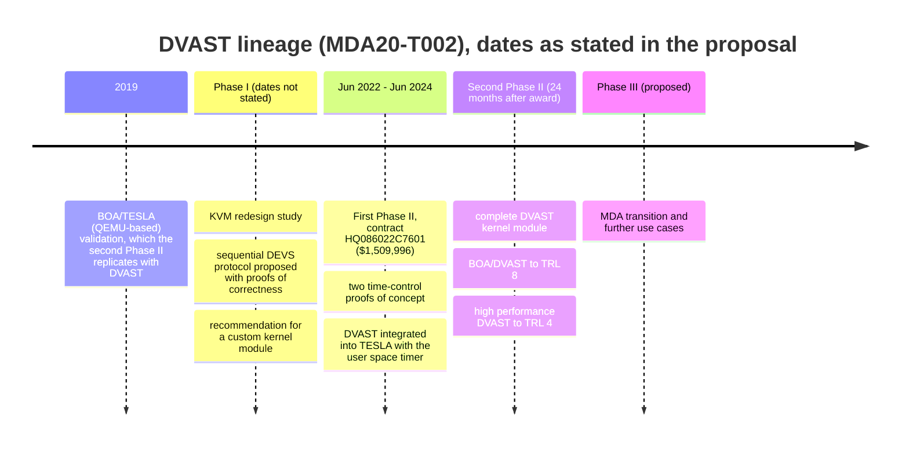

# DVAST Project History: Phase I and the First Phase II

What was done before the second Phase II, as the accepted proposal reports it. The sources are (1) Significance, "Results of Phase I Work", "Results of First Phase II Work", (4) Related Work, and Appendices 1–2.

---

## Phase I: KVM redesign investigation

**Goal:** "develop an approach towards a re-design of the Linux Kernel-based Virtual Machine (KVM) hypervisor to more effectively support 'as is' operational software participating in non-real-time simulation systems."

### Appendix 1: architecture work
- The team listed the architectural requirements for a computer-system simulator that works *as a component of a system-of-systems model*. In that setting, code verification and computer performance matter less than **short turnaround time**, so systems engineers can explore configurations and sensitivities over many runs.
- A survey of computer-architecture simulators was expected to show that their turnaround is too long for SoS questions. Virtualization solves turnaround in principle, but existing tools connect guests to the *real* world, and as-is testing needs them connected to a *simulated* world.
- Three architectures were examined: a native hypervisor, a hosted hypervisor, and a **DEVS model of a computer system**, the last implemented in ADEVS (see `architecture.md` §7).
- An architectural framework was built in **MS4 Me** to show how a proposed architecture meets the requirements, and to collect concrete feedback from MDA.
- **The BCM → VCM homomorphism** formalized "same timing and I/O as the ideal model" and gave conditions on time-base mapping and event occurrence. The as-is system was modeled as **DEVS-like** (see `architecture.md` §8).

### Appendix 2: accurate timing source with KVM
The work had three activities:
1. **KVM development environment.** The team showed the workflow for building a custom KVM module and swapping it for the loaded module in a running kernel.
2. **Non-real-time clock management.** The team found how KVM handles TSC reads, and what changes would let user-space control and update the TSC of KVM vCPUs.
3. **Execution limitation.** The team surveyed ways to track and cap vCPU execution time. The schedule-based approach, using the **DEADLINE** scheduler, is widely available, but it may not tell the scheduled thread that its budget ran out. Delivering **SIGXCPU** to the DEVS controller "may not work".

### Phase I conclusions
- Adding a simulation mode to KVM is technically feasible, but **not the best solution**. KVM is about 100k SLOC, tightly coupled, complex in how it handles time, hard to upstream, and costly to maintain.
- **Recommendation:** a custom, simulation-specific kernel module built around the **sequential DEVS simulation protocol**. It has two components, a minimal virtual hardware model and a custom scheduling mechanism. It builds on existing Linux capabilities and keeps a KVM-like interface.

**Benefits claimed for DVAST** in the Phase I results:
1. Physical and digital parts of the environment can be simulated together with live as-is software, whatever the true execution speed. The proposal says such dynamic analysis is not possible with current technologies.
2. Hardware models are costly to build, but the cost "is likely to be amortized over the lifetime of the simulation of a SoS".
3. Cyber-attack impact on whole-system performance can be studied, because the operational software runs as is. Hardware-in-the-loop makes that too expensive or too dangerous.
4. An insertable technology for M&S across government and commercial users.

---

## First Phase II: feasibility demonstration

**Contract:** HQ086022C7601, value to date $1,509,996, June 2022 – June 2024. Source: (4).

The five results, as the proposal states them:

| # | Result | Key detail | Carry-over into the second Phase II |
|---|--------|------------|-------------------------------------|
| 1 | **Elaborated the simulation protocol design** | Extended the Phase I correctness proofs into software design documents and feature tests for correctness and performance. | Not stated. (Inferred: this likely feeds the Software Technical Design Document.) |
| 2 | **Custom scheduling in the Linux kernel** | Two proofs of concept: (a) a **user space timer** that evicts the virtual core and needs no admin rights, and (b) a **kernel module** that uses the Intel VMX time-out instruction to expose the TSC with simulation time and evict with maximum precision. | "The further development of this kernel module will be a key aspect of the proposed second Phase II." |
| 3 | **Minimal virtual hardware model** | Showed that the user space timer is enough when the guest does not need the TSC. The kernel module reused some KVM functionality and had limited scope. | "Requires additional development to be a complete solution." This became proposal T1.1 (revised T3). |
| 4 | **Simulation module and DEVS-based simulator** | A DEVS interface for executing the as-is instruction sequence, integrated into TESLA by **refactoring the processor core model**. | The DEVS interface is attached to the kernel module in proposal 1.2.1. |
| 5 | **Integrated with TESLA** | MDA's TESLA was the demonstration host, using the **user space timer**. | "Extensions of the proof of principle kernel solution will be a focus of the second Phase II." |

**Also demonstrated:** a rudimentary HLT-based speedup with the user-space DVAST, giving faster than real time when *every* core in the virtualized computer was idle (source: (3) Subtask 2.1). Per (6), the First Phase II also clarified the DEVS-based design of the DVAST simulation step and built a **DEVS Simulation Protocol test harness** for V&V of DVAST.

---

## Related prior programs

| Program | Relationship to DVAST |
|---------|-----------------------|
| **TESLA** (MDA, developed at ORNL) | The QEMU-based host framework. It synchronizes the perceived real time of tactical software in a VM with the simulation time of a high-fidelity simulation. It was applied to BOA for EDISS, and BOA/TESLA was validated in 2019. DVAST is intended to **replace** its QEMU core. |
| **MDA18-012 second Phase II (CAMLI)** | HQ0860-22-C-7144, value to date $1,809,990, Sep 2022 – Sep 2024. Bidirectional SysML/DEVS mapping, model library, V&V metadata, DSFA, and LLM-generated DEVS models. DVAST is to be integrated with CAMLI. |
| **MDA22-T001 (ParaDEVS)** | Paratemporal Simulation with Uncertainty Quantification. A sibling RTSync MDA program. |
| **ATC-Gen (JITC)** | NBC 00H02C0001, value to date $3,459,349, 2008–2013. The RTSync/ORNL team developed the ADEVS simulation framework for JITC mission needs. RTSync formalized Link 16 (MIL-STD-6016C) as a DEVS model for automated conformance testing. |
| **ORNL: Federated Science Instruments** | 2019–2020. Federations of HPC and experimental facilities, including a virtualized network testbed and simulator. |
| **ORNL: Defense-in-Depth for SDR** | 2013–2019. Container and VM isolation for SDR stacks, plus a simulation platform for measuring virtualization overhead. See ref. [2], Hitefield dissertation. |
