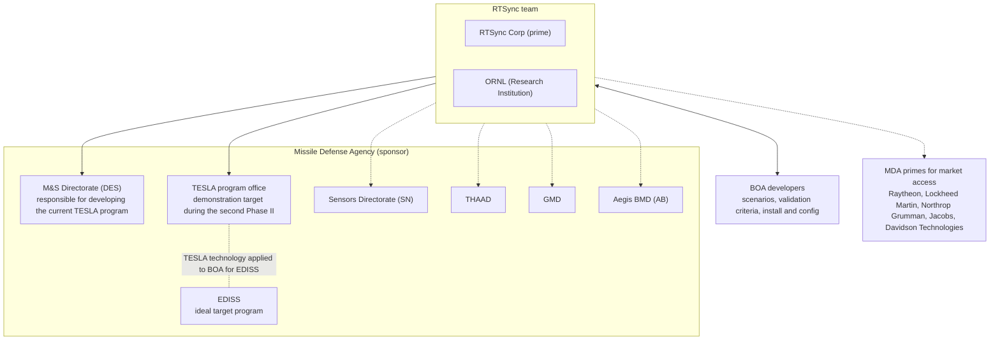

# DVAST Program Facts

Administrative and organizational facts about the DVAST second Phase II, from the accepted technical volume. Facts tagged **[S]** come from the post-award quarterly status reports (QSR #1–#3, see `revised-plan.md` §0). A field that no source states is marked **not stated**. Do not fill it in by guessing.

## Identification

| Field | Value | Source |
|-------|-------|--------|
| Title | **DEVS-based Virtual As Is Simulation Test Platform (DVAST)** | Title line |
| Program | MDA **STTR**, topic **MDA20-T002**: *Non-Real-Time Hardware Assisted Computer System Simulation* | (1), (2) |
| Phase | **Second Phase II**, following Phase I and the First Phase II | page header, (2) |
| Proposal number | **B2S-0089** | page header |
| Document | Technical Volume, 20 pages (`MDA20_T002_2ndPh2_TechVolume_RTSync.docx`). The file metadata is dated 2025-06-16. | file |
| Status | Accepted (per the project owner) | n/a |
| Sponsor | **Missile Defense Agency (MDA)** | (1) |
| Prime | **RTSync Corp**, founded 2004 as a spin-off of ACIMS (University of Arizona and Arizona State University) | (10) |
| Research Institution | **Oak Ridge National Laboratory (ORNL)**, performing more than 30% of the work | (8) |
| Team name | "the RTSync team" (RTSync + ORNL) | (1) |
| Duration | 24 months (deliverables run to +24 months after contract award, over a two-year schedule) | Table 1, Table 2 |
| Contract number | **HQ0860-25-C-E058**. The report file names write it as HQ086025CE058. | [S] report covers |
| Period of performance | **September 29, 2025 – September 28, 2027 (plan)** | [S] deck slide "2nd Phase II Status" |
| Kickoff | Oct 7, 2025. The slide lists it as "Phase I Kickoff Slides". | [S] same slide |
| Award date as such, and contract value | **not stated**. The start of the period of performance is the closest stated date. | n/a |
| Government POC for the second Phase II | An MDA Topic POC is listed in the status-report decks. This skill does not record personnel, so refer the user to the source documents. | [S] |

## Reporting and meetings [S]

| Item | Value |
|------|-------|
| Quarterly status report | **CDRL A004** on the report covers and file names. The deck's deliverables table says data item A002 (see `source-notes.md` §H). |
| Performing-organization report numbers | QSR #2 `FY2025_MDA-STTR20T002-2P2-02`, QSR #3 `FY2025_MDA-STTR20T002-2P2-03`. The QSR #1 cover carries the stale `FY2024_MDA-STTR20T002-PH2-07`. |
| Distribution | Distribution B, U.S. Government agencies only, Critical Technology. QSR #2 and QSR #3 add an export-control warning (AECA / EAR) and a destruction notice. |
| Status meetings (deck dates) | Kickoff Oct 7, 2025. Then Dec 11, 2025 (QSR #1), Feb 5, 2026 (QSR #2) and Jun 9, 2026 (QSR #3). QSR #2 and QSR #3 each call their meeting "the third meeting". |

## Administrative sections

| Section | Content |
|---------|---------|
| (5) Future R&D | Anticipated result: the DEVS-based DVAST prototype of the sequential protocol. The MDA customer could transition it through **Phase III** (use cases, performance analysis). No certifications or approvals are anticipated for Phase III testing. If classified data access is needed, the team will arrange facility clearance during the second Phase II. DVAST can strengthen DoD digital engineering infrastructure, and the team will engage defense contractors about commercialization. |
| (6) Key Personnel | Not summarized in this skill (personnel information is deliberately excluded). |
| (7) Facilities/Equipment | RTSync- and ORNL-owned facilities. No equipment purchases. Environmental-compliance statement. No GFP required. |
| (8) Subcontractors/Consultants | ORNL as Research Institution, with more than 30% of the work, leveraging TESLA experience. |
| (9) Prior/pending support | "No prior, current, or pending support for proposed work." |

## Stakeholders and customer organizations

Solid arrows are engagements the proposal plans. Dotted arrows are potential users or partners, or context. Source: (3), (10).

**Since award [S]:** the BOA/MDST demonstration waited on a **point of contact at Northrop Grumman** (QSR #1 and #2). By June 2026 the team was "looking for a new demonstration target", specifically an opportunity to demonstrate DVAST in the **SWIC** (never expanded in the reports). The team hopes to "build momentum for the transition of the SWIC to a simulation-based capability". See `revised-plan.md` §8.

## Contract history (from (4) Related Work)

| Program | Contract | Value to date | Period | Role |
|---------|----------|-------|--------|------|
| MDA20-T002 Phase II (First Phase II, DVAST) | HQ086022C7601 | $1,509,996 | Jun 2022 – Jun 2024 | Written in (4) as "RTSync (Sub), Oak Ridge National Laboratory (Sub)", as given in the source |
| MDA18-012 second Phase II (CAMLI) | HQ0860-22-C-7144 | $1,809,990 | Sep 2022 – Sep 2024 | RTSync (Prime), nou Systems (sub) |
| ATC-Gen (JITC) | NBC 00H02C0001 | $3,459,349 | Mar 2008 – Feb 2013 | RTSync (Sub), ORNL (Sub), Northrop Grumman IT (Prime) |
| MDA22-T001 (ParaDEVS) | not stated | not stated | not stated | Named in (6) as an MDA STTR Phase II |

For narrative detail see `history.md`.
