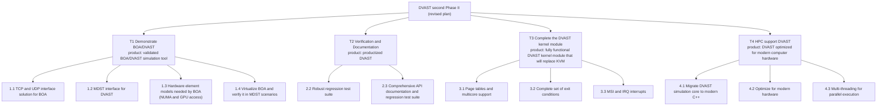
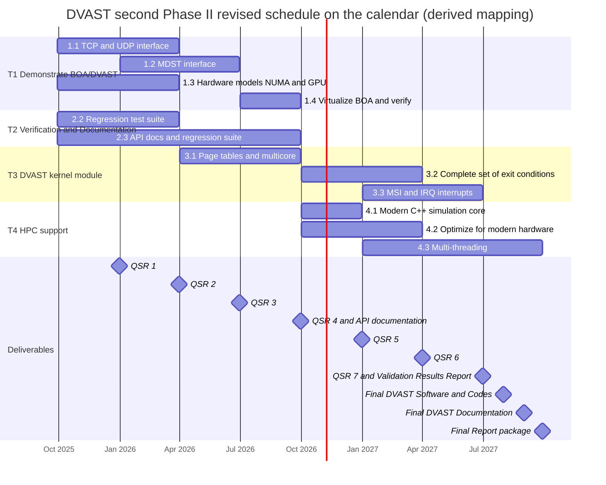

# DVAST Second Phase II: Revised Tasks, Schedule, Deliverables and Progress

The **current** work plan, as the team revised it after award, and the progress reported against it. The plan **as proposed** (Table 1 and Table 2 of the Technical Volume) is in `work-plan.md`. Use this file for questions about what the project is doing now, and `work-plan.md` for what the proposal said.

---

## 0. Sources and how to cite them

| Tag | Document | Report date | Period covered (as written) | Status-meeting deck in its appendix |
|-----|----------|-------------|-----------------------------|-------------------------------------|
| **QSR #1** | `HQ086025CE058_A004_StatusReport_Q1_RTSync_12312025 - v2.docx` | 31 Dec 2025 | "23 December 2023 – 15 March 2024" (stale, see `source-notes.md` §H) | Dec 11, 2025 (App. A) |
| **QSR #2** | `HQ086025CE058_A004_StatusReport_Q2_RTSync_04012026.docx` | 31 Mar 2026 | 27 Dec 2025 – 27 Mar 2026 | Feb 5, 2026 (App. B) |
| **QSR #3** | `HQ086025CE058_A004_StatusReport_Q3_RTSync_06302026.pdf` | 30 Jun 2026 | 27 Mar 2026 – 27 Jun 2026 | Jun 9, 2026 (App. C, included twice) |

- **The revised task list comes from the deck slide "Schedule of major events".** It is identical in all three decks. The revised deliverables come from the slide "Phase II products" ("2nd Phase II products" in QSR #3). Deliverable status comes from the slide "2nd Phase II Status".
- **Cite by report and slide title**, for example "QSR #3, App. C, 'Schedule of major events'". Slide numbers differ between decks, so do not rely on them.
- **The reports are Distribution B (U.S. Government agencies only), and QSR #2 and QSR #3 carry an export-control warning.** This file keeps curated facts only: no verbatim passages and no slide images. Anything you draft from it for a wider audience inherits those markings.

---

## 1. What changed from the proposal

- **Four tasks replace two.** The proposal's Task 1 is split into a BOA demonstration task (T1) and a kernel-module task (T3). Productization is a new task (T2). High performance computing becomes T4.
- **The kernel module moved later.** Proposal T1.1 ran Y1 Q1–Q3. Revised T3 runs Y1 Q3 to Y2 Q3.
- **The BOA demonstration moved earlier.** The proposal virtualized BOA in Y2 Q1–Q2. The revised plan finishes all of T1 in Year 1.
- **New work items:**
  - hardware models that BOA needs (NUMA, and GPU access by PCI passthrough), T1.3
  - a regression test suite and end-user API documentation, T2
  - migrating the DVAST simulation core to modern C++, T4.1
  - optimizing for modern hardware, T4.2
- **Dropped as separate line items:**
  - integrating the kernel module into TESLA (proposal T1.2)
  - the BogoMIPS precision benchmark (1.2.3)
  - tactical message-format translation (1.3.2)
  - the conservative parallel DEVS algorithm (2.2.2), whose place is taken by generic "multi-threading for parallel execution"
- **HLT is not a line item on the revised schedule.** The reports still track it under "Goal 3: HPC support", where it is complete. See §3.
- **Deliverables:** the Software Technical Design Document (+12), User Documentation (+15) and Experimentation Results (+18) were dropped. **API documentation for DVAST with examples and user guide** (+12) was added. See §5.
- **TRL:** the revised plan states no per-task TRL targets. The proposal's targets (TRL 8 for BOA/DVAST and TRL 4 for high performance DVAST) are the only per-task targets on record. The decks' "Commercialization – Product Roadmap" slide says generic dual-use DVAST technology reaches "TRL 6 after Phase II and TRL 8 after 2nd Phase II".

---

## 2. Work breakdown (revised schedule IDs)

These IDs are canonical for this skill. The reports' "Goal N" numbering is different, and the crosswalk is in §3.

| ID | Subtask (slide wording, lightly normalized) | Product (slide) |
|----|---------------------------------------------|-----------------|
| **T1** | **Demonstrate BOA/DVAST** | Validated BOA/DVAST simulation tool |
| 1.1 | Develop a TCP and UDP interface solution for BOA (the slide says "TPC") | |
| 1.2 | Develop MDST interface for DVAST | |
| 1.3 | Finish models of hardware elements needed by BOA. The reports specify NUMA and GPU access. | |
| 1.4 | Virtualize BOA and verify its correct execution within missile scenarios simulated with MDST | |
| **T2** | **Verification and Documentation** (the reports call it "Productization") | Productized DVAST |
| 2.2 | Robust regression test suite for DVAST. There is **no 2.1**. | |
| 2.3 | Comprehensive API documentation and regression test suite | |
| **T3** | **Complete the DVAST kernel module** | "Fully function DVAST kernel module that will replace KVM" |
| 3.1 | Page tables and multicore support | |
| 3.2 | Complete set of exit conditions | |
| 3.3 | MSI and IRQ interrupts | |
| **T4** | **HPC support DVAST** | "DVAST computer system simulator optimized to get the most performance out of modern computer hardware" |
| 4.1 | Migration of DVAST simulation core to modern C++ | |
| 4.2 | Optimize for modern hardware | |
| 4.3 | Multi-threading for parallel execution | |

---

## 3. Crosswalks

### Revised schedule IDs, the reports' "Goal" numbering, and the proposal

The report text headings (for example "2.1 Task 1: Complete the DVAST kernel module") and the "Progress to date" slide use **Goal / Task 1–4** in a different order from the schedule slide. Always say which scheme you mean.

| Revised schedule ID | Reports' "Goal / Task" | Proposal Table 1 (see `work-plan.md`) |
|---------------------|------------------------|---------------------------------------|
| T1 Demonstrate BOA/DVAST | Goal 2 "Demonstrate BOA/DVAST" | Parts of T1.3 and T1.4 |
| 1.1 TCP and UDP interface | Goal 2, first bullet | T1.3 (1.3.1 DEVS TCP/IP protocols). 1.3.2 message translation is not carried over. |
| 1.2 MDST interface | Goal 2, second bullet | 1.4.1 MDST-to-TESLA interface |
| 1.3 Hardware models for BOA (NUMA, GPU) | Goal 2, third bullet | New |
| 1.4 Virtualize BOA and verify | Goal 2, fourth bullet | 1.4.2 |
| T2 Verification and Documentation | Goal 4 "Productization" | New |
| 2.2 Regression test suite | Goal 4, "Robust regression test suite" | New |
| 2.3 API documentation (+ regression suite) | Goal 4, "Comprehensive documentation for DVAST API aimed at end users". QSR #3 adds "DEVS component model specification". | New. It corresponds to the new +12 API documentation deliverable. |
| T3 Complete the DVAST kernel module | Goal 1 "Complete the DVAST kernel module" | T1.1 (and implicitly T1.2) |
| 3.1 Page tables and multicore | none | 1.1.4 extended page tables. Multicore is new. |
| 3.2 Complete set of exit conditions | none | Closest to 1.1.3 MMIO/port I/O (these are VM-exit causes). This is an interpretation. |
| 3.3 MSI and IRQ interrupts | none | 1.1.1 simulated hardware interrupts |
| T4 HPC support | Goal 3 "HPC support for DVAST" | Task 2 |
| (no schedule line) | Goal 3, "Leverage energy management instructions (specifically, HLT)" | T2.1 HLT instruction |
| 4.1 Modern C++ core, 4.2 Optimize | Goal 3, "Multi-threading and code optimizations within DVAST" | New |
| 4.3 Multi-threading | Goal 3, same bullet | T2.2 (2.2.1 standard parallel DEVS). 2.2.2 conservative parallel DEVS is not named. |
| none | none | T1.2 integrate the kernel module into TESLA (1.2.1–1.2.3) has no explicit counterpart |

---

## 4. Schedule

### Quarters (from the "Schedule of major events" slide)

The quarters were read from the slide's bar colors. The slide labels only Year 1 and Year 2, with four columns each.

| Task | Y1 Q1 | Y1 Q2 | Y1 Q3 | Y1 Q4 | Y2 Q1 | Y2 Q2 | Y2 Q3 | Y2 Q4 |
|------|:-:|:-:|:-:|:-:|:-:|:-:|:-:|:-:|
| **T1 Demonstrate BOA/DVAST** (summary bar) | ▒ | ▒ | ▒ | ▒ | | | | |
| 1.1 TCP and UDP interface | ■ | ■ | | | | | | |
| 1.2 MDST interface | | ■ | ■ | | | | | |
| 1.3 Hardware models for BOA | ■ | ■ | | | | | | |
| 1.4 Virtualize BOA and verify | | | | ■ | | | | |
| **T2 Verification and Documentation** (summary bar) | ▒ | ▒ | ▒ | ▒ | | | | |
| 2.2 Regression test suite | ■ | ■ | | | | | | |
| 2.3 API documentation and regression test suite | ■ | ■ | ■ | ■ | | | | |
| **T3 Complete the DVAST kernel module** (summary bar) | | | ▒ | ▒ | ▒ | ▒ | ▒ | |
| 3.1 Page tables and multicore | | | ■ | ■ | | | | |
| 3.2 Complete set of exit conditions | | | | | ■ | ■ | | |
| 3.3 MSI and IRQ interrupts | | | | | | ■ | ■ | |
| **T4 HPC support DVAST** (summary bar) | | | | | ▒ | ▒ | ▒ | ▒ |
| 4.1 Modern C++ core | | | | | ■ | | | |
| 4.2 Optimize for modern hardware | | | | | ■ | ■ | | |
| 4.3 Multi-threading | | | | | | ■ | ■ | ■ |

### Calendar mapping (derived)

The decks give the period of performance as **September 29, 2025 – September 28, 2027 (plan)**, and the quarterly reports are scheduled at calendar quarter-ends. Treating Y1 Q1 as the quarter ending Dec 31, 2025 gives the mapping below. The reports do not state this mapping, so present it as derived.

| Plan quarter | Y1 Q1 | Y1 Q2 | Y1 Q3 | Y1 Q4 | Y2 Q1 | Y2 Q2 | Y2 Q3 | Y2 Q4 |
|---|---|---|---|---|---|---|---|---|
| Calendar | Sep 29 – Dec 2025 | Jan – Mar 2026 | Apr – Jun 2026 | Jul – Sep 2026 | Oct – Dec 2026 | Jan – Mar 2027 | Apr – Jun 2027 | Jul – Sep 28, 2027 |
| QSR due | #1 Dec 31, 2025 | #2 Mar 31, 2026 | #3 Jun 30, 2026 | #4 Sep 30, 2026 | #5 Dec 31, 2026 | #6 Mar 31, 2027 | #7 Jun 30, 2027 | none (final package) |

---

## 5. Deliverables (revised)

### Products ("Phase II products" slide)

| Product | Type | Due (months after CA) | Qty | Approx. calendar (derived) |
|---------|------|------------------------|-----|----------------------------|
| **API documentation for DVAST with examples and user guide** (new) | .pdf | +12 | 1 | end of Sep 2026 |
| Quarterly Status Reports | .ppt | +3, +6, +9, +12, +15, +18, +21 | 7 | see the QSR log below |
| Validation Results Report | .pdf | +21 | 1 | end of Jun 2027 |
| Final DVAST Software and Codes | Source code in .zip | +22 | 1 | Jul 2027 |
| Final DVAST Documentation | .pdf | +23 | 1 | Aug 2027 |
| Final Report package (same nine items as proposal Table 2, see `work-plan.md` §5) | .pdf | +24 | 1 each | Sep 2027 |

The calendar column assumes that contract award (CA) coincides with the start of the period of performance, Sep 29, 2025. The reports do not state the CA date as such.

Dropped relative to proposal Table 2: the Software Technical Design Document (+12), User Documentation (+15) and Experimentation Results (+18).

### QSR log ("2nd Phase II Status" slide, latest deck)

| Deliverable | Data item (slide) | Format (slide) | Scheduled | Actual | Status |
|-------------|-------------------|----------------|-----------|--------|--------|
| Kickoff slides (the slide says "Phase I Kickoff Slides") | Informal | Contractor: PPTX | Oct 7, 2025 | Oct 7, 2025 | completed |
| QSR #1 | A002 | Contractor: Word | Dec 31, 2025 | Dec 31, 2025 | completed |
| QSR #2 | A002 | Contractor: Word | Mar 31, 2026 | Apr 3, 2026 | completed |
| QSR #3 | A002 | Contractor: Word | Jun 30, 2026 | (report dated Jun 30, 2026) | "on-going" in the Jun 9 deck |
| QSR #4 | A002 | Contractor: Word | Sep 30, 2026 | not reported | |
| QSR #5 | A002 | Contractor: Word | Dec 31, 2026 | not reported | |
| QSR #6 | A002 | Contractor: Word | Mar 31, 2027 | not reported | |
| QSR #7 | A002 | Contractor: Word | Jun 30, 2027 | not reported | |

The report covers and file names say **CDRL A004**, not A002. The format is Word here but ".ppt" in the products table. See `source-notes.md` §H. The slide lists "Issues/Concerns: None" in all three decks.

---

## 6. Progress ledger

The status words come from the "Progress to date" slide of each deck. Where the report text says something different, the difference is noted. These are **dated snapshots**. For anything after June 2026, ask the user.

| Item | QSR #1 (deck Dec 11, 2025) | QSR #2 (deck Feb 5, 2026) | QSR #3 (deck Jun 9, 2026) |
|------|----------------------------|---------------------------|---------------------------|
| **T3 Kernel module** (Goal 1) | No progress | No progress | No progress. Next step: "Restart work on the DVAST kernel module" |
| **1.1 TCP and UDP** | lwIP-based solution works for UDP/IP and TCP/IP. Packet loss at very high data rates is under investigation. | "In progress". NetworkProxy device model described. | **"complete"**. The text's next steps still list the packet-loss debugging, carried over from QSR #1. |
| **1.2 MDST interface** | No progress. Needs a POC at Northrop Grumman. | Same | **"looking for new demonstration target"** |
| **1.3 Hardware models (NUMA, GPU)** | Preliminary PCI passthrough. Partial NUMA solution on QEMU. | "both progressing". GPU visible to the guest in `lspci`, VFIO model in progress. | **"complete"**. The text says NUMA mapping was verified on a physical two-node machine but small-to-large mapping needs more work, and NVIDIA GPU access testing is still in progress. |
| **1.4 Virtualize BOA and verify** | No progress. Needs a POC at Northrop Grumman. | Same | **"looking for a new demonstration target"**. The SWIC is being explored. |
| **HLT** (Goal 3, no schedule line) | Complete and tested | "complete" | "complete" |
| **T4 Multi-threading and optimization** | No progress | "ongoing" on the slide, "no progress to date" in the text | "ongoing". Initial multi-thread optimizations are complete, modernization of the adevs C++ engine is nearly complete, and refactoring DVAST onto the updated engine has begun. |
| **2.3 API documentation** | Doxygen integrated, public API documented. Docs for the lwIP solution and DVAST internals are still to do. | "API documents are complete (first draft)" | Same, plus DEVS model specifications (atomic and coupled hardware models) as Markdown |
| **2.2 Regression test suite** | No progress. Plan: generative AI for test development. | "progressing" on the slide, "no progress to date" in the text | "progressing": inverse DEVS model testing, generative-AI test generation, and "replay" regression testing |

### Position against the revised schedule (inference, not stated in the reports)

As of the June 2026 deck, compared with §4:
- 1.2 (due by Y1 Q3) had not started.
- 1.4 (Y1 Q4) had no demonstration target.
- 3.1 (starting Y1 Q3) had not started.
- 1.1, 1.3, HLT and the first draft of the API documentation were done on or ahead of plan.
- T4 work started earlier than the Y2 Q1 plan.

The reports do not describe the project as late ("Issues/Concerns: None"), so present this comparison as your own reading, not the team's.

---

## 7. Implementation facts reported (curated)

Short summaries for context. They are not proposal claims. Tag them as status-report content.

| Area | What the reports say was built or found |
|------|------------------------------------------|
| Network (1.1) | A **NetworkProxy** device model uses **lwIP** to create one network interface inside the simulator (on simulation time) and one on the host (on real time), bridged by proxy classes (**InternalListener** and **ExternalListener**) that create a proxy per TCP connection. Internal and external address:port pairs are fixed when the device is created. This removes the dependence on Linux kernel real-time retransmit timers, which is the proposal's TCP retry-timer problem. |
| GPU / PCI passthrough (1.3) | A **PCI_VFIO** device model uses the Linux VFIO ioctl interface to give the simulator host PCI devices. It currently supports only type 0x00 PCI devices: configuration space, MMIO to BARs, DMA, and MSI and INTx interrupts. Open question: whether GPU drivers or CUDA have time-based behavior that could time out, as TCP/IP did. |
| NUMA (1.3) | The goal is guest I/O latency that matches the host's, by mirroring the host topology 1-to-1: pin each vCPU to a physical CPU, map memory byte ranges, and keep the distance table. Topology comes from ACPI SRAT (via `numactl -H` and `lsmem`), and the guest gets SRAT, SLIT and PPTT tables. The default mapping for a guest smaller than the host fills the first host node and spills into the next. The best "small to large" policy is still open. |
| HLT | The guest's idle-loop HLT reaches DVAST as a KVM exit, and the simulation clock then advances faster than real time. Newer kernels need the `idle=halt` boot flag. The newest kernels use "UWAIT" instead of HLT, and stock KVM gives no exit on it. The team cites this as further motivation for the DVAST kernel module (T3). GUI-free (headless) guests benefit most. |
| Simulation engine (T4) | The adevs C++ DEVS engine, designed in the late 1990s and optimized for memory, is being modernized for speed. DVAST is being refactored onto it. |
| Documentation (T2) | Doxygen HTML from source comments. AI-assisted extraction of DEVS atomic and coupled specifications from the hardware-model sources (for example Core, PIT, APIC, Processor, Computer), with state diagrams, coupling flow charts and sequence diagrams. |
| Regression testing (T2) | Experimental Frame / System Under Test (EFSUT) approach. An **inverse DEVS model** of each device acts as the experimental frame: it emits the inputs the device expects and waits for its outputs. The inverse models are generated with an LLM from a reference model and inverse-tester pair, then verified with the adevs simulator. **Replay testing** records known-good I/O trajectories per device and compares later runs against them. |

---

## 8. Open issues the reports raise

- **Demonstration target.** Tasks 1.2 and 1.4 depended on a Northrop Grumman POC for MDST. By June 2026 the team was "looking for a new demonstration target", specifically an opportunity in the **SWIC**. The reports never expand SWIC, so do not guess. Open questions include cybersecurity scans, certification or accreditation for bringing software into the SWIC, and whether a new target needs unanticipated DVAST features.
- **BOA environment questions (QSR #1–#3):** the Red Hat version for BOA and for the cloud test environment, the core and memory requirements, whether BOA can run headless, and whether a minimal OS configuration exists.
- **Kernel module urgency:** the move from HLT to UWAIT in new kernels (see §7).
- **GPU driver timing unknowns** (see §7).
