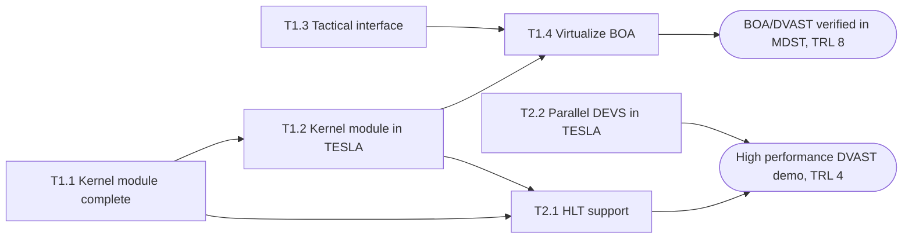
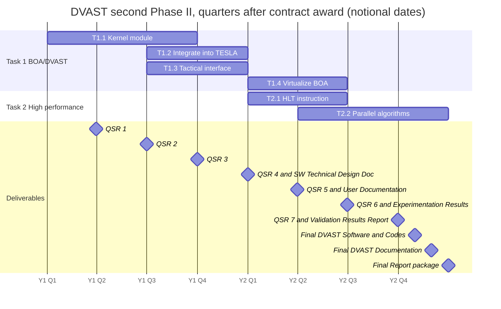

# DVAST Second Phase II: Objectives, Tasks, Schedule, Deliverables (as proposed)

> **This is the plan as proposed, and it has been superseded.** After award, the team replaced it with a four-task plan (T1 Demonstrate BOA/DVAST, T2 Verification and Documentation, T3 Complete the DVAST kernel module, T4 HPC support) and a revised deliverables list. For the current tasks, schedule, deliverables and progress, and for the crosswalk from the IDs below to the revised IDs, read `revised-plan.md`. Use this file when the question is about what the proposal said. The IDs below (T1.1–T2.2) are **proposal** IDs, so write "proposal T1.1" when that could be confused with a revised ID.

The breakdown of the work plan in the accepted proposal. Task IDs follow **Table 1** (T1.1–T2.2). The prose of section (3) labels Task 1's subtasks differently, as mapped below. Sources: (2) Technical Objectives, (3) Work Plan, Table 1, Table 2.

---

## 1. Objectives and targets

**Primary aim:** mature the First Phase II proofs of concept into complete solutions that can host as-is software in MDA's non-real-time simulation environments.

| # | Objective | TRL target | Delivered by |
|---|-----------|-----------|--------------|
| 1 | Virtualize **BOA** with DVAST, and verify that virtualized BOA executes correctly in engagement scenarios simulated with **MDST** | **TRL 8** | Task 1 |
| 2 | Design and demonstrate an initial DVAST capability for simulating the **high performance computers** MDA is adopting in its electronics modernization | **TRL 4** | Task 2 |

**End state:** DVAST "capable of replacing the existing, Quick EMUlator (QEMU)-based TESLA solution".

**Anticipated benefits**, with the basis the proposal gives for each:

| Benefit | Basis given |
|---------|-------------|
| At least a **10x** cut in long-term software maintenance cost | ORNL Technical Report ORNL/TM-2021/1994 |
| **5x** better time-management precision than the QEMU-based TESLA | The Phase I and First Phase II reports |
| A virtualized **TSC register that reports simulation time** | None given. It follows from the kernel-module work in T1.2. |
| Simulation of computers up to **2x** the scale and performance of the physical host | Multicore use, plus overprovisioning in operational systems |

---

## 2. Work breakdown

```mermaid
flowchart TD
    P["DVAST second Phase II"]
    P --> T1["Task 1: Create and verify BOA/DVAST<br/>(TRL 8)"]
    P --> T2["Task 2: Design and demonstrate a high performance DVAST<br/>(TRL 4)"]
    T1 --> T11["T1.1 Complete the DVAST kernel module"]
    T1 --> T12["T1.2 Integrate the kernel module into TESLA"]
    T1 --> T13["T1.3 Tactical interface solution for BOA/DVAST"]
    T1 --> T14["T1.4 Virtualize BOA"]
    T2 --> T21["T2.1 HLT instruction"]
    T2 --> T22["T2.2 Parallel simulation algorithms"]
    T11 --> S111["1.1.1 Enable simulated interrupts"]
    T11 --> S113["1.1.3 Device I/O sub-systems"]
    T11 --> S114["1.1.4 Extended page table sub-system"]
    T12 --> S121["1.2.1 DEVS interface implementation"]
    T12 --> S122["1.2.2 Integration with TESLA"]
    T12 --> S123["1.2.3 Benchmark precision of timing solution"]
    T13 --> S131["1.3.1 DEVS implementations of communication protocols"]
    T13 --> S132["1.3.2 Tactical message format / simulation data translation tool"]
    T14 --> S141["1.4.1 MDST to TESLA interface"]
    T14 --> S142["1.4.2 Install and verify the as-is BOA software"]
    T21 --> S211["2.1.1 HLT support for DVAST"]
    T21 --> S212["2.1.2 TESLA virtual core support for HLT"]
    T21 --> S213["2.1.3 Investigate novel speedup opportunities"]
    T22 --> S221["2.2.1 Standard parallel DEVS algorithm"]
    T22 --> S222["2.2.2 Conservative parallel DEVS algorithm"]
```

**How the prose labels map to Table 1:**

| Section (3) prose | Table 1 ID |
|---|---|
| Subtask 1.1: Complete implementation of the DVAST kernel module | T1.1 |
| Subtask 2: Integrate the completed DVAST kernel module into TESLA | T1.2 |
| Subtask 3: Develop a tactical interface solution for BOA | T1.3 |
| Subtask 4: Virtualize BOA and verify its correct execution… | T1.4 |
| Subtask 2.1: Leverage the halt (HLT) instructions… | T2.1 |
| Subtask 2.2: Parallel simulation within TESLA | T2.2 |

Table 1 has **no 1.1.2**. The prose lists three T1.1 goals: interrupts, extended page tables, and MMIO/port I/O. Table 1 lists them as 1.1.1, 1.1.4 and 1.1.3.

---

## 3. Task details

### Task 1: Create and verify BOA/DVAST
It culminates in verifying that BOA, virtualized with DVAST, operates correctly with missile-defense scenarios simulated by MDST. "We anticipate replicating the successful validation of BOA/TESLA that was completed in 2019 but now using the more capable DVAST technology."

#### T1.1 Complete implementation of the DVAST kernel module (Y1 Q1–Q3)
Extend the First Phase II proof-of-concept kernel module into a complete solution "that can support all features of the TESLA computer system simulator".

| ID | Goal | Why it matters / gap in the prototype |
|----|------|---------------------------------------|
| 1.1.1 | Transmit **simulated hardware interrupts** to the virtual core | So the as-is software can interact with network interfaces, disk drives and other peripherals. |
| 1.1.3 | Complete **memory-mapped I/O and port I/O** between simulated hardware and the virtual core | The prototype covered "a significant subset" but "omitted several key use cases". |
| 1.1.4 | Complete the **extended page tables** system, which maps "virtualized memory addressed used by the guest to physical memory addresses in the host" and so simulates guest RAM | The prototype covered "a significant subset" but "omitted several key use cases". |

#### T1.2 Integrate the complete DVAST kernel module into TESLA (Y1 Q3–Q4)
Create the DEVS interface for the kernel module that was defined in Phase I. It was already demonstrated for the user space timer in the First Phase II. When done, the kernel module is a **fully functional alternative** to the user-space solution, and it provides (1) the most precise possible control over the relation between the virtual core's execution time slice and the passing of simulation time, and (2) guest access to the TSC.

| ID | Goal |
|----|------|
| 1.2.1 | Attach the First Phase II DEVS interface layer to the DVAST kernel module. |
| 1.2.2 | Integrate the kernel module into the TESLA computer system simulator. |
| 1.2.3 | Demonstrate the precision gain by using the simulated TSC to estimate **BogoMIPS** (loop iterations per second), with "consistent, tunable measurement results". |

#### T1.3 Develop a tactical interface solution for BOA/DVAST (Y1 Q3–Q4)
Enable non-real-time simulations that use MDST's TCP/IP messaging between BOA and MDST. This fixes the TCP transmit-retry-timer problem of the QEMU-based TESLA by extending ORNL's interposed simulated protocol stack (see `architecture.md` §9).

| ID | Goal |
|----|------|
| 1.3.1 | DEVS implementations of the TCP/IP protocols used by BOA and MDST. |
| 1.3.2 | Software, as needed, that translates simulation data to and from the tactical message formats. |

#### T1.4 Virtualize BOA (Y2 Q1–Q2)
Create BOA/DVAST and interface it with MDST. The plan reuses the **disk images** and the **MDST-to-TESLA interface** from the 2019 BOA/TESLA demonstration.

| ID | Goal |
|----|------|
| 1.4.1 | An interface that lets BOA/DVAST act as a component within MDST. |
| 1.4.2 | Virtualize BOA with DVAST and demonstrate correct execution in relevant scenarios. This depends on "close collaboration with the BOA developers" for scenarios, validation criteria, installation and configuration. |

### Task 2: Design and demonstrate a high performance DVAST
It culminates in a demonstration of a DVAST that can (a) **simulate computers more capable than the physical host** and (b) **simulate smaller or similar computers at or faster than real time, on average**. The approach exploits multicore hosts and the overprovisioning of DoD operational hardware.

#### T2.1 HLT instruction (Y2 Q1–Q2)
Expose guest **HLT** execution to the DEVS processor-core model, which then assigns an **infinite time advance** until a peripheral interrupt arrives. Evidence cited: operational systems provisioned for 100% of the expected load leave up to 50% of cores idle, which suggests "at least 2x reduction in simulation time". A rudimentary version already worked in the user-space DVAST.

| ID | Goal |
|----|------|
| 2.1.1 | Extend DVAST to inform TESLA when HLT executes. |
| 2.1.2 | Modify the TESLA processor core model to report an infinite time advance to the DEVS simulator. |
| 2.1.3 | Investigate new ways, inside the custom DVAST kernel, to use the knowledge that the vCPU is idle. |

#### T2.2 Parallel simulation algorithms (Y2 Q2–Q4)
Build a parallel simulation capability in TESLA by adding multi-threaded algorithms to the DEVS simulation tool at TESLA's core.

| ID | Goal |
|----|------|
| 2.2.1 | Implement and benchmark a multi-threaded **standard parallel DEVS** algorithm, which parallelizes output computation and state transitions (ref. [16]). |
| 2.2.2 | Implement and benchmark a **conservative parallel DEVS** variant (refs. [16], [17]). It gives near-linear speedup under ideal conditions, but in practice the gain depends on the application and on exploiting lookahead. It includes graph algorithms that assign atomic models to logical processes using lookahead calculations. |

### Dependencies implied by the text and schedule
The proposal has no dependency chart. The edges below are inferred from the wording ("extend the DVAST kernel module…", "Our final subtask…") and from the Table 1 timing.

---

## 4. Schedule (Table 1)

The quarters were recovered from the cell shading in the .docx. Table 1 labels only Year 1 and Year 2, with four columns each.

| Task | Y1 Q1 | Y1 Q2 | Y1 Q3 | Y1 Q4 | Y2 Q1 | Y2 Q2 | Y2 Q3 | Y2 Q4 |
|------|:-:|:-:|:-:|:-:|:-:|:-:|:-:|:-:|
| T1.1 Kernel module (1.1.1, 1.1.3, 1.1.4) | ■ | ■ | ■ | | | | | |
| T1.2 Integrate into TESLA (1.2.1–1.2.3) | | | ■ | ■ | | | | |
| T1.3 Tactical interface (1.3.1–1.3.2) | | | ■ | ■ | | | | |
| T1.4 Virtualize BOA (1.4.1–1.4.2) | | | | | ■ | ■ | | |
| T2.1 HLT instruction (2.1.1–2.1.3) | | | | | ■ | ■ | | |
| T2.2 Parallel algorithms (2.2.1–2.2.2) | | | | | | ■ | ■ | ■ |

The gantt below uses a **notional contract award (CA) of 2001-01-01** so that Mermaid can draw it. Read the axis as quarters after award, not as calendar dates. The proposal does not state the actual award date. The status reports give the period of performance, and `revised-plan.md` §4 draws the revised schedule on the calendar.

---

## 5. Deliverables (Table 2)

| Product | Type | Due (months after CA) | Qty | Quarter |
|---------|------|------------------------|-----|---------|
| Quarterly Status Reports | .ppt | +3, +6, +9, +12, +15, +18, +21 | 7 | End of each quarter, Y1 Q1 to Y2 Q3 |
| Software Technical Design Document | .pdf | +12 | 1 | End of Y1 Q4 |
| User Documentation | .pdf | +15 | 1 | End of Y2 Q1 |
| Experimentation Results | .pdf | +18 | 1 | End of Y2 Q2 |
| Validation Results Report | .pdf | +21 | 1 | End of Y2 Q3 |
| Final DVAST Software and Codes | Source code in .zip | +22 | 1 | Y2 Q4 |
| Final DVAST Documentation | .pdf | +23 | 1 | Y2 Q4 |
| Final Report package* | .pdf | +24 | 1 each | End of Y2 Q4 |

\*The Final Report package contains: Contract Summary Report (Final Report); Certificate of Compliance (SBIR/STTR Life-Cycle Certification); Computer Software Product; Product Documentation and User Manuals; Report of Invention and Disclosure; Technical Report, Study Services (Prototype Design and Operation Document); Contract Summary Report (Phase III Plan); Government Property Inventory Report (GFP and CAP Listing); and Final Summary Chart (SBIR/STTR Transition Summary Chart).

### Deliverable-to-task alignment (inferred, not stated in the proposal)
This alignment comes only from due dates and task content. Confirm it with the project team before using it in a deliverable.

| Deliverable | Most relevant work |
|-------------|--------------------|
| Software Technical Design Document (+12) | T1.1 kernel module design, T1.2 DEVS interface, T1.3 protocol and translator design |
| User Documentation (+15) | T1.2 kernel module in TESLA, T1.4.1 MDST interface |
| Experimentation Results (+18) | T1.2.3 BogoMIPS precision benchmark, T2.1 HLT speedup, early T2.2 benchmarks |
| Validation Results Report (+21) | T1.4.2 BOA/DVAST correct execution in MDST scenarios |
| Final software and documentation (+22/+23) | All tasks, including the T2.2 parallel algorithms |

---

## 6. Staffing and resources relevant to execution

- **ORNL performs more than 30%** of the work. ORNL brings the TESLA experience (section (8)).
- **Equipment and property:** the work uses RTSync- and ORNL-owned facilities. No equipment purchases and no Government Furnished Property are anticipated.
- **Collaboration needed:** BOA developers (scenarios, validation criteria, install and configuration). The 2019 BOA/TESLA disk images and MDST-to-TESLA interface are reused.
- **Integration and demonstration:** DVAST is to be integrated with **CAMLI** and demonstrated during the second Phase II, per (10).
