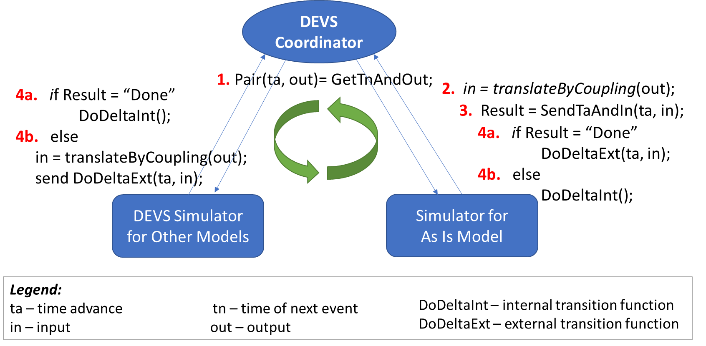
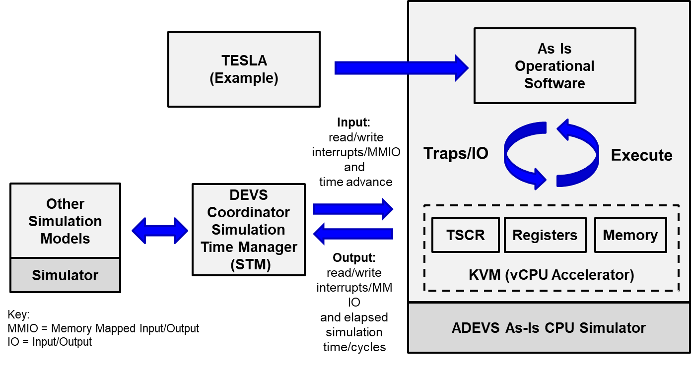
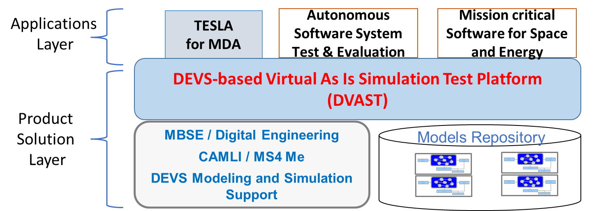
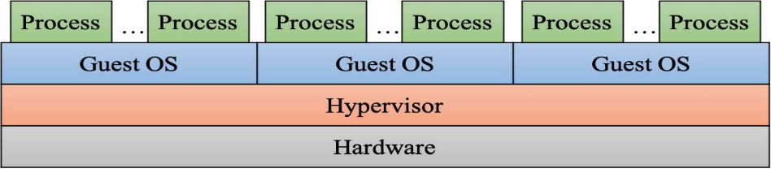
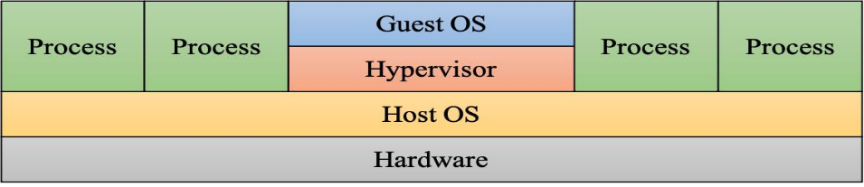
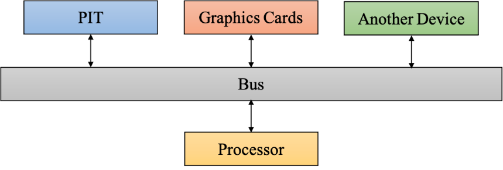
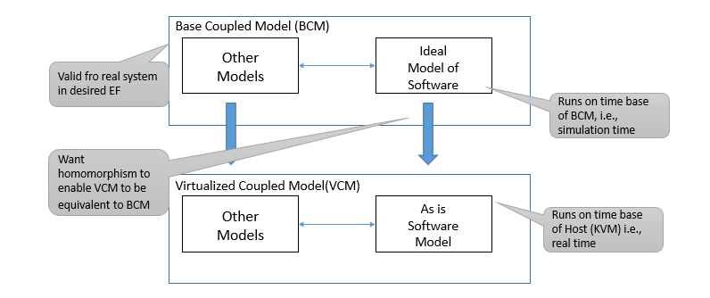

<!--
Source copy of the accepted proposal, extracted for the dvast-expert skill.
  Original file : MDA20_T002_2ndPh2_TechVolume_RTSync.docx (20 pages, Microsoft Word)
  Page header   : "Topic#: MDA20-T002  Second Phase II   Proposal #: B2S-0089   RTSync Corp"
  Extraction    : pandoc -t gfm (2026-09-28). The text is verbatim, including the source's typos.
                  Bracketed "[Extraction note: ...]" blocks are the only additions.
  Figures       : figures/fig1..fig7 (image3.png in the .docx is a byte-identical duplicate of Figure 2)
-->

**Glossary**

> **BOA**: Ballistic Missile Defense System Overhead Persistent Infrared Architecture
>
> **DEVS**: Discrete Event System Specification
>
> **DSP**: DEVS Simulation Protocol
>
> **DVAST**: DEVS-based Virtual AS IS Simulation Test Platform
>
> **EDISS**: End to end Digital Integrated System-level Simulation
>
> **DMBSE**: DEVS-based Model Based System Engineering
>
> **KVM**: Kernel based Virtual Machine
>
> **MBSE**: Model Based System Engineering
>
> **MDA**: Missile Defense Agency
>
> **M&S**: Modeling & Simulation
>
> **MS4 Me**: RTSync’s DEVS-based M&S Development environment
>
> **TCIS**: Time Controlled Instruction Stream
>
> **TESLA**: Tactical Emulation for Software-in-the-Loop Assessment
>
> **VCPU**: Virtual/clock CPU

**Title: DEVS-based Virtual As Is Simulation Test Platform (DVAST)**

**(1)** **Significance of Problems and Results of Phase I Work**

RTSync Corp (RTSync) together with Oak Ridge National Laboratory (ORNL), formed the RTSync team, to work on the Phase I and First Phase II of the Missile Defense Agency (MDA) STTR project MDA20-T002: Non-Real-Time Hardware Assisted Computer System Simulation. In Phase I, we investigated the design of a non-real-time simulation platform that creates an opportunity to radically change the way simulation is utilized by enterprises such as MDA to include high fidelity models of tactical software systems within their simulations. The new approach to developing and testing proposed System of System (SoS) architectures is to employ models of hardware systems that execute the unmodified operationally relevant software systems of interest, and thereby allow such software to be used in discrete event simulation models.

Our stated goal was to develop an approach towards a re-design of the Linux *Kernel-based Virtual Machine (KVM)* hypervisor to more effectively support “as is” operational software participating in non-real-time simulation systems. Hypervisors, also known as virtual machine monitors, allow users to create and run multiple guest *virtual machines* (VMs) on a host computer by virtually sharing its resources such as memory and processing.

Using virtual computing platforms for non-real-time simulation (faster or slower) provides significant benefits in terms of cost and performance. For example, one application of potential interest to MDA is testing of new software being designed to run on the next generation high performance hardware. Such hardware is typically not readily available for supporting current simulations and development. Achieving equivalently accurate execution of “as is” software using current generation lower performance hardware requires that the next generation hardware be modeled and executed in a powerful virtual environment.

Such simulations must take place under active control of a simulation time manager which progresses computation at a rate that is consistent with the other federates in the simulation. Virtualization can enable this capability by implementing the virtualized hardware, however existing solutions such as KVM are not designed with non-real-time simulation use cases in mind. Indeed, KVM is designed on the assumption that a virtual machine must provide an accurate view of real-world wall clock time to guest operating systems. This manifests in two ways: 1) no mechanism is provided to control the amount of computational time given to a virtual core in relation to a non-real-time clock and 2) the virtualized Time Stamp Counter Register (TSCR), which is the preferred time source for modern operating systems, is keyed to wall-clock time for virtualization use.

Modifying KVM with simulation support was investigated as an initially attractive solution for supporting “as-is” non-real-time simulation. While it is technically feasible to add a simulation mode to the KVM module, this may not be the best overall solution. Because KVM is solely designed to support virtualization workflows, there is significantly more functionality included in the system than is needed for a purely simulation system. It is more capable and more complex than what is needed. This complicates modifying KVM and providing maintenance and support for future systems and deployments. KVM’s existing method to handle time is also much more complicated than needed for simulation systems and can be a limiting factor to implementing a KVM based solution and maintaining this for future systems. Any modifications to KVM to support simulation would likely be difficult to upstream and not be supported by the virtualization community.

The economic costs alone for supporting these types of modifications long term do not make modifying KVM an appealing solution. Depending on the measure, KVM can be close to 100k source lines of code. The different KVM components are tightly integrated, making a simple change to the API can result in changes being applied to all architecture specific implementations. Arguably one could only modify the architecture code being used, however this makes upstreaming changes even more unlikely. This creates a very high risk for using this approach for enabling “as-is” simulations.

We concluded that creating a custom simulation specific kernel module is a more economical and risk-adverse approach and our recommended path forward. This can be a far simpler implementation than full KVM since the simulation constraints are more straightforward than virtualization. Mainly, the complexity with tracking wall-clock time is reduced since the simulation coordinator is responsible for tracking time and informing each of the simulation components. A simulation specific kernel module can drop the majority of the KVM functionality and only implement the vCPU features and provide the proper DEVS specific interfaces for injecting the proper simulation time into the vCPU’s TSC register. Additionally, only the architectures in use need to be supported with the ability to add support for other architectures in the future.

Appendix 1 summarizes the work that was done to investigate the KVM-based architecture redesign for non-real-time simulation in Phase I. Appendix 2 summarizes the work done to investigate the design and use cases for employing an accurate timing source with KVM.

## Background

The DEVS formalism was developed on the firm mathematical system theory foundation of A.W. Wymore (1967) and others and constitutes a well-founded computational basis for System theory-based modeling and simulation (M&S) needed by today’s digital engineering. The mathematical theory helps ensure reliable simulation system implementations and accurate simulation time management. The DEVS hierarchical construction methodology supports the complex system development needed for correct cyber-physical system M&S and downstream implementation.

A DEVS model formalization specifies a model's inputs, states, and outputs in a manner similar to a finite state automaton. However, a key difference is that the formal structure includes a time-advance function which allows it to represent discrete event systems as well as simulated continuous components. Due to its universality of realization (Zeigler, Muzy, and Kofman 2018), any real world system, or system of systems (SoS), can be modeled in DEVS and simulated in a DEVS-compliant computational platform.

We briefly state and stress some key aspects of DEVS. The DEVS formalism formalizes what a model is, what it must contain, and what it does not contain (for instance, experimentation and simulation control parameters are not contained in the model). Moreover, DEVS is universal and unique for discrete event system models. Any system that accepts events as inputs over time and generates events as outputs over time is equivalent to a DEVS model.

With DEVS, a model of a large system can be decomposed into smaller component models with couplings between them. The DEVS formalism defines two kinds of models: (i) atomic models that represent the basic models providing specifications for the dynamics of a system components, and (ii) coupled models that describe how to couple several component models (which can be atomic or coupled models) together to form a new model. This hierarchical construction stems from the proof that a coupled model behaves like an atomic model due to DEVS formalism’s closure under coupling which is strongly linked to systems being well-defined (Zeigler, Muzy, and Kofman 2018).

An abstract simulator algorithm is associated with the DEVS formalism in order to execute the structure of a model and thereby generate its behavior. This technology-free abstract simulator standard enables DEVS models to be simulated on multiple different execution platforms, including those on desktops (for development) and those on high-performance platforms (such as Clusters or High Performance Computers) while guaranteeing that the simulated system’s behavior is unchanged.

The architectural concept that emerged for simulation of a discrete event simulation involving non-real-time simulation of “as is” software is depicted in Figure 1. Here the simulation is assumed to be managed by a DEVS simulator that handles the interaction between the “as is” software that is executed as a guest under a hypervisor with the other simulation models that are represented in the usual form of DEVS models. For the simulation to proceed correctly, timing of the latter models has to be properly synchronized with timing of the “as is” software whose time processing is controlled by the hypervisor execution of its code. The following First Phase II technical objectives (see next section) demonstrated a viable path towards achieving this requirement.

**Figure 1**. Sequential Simulation Design for DVAST showing steps in the iterative cycle

Figure 1 shows that the time advance and the elapsed time variables associated with DEVS models need to be correctly calculated and reported by the simulators of the component models. We identified a design for implementation of the DEVS simulation protocol that satisfies these requirements in which the simulator of the “as is” software model and the coordinator are modified to fit within the constraints imposed by the virtual execution architecture.

Subsequently, we elaborated the design for the second alternative and developed a proof-of-concept implementation in MS4 Me to verify its correct behavior. In the proposed sequential implementation of the DEVS simulation protocol for DVAST, the coordinator first queries Simulator 1 (for the other models) for its time of next event and output (Step 1 in Figure 1). In Step 2, the coordinator translates this output message to the associated input message, according to the coupling information supplied by its coupled model. In Step 3, the coordinator then sends the pair of time advance and input to Simulator 2. In Step 4, Simulator 2 marches the model forward until an output event is encountered or until the time advance just received, whichever occurs first.

If the time advance bound is encountered first, then it notifies the coordinator and Simulator 1 of this fact (Step 4a). Otherwise (Step 4b), Simulator 2 sends its output to the coordinator which translates it using the the coupling to input for Simulator 1. The appropriate state transitions are implemented in Steps 4 a and b by both Simulators so that the end result is the correct global transition specified by the DEVS simulation protocol. We note that the main advantage of the sequential version of the DEVS protocol is that Simulator 2 does not have to remember the state of its model as it marches the model state forward. This greatly simplifies the implementation of DVAST by reducing the interactions required with the hypervisor platform.

## Results of Phase I Work

Therefore, based upon our investigations and conclusions in Phase I, we proposed an implementation of DEVS based on the proposed sequential simulation protocol for supporting accurate non-real-time simulation of “as is” operational software. To do so, we proposed to develop a custom Linux kernel module during Phase II to support this implementation. Our custom module was anticipated to implement some similar capabilities as the existing KVM solution but will be solely focused on supporting simulation workflows rather than virtualization workflows. This means the overall complexity of the module will be greatly reduced as compared to KVM. Our custom module will consist of two major components:

1)  the minimal virtual hardware model for executing unmodified software and

2)  a custom scheduling mechanism for controlling overall execution time.

We will build on existing capabilities in Linux where possible to reduce the overall size of our solution and reduce overall risk. We will also use a similar interface to KVM in order to reduce complexity of migrating between solutions.

The proposed ***DEVS-based virtual as is simulation test platform (DVAST)*** offers the following important benefits:

- All of the physical and other digital aspects of the environment can be simulated in conjunction with live software “as is” regardless of the true execution speed of the simulated environment. Such ability to perform dynamic analysis is not possible using current technologies.

- Although the cost of building and maintaining hardware models incurs a large initial cost, this cost is likely to be amortized over the lifetime of the simulation of a SoS.

- It will become feasible to examine the impact of cyber-attacks on overall systems performance because the entire operational software is being used “as is” in the simulation environment. This capability is too expensive or too dangerous using the current hardware in the loop approach.

- The proposed non-real-time simulation platform represents an insertable technology for a broad spectrum of modeling and simulation (M&S) applications across both government and commercial spheres.

## Results of First Phase II Work

The technical objectives of the First Phase II work were to demonstrate the technical feasibility of solutions identified in Phase I. Specifically, we accomplished the following in the First Phase II:

1)  **Elaborated the design of the simulation protocol to support DVAST** – We extended the proofs of correctness developed in Phase I and transformed these into software design documents and testing of features that would establish the correctness and performance properties of the platform.

2)  **Developed a custom scheduling mechanism within the Linux kernel** – We produced two proof of concept implementations of the DVAST protocol. In the first proof of concept, a high precision user space timer is used to evict the DVAST virtual core from the physical processor core. This solution has the key, advantageous feature that it does not require the installation of new kernel modules and so can be applied without administrative permissions. The second proof of concept is a new kernel module that uses the Intel time out instruction from the Intel VMX instruction set to (a) expose the time stamp counter with the simulation time and (b) evict the virtual core from the physical core with the greatest precision possible. *The further development of this kernel module will be a key aspect of the proposed second Phase II.*

3)  **Developed a minimal virtual hardware model** – We demonstrated the basic feasibility of the technologies described in (2) above with a minimal simulated hardware model. This demonstration showed that the user space timer is sufficient for simulations that do not require access to the time stamp counter. Our approach to the kernel module reused some of the existing KVM functionality to reduce the overall development time and limited its scope of applicability to achieve a demonstration with the allotted resources. *This new module confirmed the viability and potential of a new kernel module, but it requires additional development to be a complete solution*.

4)  **Developed the simulation module and DEVS-based simulator** – We completed an implementation of the DEVS based interface for executing the instruction sequence of “as-is” operational software. This interface was integrated into the TESLA solution by refactoring the processor core model.

5)  **Integrated our solution within the Tactical Emulation for Software-in-the-Loop Assessment (TESLA) system for testing** – The First Phase II was completed by using the MDA’s TESLA framework as an example demonstration for our simulation solution that employs the user space timer technology. *Extensions of the proof of principle kernel solution will be a focus of the second Phase II.*

**(2)** **Second Phase II Technical Objectives**

RTSync Corp (RTSync) together with Oak Ridge National Laboratory (ORNL), have formed the RTSync team, to work on this second Phase II of the Missile Defense Agency (MDA) STTR project MDA20-T002: Non-Real-Time Hardware Assisted Computer System Simulation. The primary aim of the second Phase II is to mature the proof-of-concept solutions developed in the first Phase II into complete solutions that are capable of meeting MDA’s need to host “as is” software systems within non-real time simulation environments. Specifically, we propose to:

1)  virtualize the Ballistic Missile Defense System Overhead Persistent Infrared Architecture (BOA) software system using the new DVAST technology and verify the correct execution of the virtualized BOA software in the context of engagement scenarios simulated using MDST with the aim of achieve TRL 8; and

2)  design and demonstrate an initial capability for DVAST to simulate the types of high performance computer systems being adopted by MDA as part of its ongoing electronics modernization efforts with the aim of achieving TRL 4.

At the completion of the proposed research and development effort, we anticipate that DVAST will be capable of replacing the existing, Quick EMUlator (QEMU)-based TESLA solution. In doing so, we anticipate the following significant benefits:

1)  at least 10x reduction in long term software maintenance costs, as detailed in ORNL Technical Report ORNL/TM-2021/1994

2)  a 5x improvement in the precision of the time management solution relative to the QEMU-based TESLA, as described in our Phase I and first Phase II reports;

3)  a virtualized time stamp counter register that reports simulation time; and

4)  a capability to simulate very large scale, very high-performance computers (up to 2x the scale and performance of the physical hardware being used for simulation) by fully leveraging the multiple cores available in all modern computers and the overprovisioning of hardware resources that is common in operational systems.

**(3) Second Phase II Work Plan**

Figure 2 illustrates the key components of the integrated second Phase II deliverables.

**Figure 2**. Integrated DVAST Platform with TESLA example to be completed during second Phase II Demonstration

> [Extraction note: Figure 2 carries two overlaid callouts that are not part of the PNG. From the drawing-group coordinates, the callout "Replace" points at the *KVM (vCPU Accelerator)* box, and the callout "Modify for new replacement API" points at the *ADEVS As-Is CPU Simulator* bar.]

During second Phase 2, we proposed two distinct thrusts of research. In the first, we proposed to extend the proof-of-concept implementations created during the first Phase 2 into a complete solution capable of virtualizing relevant MDA software assets. In the second thrust, we will design and demonstrate a high performance virtualization solution that extends the scale of computer systems that DVAST can simulation. To this end, we propose the following tasks.

**Task 1: Create and verify BOA/DVAST**

This task will culminate in a verification that BOA, now virtualized using the DVAST technology, operates correctly in conjunction with missile defense scenarios simulated by MDST. In summary, we anticipate replicating the successful validation of BOA/TESLA that was completed in 2019 but now using the more capable DVAST technology. Specific subtasks include:

**Subtask 1.1: Complete implementation of the DVAST kernel module -** We will extend our proof-of-concept kernel module for DVAST that was developed in the 1st Phase 2 into a complete solution that can support all features of the TESLA computer system simulator. Specific goals include the following.

1)  Transmitting simulated hardware interrupts to the virtual core; this is needed so that the “as is” software can interact with network interfaces, disk drives, and other peripheral equipment.

2)  Complete our implementation of the extended page tables system; extended page tables used to map virtualized memory addressed used by the guest to physical memory addresses in the host. That is, to simulate the random-access memory of the guest computer. Our proto-type demonstrated the feasibility of a significant subset of an extended page table system in the context of DVAST but this demonstration omitted several key use cases that are necessary for a fully functional solution.

3)  Complete support for memory mapped I/O and port I/O between simulated hardware and the virtual core. Our prototype demonstrated the feasibility of a significant subset of a simulated input/output system for communicating data with peripheral devices, but this demonstration omitted several key use cases that are necessary for a fully functional solution.

**Subtask 2: Integrate the completed DVAST kernel module into TESLA -** This subtask will create the DEVS interface defined in Phase I for the DVAST kernel module. This interface was demonstrated in the first Phase II for the user space timer solution. This subtask extends that implementation to include the new DVAST kernel module. When this subtask is complete, the DVAST kernel module will be a fully functional alternative to the user space solution. This complete DVAST kernel model will provide (1) the most precise control possible over the relation between execution time slice given to the virtual core and the passing of simulation time and (2) guest access to the time stamp counter by the virtual core. Specific goals include

1)  Attach the DEVS interface layer developed in the first Phase II to the DVAST kernel module

2)  Integrate the DVAST kernel module into the TESLA computer system simulator

3)  Demonstrate the anticipated improvement in precision by using the simulated time stamp counter to estimate BogoMIPS (number of iterations of a loop per second) and showing consistent, tunable measurement results.

**Subtask 3: Develop a tactical interface solution for BOA** - This subtask will enable non-real time simulations that use MDST’s TCP/IP based messaging to exchange simulation data between BOA and MDST. In prior work with the QEME-derived TESLA, the extent to which non-real time simulations could be supported was limited by the transmit retry timer in the TCP protocol stack. The origin of this problem was the disparity in perceived time between the *non-real time* execution of the protocol stack within virtualized BOA and the *real time* execution of the protocol stack within MDST and the Linux kernel. In prior work ORNL has demonstrated a solution to this problem by interposing a simulated protocol stack that immediately accepts data from the *real time* protocol stack and then handles all interactions with the *non-real time* protocol stack in simulated time. We will extend our proto-type solution through two specific activities:

1)  DEVS implementations of the TCP/IP protocols used by BOA and MDST;

2)  Create software, as needed, to translate simulation data to and from the appropriate tactical message formats.

**Subtask 4: Virtualize BOA and verify its correct execution within missile scenarios simulated with MDST** - Our final subtask will be to virtualize BOA to create BOA/DVAST and interface BOA/DVAST with MDST. We anticipate leveraging the disk images and MDST to TESLA interface created as part of the 2019 demonstration of BOA/TESLA. This subtask has two primary subtasks

1)  Create an interface for BOA/DVAST that permits it to act as a component within MDST.

2)  Virtualized BOA using DVAST and demonstrate its correct execution in relevant simulation scenarios. We anticipate close collaboration with the BOA developers to define relevant scenarios, validation criteria, and for assistance installing and configuring the application.

**Task 2: Design and demonstrate a high performance DVAST**

This task will culminate in the demonstration of a high performance DVAST that can (a) simulate computer systems more capable than the underlying, physical hardware and (b) simulate smaller or similarly capable computer systems in, on average, at or faster than real time. Our specific approach aims to fully leverage the multiple cores available in all modern computer systems and take full advantage of the overprovisioning of computer hardware in most systems that support DoD operational capabilities. Specific subtasks include:

**Subtask 2.1: Leverage the halt (HLT) instructions in a guest’s instruction stream -** We will extend the DVAST kernel module to expose the execution of HLT instructions to the DEVS model of a processor core. A processor core issues the HLT instruction to inform the operating system that it has no more instructions to execute and is waiting on a hardware interrupt. This instruction is used by the Linux operating system to reduce power consumption by putting the halted processor core into a low power state. The DEVS model of the core can simulate this state by assigning an infinite time advance to the core model until it receives an interrupt from some peripheral device (clock, disk controller, etc.) simulated within TESLA.

In a typical computer system, most processor cores are idle most of the time. Indeed, we have seen DoD operational software systems that are provisioned for workloads up to 100% of what is expected, with the result that up to 50% of the processor cores are idle under anticipated workloads. This suggests the possibility of at least 2x reduction in simulation time if these idle processor cores can be identified and the computational resources allocated to them are freed for other tasks within the simulation.

A rudimentary capability to use the HLT instruction for speeding up a simulation was demonstrated with our used space DVAST solution. There, faster than real time execution could be achieved in instants when all cores in the virtualized computer were idle. We will incorporate this capability into the new DVAST kernel module and investigate new opportunities for speedup that it affords in the context of our specialized kernel module. Specific goals include:

1)  extend DVAST to inform TESLA of the execution of the HLT instruction;

2)  modify the TESLA processor core model to use this information to report an infinite time advance to the DEVS simulator;

3)  investigate novel opportunities within our custom DVAST kernel to leverage knowledge that the virtual processor core is idle.

**Subtask 2.2: Parallel simulation within TESLA -** This task will create a parallel simulation capability within TESLA that can take full advantage of a multicore computer to accelerate the simulation of virtualized “as is” software. To accomplish this, we anticipate incorporating a multi-threaded simulation algorithm in the DEVS simulation tool that forms the core of the TESLA model. Specific goals include the following.

1)  Implement and benchmark a multi-threaded version of the standard, parallel DEVS simulation algorithm. This algorithm parallelizes the computation of the component outputs and parallelizes computation of the component state transitions; e.g., as described in \[16\].

4)  Implement and benchmark a variant of the conservative parallel DEVS simulation algorithm described in \[16\] and \[17\]. Under ideal circumstances, this algorithm provides nearly linear speedup in the number of computational cores used to execute the simulation. In practical applications, the speedup depends strongly on the application characteristics and the ability to effectively identify and exploit lookahead in collections of components. Towards this end, we anticipate the construction of graph algorithms that automatically identify a good assignment of atomic models to the logical processes of the parallel algorithm based on the lookahead calculation methods described in \[17\].

# Timetable of Key Milestones and Activities:

Table 1 shows the timetable for the key milestones and activities.

***Table 1**. Timetable of key milestones and activities.*

| Task / Subtask | Y1 Q1 | Y1 Q2 | Y1 Q3 | Y1 Q4 | Y2 Q1 | Y2 Q2 | Y2 Q3 | Y2 Q4 |
|---|---|---|---|---|---|---|---|---|
| ***T1.1: Complete implementation of the DVAST kernel module*** | ■ | ■ | ■ | | | | | |
| 1.1.1 Enable simulated interrupts | ■ | ■ | ■ | | | | | |
| 1.1.3 Device I/O sub-systems | ■ | ■ | ■ | | | | | |
| 1.1.4 Extended page table sub-system | ■ | ■ | ■ | | | | | |
| ***T1.2: Integrate complete DVAST kernel module into TESLA*** | | | ■ | ■ | | | | |
| 1.2.1 DEVS interface implementation | | | ■ | ■ | | | | |
| 1.2.2 Integration with TESLA | | | ■ | ■ | | | | |
| 1.2.3 Benchmark precision of timing solution | | | ■ | ■ | | | | |
| ***T1.3: Develop a tactical interface solution for the BOA/DVAST*** | | | ■ | ■ | | | | |
| 1.3.1 DEVS implementations of relevant communication protocols | | | ■ | ■ | | | | |
| 1.3.2 Tactical message format/Simulation data translation tool | | | ■ | ■ | | | | |
| ***T1.4: Virtualize BOA*** | | | | | ■ | ■ | | |
| 1.4.1 MDST to TESLA interface | | | | | ■ | ■ | | |
| 1.4.2 Installation and verification of the "as is" BOA software | | | | | ■ | ■ | | |
| ***T2.1 HLT instruction*** | | | | | ■ | ■ | | |
| 2.1.1 HLT instruction support for DVAST | | | | | ■ | ■ | | |
| 2.1.2 TESLA virtual core support for HLT | | | | | ■ | ■ | | |
| 2.1.3 Investigate novel opportunities for speedup | | | | | ■ | ■ | | |
| ***T2.2 Parallel simulation algorithms*** | | | | | | ■ | ■ | ■ |
| 2.2.1 Implement and benchmark standard parallel DEVS algorithm | | | | | | ■ | ■ | ■ |
| 2.2.2 Implement and benchmark parallel conservative algorithm | | | | | | ■ | ■ | ■ |

> [Extraction note: the schedule bars exist in the .docx only as cell shading, which plain-text extraction loses. The ■ marks above were recovered from the shading of each cell. The quarter columns are Year 1 and Year 2 as labelled in the source; the source does not number the quarters. Row labels are verbatim, including the missing 1.1.2.]

**Phase II Products:**

Our planned products and reports to be delivered during second Phase II include the following products and reports in Table 2:

***Table 2**. Products and Reports.*

<table>
<colgroup>
<col style="width: 51%" />
<col style="width: 12%" />
<col style="width: 23%" />
<col style="width: 13%" />
</colgroup>
<thead>
<tr class="header">
<th><strong>Second Phase II Products including Reports</strong></th>
<th><strong>Type</strong></th>
<th><strong>Schedules (Months after CA)</strong></th>
<th><strong>Quantities</strong></th>
</tr>
</thead>
<tbody>
<tr class="odd">
<td>Status Report: Quarterly Status Reports</td>
<td>.ppt</td>
<td>+3, +6, +9, +12, +15, +18, +21 months</td>
<td>7</td>
</tr>
<tr class="even">
<td>Software Technical Design Document</td>
<td>.pdf</td>
<td>+12 months</td>
<td>1</td>
</tr>
<tr class="odd">
<td>User Documentation</td>
<td>.pdf</td>
<td>+15 months</td>
<td>1</td>
</tr>
<tr class="even">
<td>Experimentation Results</td>
<td>.pdf</td>
<td>+18 months</td>
<td>1</td>
</tr>
<tr class="odd">
<td>Validation Results Report</td>
<td>.pdf</td>
<td>+21 months</td>
<td>1</td>
</tr>
<tr class="even">
<td>Final DVAST Software and Codes</td>
<td>Source code in .zip</td>
<td>+22 months</td>
<td>1</td>
</tr>
<tr class="odd">
<td>Final DVAST Documentation</td>
<td>.pdf</td>
<td>+23 months</td>
<td>1</td>
</tr>
<tr class="even">
<td>Final Report (Contract Summary Report), Certificate of Compliance: SBIR_STTR Life-Cycle Certification, Computer Software Product, Product Documentation and User manuals, Report of Invention and Disclosure, Technical Report - Study Services: Prototype Design and Operation Document, Contract Summary Report: Phase III Plan, Government Property Inventory Report: Government Furnished Property (GFP) and 
Contractor Acquired Property (CAP) Listing, Final Summary Chart: SBIR/STTR Transition Summary Chart</td>
<td>.pdf</td>
<td>+24 months</td>
<td>1 for each report</td>
</tr>
</tbody>
</table>

**(4)** **Related Work**.

Title: **Non Real-Time Hardware Assisted Computer System Simulation (MDA20-T002 Phase II)** Performing Organization/Client: RTSync (Sub), Oak Ridge National Laboratory (Sub) Contract \# (Value to date): HQ086022C7601 (\$1,509,996) Period of Performance: June 2022 – June 2024 Reference: Dr. Greg Garbe, Missile Defense Agency, Gregory.Garbe@mda.mil 719-721-9049 Description: The RTSync team’s design of a non-real-time simulation platform has created an opportunity to radically change the way that simulation utilizing enterprises such as Missile Defense Agency include high fidelity models of tactical software systems within their simulations. The new approach to developing and testing proposed System of System (SoS) architectures is to employ models of hardware systems that execute the unmodified operationally relevant software systems of interest, and thereby allow such software to be used in discrete event simulation models. The RTSync team implemented the sequential simulation protocol for supporting accurate non-real-time simulation of “as-is” operational software called DEVS-based virtual as is simulation test platform (DVAST).

Title: **Model Level Integrated Simulation Architecture for Collaborative Development (MDA18-012 second Phase II)** Performing Organization/Client: RTSync (Prime), nou Systems (sub) / MDA Contract \# (Value to date): HQ0860-22-C-7144 (\$1,809,990) Period of Performance: September 2022 - September 2024 Reference: Dr. Greg Garby, MDA, Gregory.Garbe@mda.mil 719-721-9265

Description: The objectives of the digital engineering implementation and integration research are the development of Bidirectional SysML / DEVS model mapping architecture and expansion of Model Library and V&V Meta-data capabilities previously developed. The resulting Integrated Simulation Architecture will exhibit essential properties of ease of model integration, model composability and support for high performance execution. CAMLI will undergird a SE and digital engineering methodology that can support a full life-cycle to design, model, and validate complex Systems of Systems. Composability and reusability based on DEVS approach is to leverage RTSync’s CAMLI capabilities to specify the interfaces and structures of system components that are already specified in SysML. We can then use the DEVS Streaming Framework for Adaptive Architectures (DSFA) to instantiate alternative and pathways for events in complex webs. Leveraging the latest LLM tools, the RTSync team revolutionizes the MBSE process with the automated generation of DEVS Models. With the help of LLMs, we can analyze source system documentation and requirements for any DEVS models, create a list of all potential DEVS models, generate a complete outline of the DEVS model that adheres to the DEVS formalism, generate DEVS Java code with fully functioning DEVS capabilities.

Title: **Automated Test Case Generator (ATC-Gen)**

Performing Organization/Client: RTSync (Sub), Oak Ridge National Laboratory (Sub), Northrop Grumman IT (Prime) /DITCO-SCOTT Joint Interoperability Test Command (JITC)

Contract \# (Value to date): NBC 00H02C0001 (\$3,459,349)

Period of Performance: March 2008 – February 2013

Reference: Nancy Johnson, JITC 520-533-0421, nancy.johnson@disa.mil

Description: The RTSync/ORNL/Northrop Grumman IT team adopted the M&S Framework and the DEVS specification family as part of its formalized approach to Global Information Grid and its Service Oriented Architecture (GIG/SOA) web-service M&S for net-centric testing. The RTSync/ORNL team performed data link protocol modeling, developed simulation frameworks to support testing activities, and developed the ADEVS simulation framework to support JITC mission needs. The RTSync/ORNL team developed the ATC-Gen, a DEVS methodology-based software toolset that is innovating and automating standards conformance testing at the JITC. RTSync employed DEVS to establish a reference architecture which formalizes the military standard (Link 16) as a DEVS model which captures MILSTD 6016C rule sets in an unambiguous operational manner. This model includes all the behaviors in the MILSTD and forms the basis for subsequent analysis, automation, and test case generation. Test cases are defined as sequences, or paths through the standard that are then cast (transformed) as mirror images of the Link-16 rule-set baseline model. The RTSync team performed this classified contract work for the JITC as a subcontractor to the Northrop Grumman team.

**Research Institution’s Related Work**

ORNL as the research institution partner has extensive work experience on the current TESLA project at MDA that focuses on virtualization of workstation level computer system and software performance based on DEVS methodology. The TESLA project experience and insights will be leveraged to implement the proposed approach during Phase I. Other related work performed by the ORNL technical team members includes:

Title: **Federated Science Instruments**

Period of Performance: October 2019 – October 2020

Description: This is an internally funded project at Oak Ridge National Laboratory researching the concept of scientific federations. These federations connect leadership high-performance-computing systems with experimental science facilities by leveraging software defined technologies for quickly integrating these systems together. ORNL is developing a software framework to streamlining the usage of such federations by science users. Part of this work also includes developing a virtualized network testbed and simulator that quickly allows users to software and workflows in a test environment mirroring the production instruments and computing facilities.

Title: **A Defense-In-Depth Security Architecture for Software Defined Radio Systems**

Period of Performance: September 2013 – May 2019

Description: Many wireless communication systems are shifting towards software implementations which exposes new attack surfaces that can be vulnerable to exploits. These Software Defined Radio (SDR) systems can contain vulnerabilities within the radio’s software stack itself that allow attackers to easily compromise the entire system. This work focused on developing secure architectures for SDRs that uses isolation mechanisms such as containers and virtual machines to enforce different security zones within a SDR system. Exploits against vulnerabilities within blocks are contained by the isolation zones which protects the rest of the system from compromise. This work also included developing a simulation platform for automating performance tests of different SDR applications executing within these isolation zones to better understand the overall overhead incurred by executing waveforms within different virtualization environments.

**(5)** **Relationship with Future Research or Research and Development**.

The anticipated result during second Phase II period is DEVS-based DVAST,*** ***a prototype implementation of DEVS sequential simulation protocol for supporting accurate non-real-time simulation of “as-is” operational software     This virtual hardware-based "as is" simulation capability will benefit the MDA and collaborating agencies by significantly increasing mission readiness. After second Phase II, the MDA customer could support a transition with a Phase III program to enhance our DVAST environment by testing various use cases and performance analysis applications for robust operational capabilities. 

The RTSync team does not anticipate certifications or approvals are required to conduct Phase III testing for this proposed approach. If classified data access is required for Phase III activities, the RTSync team will identify the need with MDA and prepare for necessary facility clearance form and process during second Phase II period.  

The DVAST platform can be leveraged to enhance the Digital Engineering ecosystem infrastructure across Department of Defense (DoD) agencies. The RTSync team will engage with defense contractors and major industry players to identify potential use cases and explore opportunities for future commercialization of DVAST technologies.

**(6)** **Key Personnel**.

### Dr. Bernard P. Zeigler, Chief Scientist, RTSync (Principal Investigator), Citizenship - USA

Ph.D. Computer/Communications Sciences, University of Michigan, MI, 1968, M.S. Electrical Engineering, M.I.T., Boston MA, 1964, B.S. Engineering Physics, McGill University, Montreal CA, 1962

Dr. Bernard P. Zeigler is Professor Emeritus of Electrical and Computer Engineering at the University of Arizona. Zeigler has held faculty appointments at the University of Michigan (1969-1975, 1980-1981), the Weizmann Institute in Israel (1975-1980), Wayne State University (1981-1984), The University of Arizona (1985-2010), and Arizona State University (2005-2008).

While in Arizona, Dr. Zeigler served as the Co-Director of the Arizona Center for Integrative Modeling and Simulation (ACIMS). While with ACIMS, he led a large R&D project with the Joint Interoperability Test Command (JITC) and was awarded Golden Eagle Awards for research and development of the Automated Test Case Generator, 2005 as well as an award for Best M&S Development in the Cross-functional Area, by the National Training Association, in 2006. He is currently affiliated with the Center of Excellence in Command, Control, Communications, Computing and Intelligence (C4I Center) at George Mason University and is also the Chief Scientist at RTSync Corp.

Dr. Zeigler is currently leading the MDA STTR Phase II project (MDA18-012) to support Model Level Integrated Simulation Architecture for Collaborative Development. He also led the MDA STTR Phase II project (MDA20-T002) by the RTSync and Oak Ridge National Lab Team that developed the DVAST prototype and is leading the MDA STTR Phase II project (MDA22-T001), Paratemporal Simulation with Uncertainty Quantification (ParaDEVS).

Dr. Zeigler, having published several books on modeling and simulation, is best known for his theoretical work concerning modeling and simulation performed according to general systems theory. He is a Fellow of the Institute of Electrical and Electronics Engineers (IEEE) as well as The Society for Modeling and Simulation International (SCS) which he served as President (2002-2004). He is a member of the SCS Hall of Fame. In 2013 he received the Institute for Operations Research and Management Sciences (INFORMS) Simulation Society Distinguished Service Award. In 2015 he received the INFORMS Lifetime Professional Achievement Award, which is the highest honor given by the Institute for Operations Research and the Management Sciences’ Simulation Society.

**Mr. Christian Koertje, Senior Research Staff Member, RTSync****, Citizenship – USA**

M.S. Systems Science, Binghamton University (SUNY Binghamton), Binghamton, NY (2023),

B.S. Physics and B.A. Applied Mathematics, University of North Carolina Wilmington, Wilmington, NC

\(2021\)

Mr. Christian Koertje is a research staff member at RTSync since 2022. With RTSync, he has worked on

various M&S research and development projects including applications to high-performance parallel and distributed simulation, AI/ML assisted modeling, and DEVS-based MBSE and collaborative architecture model level integration environment. He contributed toward the first Phase II DVAST project by clarifying the DEVS-based design for the DVAST simulation step as well as developing a DEVS Simulation protocol test harness for verification and validation of the DVAST system. He has trained many graduate students at State University of New York (SUNY) Binghamton and guided them in the development of their theses in M&S. He is currently leading the development of the MDA STTR Phase II project (MDA22-T001), Paratemporal Simulation with Uncertainty Quantification (ParaDEVS). This ParaDEVS project is to develop advanced stochastic simulations with the goal of decreasing time to execute very high branching, long running models for statistically significant outcome distributions.

**Dr. James Nutaro, Technical Lead, Oak Ridge National Laboratory (Research Institution), Citizenship – USA**

Ph.D. Computer Engineering, University of Arizona, AZ, 2003,

B. Engr. Computer Engineering, University of Arizona, AZ, 1998

Dr. James Nutaro is the Group Lead for the Systems Engineering & Cybernetics Group at Oak Ridge National Laboratory (ORNL), where he has been a member of the research staff since 2003. Prior to joining ORNL, Dr. Nutaro was a system engineering at Raytheon Missile Systems and Northrop Grumman, and a Research Assistant Professor at the University of Arizona. Dr. Nutaro is currently supporting Northrop Grumman, on behalf of the Missile Defense Agency, as it transitions the ORNL developed TESLA simulation technology into commercial use and provides modeling & simulation expertise to the Department of Energy’s DEUCE centrifuge program.

Dr. Nutaro is an associate editor for the ACM Transactions on Modeling and Computer Simulation and SIMULATION: The Transactions of the Society for Computer Simulation International, and is a consulting editor for the Journal of Defense Modeling and Simulation.

**Foreign Citizens**.

No foreign nationals or individuals are participants in the proposed work.

**(7)** **Facilities/Equipment**.

The RTSync Team will support the proposed effort with RTSync- and ORNL-owned facilities and equipment. The RTSync Team anticipates no purchases of equipment to complete the proposed effort.

The facilities where the proposed work will be performed meet environmental laws and regulations of federal, state and local Governments for, but not limited to, airborne emissions, waterborne effluents, external radiation levels, outdoor noise, solid and bulk waste disposal practices, and handling and storage of toxic and hazardous materials.

The RTSync Team anticipates no requirement for Government Furnished Property to accomplish the proposed effort.

**(8)** **Subcontractors / Consultants**.

RTSync will partner with ORNL as Research Institution. RTSync has partnered with ORNL on several SBIR and STTR topics from MDA and demonstrated successful partnership shown in the Related Work. ORNL has extensive work experience on the current TESLA project at MDA that focuses on virtualization of workstation level computer system and software performance based on DEVS methodology. The TESLA project experience and insights will be leveraged to implement the proposed approach during the proposal second Phase II. ORNL will perform more than 30% of the proposed work during second Phase II period.

**(9)** **Prior, Current, or Pending Support of Similar Proposals or Awards**.

No prior, current, or pending support for proposed work.

**(10) Commercialization Strategy**.

**a) DVAST product for Missile Defense System and Commercial Marketplace**

Through proven product and program partnering processes, RTSync will commercialize the proposed DVAST technology for MDA and other government and private sector customers. RTSync has a proven track record of M&S technology transfer from theoretical innovation to real-world practice. Founded in 2004, RTSync is a commercial spin-off of the Arizona Center for Integrative Modeling and Simulation (ACIMS) at the University of Arizona and Arizona State University. RTSync has developed and applied DEVS technology and software to interoperability testing and evaluation, and deployment of this DoD award-winning technology. During second Phase II, RTSync will contact the Tactical Emulation for Software-in-the-Loop Assessment (TESLA) program office at MDA and propose for a demonstration of the DVAST technology. TESLA is a time management framework that synchronizes perceived real time of tactical software on a virtual machine with the simulation time of a high fidelity simulation framework. TESLA technology has been applied to BMDS OPIR Architecture (BOA) to develop a representation for use in the End-to-end Digital Integrated System-level Simulation (EDISS), which is an ideal target program for the DVAST support. Figure 3 shows the other potential dual use commercial domain areas for autonomous software systems and mission critical support software for space and energy applications. DVAST platform will be integrated with the CAMLI environment that supports MBSE and Digital Engineering, which will be demonstrated during the proposed second Phase II period.

**Figure 3.** *Dual Use DVAST product applicable to both defense and non-defense applications will benefit the TESLA program at MDA and other Commercial Applications in complex system designs and implementations.*

While the primary focus of DVAST is on defense applications, its underlying principles and technologies have significant potential for commercialization in various sectors. Model-Based System Engineering (MBSE) and Digital Engineering: DVAST's integration of operational software into simulations aligns with the growing trend in industries such as aerospace, automotive, energy, and manufacturing to adopt MBSE and digital twins for product development and lifecycle management.

**b) Customers and Market Size**

**Future government and commercial users of the proposed non-real-time simulation solution**

The redesigned custom non-real-time simulation platform represents an insertable technology for a broad spectrum of M&S applications across both government and commercial spheres. Potential commercial applications of customer designed KVM non-real-time simulation platform will enable users of simulation capabilities to reduce development, integration, and deployment time and risk of new mission critical applications on their high performance computing infrastructure and lay the foundation for new business models. Early detection and prediction of faulty behavior of new software that causes high costs and enormous effort before real commissioning requires big capital investments and longer periods of setup time for test and evaluation. With the KVM non-real-time simulation platform technologies to be developed during this STTR project, such detection and prediction cost and time can be significantly reduced up to 95% on virtual machines computing infrastructure.

To successfully apply our non-real-time simulation and virtualization technology to the BMDS domain, the RTSync Team will engage with the M&S Directorate (DES) that is responsible for developing the current TESLA program for a mixture of hardware in the loop and tactical software testing. RTSync will work with others program offices within MDA that could benefit from our non-real-time hardware and software simulation solution, which includes any of the element program offices that develops a particular weapon system such as the Sensors Directorate (SN), the Terminal High Altitude Area Defense (THAAD), the Ground-based Midcourse Defense (GMD), and Aegis BMD (AB).

In addition to application in the MDA BMDS domain, the Department of Defense could use our hardware virtualization technology to test new weapon’s systems. Almost all new weapons systems are computerized. With the increasing computerization of cars and self-driving cars on the horizon, the car industry could be a major future user of our technology.

**Market Size**

RTSync's initial target markets will include Aerospace & Defense: Global defense expenditures reached \$2.7 trillion in 2024, with AI-driven simulations increasingly adopted for tactical planning and system testing platforms growing at a CAGR of 9.4%. Validation has been achieved through peer-reviewed publications, pilot collaborations, and partnerships, including Oak Ridge National Laboratory and University research group partners. The following Table 3 provides RTSync’s rough estimates of initial commercial potential in the envisioned application areas for dual use of DVAST technology:

***Table 3.** Market size*

|               |                                           |                                                   |                       |                                                      |                   |                         |
|---------------|-------------------------------------------|---------------------------------------------------|-----------------------|------------------------------------------------------|-------------------|-------------------------|
| Market Name   | Known or Estimated Customer Organizations | % Using or Needing Similar / Related Capabilities | Potential Market Size | Annual Budget for Similar or Related SW per Customer | Total Expenditure | Initial ~1% Penetration |
| Defense       | 30                                        | 100%                                              | 30                    | \$20M                                                | \$600M            | \$6.0M                  |
| Engineering   | 50                                        | 80%                                               | 40                    | \$3M                                                 | \$120M            | \$1.2M                  |
| Cybersecurity | 30                                        | 50%                                               | 15                    | \$800K                                               | \$12M             | \$120K                  |
| Space         | 90                                        | 40%                                               | 36                    | \$1M                                                 | \$36M             | \$360K                  |

**c) Funding and acquisition strategy**

RTSync expects to minimize first-year financial resource requirements for launch, and then follow launch with a direct sales approach during the second year. For access to MDA and government markets, RTSync will target several partner firms currently working on MDA contracts, such as Raytheon, Lockheed Martin, Northrop Grumman, Jacobs, and Davidson Technologies.

***Table 4.** Five-year financial forecast*

|            |             |             |             |             |             |
|------------|-------------|-------------|-------------|-------------|-------------|
|            | Year 1      | Year 2      | Year 3      | Year 4      | Year 5      |
| Revenues   | \$350,000   | \$650,000   | \$1,200,000 | \$2,500,000 | \$3,700,000 |
| Costs      | \$650,000   | \$400,000   | \$300,000   | \$250,000   | \$250,000   |
| Profit     | (\$300,000) | (\$250,000) | \$900,000   | \$2,250,000 | \$3,450,000 |
| Investment | \$400,000   | \$250,000   | 0           | 0           | 0           |

In projecting financial returns and investment needs beyond Phase II of this work, Table 4 presents a five-year forecast based on capital and cash flow requirements necessary to achieve revenue targets. If awarded a Phase II contract, the RTSync Team will present the technology and business plan to investor groups and partner companies for initial investment to fund marketing and integration into the MDS and commercial customer organizations. RTSync's pathway to revenue includes: a) Software as a Service (SaaS) & Licensing: Offering cloud-based simulation services on platforms like AWS and Azure, providing subscription-based access to fintech and defense clients. b) Enterprise & Institutional Licensing: Selling customized predictive modeling solutions to hedge funds, banks, and government entities. c) Consulting & Training Services: Monetizing industry-specific simulation integration and training programs. d) Partnerships & Collaborations: Leveraging alliances with financial institutions, defense agencies, and AI-driven market analytics providers to expand reach and commercial adoption.

**d) Company Marketing Expertise and Plan**

The RTSync team has gained much of the needed expertise in marketing, but some areas need improvement. Therefore, RTSync will hire the necessary skills in Digital Marketing, Social Media Management, and Analytics to strengthen online marketing campaign.

During second Phase II period, the RTSync Team will approach target companies in the Defense and non-Defense sectors to assess our hardware virtualization technology. Team members will network through colleagues in Institute of Electrical Electronic Engineers (IEEE), Simulation Interoperability Standards Organization (SISO), and defense contractors. RTSync will consult with marketing specialists to explore options to gain access to potential user community within three months of second Phase II contract award.

**e) Competitors and Advantages**

Competitors in the market include software / hardware performance testing application developers and analytics service providers. Major vendors in the field such as Siemens, GE, IBM, and many other companies provide testing and evaluation tools and analytics services in the current marketplace. The key advantages of the RTSync-centric offerings overcome the limitations of current software / hardware applications that cannot be generalized with simulation time management approaches. Employing the system theory-based modeling and simulation framework to support the full software / hardware MBSE and Digital Engineering life cycle stages technologies, RTSync’s DVAST provides composability, reusability, and flexible virtual as is software testing capabilities.

**Intellectual Property (IP)**

RTSync’s proposed second Phase II project aims to overcome key technical challenges in developing generic DVAST technologies. As part of its intellectual property strategy, RTSync plans to file a new patent to safeguard DVAST’s innovations by June, 2026, complementing its existing patent applications. From its earlier work, RTSync was granted the necessary patents. The company's IP strategy includes: a) Patents: Securing IP protection for core technologies in 2023 and 2024, including: 1) US Patent 12,124,778 B1: "Method for Improving the Simulation of Complex Stochastic Systems." 2) US Patent 11,922,102 B1: "Method to Integrate Diverse Components for Simulation of Complex Systems." b) Trade Secrets: Protecting proprietary AI-driven modeling techniques and paratemporal simulation algorithms. c) Publications & Thought Leadership: Establishing credibility through peer-reviewed research, including contributions to the Winter Simulation Conference.

This multi-layered strategy ensures sustained innovation, market differentiation, and legal protection against industry threats.

# (12) References.

1.  Amsden, Zachary, Timekeeping Virtualization for X86-Based Architectures. Accessed 14 April 2020: https://www.kernel.org/doc/Documentation/virtual/kvm/timekeeping.txt.

2.  Hitefield, S. “A Defense-In-Depth Security Architecture for Software Defined Radio Systems”, Ph.D. Dissertation, Virginia Tech, 2019.

3.  Jayaraman, Arunkumar, “Comparative Study of Virtual Machine Software Packages with Real Operating System,” Master Thesis Electrical Engineering, School of Computing, Blekinge Institute of Technology, Sweden, June 2012

4.  Kernel 2020 https://www.kernel.org/doc/Documentation/virtual/kvm/api.txt

5.  KVM 2020 https://www.kernel.org/doc/Documentation/virtual/kvm/api.txt

6.  LAPIC 2020 (<https://wiki.osdev.org/APIC>).

7.  Liu, Shukun and Jia, Weijia. “A Survey: Main Virtualization Methods and Key Virtualization Technologies of CPU and Memory,” The Open Cybernetics & Systemics Journal, 2015, 350-358.

8.  Masood, A., Sharif, M., Yasmin, M., and Raza, M., “Virtualization Tools and Techniques: Survey”, Nepal Journal of Science and Technology Vol. 15, No.2 (2014) 141-150

9.  Missile Defense Agency, *(U) Ballistic Missile Defense System Integrated Master Assessment Plan.* Ft Belvoir, VA: Department of Defense, 2013

10. MS4 Me 2010, <http://www.ms4systems.com/pages/ms4me.php>

11. Ozmen, Ozgur, Nutaro, James J., Sanyal, Jibonananda, and Olama, Mohammed M. Simulation-based Testing of Control Software. United States: N. p., 2017. Web. doi:10.2172/1343541.

12. Quick EMUlator (QEMU), https://www.qemu.org /, accessed 2020

13. Timekeeping 2020 https://opensource.com/article/17/6/timekeeping-linux-vms

14. Timestamp Counter, TSC 2020 https://wiki.osdev.org/TSC

15. Yeh, T. and Chiang, M., "On the interface between QEMU and SystemC for hardware modeling," 2010 International Symposium on Next Generation Electronics, Kaohsiung, 2010, pp. 73-76

16. Zeigler, B. P., Muzy, A., and Kofman, E., Theory of Modeling and Simulation (3rd ed.), Academic Press, Elsevier 2018

17. Nutaro, James, Building Software for Simulation. Wiley 2011.

**Appendix 1. Work done to investigate the KVM-based architecture redesign for non-real-time simulation**

In a simulation-based testing “as is” software in system of systems contexts, neither code verification nor computer system performance are of primary concern. Rather, we wish to assess the contribution of the software to the overall design purpose of the system. In this context, the turnaround time for a system of systems simulation must be short enough that a systems engineer can examine alternative configurations, sensitivity to changes in operating conditions, and a host of other issues that require many repetitions to address properly. Thus the computational demands of the underlying computer system model are a deciding factor in its usefulness for these types of simulations. We have begun to survey the computer architecture simulation tools to simulate benchmark applications running on models of a modern microprocessors. We expect to establish that the relatively long turnaround times make computer architecture simulations impractical for addressing system of systems questions.

Preliminary study also revealed that virtualization technology can solve the problem of long turnaround times in principle. However, existing virtualization technologies are not intended to be used as components in a simulation model. The mismatch comes from the fact that a virtualization tool enables interaction between virtualized workloads and the real world whereas as is software testing requires the virtualized system to interact with a simulated world.

In this task we began by enumerating the architectural requirements for a computer system simulator that is to be used within a system of systems model. To meet these requirements, we examined some potential architectures drawn from the literature:

1.  Native hypervisor 2. Hosted hypervisor 3. DEVS model of a computer system

Figure 4 illustrates the native hypervisor architecture in which the hypervisor executes directly on actual hardware.

***Figure** **4**. A native hypervisor*

Figure 5 illustrates the hosted hypervisor architecture which differs from the native case only in that the hypervisor executes as a process on the host operating system but otherwise supports guest operating systems as in the native case.

***Figure 5.** A hosted hypervisor*

Figure 6 shows the topmost level of the computer system model. At this level of resolution, the processor is presented as monolithic entity that issues port and memory mapped I/O requests and that reacts to interrupts. The bus routes events and acknowledgements such as 1) those generated by a device to send an interrupt to the microprocessor, 2) message signaled interrupts produced by device connected to a Peripheral Component Interconnect (PIC), 3) events when software issues a port I/O instruction directed at a port claimed by the device or 4) events when software issues a memory mapped I/O instruction directed at a memory address claimed by a device. Also, the programmable interval timer (PIT), a counter that generates an output signal when it reaches a programmed count, may trigger an interrupt.

***Figure 6.** Sketch of model of a computer system*

The design has three main features that distinguish it from other computer systems simulators and virtualization tools:

1.  The model can execute on top of established modeling and simulation (M&S) environments

2.  The model may comprise multiple computer system models to exist within the same operating system process.

3.  Every aspect of the model except the execution of machine instructions operates in simulation time.

An implementation of the computer system model was realized as a discrete event simulation expressed in terms of the ADEVS [( <u>https://web.ornl.gov/~nutarojj/adevs/</u>](https://web.ornl.gov/~nutarojj/adevs/) ) object oriented general purpose programming language. The RTSync team employed the DEVS formalism that provides the requisite theoretical and practical basis for development of such architectures. DEVS (and, therefore, ADEVS) organizes a model into atomic and coupled (or network) components. An atomic component is essentially an event driven state machine. In the ADEVS implementation, atomic models are used to realize an Advanced Host Control Interface disk controller (AHCI), graphics card, programmable interval timer (pit), Local Advanced Programmable Interrupt Controller (LAPIC), Input**/**Output Advanced Programmable Interrupt Controller (IOAPIC), Peripheral Component Interface devices (PCI), and other discrete hardware elements. Devices are represented as atomic models where typically a device data sheet is translated into an atomic model.

In addition to meeting the requirements set forth above, the following features become possible with a DEVS model of a computer system:

1.  The model in the hierarchical modular construction form enabled by DEVS may represent several computers in a cluster configuration. This allows parallel and distributed simulation without the inefficiencies and complexities of inter-process communication.

2.  If the other elements of this system model are DEVS compliant, then the system model has intrinsic support for participating in a federated simulation.

We developed an architectural level framework to represent the above models in MS4 Me [(www.ms4systems.com)](http://www.ms4systems.com/) to study how a proposed architecture can meet the stated requirements. MS4 Me is DEVS M&S Integrated Development Environment with easy-to-use graphics interface to support both high and low levels of modeling and system design approaches. This framework is also a tangible showcase of the above models and will help us solicit concrete feedback from MDA This was formulated as developing a design of a simulation platform to allow the “as is” software model to interact with the other models exactly how an ideal model of the software interacts with them. Formulating the requirements in this manner allows us also to measure departure from exact replication in achievable approximations. Here an ideal model is one which fully reflects the manner, in which software behaves when executes on a fielded tactical system. This requires that the timing of events and exchange of inputs and outputs are the same as they would be when interacting with the ideal model.

***Figure 7**. Morphism from Base Coupled System to Virtualized Coupled System*

To formulate the requirement that the timing of events and exchange of inputs and outputs are the same as they would be when interacting with the ideal model we established a homomorphism between the coupled models simulated by the DEVS Simulation Protocol in Figure 7. Here the Base Coupled Model (BCM) is a coupled model of two component. One component is the assumed ideal model, the other component, called “Other Models”, combines the other components, all of which are assumed to be DEVS models. The resultant of this composition is a DEVS model due to the “closure of under coupling” property known for the DEVS formalism. The target of the homomorphism is the Virtualized Coupled Model (VCM) consisting of the other components coupled to the “as is” component. This framework enabled us to derive conditions for homomorphism between the Base Coupled Model (BCM) and Virtualized Coupled Model (VCM) relating to how to enforce the mapping between time bases and the correct occurrence of events.

We also modeled the “as is” system as a “DEVS-like” system, which is a system whose input and output time segments are considered to be discrete event streams. The mathematical representation of DEVS-like systems allowed us to infer that they can respond to external events by immediately changing state and subsequently tracing an input-free state trajectory until a next event occurs. The next event can be another external event occurring later or the generation of an output event. This representation allowed us to translate the defining elements of any DEVS-like system into the basic elements of a DEVS. We then specialized a well-known type of homomorphism to derive conditions that assure that the “as is” model can be faithfully represented by the virtualized execution. Application of this homomorphism to the DEVS Simulation Protocol allowed us to interpret these derived conditions to its detailed operation in the context of the virtual host’s execution. Investigation into design and use cases for employing an accurate timing source with KVM.

**Appendix 2. Work done to investigate the design and use cases for employing an accurate timing source with KVM**

Our goal for this effort was developing an approach towards a DEVS-based re-design of the Linux Kernel-based Virtual Machine (KVM) hypervisor to effectively support “as-is” software simulation in non-real time environments. The current KVM implementation is specifically designed for virtualization rather than simulation. Both types of workflows share a common requirement of executing unmodified software, however they drastically diverge when dealing with time management. Virtualization systems have a hard requirement for providing an accurate real-world wall clock time to guest operating systems and applications. This manifests in two ways: 1) no mechanism is provided to control the amount of computational time given to a virtual core in relation to a non-real-time clock and 2) the virtualized Time Stamp Counter (TSC) register, which is the preferred time source for modern operating systems, is keyed to wall-clock time for virtualization use.

For this effort, we focused our investigation on these two main issues for supporting non-real-time simulation of “as-is” software. First, we focused on developing an approach for modifying KVM to add mechanisms for the TSC handler for supporting non-real-time simulation and investigated several methods for limiting the amount of computational time given to a virtual core and managing the passage of simulation time with the DEVS based simulation controller. In contrast to real-time simulation, time in non-real-time simulation does not flow naturally but requires a simulation coordinator to determine the advance of time as dictated by events/and or steps.

Modifying KVM for non-real-time simulation support is an initially attractive solution because KVM already implements many of the required features and architecture specific implementations for creating virtual machines. The virtual machines can run the simulation software without modification reducing the time to deploy new simulation systems or model new hardware systems. We focused on three main activities for supporting non-real-time simulations in KVM.

> 1\) Creating a KVM development environment: We setup a development environment and successfully demonstrated the workflow for creating a new KVM-based module, building our custom module, and replacing an existing, loaded module with our custom module in a running Linux kernel.
>
> 2\) Adding non-real-time clock management supporting to KVM: We investigated the KVM module and identified how the current implementation handled the TSC reads and identified modifications required to allow user-space applications to control and update the TSC for KVM virtual CPUs (vCPUs).
>
> 3\) Adding execution limitation mechanism support to KVM: We investigated multiple methods for tracking and limiting the amount of time a virtual processor could execute and the high-level approaches for integrating this into KVM.

From these investigations we drew the following conclusions:

The biggest benefit of using a schedule-based approach is that it should already be available on all supported platforms but may require some steps to rebuild or enable in the kernel for a given system. However, there are issues to specifically using the DEADLINE scheduler that may limit this approach or stop it from becoming a viable solution. If combined with the KVM modules this approach will limit the overall execution time of a vCPU but integrating this within a DEVS based simulation can be difficult. The DEADLINE scheduler may not inform the thread or process being scheduled that it has exceeded the allotted time for a period, so there may not be a method to indicate to the DEVS controller the process has blocked. This scheduler policy is mainly used for real-time systems and applications and expects a given task to execute all associated instructions within a given runtime and then yield to allow other tasks to execute. If the runtime values are exceeded, the kernel switches to other tasks to ensure they have time available to complete before their deadlines. Once the next time period starts, the original blocked tasks need to execute again and this entire process repeats. Normal applications without this constraint appear to simply pause executing for some time before immediately resuming from the last instruction. This could be solved by delivering the SIGXCPU signal to the DEVS controller, but it may not work.

*In summary, modifying KVM with simulation support was initially an attractive solution for supporting “as-is” non-real-time simulation. However, we came to the conclusion that creating a custom simulation specific kernel module is a more economical and risk-adverse approach and our recommended path forward*.
