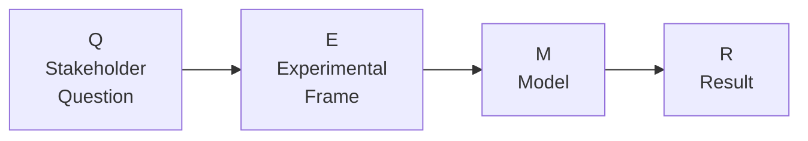
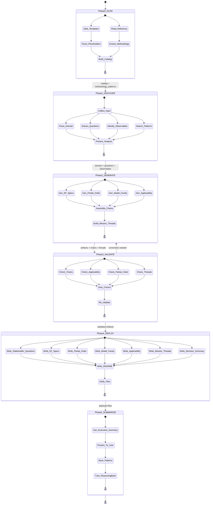
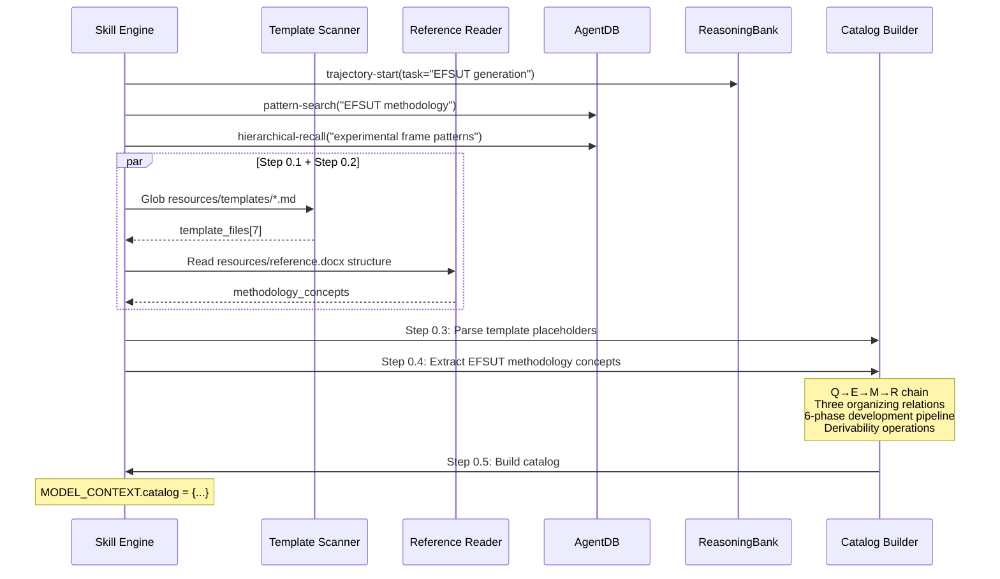
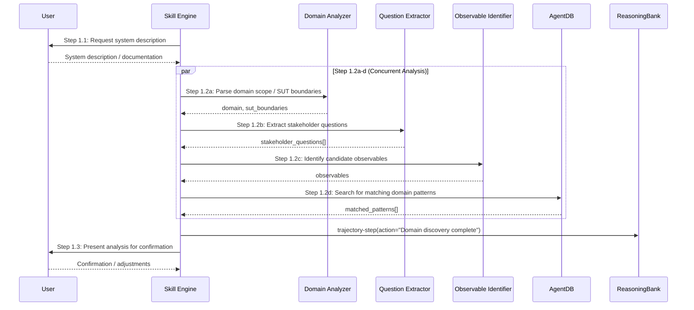
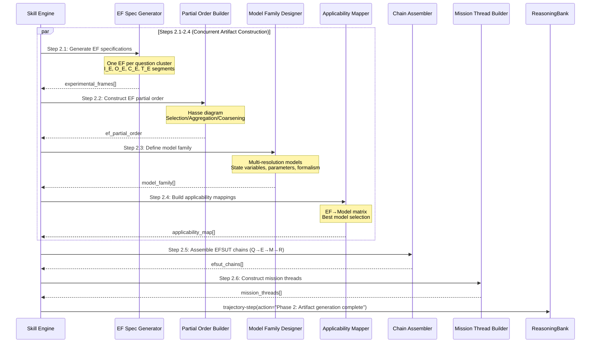
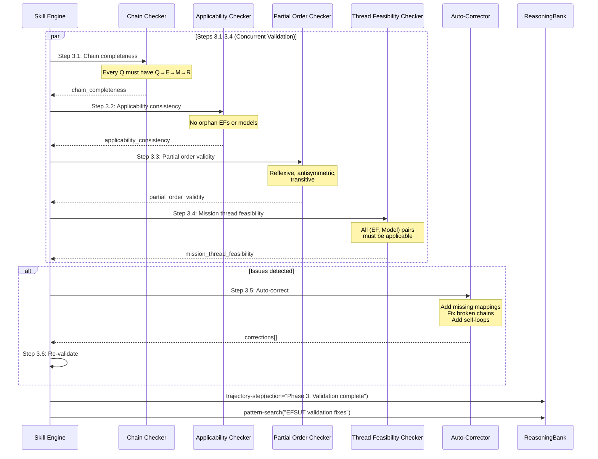
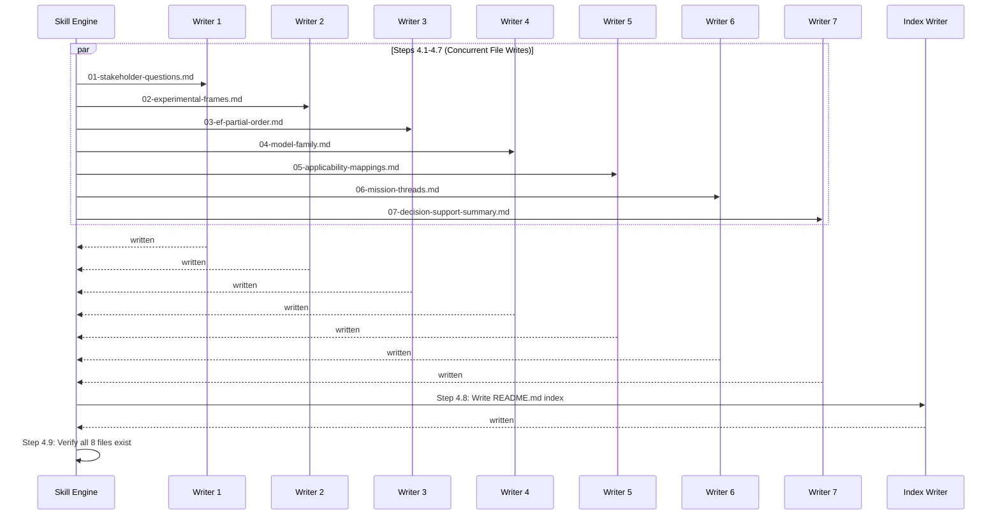
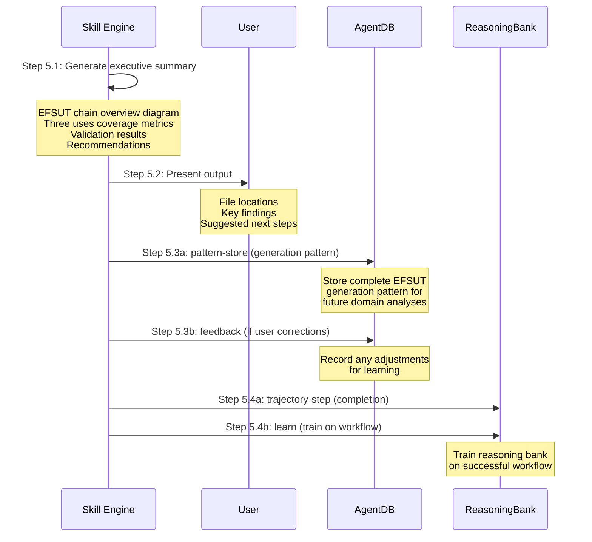

# Generate EFSUT

## What This Skill Does

Generates a complete set of EFSUT (Experimental Frame - System Under Test) methodology documentation through a structured, concurrent workflow with semantic continuity across all phases. The skill:

1. **Ingests** user system descriptions and/or extensive system documentation
2. **Elicits** stakeholder questions and identifies observational requirements
3. **Constructs** formal Experimental Frame specifications with input/output segments
4. **Organizes** frames into a derivability partial order (Hasse lattice)
5. **Defines** a multi-resolution model family with morphism relations
6. **Maps** applicability relations between frames and models
7. **Assembles** mission threads as ordered (EF, Model) decision chains
8. **Produces** 7 validated Markdown files covering Zeigler's three complementary uses of EFSUT:
   - **Use 1: Model Development** — structured construction of multiresolution model families
   - **Use 2: System Testing** — test-engineering framework for verifying implementations
   - **Use 3: Decision Support** — mission threads for transparent, auditable decision chains

### EFSUT Core Concepts

The methodology is grounded in the **EFSUT Chain**:



Three organizing relations structure the framework:
- **Derivability (≤):** Partial order over EFs via selection, aggregation, and coarsening
- **Applicability:** Which models can meaningfully answer questions posed by each EF
- **Morphism:** Structure-preserving mappings ensuring behavioral consistency across model resolutions

## Workflow Overview



## Model Context Object

All phases read from and write to a shared **Model Context** that maintains semantic consistency:

```
MODEL_CONTEXT = {
  // From Phase 0 (Reference Scan)
  catalog: {
    templates: [                 // 7 markdown scaffold templates
      { name: "stakeholder-questions", path: "resources/templates/stakeholder-questions.md",
        placeholders: ["domain_name", "questions", "category_counts", "linked_efs"] },
      { name: "experimental-frame", path: "resources/templates/experimental-frame.md",
        placeholders: ["domain_name", "experimental_frames", "decision_metrics"] },
      { name: "ef-partial-order", path: "resources/templates/ef-partial-order.md",
        placeholders: ["domain_name", "hasse_edges", "derivability_edges", "levels"] },
      { name: "model-family", path: "resources/templates/model-family.md",
        placeholders: ["domain_name", "models", "morphism_edges"] },
      { name: "applicability-mapping", path: "resources/templates/applicability-mapping.md",
        placeholders: ["domain_name", "applicability_mappings", "efsut_chains"] },
      { name: "mission-thread", path: "resources/templates/mission-thread.md",
        placeholders: ["domain_name", "mission_threads", "thread_interactions"] },
      { name: "decision-support-summary", path: "resources/templates/decision-support-summary.md",
        placeholders: ["domain_name", "executive_summary", "recommendations"] }
    ],
    methodology_patterns: {
      efsut_chain: "Q → E → M → R",
      three_uses: ["Model Development", "System Testing", "Decision Support"],
      organizing_relations: ["Derivability", "Applicability", "Morphism"],
      development_pipeline: [
        "Requirements Elicitation",
        "EF Partial Order Construction",
        "Model Family Definition",
        "EF→Model Applicability Mapping",
        "Mission-Thread Construction",
        "Decision Support Output"
      ],
      derivability_operations: ["Selection", "Aggregation", "Coarsening"]
    },
    reference: {
      path: "resources/reference.docx",
      title: "Three Complementary Uses of the EFSUT Methodology",
      author: "Bernard P. Zeigler"
    }
  },

  // From Phase 1 (Domain Discovery)
  domain: {
    name: "",                    // Domain identifier (e.g., "ecological-mite-dynamics")
    description: "",             // Full system description
    scope: "",                   // System boundary definition
    documentation_sources: []    // Paths to ingested documents
  },
  stakeholder_questions: [
    {
      id: "Q1",                  // Question identifier
      stakeholder: "",           // Who is asking (e.g., "Farmer", "Engineer")
      question: "",              // The question text
      category: "",              // Category (e.g., "Severity", "Intervention", "Performance")
      priority: "",              // Priority level (HIGH, MEDIUM, LOW)
      decision_context: "",      // What decision this question informs
      observables: []            // Required observables to answer this question
    }
  ],
  observables: {
    inputs: [],                  // Admissible input segments
    outputs: [],                 // Measurable output observables
    controls: [],                // Control conditions on SUT operation
    termination_conditions: []   // When to stop observation
  },
  sut_boundaries: {
    components: [],              // System components within boundary
    interfaces: [],              // External interfaces
    environment: ""              // Environmental assumptions
  },

  // From Phase 2 (Artifact Generation)
  experimental_frames: [
    {
      id: "EF1",                 // Frame identifier
      name: "",                  // Descriptive name
      questions_addressed: [],   // Question IDs this frame addresses
      input_segment: [           // I_E: admissible inputs
        { name: "", type: "", range: "", description: "" }
      ],
      output_segment: [          // O_E: measurable outputs
        { name: "", type: "", measurement: "", description: "" }
      ],
      control_conditions: [],    // C_E: constraints on SUT operation
      termination_conditions: [],// T_E: when to stop observation
      decision_metrics: [        // Mapping from outputs to decisions
        { name: "", derivation: "", interpretation: "" }
      ],
      resolution_level: ""       // Abstraction level (e.g., "Global", "Local", "Detailed")
    }
  ],
  ef_partial_order: {
    nodes: [],                   // EF IDs in the partial order
    edges: [                     // Derivability edges
      { from: "", to: "", operation: "", description: "" }
    ],
    lattice_diagram: "",         // Mermaid UML diagram string
    morphisms: []                // Cross-level morphism descriptions
  },
  model_family: [
    {
      id: "M1",                  // Model identifier
      name: "",                  // Descriptive name
      resolution: "",            // Resolution level
      boundary: "",              // What the model includes/excludes
      state_variables: [         // State variable definitions
        { name: "", type: "", domain: "", description: "" }
      ],
      parameters: [              // Tunable parameters
        { name: "", type: "", default: "", description: "" }
      ],
      fidelity: "",              // Fidelity level (e.g., "High", "Medium", "Low")
      formalism: ""              // DEVS formalism variant
    }
  ],
  applicability_map: [
    {
      ef_id: "",                 // Experimental Frame ID
      model_id: "",              // Model ID
      applicable: true,          // Is this model applicable to this frame?
      is_best: false,            // Is this the best (most abstract sufficient) model?
      justification: "",         // Why applicable or not
      morphism_type: ""          // Type of structure-preserving mapping
    }
  ],
  efsut_chains: [
    {
      question_id: "",           // Originating question
      ef_id: "",                 // Experimental frame used
      model_id: "",              // Model selected via applicability
      expected_result_type: ""   // What kind of result is produced
    }
  ],
  mission_threads: [
    {
      id: "MT1",                 // Thread identifier
      name: "",                  // Thread name
      purpose: "",               // What decision this thread supports
      steps: [                   // Ordered sequence of (EF, Model) pairs
        { step_num: 1, ef_id: "", model_id: "", purpose: "", result_description: "" }
      ],
      decision_output: "",       // Final decision/recommendation
      uncertainty_handling: ""   // How uncertainty is addressed
    }
  ],

  // From Phase 3 (Validation)
  validation: {
    passed: false,
    chain_completeness: {
      status: "",                // PASS/FAIL
      missing_chains: [],        // Questions without complete Q→E→M→R chains
      coverage_pct: 0            // Percentage of questions with complete chains
    },
    applicability_consistency: {
      status: "",
      orphan_efs: [],            // EFs with no applicable model
      orphan_models: []          // Models with no applicable EF
    },
    partial_order_validity: {
      status: "",
      reflexivity: "",           // PASS/FAIL
      antisymmetry: "",
      transitivity: "",
      missing_self_loops: [],    // EFs needing reflexive edges
      invalid_cycles: []         // Antisymmetry violations
    },
    mission_thread_feasibility: {
      status: "",
      infeasible_threads: [],    // Threads with broken steps
      broken_steps: []           // Steps where EF is not applicable to Model
    },
    corrections: []              // Auto-corrections applied
  },

  // From Phase 4 (Deployment)
  deployment: {
    deployed: false,
    output_dir: "",              // test/efsut/[domain-name]/
    files: [],                   // List of written file paths
    timestamp: ""
  },

  // From Phase 5 (Summary)
  summary: {
    executive_summary: "",
    chain_overview_diagram: "",  // Mermaid UML diagram string
    timestamp: ""
  }
}
```

## Prerequisites

- A system or domain to analyze (physical, computational, organizational, etc.)
- System description (brief text) OR extensive system documentation (PDFs, docs, specifications)
- Reference document: `resources/reference.docx` (Bernard P. Zeigler, "Three Complementary Uses of the EFSUT Methodology")

## Reference Library

This skill includes a reference library with methodology documentation and scaffold templates.

### Resource Paths (Relative to Skill Directory)

```
generate-ef-sut/
└── resources/
    ├── reference.docx           # Zeigler's EFSUT methodology paper
    └── templates/               # 7 markdown scaffold templates
        ├── stakeholder-questions.md    # Q catalog with traceability diagram
        ├── experimental-frame.md       # EF specs with I/O/C/T segments
        ├── ef-partial-order.md         # Derivability lattice (Hasse diagram)
        ├── model-family.md             # Multi-resolution model descriptions
        ├── applicability-mapping.md    # EF→Model mapping matrix
        ├── mission-thread.md           # Decision chain sequences
        └── decision-support-summary.md # Executive summary with three uses
```

### Template Structure

Each template uses Handlebars-style placeholders (`{{field_name}}`, `{{#each collection}}`) and includes pre-built Mermaid UML diagram blocks for:
- Traceability flowcharts (Question → EF linkage)
- UML class diagrams (EF hierarchy, model morphisms)
- Sequence diagrams (mission thread step-by-step execution)
- Pie charts (question category distribution)

---

## Phase 0: Reference Library Scan (Automatic)

**Purpose:** Catalog templates and extract methodology patterns from the reference document.

**Executes:** Automatically on skill invocation, BEFORE user interaction.

### Concurrent Execution



**Steps 0.1, 0.2 (CONCURRENT):**
```
// Execute these calls in a single message with parallel tool calls:
Glob: resources/templates/*.md          → template_files[]
Read: resources/reference.docx          → methodology_structure
```

**Step 0.3 (Sequential, depends on 0.1):**
For each template file, extract:
- Template name and purpose
- Placeholder fields (`{{field_name}}`)
- Mermaid diagram blocks and their required data
- Section headings and structure

**Step 0.4 (Sequential, depends on 0.2):**
From the reference document, extract:
- The EFSUT chain pattern (Q → E → M → R)
- Three complementary uses and their mapping to output artifacts
- Three organizing relations (Derivability, Applicability, Morphism)
- Derivability operations (Selection, Aggregation, Coarsening)
- The 6-phase EFSUT development pipeline
- Case study patterns (ecological, response-time, HelloWorld, processor-device)

**Step 0.5: Build Catalog → MODEL_CONTEXT.catalog**

See the `catalog` section of MODEL_CONTEXT above for the full schema.

**AgentDB Integration:**
```
// Search for prior EFSUT patterns before starting
mcp__claude-flow__agentdb_pattern-search(query="EFSUT experimental frame methodology", topK=5)
mcp__claude-flow__agentdb_hierarchical-recall(query="experimental frame system under test patterns")
```

**ReasoningBank Integration:**
```
// Begin trajectory for multi-step workflow
mcp__claude-flow__hooks_intelligence_trajectory-start(
  task="Generate EFSUT methodology documentation",
  agent="generate-ef-sut"
)
```

### Phase 0 → Phase 1 Handoff

```
HANDOFF_0_TO_1 = {
  catalog: MODEL_CONTEXT.catalog,
  prior_patterns: [...]           // From AgentDB search (may be empty)
}
```

---

## Phase 1: Domain Discovery (User Interaction)

**Purpose:** Collect system description or ingest documentation; identify stakeholder questions, observables, and SUT boundaries.

**Depends on:** `HANDOFF_0_TO_1`

### Concurrent Execution



**Step 1.1: Collect the user's system description.**
If the user has not already provided one in their message, ask using `AskUserQuestion`:
- "Describe the system or domain you want to analyze using the EFSUT methodology. You can provide a brief description (one paragraph) or point to documentation files. Include: what the system does, who the stakeholders are, and what decisions need to be supported."

If the user provides documentation file paths, ingest them by reading each file and extracting relevant system information.

**Steps 1.2a, 1.2b, 1.2c, 1.2d (CONCURRENT after 1.1):**

| Step | Input | Output | Method |
|------|-------|--------|--------|
| 1.2a | User description/docs | `domain`, `sut_boundaries` | Parse system components, interfaces, environment |
| 1.2b | User description/docs | `stakeholder_questions[]` | Extract who asks what, categorize, prioritize |
| 1.2c | User description/docs | `observables` | Identify inputs, outputs, controls, termination conditions |
| 1.2d | `catalog.methodology_patterns` | `matched_patterns[]` | Search AgentDB for similar domain analyses |

**Step 1.2a: Parse Domain Scope and SUT Boundaries**
Analyze the description to determine:
- System name and scope
- Components within the system boundary
- External interfaces (inputs from environment, outputs to stakeholders)
- Environmental assumptions and constraints

**Step 1.2b: Extract Stakeholder Questions**
Identify stakeholders and their questions. For each question, determine:
- **Stakeholder:** Who is asking (role, perspective)
- **Question:** What they need to know
- **Category:** Classification (e.g., Performance, Safety, Intervention, Cost, Risk)
- **Priority:** How critical this question is to the decision context
- **Decision Context:** What decision this question informs
- **Observables:** What must be measured to answer this question

**Step 1.2c: Identify Candidate Observables**
Map the system's measurable quantities:
- **Inputs (I_E):** Admissible input segments the SUT can receive
- **Outputs (O_E):** Observable outputs the SUT produces
- **Controls (C_E):** Constraints on how the SUT operates during observation
- **Termination Conditions (T_E):** When observations end

**Step 1.2d: Search AgentDB for Matching Patterns**
```
mcp__claude-flow__agentdb_pattern-search(query="[domain-specific terms]", topK=5)
```

**Step 1.3: Present the complete analysis for user confirmation.**

Output all discovered elements in a clearly formatted block:

```
Based on your description, here is the EFSUT domain analysis:

Domain:            [inferred domain name and scope]
SUT Boundaries:    [components, interfaces, environment]

Stakeholder Questions:
  Q1 [Stakeholder]: [Question] (Category: X, Priority: HIGH)
  Q2 [Stakeholder]: [Question] (Category: Y, Priority: MEDIUM)
  ...

Observables:
  Inputs:           [list]
  Outputs:          [list]
  Controls:         [list]
  Termination:      [list]
```

Ask using `AskUserQuestion`:
"Does this analysis look correct, or would you like to adjust any elements (add/remove questions, change priorities, modify scope)?"

**Swarm Integration (for complex domains):**
```
// For domains with extensive documentation, use swarm for parallel analysis
mcp__claude-flow__swarm_init(topology="hierarchical", name="efsut-discovery")
mcp__claude-flow__agent_spawn(type="domain-analyzer", task="Parse SUT boundaries from documentation")
mcp__claude-flow__agent_spawn(type="question-extractor", task="Extract stakeholder questions from documentation")
```

**ReasoningBank Integration:**
```
mcp__claude-flow__hooks_intelligence_trajectory-step(
  trajectoryId="[active-trajectory]",
  action="Phase 1: Domain discovery complete",
  result="[question_count] questions, [component_count] components identified",
  quality=0.85
)
```

### Phase 1 → Phase 2 Handoff

```
HANDOFF_1_TO_2 = {
  catalog: MODEL_CONTEXT.catalog,
  domain: MODEL_CONTEXT.domain,
  stakeholder_questions: MODEL_CONTEXT.stakeholder_questions,
  observables: MODEL_CONTEXT.observables,
  sut_boundaries: MODEL_CONTEXT.sut_boundaries,
  matched_patterns: [...]
}
```

---

## Phase 2: EFSUT Artifact Generation

**Purpose:** Build all core EFSUT artifacts: EF specifications, partial order, model family, applicability mappings, EFSUT chains, and mission threads.

**Depends on:** Full MODEL_CONTEXT from Phases 0 and 1. This is the **heaviest phase** with the most concurrent work.

### Concurrent Execution



**Steps 2.1, 2.2, 2.3, 2.4 (CONCURRENT):**

| Step | Input | Output |
|------|-------|--------|
| 2.1 | `stakeholder_questions`, `observables` | `experimental_frames[]` |
| 2.2 | `experimental_frames[]` | `ef_partial_order` |
| 2.3 | `experimental_frames[]`, `sut_boundaries` | `model_family[]` |
| 2.4 | `experimental_frames[]`, `model_family[]` | `applicability_map[]` |

**Step 2.1: Generate Experimental Frame Specifications**

For each cluster of related stakeholder questions, construct a formal EF:

1. Group questions by observable overlap and resolution level
2. For each group, define:
   - **Input Segment (I_E):** Admissible inputs — what stimuli can be applied to the SUT
   - **Output Segment (O_E):** Measurable outputs — what can be observed
   - **Control Conditions (C_E):** Constraints on SUT operation during the experiment
   - **Termination Conditions (T_E):** When the experiment ends
   - **Decision Metrics:** Mappings from raw outputs to decision-oriented observables
3. Assign a resolution level (e.g., Global, Regional, Local, Detailed)

**Step 2.2: Construct EF Partial Order**

Build the derivability lattice over experimental frames:

1. For each pair of EFs, determine if one is derivable from the other via:
   - **Selection:** Extract a subset of variables or spatial cells
   - **Aggregation:** Combine or sum values across cells
   - **Coarsening:** Transform continuous values to discrete categories
2. Build the Hasse diagram (transitive reduction of the partial order)
3. Verify partial order properties (reflexivity, antisymmetry, transitivity)
4. Generate Mermaid `graph BT` diagram for the lattice

**Step 2.3: Define Model Family**

For each resolution level in the partial order, define a model:

1. Determine model boundary (what's inside vs. outside)
2. Define state variables and their domains
3. Specify tunable parameters
4. Classify formalism (e.g., DEVS Atomic, DEVS Coupled, Differential Equation, Stochastic)
5. Assess fidelity level relative to the real system
6. Identify morphism relations between models at different resolutions

**Step 2.4: Build Applicability Mappings**

For each (EF, Model) pair:

1. Determine if the model can answer the questions posed by the EF
2. Justify applicability (or lack thereof)
3. Identify the morphism type if applicable
4. Select the "best" model for each EF: the most abstract model that fully answers the frame's questions

**Step 2.5: Assemble EFSUT Chain Linkages (Sequential, depends on 2.1-2.4)**

For each stakeholder question, trace the complete chain:
- Q (question) → E (experimental frame) → M (best model via applicability) → R (expected result type)

Verify every question has at least one complete chain.

**Step 2.6: Construct Mission Threads (Sequential, depends on 2.5)**

Build ordered decision workflows:

1. Identify decision scenarios from stakeholder questions
2. For each scenario, construct a sequence of (EF, Model) steps
3. Each step selects a model via applicability, executes, evaluates, and informs the next EF
4. Define the final decision output and uncertainty handling approach

**Swarm Integration (for large domains):**
```
mcp__claude-flow__agent_spawn(type="ef-generator", task="Generate EF specs for question cluster [ids]")
mcp__claude-flow__task_orchestrate(
  tasks=["ef-specs", "partial-order", "model-family", "applicability"],
  strategy="parallel-then-sequential"
)
```

**ReasoningBank Integration:**
```
mcp__claude-flow__hooks_intelligence_trajectory-step(
  trajectoryId="[active-trajectory]",
  action="Phase 2: Artifact generation complete",
  result="[ef_count] EFs, [model_count] models, [chain_count] chains, [thread_count] threads",
  quality=0.9
)
```

### Phase 2 → Phase 3 Handoff

```
HANDOFF_2_TO_3 = {
  // All prior MODEL_CONTEXT +
  experimental_frames: MODEL_CONTEXT.experimental_frames,
  ef_partial_order: MODEL_CONTEXT.ef_partial_order,
  model_family: MODEL_CONTEXT.model_family,
  applicability_map: MODEL_CONTEXT.applicability_map,
  efsut_chains: MODEL_CONTEXT.efsut_chains,
  mission_threads: MODEL_CONTEXT.mission_threads
}
```

---

## Phase 3: Validation (Consistency and Completeness)

**Purpose:** Verify internal consistency of all EFSUT artifacts. Auto-correct detectable issues and re-validate.

**Depends on:** `HANDOFF_2_TO_3`

### Concurrent Execution



**Steps 3.1, 3.2, 3.3, 3.4 (CONCURRENT):**

| Step | Check | Pass Condition | Failure Action |
|------|-------|----------------|----------------|
| 3.1 | Chain Completeness | Every Q has at least one Q→E→M→R chain | Flag missing chains, suggest EF/Model additions |
| 3.2 | Applicability Consistency | No orphan EFs (every EF maps to ≥1 model); No orphan models (every model maps to ≥1 EF) | Flag orphans, suggest mappings |
| 3.3 | Partial Order Validity | Reflexive (self-loops), Antisymmetric (no mutual derivability unless equal), Transitive (closure holds) | Add missing self-loops, remove invalid cycles, add transitive edges |
| 3.4 | Mission Thread Feasibility | Every step (EF, Model) is an applicable pair; thread sequence is executable | Flag broken steps, suggest model substitutions |

**Step 3.5: Auto-Correction (Sequential, if issues detected)**

For each detected issue:
1. **Missing chain:** Create a minimal EF or add an applicability mapping
2. **Orphan EF:** Suggest the most abstract applicable model
3. **Orphan Model:** Identify questions the model could answer, create corresponding EF
4. **Missing self-loop:** Add reflexive edge to partial order
5. **Invalid cycle:** Remove the weaker derivability edge
6. **Broken thread step:** Substitute with the next-best applicable model

**Step 3.6: Re-validate (Sequential, after auto-correction)**

Run all four checks again on the corrected artifacts. If issues persist, report to user.

**ReasoningBank Integration:**
```
mcp__claude-flow__hooks_intelligence_trajectory-step(
  trajectoryId="[active-trajectory]",
  action="Phase 3: Validation complete",
  result="passed=[true/false], corrections=[count]",
  quality=0.95
)
mcp__claude-flow__hooks_intelligence_pattern-search(query="EFSUT validation corrections")
mcp__claude-flow__hooks_intelligence_pattern-store(
  pattern="EFSUT validation fix: [description]",
  confidence=0.9
)
```

### Phase 3 → Phase 4 Handoff

```
HANDOFF_3_TO_4 = {
  // All prior MODEL_CONTEXT +
  validation: MODEL_CONTEXT.validation,
  ready_for_deploy: MODEL_CONTEXT.validation.passed
}
```

If `ready_for_deploy` is false after auto-correction, present remaining issues to the user for manual resolution before proceeding.

---

## Phase 4: Deploy (Write Output Files)

**Purpose:** Write all validated EFSUT documentation to `test/efsut/[domain-name]/`.

**Depends on:** `HANDOFF_3_TO_4` with `ready_for_deploy = true`

### Concurrent Execution



**Steps 4.1-4.7 (CONCURRENT):**

Write 7 markdown files to `test/efsut/[domain-name]/`, populating each template with data from MODEL_CONTEXT:

| Step | File | Template Source | Data Source |
|------|------|----------------|-------------|
| 4.1 | `01-stakeholder-questions.md` | `templates/stakeholder-questions.md` | `stakeholder_questions`, `observables` |
| 4.2 | `02-experimental-frames.md` | `templates/experimental-frame.md` | `experimental_frames` |
| 4.3 | `03-ef-partial-order.md` | `templates/ef-partial-order.md` | `ef_partial_order` |
| 4.4 | `04-model-family.md` | `templates/model-family.md` | `model_family` |
| 4.5 | `05-applicability-mappings.md` | `templates/applicability-mapping.md` | `applicability_map`, `efsut_chains` |
| 4.6 | `06-mission-threads.md` | `templates/mission-thread.md` | `mission_threads` |
| 4.7 | `07-decision-support-summary.md` | `templates/decision-support-summary.md` | Full MODEL_CONTEXT summary |

**Step 4.8: Write README.md Index (Sequential, after 4.1-4.7)**

Generate an index file linking all artifacts:

```markdown
# EFSUT Analysis: [Domain Name]

Generated: [timestamp]

## Artifacts

| # | Document | Description |
|---|----------|-------------|
| 1 | [Stakeholder Questions](./01-stakeholder-questions.md) | [N] questions from [M] stakeholders |
| 2 | [Experimental Frames](./02-experimental-frames.md) | [N] formal EF specifications |
| 3 | [EF Partial Order](./03-ef-partial-order.md) | Derivability lattice with [N] edges |
| 4 | [Model Family](./04-model-family.md) | [N] models across [M] resolution levels |
| 5 | [Applicability Mappings](./05-applicability-mappings.md) | [N] EF→Model mappings |
| 6 | [Mission Threads](./06-mission-threads.md) | [N] decision threads |
| 7 | [Decision Support Summary](./07-decision-support-summary.md) | Executive summary |

## Methodology

Based on Bernard P. Zeigler's "Three Complementary Uses of the EFSUT Methodology."
```

**Step 4.9: Verify all files exist (Sequential, after 4.8)**
```
Glob: test/efsut/[domain-name]/*.md → verify 8 files present
```

### Phase 4 → Phase 5 Handoff

```
HANDOFF_4_TO_5 = {
  // All prior MODEL_CONTEXT +
  deployment: {
    deployed: true,
    output_dir: "test/efsut/[domain-name]/",
    files: ["README.md", "01-stakeholder-questions.md", ...],
    timestamp: "[ISO-8601]"
  }
}
```

---

## Phase 5: Summary and Learning

**Purpose:** Generate executive summary, present output to user, persist patterns for future sessions.

**Depends on:** `HANDOFF_4_TO_5`

### Execution



**Step 5.1: Generate Executive Summary**

Build the decision support summary including:
- EFSUT chain overview as a Mermaid flowchart showing all Q→E→M→R linkages
- Three uses coverage metrics (Model Development, System Testing, Decision Support)
- Validation results summary
- Recommendations for next steps (e.g., implement models, run simulations, extend analysis)

**Step 5.2: Present Output to User**

Display:
- Output directory path: `test/efsut/[domain-name]/`
- File count and descriptions
- Key metrics: questions, EFs, models, chains, threads
- Suggested next steps

**Step 5.3: Store Patterns (AgentDB)**
```
// Persist the generation pattern for future domain analyses
mcp__claude-flow__agentdb_pattern-store(
  pattern={
    type: "efsut-generation",
    domain: "[domain-name]",
    question_count: N,
    ef_count: N,
    model_count: N,
    chain_count: N,
    thread_count: N,
    resolution_levels: [...],
    categories: [...],
    success: true
  },
  confidence=0.9
)

// Record user corrections if any were made
mcp__claude-flow__agentdb_feedback(
  feedback="[description of corrections]",
  context="efsut-generation"
)
```

**Step 5.4: Train ReasoningBank**
```
// Log completion step
mcp__claude-flow__hooks_intelligence_trajectory-step(
  trajectoryId="[active-trajectory]",
  action="Phase 5: Generation complete",
  result="[file_count] files written to [output_dir]",
  quality=0.95
)

// Train on the successful workflow
mcp__claude-flow__hooks_intelligence_learn(
  trajectoryId="[active-trajectory]",
  verdict="success",
  reward=0.95
)
```

---

## Troubleshooting

### Common Issues

| Issue | Cause | Fix |
|-------|-------|-----|
| No stakeholder questions identified | Description too vague | Ask user for more detail about decisions to be supported |
| Orphan EFs after validation | Model family too narrow | Add models at missing resolution levels |
| Partial order not valid | Missing reflexive edges | Auto-add self-loops (Phase 3 auto-correction) |
| Mission thread infeasible | Broken applicability in sequence | Substitute with next-best applicable model |
| Empty derivability lattice | All EFs at same resolution | Check if EFs truly differ in abstraction level; may need splitting |
| Template placeholder not filled | Missing MODEL_CONTEXT field | Ensure Phase 2 populated all required fields before Phase 4 |

### Validation Recovery

If Phase 3 validation fails and auto-correction cannot resolve all issues:
1. Present remaining issues to user with specific suggestions
2. Allow user to adjust questions, EFs, or models
3. Re-run Phases 2-3 with adjustments
4. The workflow diagram includes a `Phase3 → Phase2` correction loop for this purpose

---

## Related Skills

- **[DEVS Builder](../devs-builder/SKILL.md)** — Generate runnable DEVS atomic and coupled models. Use after EFSUT analysis to implement models identified in the model family.
- **[PowerDEVS Builder Startup](../power-devs-builder-startup/SKILL.md)** — Generate PowerDEVS continuous/hybrid system models. Use for model family entries with differential equation or QSS formalisms.
