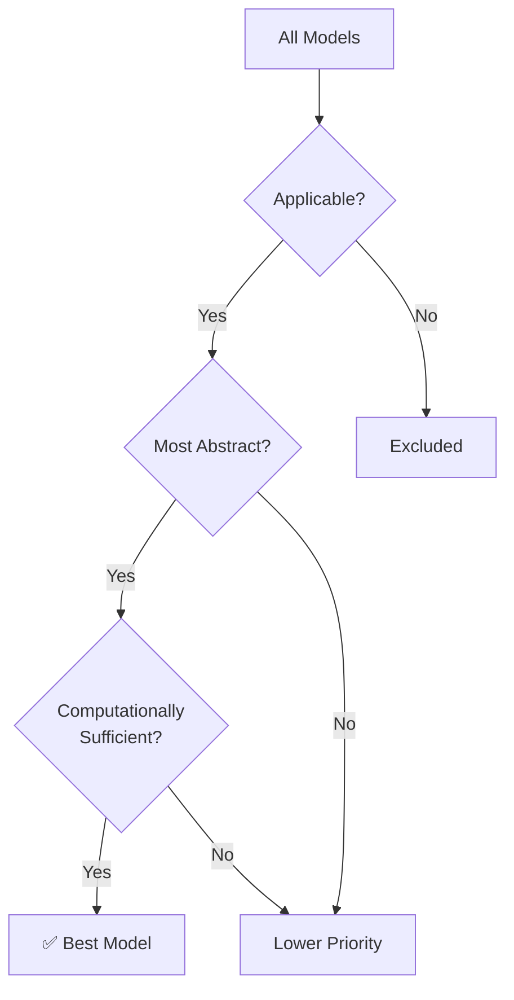

# Applicability Mappings — {{domain_name}}

> Generated by the Generate EFSUT skill

## Overview

This document defines the **applicability relation** between Experimental Frames and Models for **{{domain_name}}**. An EF is applicable to a model if the model can meaningfully answer the questions posed by the frame. The "best" model for each frame is the most abstract one that fully answers the frame's questions while being computationally minimal.

## Applicability Matrix

| EF \ Model | {{#each models}}{{model_id}} | {{/each}}
|------------|{{#each models}}--------|{{/each}}
{{#each experimental_frames}}
| **{{ef_id}}** | {{#each model_applicability}}{{status}} | {{/each}}
{{/each}}

**Legend:** ✅ = Applicable (Best), ⚪ = Applicable, ❌ = Not Applicable

## Detailed Mappings

{{#each applicability_mappings}}

### {{ef_id}} → {{model_id}}

| Field | Value |
|-------|-------|
| **Applicable** | {{applicable}} |
| **Best Model** | {{is_best}} |
| **Morphism Type** | {{morphism_type}} |

**Justification:** {{justification}}

---

{{/each}}

## EFSUT Chain Linkages (Q → E → M → R)

```mermaid
flowchart LR
    {{#each efsut_chains}}
    subgraph "Chain {{chain_id}}"
        Q{{chain_id}}["Q: {{question_text}}"]
        E{{chain_id}}["E: {{ef_id}}"]
        M{{chain_id}}["M: {{model_id}}"]
        R{{chain_id}}["R: {{result_type}}"]
        Q{{chain_id}} --> E{{chain_id}} --> M{{chain_id}} --> R{{chain_id}}
    end
    {{/each}}
```

## Best Model Selection

For each Experimental Frame, the best model is selected by:
1. Filtering to applicable models only
2. Ranking by abstraction level (most abstract first)
3. Verifying computational sufficiency (can the model produce required observables?)
4. Selecting the most abstract model that passes all checks



## Coverage Analysis

| Metric | Value |
|--------|-------|
| Total EFs | {{total_efs}} |
| Total Models | {{total_models}} |
| Total Mappings | {{total_mappings}} |
| Orphan EFs (no applicable model) | {{orphan_efs}} |
| Orphan Models (no applicable EF) | {{orphan_models}} |
| Coverage | {{coverage_pct}}% |
