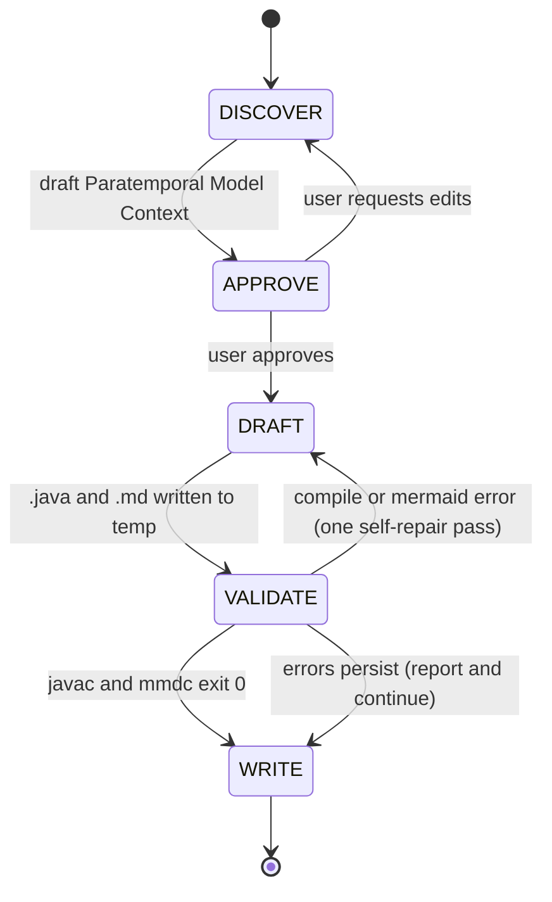

# paradevs-model-builder

## What This Skill Does

Takes a description and/or supporting artifacts (prompt text, Markdown/TXT files, PDFs in `docs/paradevs/`, or predefined Java source to convert) and produces a compilable Paratemporal DEVS tree-expansion module:

1. a **node class** `ParaDevsNodeFor{Domain} extends ParaDevsNode` carrying domain state and one or more `setBranch*()` methods; and
2. a **tree driver class** `TreeFor{Domain}` holding static `makeTreeToDepth` / `advanceLeafFront` / `equivalent` / `equivalentTo` (and, optionally, aggregation helpers and a `main()` harness).

Plus a Mermaid tree-and-call-graph diagram and a one-page README.

The skill replaces Monte Carlo simulation with breadth-first tree expansion: every stochastic choice is enumerated instead of sampled; equivalent states are merged so the tree stays polynomial instead of exponential. This is the core idiom from `docs/paradevs/` (Zeigler et al. 2024, Systems 2024, and the Evidence Appendix) and from the reference models at `~/DEVS/paradevs/Closure-DEVS-paradevs-plugin/test/Models/java/reference/`.

Two template families are supported and the user is **always asked** which fits:

- **Non-evidence** (default) — plain tree expansion over domain state. Matches Volume / AirBattle / RPO style.
- **Evidence-integrated** — wires the generic `com.ms4systems.devs.paradevs.quantized.*` package (`Quantizer`, `QuantizedOperatorTable`, `GDomainConverter`, `ThresholdClassifier`) for evidence-scored domains. Matches Safety style with `EvidenceAppendix.pdf` quantization.

The skill narrows scope to the node+driver pair. Wrapping the expander in a Closure-DEVS Atomic (à la `Severity_ParaDEVS` in the treeexpander reference) is out of scope — pair with `closure-devs-atomic` for that layer.

## Workflow Overview



## Stages

### Stage 1 — DISCOVER

**Inputs (any combination):**

- Plain-text description in the prompt.
- Markdown or plain-text files (e.g. output of `devs-model-outline`).
- PDF documents in `docs/paradevs/` (read via the `Read` tool) — especially the Evidence Appendix when the domain mentions evidence scoring.
- Predefined source code the user wants converted into a paratemporal builder. When this is the input, identify the Monte Carlo sampling site(s) in the legacy code — those are the branch points for the tree expander.

**Extract into a draft Paratemporal Model Context:**

- `domain` (CamelCase token for class naming — default `FooTree` / `ParaDevsNodeForFoo` when converting from a class `Foo`)
- `package` (if user specified, or inferable from an existing project layout)
- `state_fields[]` — for each field: `{ name, type, init }` (the fields that persist on a tree node)
- `branch_alphabet` — labels emitted per layer (e.g., "granule 0..9", "severity LOW/MED/HIGH", "phase DETECT/TRACK/...")
- `setBranch_signature(s)` — which fields mutate per branch, which are copied; whether multiple overloads are needed (phase-specific vs. single generic)
- `termination_predicate` — when a node becomes terminal (e.g., `partialSumSq > 1`, `phase == RESPONSE`, all cues observed)
- `max_depth_semantics` — fixed int, per-phase count, episode-indexed, or a predicate
- `main_harness` — whether to emit a runnable `main()` for standalone execution
- `prob_accumulation` — `product` (default; `pathProb = parent.pathProb * prob`, as in every reference model) or `log` (`logPathProb = parent.logPathProb + log(prob)`, merged with log-sum-exp). Flag an **underflow signal** when the expected depth times `-log(min branch prob)` approaches 700, when branch probabilities are rare-event scale (`<= 1e-6`) over many layers, or when legacy source already carries log-likelihoods. Surface the signal; the user chooses in Stage 2. See `resources/patterns/log-space-accumulation.md`.
- `evidence_signal` — whether the description mentions:
  - accumulating continuous `[0,1]` evidence via a binary operator (probabilistic sum, MAX, …);
  - threshold-based action labels (normal / caution / warning / critical);
  - compile-time tuning of fidelity / graininess `G`;
  - order-independent (multiset) accumulation.
  These cues feed the Stage-2 quantized-integration question. Do **not** decide yes/no here — surface them and ask.

Reference-model classification (see `resources/reference/reference-models-index.md`):

| Signal | Closest reference |
|--------|-------------------|
| Single continuous accumulator, fixed depth | Volume |
| Multi-field branching, multiple `setBranch` shapes | AirBattle / Engagement |
| Sequential phases, one per depth level | RPO |
| Evidence accumulator + thresholds + labels | Safety + `quantized/*` |

Pick the closest, note it in the context, and reuse its conventions at DRAFT time.

**Do NOT write any files in this stage.**

### Stage 2 — APPROVE

Present a compact "Paratemporal Model Context" summary:

```
Domain        : {domain}
Package       : {package or "(default)"}
Closest ref   : {Volume | Engagement | RPO | Safety}

Node class    : ParaDevsNodeFor{Domain}
Driver class  : TreeFor{Domain}

State fields  : {name : type = init}, ...
Branch alpha  : {labels}   (probs: {...})
setBranch     : {signature(s)}
Terminate     : {predicate}
Max depth     : {fixed int | phased | predicate | episode-indexed}
Main harness  : {yes | no}
Prob accum    : {product | log}   (underflow signal: {none | reason})
```

Then ask (using `AskUserQuestion`, single turn):

1. **Equivalence predicate** — one of:
   - **exact** (discrete state: enums, Strings, deep-equatable Maps)
   - **tolerance** (continuous accumulators; follow-up: which fields, which ε)
   - **histogram** (multiset of quantized levels — symmetry-merging; requires evidence integration)

2. **Quantized-evidence integration** (only when Stage 1 flagged the signal): *"This looks like a candidate for `com.ms4systems.devs.paradevs.quantized`. Wire it in (imports + `QuantizedOperatorTable.forProbabilisticSum(G)` + `ThresholdClassifier<String>` + histogram equivalence)?"* — **yes / no / no-but-cite-in-README**. When answered **yes**, also confirm `G`, the binary operator `U`, the threshold vector, and the action-label vector.

3. **Probability accumulation** — **product** (default) or **log-space**. Recommend `log` only when Stage 1 raised the underflow signal; otherwise recommend `product` and state why (shallow tree, moderate branch probabilities, line-for-line match with the references).

4. **Unresolved items** — surface any inferred values the user should confirm (e.g., guessed `EPS`, guessed max depth, inferred class names).

Wait for explicit approval (`yes` / `edit` / `cancel`). Only proceed to DRAFT after **explicit** approval.

### Stage 3 — DRAFT

**Pick the template family** based on Stage-2 answers:

- Non-evidence → `resources/templates/paradevs-node.java.tmpl` + `resources/templates/paradevs-tree-driver.java.tmpl`
- Evidence-integrated → `resources/templates/paradevs-node-evidence.java.tmpl` + `resources/templates/paradevs-tree-driver-evidence.java.tmpl`

**Splice in the equivalence predicate** from:

- `resources/templates/equivalent-exact.java.frag`
- `resources/templates/equivalent-tolerance.java.frag`
- `resources/templates/equivalent-histogram.java.frag`

**Apply the probability-accumulation mode.** The templates are written in `product` mode. When the approved context says `log`, apply every substitution in `resources/patterns/log-space-accumulation.md` (node field `logPathProb`, root init, `setBranch*` line, merge line, aggregation, `main` total) and splice `resources/templates/accumulate-log.java.frag` into the driver.

Fill all `{{PLACEHOLDER}}` tokens from the approved Model Context. Consult the pattern docs for idiom compliance:

- `resources/patterns/make-tree-to-depth.md`
- `resources/patterns/advance-leaf-front.md`
- `resources/patterns/set-branch-state-snapshot.md`
- `resources/patterns/equivalence-merging.md`
- `resources/patterns/termination-and-aggregation.md`
- `resources/patterns/log-space-accumulation.md` *(`prob_accumulation = log` only)*
- `resources/patterns/quantized-evidence-integration.md` *(evidence variant only)*
- `resources/patterns/episode-aware-expansion.md` *(if Stage 1 flagged episodes)*

Render the Mermaid diagram via `resources/output-templates/tree-diagram.md.tmpl` and the README via `resources/output-templates/README.md.tmpl`.

Write all artifacts to a **temp location** (e.g., `/tmp/paradevs-model-builder-{domain}/`) — not yet to the final output directory.

### Stage 4 — VALIDATE

Three checks, run in order; one self-repair pass allowed.

**4a. Java compile.**

```bash
export CLOSURE_DEVS_JAR=${CLOSURE_DEVS_JAR:-$HOME/.m2/repository/com/ms4systems/Closure-DEVS/1.0.0/Closure-DEVS-1.0.0.jar}
export PARADEVS_SRC=${PARADEVS_SRC:-$HOME/DEVS/paradevs/Closure-DEVS-paradevs-plugin/src}

javac -cp "$CLOSURE_DEVS_JAR:$PARADEVS_SRC" \
      /tmp/paradevs-model-builder-{domain}/{NodeClass}.java \
      /tmp/paradevs-model-builder-{domain}/{DriverClass}.java
```

If `PARADEVS_SRC` isn't available but a `PARADEVS_JAR` is set (a compiled plugin JAR), substitute it in the classpath. Both env vars may be overridden from the prompt.

**4b. Mermaid render.**

```bash
resources/scripts/validate-mermaid.sh \
    /tmp/paradevs-model-builder-{domain}/tree-diagram.md \
    /tmp/paradevs-model-builder-{domain}/README.md
```

The script extracts every ` ```mermaid ``` ` fenced block and pipes it through `mmdc` (via `npx --yes --package=@mermaid-js/mermaid-cli@latest`). Exit 0 iff every block renders. On failure the script prints the offending block and the parser error. See `resources/reference/mermaid-label-safety.md` for the ASCII / no-`;` / no-`:=` rules the templates already obey.

**4c. Self-repair.**

For compile or Mermaid failures: perform **exactly one** self-repair pass — fix the reported error and retry the corresponding check. If it still fails, continue to WRITE and surface the errors clearly. Do **not** run the `main()` harness here — this skill stops at compile + Mermaid-render validation. The user may run `main()` themselves after WRITE completes.

### Stage 5 — WRITE

Resolve the output directory using this policy (first match wins):

1. **User-specified path** in the prompt → always honored.
2. **Inside the `devs-skills-claude` project** (detected by walking up from cwd and matching the path prefix `/home/chris/DEVS/devs-skills-claude/`, or finding a `CLAUDE.md` that names the repo): `test/paradevs-model-builder/{domain}/`.
3. **Inside a Maven project** (`pom.xml` at or above cwd): `src/main/java/{package/path}/{domain}/` — with `.java`, tree diagram, and README co-located.
4. **Inside a Gradle project** (`build.gradle` or `build.gradle.kts`): same as Maven.
5. **Fallback** (no project markers): `./{domain}/` under cwd.

Show the resolved path to the user *before* writing. Move the four files from the temp location into the final directory, then report:

- Absolute paths of `{NodeClass}.java`, `{DriverClass}.java`, `tree-diagram.md`, `README.md`
- Compile status (`javac` exit code and any remaining diagnostics)
- Equivalence predicate chosen (exact / tolerance / histogram)
- Probability accumulation mode (product / log)
- Whether quantized-evidence integration was wired in
- One-line suggestion for next steps (e.g., "to wrap this expander in a Closure-DEVS Atomic, run `closure-devs-atomic`").

## Prerequisites

- `javac` on PATH (OpenJDK or Oracle JDK 8+).
- The Closure-DEVS JAR available at `~/.m2/repository/com/ms4systems/Closure-DEVS/1.0.0/Closure-DEVS-1.0.0.jar`, OR an alternate path passed in the prompt, OR the `CLOSURE_DEVS_JAR` env var.
- The paradevs plugin source available at `~/DEVS/paradevs/Closure-DEVS-paradevs-plugin/src`, OR an alternate path passed in the prompt, OR the `PARADEVS_SRC` / `PARADEVS_JAR` env var. Required because generated code imports `com.ms4systems.devs.paradevs.*` and (optionally) `com.ms4systems.devs.paradevs.quantized.*`.
- `node` and `npx` on PATH (Node.js 18+). The VALIDATE stage invokes `mmdc` via `npx --yes --package=@mermaid-js/mermaid-cli@latest`, which auto-installs on first use. No global install required.

## Reference Library

| Path under `resources/` | Purpose |
|---|---|
| `templates/paradevs-node.java.tmpl` | Non-evidence node skeleton — extends `ParaDevsNode`, domain state fields, `setBranch*` method |
| `templates/paradevs-tree-driver.java.tmpl` | Non-evidence driver skeleton — `makeTreeToDepth`, `advanceLeafFront`, `equivalent`, optional `main()` |
| `templates/paradevs-node-evidence.java.tmpl` | Evidence-integrated node — carries `evidenceLevel`, optional `histogram[]`, `setBranchEvidence` using `QuantizedOperatorTable.lookup` |
| `templates/paradevs-tree-driver-evidence.java.tmpl` | Evidence-integrated driver — static `G`, `T`, `THRESHOLDS`, `ACTION_LABELS`, `ThresholdClassifier`, `actionPMF` |
| `templates/equivalent-exact.java.frag` | Equivalence predicate: exact state match |
| `templates/equivalent-tolerance.java.frag` | Equivalence predicate: tolerance on continuous field(s) |
| `templates/equivalent-histogram.java.frag` | Equivalence predicate: multiset (symmetry-merging) |
| `templates/accumulate-log.java.frag` | Driver helpers for log-space accumulation: `LOG_ZERO`, `logAdd`, `logSumPathProb` |
| `patterns/make-tree-to-depth.md` | Outer BFS loop idiom with reference citations |
| `patterns/advance-leaf-front.md` | Inner frontier-replacement idiom, merge-vs-admit rules |
| `patterns/set-branch-state-snapshot.md` | Copy-and-delta state snapshot, `pathProb` accumulation |
| `patterns/equivalence-merging.md` | Three predicate flavors + `equivalentTo` scan helper |
| `patterns/termination-and-aggregation.md` | Terminal moves, scalar aggregates, grouping helpers |
| `patterns/log-space-accumulation.md` | Opt-in `logPathProb` / log-sum-exp substitutions for deep or rare-event trees |
| `patterns/quantized-evidence-integration.md` | Wiring `Quantizer` / `QuantizedOperatorTable` / `GDomainConverter` / `ThresholdClassifier` into node+driver |
| `patterns/episode-aware-expansion.md` | Full-BFS vs single-layer expansion for adaptive / replanning models |
| `reference/paradevs-api-cheatsheet.md` | `ParaDevsNode` + `ParaDevsTree` public fields and methods |
| `reference/quantized-package-cheatsheet.md` | `Quantizer` / `QuantizedOperatorTable` / `GDomainConverter` / `ThresholdClassifier` public API |
| `reference/reference-models-index.md` | Volume / AirBattle / RPO / Safety summary with file:line index |
| `reference/mermaid-label-safety.md` | Portability rules for Mermaid labels (ASCII, no `;`, no `:=`) |
| `output-templates/tree-diagram.md.tmpl` | Mermaid tree-expansion + call-graph scaffold |
| `output-templates/README.md.tmpl` | Output-side README scaffold |
| `scripts/validate-mermaid.sh` | Extracts every ` ```mermaid ``` ` block and validates via `mmdc`; used by Stage 4b |
| `examples/volume-skeleton/` | Compile-ready Volume-style Node+Driver (tolerance equivalence, no evidence) |
| `examples/safety-skeleton/` | Compile-ready Safety-style Node+Driver (histogram equivalence, quantized evidence) |

## Portability note

The skill runs end-to-end with stock Claude Code tools (`Read`, `Write`, `Bash`, and the `AskUserQuestion` interactive prompt) plus a local `javac` and `npx` (for `mmdc`-based Mermaid validation; auto-installs on first use). It does **not** depend on AgentDB, `mcp__claude-flow__*` tools, or any swarm coordination. If your environment has those configured, they can be layered on externally (e.g., for pattern persistence) — but they are not part of the documented workflow.

The generated code imports `com.ms4systems.devs.paradevs.*` and (optionally) the `.quantized.*` sub-package. These live in the `Closure-DEVS-paradevs-plugin` source tree, not in a Maven-published JAR. The Stage 4 validator compiles against the source directory directly (`$PARADEVS_SRC`) or a packaged JAR (`$PARADEVS_JAR`) — honor whichever the user has set.

## Related skills

- `closure-devs-atomic` — wrap a paratemporal tree builder in a Closure-DEVS `Atomic` (see `Severity_ParaDEVS.java` in the treeexpander reference). **Pair with `paradevs-model-builder`** to take a generated tree expander and add the DEVS simulation layer on top.
- `closure-devs-coupled` — compose multiple atomic models into a coupled system. Useful when a paratemporal expander is one of several components in a larger DEVS system.
- `devs-model-outline` — produces formal DEVS outline documentation. Its Markdown output is a natural input to this skill's DISCOVER stage for the base DEVS scaffolding.
- `devs-builder` — fuller workflow for Closure-DEVS + MS4ME. Use this when the target is a deployed DEVS system rather than just a paratemporal tree builder.
