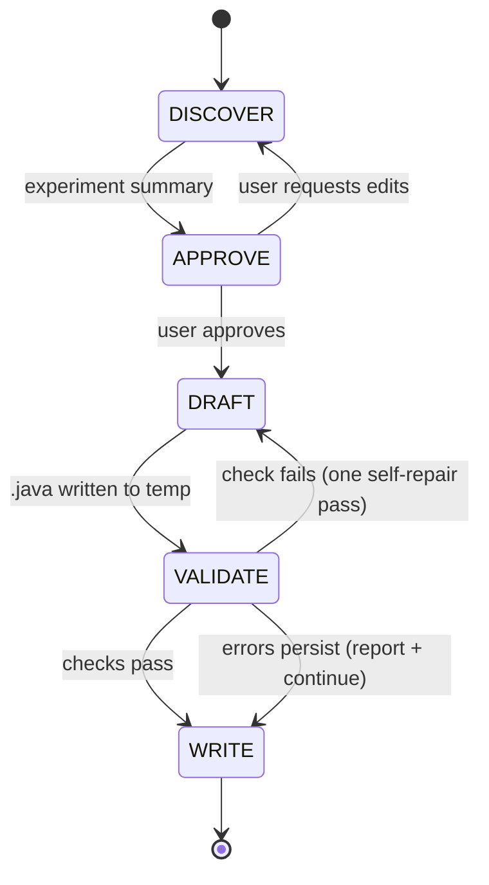

# run-control-writer

## What This Skill Does

Takes an existing DEVS model family (an `.ses`/`.pes` pair, the atomic models behind it, and a description of the experiment) and produces **one run control class per experiment**, filled from `resources/templates/run-control.java.tmpl`. The class follows the four-part shape the MS4 Me documentation prescribes:

| Part | Method | Job |
|---|---|---|
| 1 | static fields | Experiment variables that `main()` changes between runs |
| 2 | `defineModel()` | Read SES/PES text, edit `select ... from ...` and `[N]` multiplicity lines, prune to a coupled model |
| 3 | `setParams()` | `setValue(model, var, value, T.class)` for one model, `setValuesForAll(namePart, ...)` for a group |
| 4 | `getAndAnalyzeResults()` | `getValue(model, var)` cast to type, `fileHandler.appendToFile(resultsFile, csvRow)` |
| 5 | `main()` | `setResultsFile`, clear it with `writeToFile`, loop over the sweep calling `execute()` |

Two API flavors exist and the skill always picks one explicitly:

| | `ms4me` | `closure` |
|---|---|---|
| Coupled cast in `defineModel()` | `CoupledModelImpl` | `Coupled` |
| Run | `sm.execute()`; `sm.executeWView()` opens the SimViewer | `sm.execute(numIterations)`; no viewer |
| Stop | models passivate, or `setMaxSimulationTime` | the iteration count |
| Compile check here | needs MS4 Me jars (`MS4ME_CLASSPATH`) | `~/.m2/.../Closure-DEVS-1.0.0.jar` |

Source: "Conducting Experiments on RandomForest Model with Run Control Experimental Framework" (MS4 Me, July 2022) and `SimulateModel.java` in the Closure-DEVS source. The skill writes text; it does not run a simulation.

## Workflow Overview



## Run Context

All stages read from and write to one shared Run Context; its fields are the template's placeholders.

```
RUN_CONTEXT = {
  class_name: "",                 // Run{System}; Java class name
  package: null,                  // "Models.java" in an MS4 Me project, else null
  flavor: "ms4me",                // "ms4me" | "closure"  (see table above)
  system_name: "", experiment_purpose: "",

  ses_file: "", pes_file: "",     // must already exist under src/Models/ses and src/Models/pes
  experiment_vars: [ { name: "", type: "", value: null, comment: "" } ],      // static fields

  selections:     [ { entity: "", spec: "", current: "", choice_expr: "" } ], // PES: select {current} from {spec} for {entity}!
  multiplicities: [ { entity: "", current: "", count_expr: "" } ],            // PES: set multiplicity of i as [{current}] for {entity}!

  single_params:  [ { model: "", var: "", value_expr: "", type: "" } ],       // setValue
  group_params:   [ { name_part: "", var: "", value_expr: "", type: "" } ],   // setValuesForAll
  outputs:        [ { model: "", var: "", type: "", local: "" } ],            // getValue + cast

  results_file: "", csv_header: "", csv_row_expr: "",
  sweep: null,                    // { var: "", from: 0, to: 10 } -> for-loop in main(); null = one run
  num_iterations: null,           // closure flavor only: execute(n)
  max_sim_time: null,             // optional setMaxSimulationTime

  output_plan: { file: "", resolved_output_dir: null }
}
```

`choice_expr`, `count_expr`, `value_expr` and `csv_row_expr` are Java expressions (`"mode"`, `numTrees`, `"time, " + t + ", acc, " + acc`), everything else is literal text.

## Prerequisites

- An existing model family: `.ses` + `.pes` (from `ses-designer`) and its atomics (`.dnl` from `dnl-writer`, or Java). The run control can only select or replicate what the SES already declares.
- Optional: `javac` and the Closure-DEVS jar (`$CLOSURE_DEVS_JAR`, default `~/.m2/repository/com/ms4systems/Closure-DEVS/1.0.0/Closure-DEVS-1.0.0.jar`) for the `closure` compile check; MS4 Me plugin jars on `$MS4ME_CLASSPATH` for the `ms4me` one.
- No MS4 Me install required to write the file.

## Reference Library

| Path under `resources/` | Purpose |
|---|---|
| `templates/run-control.java.tmpl` | The template DRAFT fills; one placeholder per Run Context field |
| `reference/simulate-model-api.md` | `SimulateModel`, `InternalUseSeS`, `fileHandler` API; PES line shapes; model naming; flavor differences |
| `patterns/experiment-loops.md` | Parameter sweep, selection sweep, multiplicity sweep, timing, and the threaded outer loop with shared files |
| `examples/RunMultiGenRF.java` | The documentation's Random Forest run control (ms4me flavor), reconstructed from its code figures |
| `examples/CallRFModel.java` | The documentation's outer-level run control that co-simulates with a Python process |
| `scripts/check-run-control.sh` | Structural checks; `--project DIR` cross-checks the SES/PES; `--compile` runs javac |

## Stage 1 — DISCOVER

**Inputs (any combination):** prompt text; the `.ses` and `.pes`; the `.dnl` or `.java` atomics; a `devs-model-outline` or `ef-builder` document; a prior run control to revise (parse it into the Run Context; keep its analysis code verbatim unless asked).

**Infer first, ask second.** Fill every Run Context field you can derive:

1. **Flavor and location.** An MS4 Me project (`src/Models/{ses,pes,dnl,java,txt}`) means `ms4me` and package `Models.java`. A Maven project with the Closure-DEVS jar means `closure`. Otherwise ask.
2. **Model family.** `ses_file` / `pes_file` from the project; `class_name` = `Run` + the SES root entity.
3. **Selections and multiplicities.** Read the PES: every `select X from S for E!` is a candidate selection with `current = X`; every `set multiplicity of i as [N] for E!` a candidate multiplicity with `current = N`. Offer the alternatives the SES declares for `S`. Include only the ones the experiment varies.
4. **Parameters.** DNL `use V with type T` lines are settable variables (the generated Java has `setV`); Java atomics need a public `setV(T)`. Model names: `Entity`, or `Choice_Entity` for a chosen specialization; multi-aspect instances share a name part, so use `group_params`.
5. **Outputs.** The transducer's or collector's getters (`getV()`); each becomes an `outputs` entry with a cast type.
6. **Experiment.** What varies (`sweep` over an `experiment_vars` entry, or a list of selections), how many runs, the results file name and CSV columns, and how a run ends (`ms4me`: passivation or `max_sim_time`; `closure`: `num_iterations`).

Then ask only for what is missing, in one `AskUserQuestion` call where possible. **Do NOT write any files in this stage.**

## Stage 2 — APPROVE

Present the summary below and wait for `yes` / `edit` / `cancel`.

```
Run control: {class_name}.java ({flavor}) — {experiment_purpose}
Model family: {ses_file} / {pes_file}

Experiment variables:
  {type} {name} = {value}        // {comment}
PES edits per run:
  select {current} -> {choice_expr} from {spec} for {entity}
  multiplicity [{current}] -> [{count_expr}] for {entity}
Parameters:
  {model}.{var} = {value_expr} ({type})
  all *{name_part}*.{var} = {value_expr} ({type})
Outputs -> {results_file} ({csv_header}):
  {local} = ({type}) {model}.{var}
Runs: {sweep.var} from {from} to {to} | one run; ends by {passivation | max_sim_time | num_iterations}

Output: {resolved_output_dir}/{class_name}.java
Proceed? [yes / edit / cancel]
```

Only proceed to DRAFT after explicit approval. On `edit`, loop back to DISCOVER and keep the unaffected fields.

## Stage 3 — DRAFT

Write `/tmp/run-control-writer-{class_name}/{class_name}.java` by filling `templates/run-control.java.tmpl`. Rules:

- Keep exactly one branch of each `{{#if ms4me}}` block; delete the `/* OPTIONAL */` blocks that are not used; delete the template header comment.
- PES edits use `String.replace` (literal), never `replaceAll` (regex: `[3]` is a character class). The literal must occur in the PES verbatim, including the entity name.
- Every `setValue` type is the setter's exact parameter class: `int.class`, `double.class`, `String.class`, `int[].class`.
- Every `getValue` result is cast before use; `ArrayList<Double>` for list-valued variables.
- `main()` calls `setResultsFile` (which prefixes `src/Models/txt/`) and `writeToFile` with the CSV header *before* the first `execute`, otherwise rows append to last session's file.
- The sweep assigns the static variable, then calls `execute()`; each call regenerates the model through `defineModel()`.
- When the experiment needs more than one sweep shape, take it from `patterns/experiment-loops.md` rather than inventing a structure.

## Stage 4 — VALIDATE

```bash
resources/scripts/check-run-control.sh --flavor {flavor} [--project {project_root}] [--compile] \
    /tmp/run-control-writer-{class_name}/{class_name}.java
```

Exit 0 iff no errors. The script checks the class shape (extends `SimulateModel`; the four methods and `main` exist; `model =` assigned; results file cleared before `execute`), flavor consistency (`CoupledModelImpl` or no-arg `execute()` in a `closure` file is an error; `executeWView` or `setMaxSimulationTime` in a `closure` file is a warning), regex pitfalls (`replaceAll` with `[`), and with `--project` that the SES/PES files exist and every `.replace("...")` target occurs in the PES. `--compile` runs `javac` against the Closure-DEVS jar (`closure`) or `$MS4ME_CLASSPATH` (`ms4me`; skipped with a notice when unset).

Perform exactly one repair pass per failure class, then re-run. If it still fails, continue to WRITE and show the remaining diagnostics verbatim.

## Stage 5 — WRITE

Resolve the output directory (first match wins):

1. A path given by the user.
2. An MS4 Me project: `src/Models/java/` at or above cwd (or a sibling of `src/Models/ses/`). Package `Models.java`.
3. Inside `devs-skills-claude`: `test/run-control-writer/{class_name}/`.
4. A Maven or Gradle project (`pom.xml`, `build.gradle[.kts]` at or above cwd): `src/main/java/{package/path}/`.
5. Fallback: cwd.

Show the resolved path before writing. Never overwrite an existing run control without saying so; when revising, the user's file is the target. Then report: the absolute path, the check result (clean, or the remaining diagnostics), the compile result if run, and the one-line next step (run `main()` from the project; results land in `src/Models/txt/{results_file}`).

## Pitfalls

- **The SES/PES must already declare it.** A run control can switch a selection or change a multiplicity, not invent one. Add the alternative with `ses-designer` first.
- **`execute()` regenerates the model.** Static experiment variables are read fresh on every call; instance fields set in a previous run are gone.
- **`setResultsFile("x.txt")` prefixes `src/Models/txt/`.** Pass a bare file name. Clearing with `writeToFile(sm.resultsFile, "")` then appending gives a leading blank line; write the CSV header instead.
- **`appendToFile` rewrites the whole file** on every call (read, concatenate, write). Thousands of rows per run are fine; millions are not; buffer in a `StringBuilder` and append once per run.
- **Reflection needs accessors.** `setValue(m, "numTrees", v, int.class)` calls `m.setNumTrees(int)`; `getValue(m, "accuracy")` calls `m.getAccuracy()`. The first letter is upper-cased for you; the parameter class is not converted (`Integer.class` fails on an `int` setter). DNL-generated models have both accessors for every `use` variable.
- **When `setParams()` runs relative to `initialize()` differs by flavor.** The Closure-DEVS jar initializes the coordinator, then calls `setParams()`; a hold time computed in `initialize()` from a parameter uses the default, not your value. Give such parameters their default in the DNL or set them in both places.
- **`CoupledModelImpl` cast fails** → use `Coupled` (that is the `closure` flavor; the Closure-DEVS jar has no `CoupledModelImpl`).
- **`executeWView()` is for one debugging run.** It is slower and only exists in MS4 Me.
- **Outer loop delay.** When an outer run control (patterns, §5) re-launches the experiment on a thread, its sleep must exceed one run's wall time, or the next run regenerates the SES while the previous one is still simulating. Time one run with the `currentTimeMillis` wrapper first.

## Portability note

Runs with stock Claude Code tools (`Read`, `Write`, `Bash`, `AskUserQuestion`). `javac` and the Closure-DEVS jar are optional. No AgentDB, claude-flow or swarm dependencies.

## Related skills

- `ses-designer` — writes the SES/PES the run control prunes; add alternatives there.
- `dnl-writer` — the atomics whose `use` variables become `setValue` targets.
- `ef-builder` / `generate-ef-sut` — decide *what* to measure; this skill writes the driver that measures it.
- `closure-devs-coupled` — hand-written coupled models for a `closure` run control that does not prune an SES (`model = new MyCoupled("name")` in `defineModel()`).
- `devs-builder` — the end-to-end DEVS system workflow.
