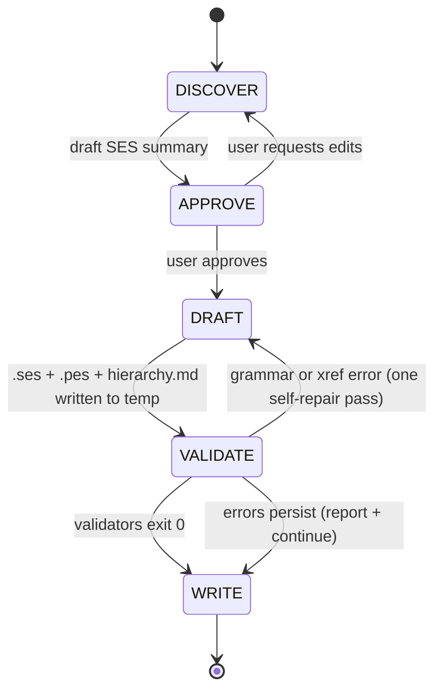

# ses-designer

## What This Skill Does

Takes a description and/or supporting artifacts (prompt text, Markdown/TXT files, PDFs, an informal hierarchy sketch, or a prior `.ses` the user wants revised) and produces:

- One `.ses` file — the full System Entity Structure in MS4 Me natural language.
- One or more `.pes` files — pruned configurations with multiplicity and specialization choices applied.
- A Mermaid hierarchy diagram (`{system_name}-hierarchy.md`) rendering the entity tree and the coupling graph.
- A one-page README summarising the design and pointing to downstream skills.

The skill is a design-artifact generator. It does not run MS4 Me, compile DEVS code, or simulate — it writes the text input that MS4 Me (or `devs-builder`) consumes next.

Hierarchical construction is the default. DISCOVER asks root-first and recurses; aspects, multi-aspects, specializations, and variables are all elicited. When a decomposition decision is ambiguous, the skill uses `AskUserQuestion` rather than guessing.

## Workflow Overview



## Model Context Object

All stages read from and write to a shared Model Context:

```
MODEL_CONTEXT = {
  system_name: "",                    // base filename (valid identifier, underscores)
  root_system: "",                    // name of the root entity in the SES
  package:     null,                  // optional, reserved for downstream tooling

  entities: [                         // every named entity in the SES
    { name: "", kind: "root|coupled|atomic",
      parent: "" | null, notes: "" }
  ],

  aspects: [                          // from the {label} perspective, {parent} is made of [children]
    { label: "", parent: "", children: ["", ""] }
  ],

  multi_aspects: [                    // from the {label} perspective, {parent} is made of more than one {unit}
    { label: "", parent: "", unit: "" }
  ],

  specializations: [                  // {entity} can be {opt1}, {opt2} or {optN} in {label}
    { entity: "", options: [""], label: "" }
  ],

  couplings: [                        // from the {aspect} perspective, [all|each] {sender} sends {msg} to [all|each] {receiver}[ as {recv}]
    { aspect: "", sender: "", message: "", receiver: "",
      as: null, sender_multi: false, receiver_multi: false,
      sender_qualifier: null,         // "all" | "each" | null
      receiver_qualifier: null }
  ],

  variables: [                        // {entity} has {var1}, {var2}
    { entity: "", vars: [""],
      ranges: [ { var: "", type: "number|integer|real|string",
                  lower: 0.0, upper: 0.0,
                  lower_inclusive: true, upper_inclusive: true,
                  enum_values: [] } ] }
  ],

  hierarchy_tree: {},                 // nested tree used by the Mermaid renderer

  pes_choices: {
    multiplicities:        [ { label: "", entity: "", N: 0 } ],
    specialization_picks:  [ { entity: "", label: "", option: "" } ],   // entity is a copy name (id1_Vehicle) when the specialized entity is a multi-aspect unit
    variants:              [ { variant_name: "", multiplicities: [], picks: [] } ]
  },

  output_plan: {
    ses_files:     [],
    pes_files:     [],
    mermaid_files: [],
    readme:        "README.md",
    resolved_output_dir: null
  }
}
```

## Prerequisites

- POSIX shell (`bash`, `awk`, `grep`, `sed`) — for the grammar validators.
- `node` and `npx` (Node.js 18+). The VALIDATE stage invokes `mmdc` via `npx --yes --package=@mermaid-js/mermaid-cli@latest`, which auto-installs on first use.
- No JDK required. No MS4 Me install required. The skill writes text artifacts only.

## Reference Library

| Path under `resources/` | Purpose |
|---|---|
| `reference/ses-grammar.md` | The six SES constructs — natural-language shape, regex, examples, page cites |
| `reference/pes-grammar.md` | PES directives — `set name`, `pruned from`, `restructure`, `set multiplicity`, `select ... from ... for`, `inherit from`, `write class files` (plus `mergeAll from` and `don't select`, which the validator accepts) |
| `reference/ses-axioms.md` | The six SES axioms (uniformity, strict hierarchy, alternating mode, valid brothers, attached variables, inheritance) and MS4 Me's coupling-scope rule |
| `reference/identifier-rules.md` | Valid-identifier regex, reserved keyword list, file-naming constraints |
| `reference/mermaid-label-safety.md` | ASCII-only, no `;`, no `:=`, shape encoding for the hierarchy diagram |
| `patterns/hierarchical-construction.md` | Root-first recursion heuristic — the DISCOVER playbook |
| `patterns/aspect-vs-specialization.md` | Decision rules for decomposition vs. variants vs. parameters |
| `patterns/multi-aspect-idioms.md` | Plain / tagged / labeled replication; `all` vs. `each` |
| `patterns/coupling-scope.md` | Parent/child + sibling scope; the multi-aspect exception |
| `patterns/variables-and-ranges.md` | Variables, inheritance through specializations, inclusive/exclusive ranges |
| `templates/ses-skeleton.ses.tmpl` | Handlebars SES body — aspects, multi-aspects, specs, couplings, variables |
| `templates/pes-skeleton.pes.tmpl` | Handlebars PES body — directive sequence |
| `templates/hierarchy.md.tmpl` | Mermaid `graph TD` + `graph LR` with shape encoding |
| `templates/README.md.tmpl` | One-page output README |
| `scripts/validate-ses.sh` | Per-line regex + reserved-keyword lint + cross-reference check + structural check (axioms, coupling scope) |
| `scripts/validate-pes.sh` | PES directive regex + ordering check + `inherit from` after its `select` |
| `scripts/validate-mermaid.sh` | Extract ` ```mermaid ``` ` blocks, render through `mmdc` |
| `examples/HelloWorld.{ses,pes}` | Worked example from MS4 Me User's Guide pp. 16–17 |
| `examples/SimpleWorkFlow.{ses,pes}` | Multi-aspect + specialization + coupling rename example, pp. 127–128 |
| `examples/SimpleWorkFlow-hierarchy.md` | Reference Mermaid rendering of the same |

## Stage 1 — DISCOVER

**Inputs (any combination):**

- Plain-text description in the prompt.
- Markdown or plain-text files (e.g. output of `devs-model-outline`).
- PDFs (read via the `Read` tool).
- An informal hierarchy sketch.
- A prior `.ses` the user wants revised — parse it with `validate-ses.sh`'s grammar to reconstruct the Model Context before editing.

**Root-first hierarchical prompting.** Use `AskUserQuestion` whenever the answer is not clearly derivable from the inputs. Ask in this order, per `patterns/hierarchical-construction.md`:

1. What is the root system (top-level entity)?
2. What are the 1–3 perspectives (aspects) that decompose the root?
3. Per aspect: what are the direct child entities?
4. Per child: decompose (another aspect), replicate (multi-aspect), specialize, or leaf atomic? — and recurse into the child if it decomposes.
5. Per multi-aspect unit: add a tagging specialization (`{UNIT} can be id in index!`). The guide makes copies only through a specialization on the unit (User's Guide p. 121), so warn the user before dropping it. Reuse the label `index` across multi-aspects (p. 126).
6. Per specialization target: what are the mutually exclusive options and the label?
7. Per entity pair under a shared aspect: what messages flow between them? Rename on receive?
8. Per entity: what variables does it carry? Ranges (numeric interval or enumeration)?

**Apply the SES axioms at prompt time** (`resources/reference/ses-axioms.md`). An entity may carry aspects *and* specializations, and several of each, so do not ask the user to choose one mode. Do keep sibling names distinct, keep variable names distinct per entity, and never re-introduce an ancestor below itself.

**Flag entities with more than one aspect.** Pruning must pick one of them (User's Guide p. 168), but the guide documents no `.pes` directive for that choice, so a generated PES cannot pin it and MS4 Me picks at random. If the choice must be fixed in the PES, suggest modeling the alternatives as a specialization whose options each carry one aspect.

**Do NOT write any files in this stage.** Populate the Model Context only.

## Stage 2 — APPROVE

Present the compact summary below, then wait for `yes` / `edit` / `cancel`. In the same turn, ask the three PES-choice questions:

> 1. For each multi-aspect, what multiplicity should the PES bake in?
> 2. For each specialization, which option does the PES select? Choices left out are made at random when the model runs (User's Guide pp. 122, 168). For a specialization on a multi-aspect unit, pick per copy (`id0_Vehicle`, `id1_Vehicle`, ...) or one option for every copy; the PES selects on copies, not on the unit (p. 122).
> 3. A single PES matching these choices, or multiple named PES variants?

**Summary format (filled from the Model Context):**

```
SES: {system_name}
Root: {root_system}

Entity tree (hierarchical, depth-indented):
  {root_system}
    [aspect: {aspect_1}]
      - {child_a}
      - {child_b}
        [aspect: {sub_aspect_1}]
          - {grandchild_x}
          - {grandchild_y}
      - {child_c}
    [aspect: {aspect_2}]
      - {child_d}
        [multi-aspect: {ma_label} -> more than one {unit}]
          - {unit} [specialization: {spec_label} -> {opt_1}, ...]

Aspects:
  - from {aspect_1} perspective: {root_system} -> {a}, {b}, {c}
  - from {sub_aspect_1} perspective: {child_b} -> {x}, {y}

Multi-aspects:
  - from {ma_label} perspective: {parent} are made of more than one {unit}

Specializations:
  - {entity} can be {opt_1}, {opt_2} or {opt_N} in {label}

Couplings:
  - from {aspect_x}: {sender} -> {receiver} : {msg}[ as {recv}]
  - from {aspect_x}: all {X} -> all {Y} : {msg}

Variables:
  - {entity} has {var_1}, {var_2}
    range of {var_1} is number with values [{min}, {max}]

PES choices:
  - multiplicity: {label} = N ({entity})
  - specialization pick: {entity} [{label}] -> {chosen_option}  (PES adds inherit from {chosen_option})
  - variants (if requested): {variant_name_1}, {variant_name_2}

Planned output artifacts:
  - {system_name}.ses
  - {system_name}.pes     (or {system_name}-{variant}.pes per variant)
  - {system_name}-hierarchy.md
  - README.md

Proceed? [yes / edit / cancel]
```

Only proceed to DRAFT after explicit user approval. If the user edits, loop back to DISCOVER and preserve unaffected Model Context fields.

## Stage 3 — DRAFT

Write all artifacts to a temp location (`/tmp/ses-designer-{system_name}/`) — not yet to the final output directory.

Fill these templates:

- `templates/ses-skeleton.ses.tmpl` → `{system_name}.ses`
- `templates/pes-skeleton.pes.tmpl` → `{system_name}.pes` (repeat per variant if requested)
- `templates/hierarchy.md.tmpl` → `{system_name}-hierarchy.md`
- `templates/README.md.tmpl` → `README.md`

Helpers the renderer must provide:

- `join_and` — `"A, B and C"` for 3+ children (no comma before `and`, User's Guide p. 174); `"A and B"` for exactly 2; `"A"` for 1.
- `join_or` — same shape, `or` as connector.
- `join_and_list` — identical to `join_and` but always `and`-terminated.
- `is_or_are` — returns `are` when the subject name is plural (ends in `s` and the entity kind is `coupled`), else `is`.
- `multi_prefix` — returns `"all "` / `"each "` / `""` based on the coupling qualifier.
- `range_expr` — emits `[lower, upper]` / `(lower, upper)` / mixed bracketing for numeric ranges, or `join_and_list enum_values` for enumerations.
- `restructure_labels` — the distinct labels in `pes_choices.multiplicities`, ordered bottom-up (deepest multi-aspect first) and joined with `" then "`. A single label when every multi-aspect shares one, as the guide recommends for `index` (p. 126).
- `first_of_option` — true for the first pick of each option in the PES, so `inherit from {OPT}!` is emitted once per distinct option.

**Specialization picks on multi-aspect units.** Restructuring replaces the unit with copies named `{option}{k}_{unit}`, with `k` counting from 0 (`id0_Vehicle`, p. 121). Write one `specialization_picks` entry per copy, with the copy name as `entity`.

## Stage 4 — VALIDATE

Validate every artifact. Three checks, run in order:

**4a. SES grammar + cross-reference check.**

```bash
resources/scripts/validate-ses.sh /tmp/ses-designer-{system_name}/{system_name}.ses
```

The validator runs four internal passes and exits non-zero on any error, with line numbers:

1. Lexical match.
2. Reserved-keyword lint.
3. Cross-reference resolution. Generated copy names such as `id0_Person` resolve to their unit.
4. Structural check: valid brothers, strict hierarchy, attached variables, `all`/`each` only on multi-aspect units, no plain self-coupling, and coupling scope with the multi-aspect exception.

**4b. PES grammar check (per PES file).**

```bash
resources/scripts/validate-pes.sh /tmp/ses-designer-{system_name}/{system_name}.pes
```

Checks directive ordering, that every `set multiplicity of LABEL ...` label appears in an earlier `restructure multiaspects using ...!` line, and that every `inherit from OPT!` follows a `select OPT from ... for ...!`. Rejects the label-less `select OPT for ENTITY!` form.

**4c. Mermaid render.**

```bash
resources/scripts/validate-mermaid.sh \
    /tmp/ses-designer-{system_name}/{system_name}-hierarchy.md \
    /tmp/ses-designer-{system_name}/README.md
```

Extracts each ` ```mermaid ``` ` block and pipes it through `mmdc`. Exit 0 iff every block rendered. See `resources/reference/mermaid-label-safety.md` for the portability rules the template follows.

**4d. Self-repair.**

For any failure class, perform **exactly one** self-repair pass — fix the reported error in the offending artifact and retry the corresponding check. If it still fails, continue to WRITE but surface the errors clearly in the user-facing summary.

## Stage 5 — WRITE

Resolve the output directory using this policy (first match wins):

1. **User-specified path** in the prompt → always honored.
2. **MS4 Me project detected** — any of: a `/ses/` directory at or above cwd; a `.project` file referencing `com.ms4systems.devs.*`; an `ms4me/` marker directory. Output to `{project_root}/ses/`.
3. **Inside the `devs-skills-claude` project** (detected by walking up from cwd and matching the path prefix `/home/chris/DEVS/devs-skills-claude/`, or finding a `CLAUDE.md` that names the repo): `test/ses-designer/{system_name}/`.
4. **Inside a Maven project** (`pom.xml` at or above cwd): `src/main/ses/{system_name}/`.
5. **Inside a Gradle project** (`build.gradle` or `build.gradle.kts`): same as Maven.
6. **Fallback** (no project markers): `./{system_name}/` under cwd.

Show the resolved path to the user *before* writing. Move the files from the temp location into the final directory, then report:

- Absolute paths of every written file.
- Validator results (ses / pes / mermaid — pass or remaining diagnostics).
- PES choices that were baked in (multiplicities, specialization picks).
- One-line next-step suggestion ("feed this `.ses` into `devs-builder` to generate the coupled DEVS Java model").

## Portability note

The skill runs end-to-end with stock Claude Code tools (`Read`, `Write`, `Bash`, `AskUserQuestion`) plus POSIX shell and `npx` (for `mmdc`-based Mermaid validation; auto-installs on first use). It does **not** depend on AgentDB, `mcp__claude-flow__*` tools, swarm coordination, MS4 Me itself, or any JDK. If your environment has those configured, they can be layered on externally — but they are not part of the documented workflow.

## Related skills

- `devs-model-outline` — produces formal DEVS outline documentation. Its Markdown output is a natural input to this skill's DISCOVER stage.
- `devs-builder` — takes an SES/PES pair and generates a runnable coupled DEVS Java model. Natural downstream step from `ses-designer`.
- `closure-devs-atomic` — when the SES leaves atomic entities that still need behavior, use this skill to generate each atomic's Java source.
- `generate-ef-sut` — experimental-frame scaffolding useful for validating the designed SES against test scenarios.
