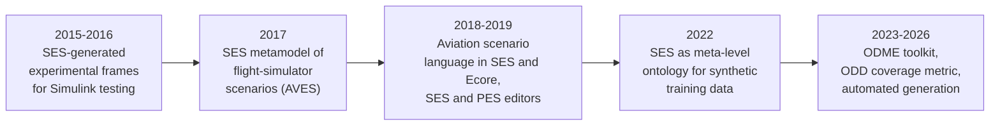

# SES/MB Applications and Zeigler's Recent Work

Where the System Entity Structure / Model Base (SES/MB) methodology has been applied, what it delivered, how it compares with neighboring approaches, and what Zeigler's own publications since 2013 say about the SES. The emphasis is 2010 onward, with earlier landmarks noted briefly. Many MDPI, HAL, and university-repository full texts were blocked during research, so several entries rest on abstracts only; those are marked. Current as of 2026-10-06.

Provenance tags: [Z] Zeigler or coauthors, read directly; [T] third-party literature; [G] MS4 Me User's Guide (page); [F] field observation from this repo's practice; [I] inference no source states.

## 1. Where the work clusters and how the SES is used

**Clusters.** Published SES applications since 2010 come from a handful of research organizations, not from industry at large [I]:

| Cluster | Typical work |
|---|---|
| University of Arizona / RTSync | Model suites, net-centric information exchange, UAV and healthcare systems of systems, MetaSES, IoT design |
| Hochschule Wismar with DLR and TU Clausthal | Extended SES/MB (eSES/MB) toolboxes, manufacturing and process-industry variants, aviation scenario engineering, ODME |
| Korean defense M&S groups | Armored-vehicle vulnerability, warship anti-missile federations, defense test-case bases |
| University of Corsica | DEVSimPy SES extensions, reinforcement learning in DEVS and SES, IoT/IoCT |
| The X-language group (Beihang University, an inferred affiliation) | SES-X, which combines SES/MB with the X language for MBSE |

Most domain papers outside these clusters are one-off uses (floating LNG plants, illicit supply chains, disaster volunteers, wafer-failure patterns) [I].

**Three uses, in falling order of frequency** [I]:

1. **Design or configuration space pruned into variants.** Manufacturing chains, LNG liquefaction cycles, wireless sensor networks, test scenarios.
2. **Ontology for information exchange.** C2 data fusion, healthcare ontologies, IoT risk models.
3. **Organizer of a model library or suite.** Climate and healthcare model suites, UAV multiresolution families.

## 2. Domain table

| Domain | Problem | SES role | Reported outcome | Citation |
|---|---|---|---|---|
| Defense test generation | Link-16 (MIL-STD-6016C) conformance testing | Test models written "in an XML-SES format", C++ DEVS generated from them | Separation of models, simulator, and distribution for reuse; no measured gain | [T] [Mak, Mittal, Hwang & Nutaro 2010, JDMS](https://doi.org/10.1177/1548512909358585) |
| C2 information exchange | Deliver what a commander asks for, when needed | SES as ontology; BML states the request; "novel pruning and transformation processes" fuse data | Air-defense scenario demonstrated in DEVS | [Z] [Lee & Zeigler 2010, JDMS 7(4):206–225](https://doi.org/10.1177/1548512910365063) |
| Network analysis | Distributed network-traffic analysis | SES over a DEVS/SOA service architecture | Feasibility demonstration | [Z] [Kim, Seo & Zeigler, SIMULATION 86(3):155–180](https://doi.org/10.1177/0037549709354112) |
| SoS on HLA/RTI | Classic SES/MB cannot synthesize federations | New SoSES/FB (federate base) with federation synthesis | Warship anti-missile defense demo | [T] [B.S. Kim, Choi & T.G. Kim 2013, SpringSim CNS](https://doi.org/10.5555/2499986.2499990) |
| Armored vehicles | Vulnerability by component and function | Hierarchical component representation | Vulnerability computed overall and by function | [T] [H.K. Kim, Hwang & J.S. Lee 2015, J. Korea Soc. Simulation 24(4)](https://doi.org/10.9709/jkss.2015.24.4.059) |
| UAV service SoS | Design by payload, energy, depot location | "a collection of partial models, each oriented to one or more objectives", built with DEVS and SES in MS4 Me | Multiresolution design method | [Z] [Zeigler & D. Kim 2019, SpringSim](https://doi.org/10.23919/springsim.2019.8732861) |
| Manufacturing optimization | Choose structure and parameters together | SES holds admissible structures; mapped to numeric structure parameters for an evolutionary algorithm in MATLAB/Simulink | Joint structure-parameter optimization | [T] [Hagendorf, Pawletta & Larek 2013, SIMULATION 89(9)](https://doi.org/10.1177/0037549713500066) |
| Energy-efficient process chains | Countershaft chains (heating, rolling, forging, turning) | Two alternative chains "structured in so-called system entity structures"; genetic algorithm searches them | Lowest energy and resource design found | [T] [Rentsch, Heinzel & Brinksmeier 2015, Procedia CIRP 33](https://doi.org/10.1016/j.procir.2015.06.026) |
| Process industry | Many plant variants | Hierarchically arranged multi-aspects; automated variant derivation | Method demonstrated | [T] [Folkerts, Pawletta & Durak 2023, SNE 33(1)](https://doi.org/10.11128/sne.33.tn.10633) |
| Floating LNG plants | Generate liquefaction-cycle alternatives | Relational SES built from C3MR and DMR rules, pruned to XML alternatives | Alternatives evaluated by process simulation and reliability analysis | [T] [Ha & Lee 2014, IJNAOE 6(3)](https://doi.org/10.2478/ijnaoe-2013-0200) |
| Semiconductors | Classify wafer-failure patterns | Per-pattern PES keeps only relevant entities "for better computational performance" | Feasibility | [T] [Han et al. 2010, IEICE Trans. Inf. Syst.](https://doi.org/10.1587/transinf.e93.d.2001) |
| Wireless sensor networks | Build large WSN models | WSN-SES/MB synthesizes DEVS structures; pruning "increases the diversity of simulation models" | **Up to 8% time and 23% cost savings** (§4) | [T] [Nam & H.J. Kim 2021, Sensors 21(2):430](https://doi.org/10.3390/s21020430) |
| IoT and IoCT | Organize models and alternative configurations | SES "organizing models and generating alternative system configurations" (abstract) | Case studies: home automation, solar monitoring, swarm robotics | [Z] [Capocchi, Zeigler & Santucci 2025, Computers 14(7):258](https://doi.org/10.3390/computers14070258) |
| IoT risk | Converged IT/OT risk evaluation | SES-based IoT-Inclusive-Systems model | MIRAI botnet case | [T] [Mittal et al. 2019, Wiley chapter](https://doi.org/10.1002/9781119552482.ch7) |
| Robotics | Task controls for cooperating robots | SES/MB specifies, generates, and executes controls | Demonstrated | [T] [Schwatinski, T. Pawletta & S. Pawletta 2012, SNE 22](https://doi.org/10.11128/sne.22.tn.10135) |
| Healthcare suites | Families of healthcare models | SES merging and multiple aspects build "suites of models"; hosted on the Model Store | Demonstrated | [Z] [Zeigler, Seo & D. Kim 2013, IJMSSC 4(3):1340006](https://doi.org/10.1142/S1793962313400060) |
| Healthcare ontology | Simulation ontology for health systems | Ontology "formally expressed using system entity structure language", mapped to OWL for Protégé and SPARQL | Cholera-outbreak case | [T] [Djitog & Kah 2020, IJPHIM](https://doi.org/10.4018/ijphim.2020010105) |
| Illicit supply chains | Recover counterfeit-PPE chain structure from sparse data | "We parameterize structural uncertainty using System Entity Structure" | Bayesian optimization and GAs suitable for calibration | [T] [van Schilt et al. 2024, AEI 62:102926](https://doi.org/10.1016/j.aei.2024.102926) |
| Reinforcement learning | Q-learning with temporal, hierarchical, multi-agent aspects | Implemented within DEVS and SES | Method | [T] [Capocchi & Santucci 2022, Information 13(3):121](https://doi.org/10.3390/info13030121) |
| Automotive MBSE | System analysis to simulation | SES-X: "two levels of model pruning for model verification and simulation efficiency" | Car-model case | [T] [Xie et al. 2023, Information 14(1):23](https://doi.org/10.3390/info14010023) |

Earlier landmarks: Rozenblit, Sevinc & Zeigler pruned a LAN design SES against network objectives ([WSC 1986, pp. 858–865](https://doi.org/10.1145/318242.318532)) [Z]; Zeigler & Hammonds (2007) recast the SES as an ontology for net-centric information exchange [Z]; Cheon, Kim & Zeigler composed DEVS models from an SES and generated XML metadata for US Climate Normals ([IRI 2008](https://doi.org/10.1109/iri.2008.4583078)) [Z].

**Gaps.** No public paper applies the SES to mission engineering in the DoD Mission Engineering Guide sense; the nearest are the UAV and ambulance SoS papers and Korean naval air-defense work. Energy appears only as an objective inside manufacturing optimization and one IoCT case; no power-grid SES study was found. Several entries rest on abstracts only (MDPI full texts were blocked).

## 3. Scenario-based testing: the most active line since 2015

A DLR / TU Clausthal / Embry-Riddle program carries the most sustained recent SES application work [T]. Its steps:

| Step | What the SES does | Citation |
|---|---|---|
| Model-based testing | Test models are experimental frames; executable EFs for a model under test are generated with SES | [T] [Schmidt, Durak & Pawletta 2016, SIMULATION 92(8):729–746](https://doi.org/10.1177/0037549716656791) |
| Flight-simulator scenarios | "Scenario development is usually conducted in an unstructured and ad hoc manner"; SES is "exploited for metamodeling in order to capture all possible elements of a scenario" | [T] [Durak et al. 2017, AIAA MST 2017-1076](https://doi.org/10.2514/6.2017-1076) |
| Aviation scenario language (ASDL) | Metamodeled in both SES and Ecore; "each metamodel can be easily converted into the other" | [Z] [Jafer, Chhaya, Zeigler & Durak 2018, IJAAA](https://doi.org/10.58940/2374-6793.1248) |
| Tools | SES Editor and PES Editor for scenario development | [T] [Karmokar et al. 2019, AIAA 2019-1712](https://doi.org/10.2514/6.2019-1712) |
| Synthetic data | SES drives operational scenarios that generate training data for an AI-based airborne system | [T] [Gupta, Durak, Ellis & Torens 2022, AIAA 2022-2103](https://doi.org/10.2514/6.2022-2103) |
| ODD-driven testing | SES for "variable structural modelling of the scenario's entities and environment", behavior trees for dynamic events; drone perception validated in Gazebo | [T] [Gupta & Durak 2023, AIAA 2023-2589](https://doi.org/10.2514/6.2023-2589) |
| ODME toolkit | "a successor to the SES tools": expert knowledge into an SES domain model, pruning to scenarios, a scenario manager labels and prioritizes, execution in MATLAB or Gazebo, assessment fed back | [T] [Naja, Gupta, Durak & Hartmann 2024, SNE 34(1):13–21](https://doi.org/10.11128/sne.34.tn.10672) |
| Coverage | Quantifiable scenario coverage against an ODD, implemented in ODME | [T] [Gupta, Sprockhoff & Durak 2025, AIAA 2025-2326](https://doi.org/10.2514/6.2025-2326) |
| Automated generation | Automates scenario generation to cut "the manual effort required to model scenarios to achieve high coverage levels" (abstract does not name SES; link is through ODME) | [T] [Gupta et al. 2026, AIAA 2026-0208](https://doi.org/10.2514/6.2026-0208) |

In this line the SES fills the "logical scenario" (parameter space) role that OpenSCENARIO-style standards leave open, pruning concretizes a scenario, and coverage of the pruning space against the ODD is the key metric [I]. No SES scenario-generation paper from a mainstream automotive OEM or supplier was found [I].

## 4. Quantified outcomes and head-to-head comparisons

**One hard number.** The only quantified benefit found is the WSN-SES/MB framework: "up to 8% time savings and up to 23% cost savings as compared to the manual extra effort" ([Nam & H.J. Kim 2021](https://doi.org/10.3390/s21020430)) [T]. Every other application shows feasibility on one example. No numbers on test-effort savings or fault-detection gains from SES scenario generation were found.

**Head-to-head comparisons** are qualitative and rest on one case each:

| Comparison | Findings | Citation |
|---|---|---|
| eSES/MB (SESToPy/SESMoPy) vs MATLAB/Simulink Variant Manager, on the power-window example | "with the Variant Manager interfaces of submodels are static, while the eSES/MB approach allows to define variable interfaces and couplings"; modeling effort does "not differ considerably"; Variant Manager is bottom-up, eSES/MB top-down; students found eSES/MB "a lot easier to get started with"; "a final comparison is not possible on the basis of just one example" | [T] [Deatcu, Pawletta & Folkerts 2019, SNE 29(1):39–43](https://doi.org/10.11128/sne.29.sw.10466) |
| OWL/EMF vs SES/XML for ASDL | Sample scenario from both "found to be identical"; SES/XML is framework-independent but "follows more rigid guidelines and restrictions", and "an understanding of SES is required to comprehend and edit these files" | [T] [Jafer, Chhaya, Updegrove & Durak 2018, JSimE vol. 1](https://doi.org/10.5281/zenodo.11114155) |
| SES vs Ecore | "they follow a similar structure in the hierarchical definition of modeled elements" | [Z] [Jafer, Chhaya, Zeigler & Durak 2018](https://doi.org/10.58940/2374-6793.1248) |

**Missing comparisons.** No published comparison of SES with feature models (FODA, cardinality-based, FeatureIDE, pure::variants), SysML v1 variant profiles or SysML v2 variability, or design-space-exploration tools (OpenMDAO, ModelCenter, DESERT) was found [T]. The Wismar group maps SES patterns onto feature-model relations, with aspects as AND and specializations as XOR, while optional and OR features need the NONE extension ([Folkerts et al. 2017, SNE 27(4)](https://doi.org/10.11128/sne.27.tn.10391)) [T]. Instead of separate DSE tools, practitioners couple the SES with optimizers: evolutionary algorithms (Hagendorf 2013), genetic algorithms (Rentsch 2015), Bayesian optimization and GAs (van Schilt 2024) [T].

## 5. Zeigler's recent work

Zeigler's own SES publications since 2013 fall into four phases [Z]:

| Phase | Work | What it says about the SES |
|---|---|---|
| 2013–2017: model suites | [Zeigler, Seo & D. Kim 2013](https://doi.org/10.1142/S1793962313400060); *Guide to Modeling and Simulation of Systems of Systems* ([2013](https://doi.org/10.1007/978-0-85729-865-2), [2017](https://doi.org/10.1007/978-3-319-64134-8)) | SES merging and multiple aspects build "suites of models"; the Guide has chapters on SES basics, specialization and pruning, aspects and multi-aspects, inheritance in pruning, and automated and rule-based pruning |
| 2016–2019: extensions and multiresolution | [Santucci, Capocchi & Zeigler 2016](https://doi.org/10.1177/0037549716657168); [Durak, Pawletta, Oğuztüzün & Zeigler 2017](https://doi.org/10.22360/springsim.2017.mod4sim.001); [Zeigler, Mittal & Traoré 2018](https://doi.org/10.3390/systems6040040); [Zeigler & D. Kim 2019](https://doi.org/10.23919/springsim.2019.8732861) | SES "represents a design space"; extensions for abstraction hierarchies and time granularity; SES/MB as metamodeling and model transformation; MBSE lacks the "capability to develop multifaceted models"; multiresolution UAV families |
| 2023: MetaSES | [Zeigler, Information 14(1):22](https://doi.org/10.3390/info14010022) (online 29 Dec 2022) | Works "toward a unification of ... the hierarchy of system specifications and morphisms and the System Entity Structure"; proposes "an abstraction of the SES called the MetaSES" for systems of systems "with multiple components belonging to specified classes" |
| 2025–2026: IoT and EFSUT | [Capocchi, Zeigler & Santucci 2025](https://doi.org/10.3390/computers14070258); [Zeigler 2026, Systems 14(6):691](https://doi.org/10.3390/systems14060691) | SES as a supporting element for organizing models and alternative configurations in IoT design; the published EFSUT abstract does not mention the SES |

**The EFSUT link is thin.** The published EFSUT paper's abstract never mentions the SES [Z]. A local manuscript marked "Submitted to: Digital Engineering and Digital Twin" (`docs/efsut/` in this repo) does not use the SES in its main text. An appended draft section prunes an SES with an EF aspect and a Model aspect into "ten Entity–Function/Model (EF/Model) pairings" and claims "Pruned SES ensures no over-modeling" [Z]. That section is unpublished and not peer reviewed, and it expands EFSUT inconsistently (see `source-notes.md` §4). Treat it as a draft idea, not a result.

**Recent non-SES work** (no SES in the abstracts) [Z]:

- Homomorphism-based model families: "Building families of models from base-lumped model pairs" ([Zeigler, Koertje & Zanni 2024, SIMULATION 100(12)](https://doi.org/10.1177/00375497241264834)).
- GEM DEVS Chat, an LLM assistant for DEVS natural-language models; in an 8-student experiment, users "understood DEVS models more quickly and accurately" ([Graciano Neto et al. 2024, MSSiS](https://doi.org/10.5753/mssis.2024.3714)).
- LLM "model seeds" restricted to "partial specifications, which are then completed through formal synthesis" (SAT/SMT) and turned into DEVS ([Alshareef & Zeigler 2026, Logics 4(3):7](https://doi.org/10.3390/logics4030007)).
- ParaDEVS (paratemporal DEVS, tree expansion for fast stochastic simulation): neither [Zeigler 2024, Systems 12(3):80](https://doi.org/10.3390/systems12030080) nor the [WSC 2024 advanced tutorial](https://doi.org/10.1109/wsc63780.2024.10838748) discusses the SES. The Systems paper only cites two SES/MB works in related work. ParaDEVS is distinct from Parallel DEVS.

**Current position** [I]: the model family is the organizing idea, and Zeigler builds families with morphisms, experimental-frame partial orders, and the MetaSES as well as the classic SES. No Zeigler publication joins the SES with LLMs; the 2026 "LLM proposes, formal synthesis completes" architecture maps naturally onto "LLM proposes an SES, pruning and axiom validation enforce correctness", which this repo's `ses-designer` skill already does in unpublished form.

**Gaps.** Whether TMS 3rd ed. covers the SES inside a chapter is unknown (no chapter title names it). The full text of the published EFSUT paper and the SES content of "DEVS and MBSE: A review" ([IJMSSC 2022](https://doi.org/10.1142/S1793962322300011)) were not checked. No dedicated SES systematic literature review or SES anniversary retrospective exists; the nearest substitutes are Durak et al. 2017, the Pawletta, Durak & Schmidt chapter in *Model Engineering for Simulation* ([2019](https://doi.org/10.1016/b978-0-12-813543-3.00018-4)), the Guide chapters, and the 2023 MetaSES paper.
