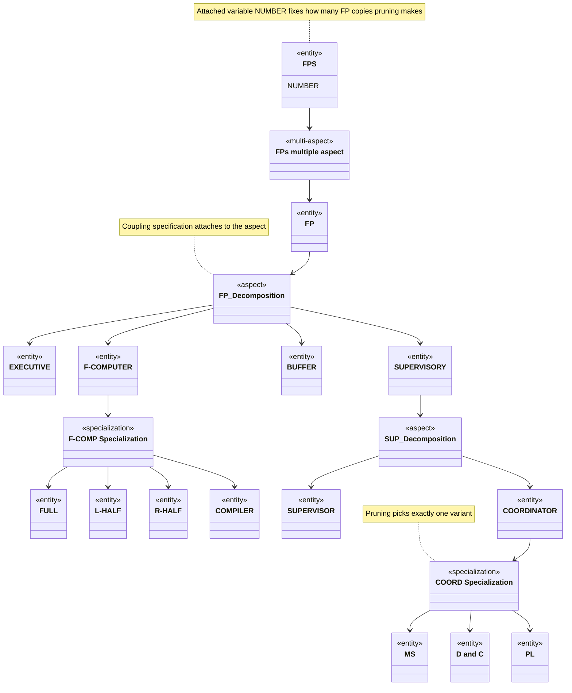

# SES Concepts: Node Types, Attached Knowledge, Pruning, and Readings

What a System Entity Structure (SES) is, the node types it is built from, the knowledge attached to those nodes, how pruning turns an SES into one pruned entity structure (PES), and the ways the Zeigler group and later authors have read the formalism (ontology, XML, relational algebra). The axioms are in `axioms.md`, and the model-base workflow is in `sesmb-workflow.md`. Current as of 2026-10-06.

Provenance tags: [Z] Zeigler or coauthors, read directly; [T] third-party literature; [G] MS4 Me User's Guide (page); [F] field observation from this repo's practice; [I] inference no source states. Papers by Zeigler's regular coauthors written without him (Rozenblit & Huang 1987; Kim 1988; Park, Lee & Kim 1994) are tagged [Z] and named in the citation.

## 1. What the SES is

**Definition.** The earliest formal definition in the open literature reads: "**Definition (Belogus [1], Zeigler [18]).** A system entity structure is a labeled tree with attached variable types. When a variable type V is attached to an item occurrence I, this signifies that a variable I.V may be used to describe the item occurrence I." [Z] ([Rozenblit & Zeigler 1985, WSC, p. 225](https://informs-sim.org/wsc85papers/1985_0048.pdf); [DOI 10.1145/21850.253157](https://doi.org/10.1145/21850.253157)). Reference [1] is Belogus's 1985 Weizmann Institute dissertation ([record](https://mathgenealogy.org/id.php?id=19314)). The archived PDF lacks its reference list, so [18] is unresolved, and the SES is older than the 1984 book: entity-structuring software (ESP) existed by about 1980 (see `history.md`).

**The problem it solves.** Organizing a family of design or model structures needs three kinds of structural knowledge: "decomposition, taxonomy, and coupling." Decomposition says how an object breaks into components. Taxonomy gives "the kinds of variants that are possible for an object," and coupling is needed because "the components of a decomposition must be coupled together" [Z] (Rozenblit & Zeigler 1985, p. 224). The SES puts all three in one declarative structure. It sits beside a model base of procedural models: "The decomposition, taxonomic, and coupling relationships are combined in the system entity structure, a declarative scheme related to frame-theoretic and object-based representations. The model base contains models which are procedural in character" [Z] ([Zeigler 1986, WSC, p. 137](https://informs-sim.org/wsc86papers/1986_0019.pdf)).

**A generalized composition tree.** A hierarchical, modular DEVS model has a composition tree of components and couplings. "By generalizing the composition tree concept so as to represent not just a single model, but a family of possible models, we arrive at the concept of system entity structure" [Z] (Zeigler 1986, p. 135). One SES therefore stands for many models, and pruning extracts one of them.

**Two driving uses.** The early papers present two motives together [Z]:

- Model base management: DEVS-Scheme "lends itself to model base organization using the entity structure knowledge representation" ([Zeigler 1987, *SIMULATION* 49(5)](https://doi.org/10.1177/003754978704900506)).
- Design-space representation: the three relations were combined "as a step toward a unifying knowledge representation scheme for design support" ([Rozenblit & Zeigler 1993, WSC, p. 606](https://informs-sim.org/wsc93papers/1993_0084.pdf); [DOI 10.1109/wsc.1993.718106](https://doi.org/10.1109/wsc.1993.718106)).

Both serve Zeigler's multifacetted-modelling program, which needs "an organized base of models whose partial perspectives can be integrated" [Z] ([Zeigler & Ören 1986, WSC, pp. 708–712](https://www.informs-sim.org/wsc86papers/1986_0108.pdf); see `sesmb-workflow.md`).

## 2. Node types

An SES has three structural node kinds plus a replication variant.

| Node | Meaning | Source |
|---|---|---|
| **Entity** | "conceptual components of reality for which models may reside in a library (model base)"; carries "slots for attribute representation" | [Z] Rozenblit & Zeigler 1993, p. 606 |
| **Aspect** | A labeled decomposition. "An entity may have several *aspects*, each denoting a decomposition, and therefore having several entities" | [Z] Rozenblit & Zeigler 1993, p. 606 |
| **Specialization** | A labeled classification. "An entity may also have several *specializations*, each representing a classification of possible variants of the entity" | [Z] Rozenblit & Zeigler 1993, p. 606 |
| **Multiple aspect** (later **multi-aspect**) | Decomposes a *multiple entity* into an indefinite number of copies of one entity. "The three vertical lines connecting a multiple entity and its singular instance is called a multiple aspect" | [Z] Zeigler 1986, p. 135 |

**Why these words.** "In the entity structure we use the term *entity* rather than model, since the entity may have several possible models to represent it. We also refer to a decomposition as an *aspect* since there may be several possible decompositions for a given entity" [Z] (Zeigler 1986, p. 135).

**Specialization semantics.** "Such a specialization indicates that a model class contains both a generic description, as well as specialized descriptions that can generate instances of several variants" [Z] (Zeigler 1986, p. 136). Variants "inherit properties of an entity to which they are related by the specialization relation" [Z] ([Rozenblit & Huang 1987, WSC, p. 604](https://informs-sim.org/wsc87papers/1987_0086.pdf); [DOI 10.1145/318371.318671](https://doi.org/10.1145/318371.318671)). "A specialization may occur in more than one location; whenever it occurs it carries with it all its attributes and substructures" [Z] (Rozenblit & Zeigler 1985, p. 225).

**Multiplicity.** "A special type of decomposition called a multiple decomposition facilitates flexible representation of multiple entities whose number in a system may vary" [Z] (Rozenblit & Zeigler 1985, p. 225). In 1986 a variable on the multiple entity held the count: "each multiple entity has a variable, e.g., FPS.NUMBER, to which we can assign a value" [Z] (Zeigler 1986, p. 136).

**Vocabulary drift.** The 1980s terms are "multiple aspect" and "multiple entity." "Multi-aspect" and "multi-entity" are the later terms [I]. MS4 Me, citing Zeigler & Hammonds (2007), defines: "A multi-aspect is a special case of an aspect except that it has only one child called its multi-entity – which can generate a specified number of copies" [G] (pp. 120–121). A 2019 Zeigler-coauthored summary: "Multi-Aspects are aspects for which the components are all of the one kind" [Z] ([Traoré, Zacharewicz, Duboz & Zeigler 2019, *SIMULATION* 95(6), Sect. 2.1](https://doi.org/10.1177/0037549718776765); [open manuscript](http://agritrop.cirad.fr/588108/1/Valued-based-Healthcare-Simulation.pdf)).

One entity may carry several aspects *and* several specializations. The 1985 CAR entity has "Physical Decomposition, Service Aspect, and Utility Specialization" [Z] (Rozenblit & Zeigler 1985, p. 228). See `axioms.md` §3.

## 3. Attached knowledge

Knowledge attaches to nodes in three ways.

1. **Variables attach to items.** "When a variable type V is attached to an entity E, this signifies that a variable [E.V] may be used to describe a property of the entity E" [Z] (Rozenblit & Huang 1987, p. 604; the bracketed token is garbled in the scan). In figures, attributes "are preceeded by the symbol '~'" [Z] (Rozenblit & Huang 1987, p. 607). Traoré et al. (2019, Fig. 1) draw "~var1 ... ~varn" [Z]. In MS4 Me text a variable is declared with `{ENTITY} has {VAR}!` and optionally ranged [G] (pp. 177–178).
2. **Coupling constraints attach to aspects.** "Coupling constraints restrict the way in which components (represented by entities) identified in decompositions (represented by aspects) can be joined together" [Z] (Rozenblit & Huang 1987, p. 604). The coupling specification belongs to one decomposition: it is "associated with the line descending from AB before it splits into the components A and B ... each one has a coupling specification associated with it" [Z] (Zeigler 1986, p. 130). The coupling scheme has three parts: external input, external output and internal coupling [Z] (Zeigler 1986, p. 130).
3. **Selection constraints attach to specializations.** "Selection constraints are associated with specializations of an entity. They restrict the way in which its subentities may replace it in the process of model construction" [Z] (Rozenblit & Huang 1987, p. 604). In rule-driven pruning, "Selection rules are associated with the entities whereas the synthesis rules are attached to the aspects" [Z] (Rozenblit & Huang 1987, pp. 604–607).

**Minimal scoping aspect.** "we must associate a constraint with an aspect which scopes all the entities that are involved in that constraint. What is more, this aspect should be minimal in the sense that there is no other aspect that lies below it in the entity structure which also scopes all the entities involved in the constraint" [Z] (Rozenblit & Zeigler 1985, p. 225). This is the theoretical root of MS4 Me's rule that a coupling names the aspect containing both endpoints, with one exception for multi-aspect units [G] (p. 176). The operational rule and its validator check live in the `ses-designer` skill (`resources/reference/ses-axioms.md`, "Coupling scope").

## 4. Drawing conventions

The 1980s figures use vertical lines, observed by reading the figures [Z]:

| Element | Drawn as | Where seen |
|---|---|---|
| Aspect | single line from the entity | Zeigler 1986, Fig. 11 (FP_Decomposition, SUP_Decomposition), p. 136 |
| Specialization | double vertical line | Zeigler 1986, Fig. 11 (F-COMP, COORD); Rozenblit & Zeigler 1985, Fig. 2 (BRAKES), p. 224 |
| Multiple aspect | triple vertical line | Zeigler 1986, p. 135; the only convention named in the text |
| Attached variable | `~name` | Rozenblit & Huang 1987, p. 607; Traoré et al. 2019, Fig. 1 |

No examined primary source uses a "double arrow" for specializations. Whether the 2007 or 2013/2017 books changed the conventions could not be checked. MS4 Me shows the SES as a tree view with colored nodes rather than line conventions [G] (pp. 25–26, 168). In Mermaid, this skill uses a UML `classDiagram` with `<<entity>>`, `<<aspect>>`, `<<specialization>>` and `<<multi-aspect>>` stereotypes (§7) [F].

## 5. Pruning and the PES

**The 1985 definition.** "we apply the mapping to remove the specializations to obtain an entity structure containing only entities and aspects. Now we imagine that we are synthesizing models by working our way down the entity structure selecting a single aspect for each entity and zero or more entities for each aspect. Such a process is called *pruning* of the entity structure" [Z] (Rozenblit & Zeigler 1985, p. 225). The same paper gives a recursive `Procedure Prune(E_j, CV_GOF, V_GOF)` that keeps the substructures serving a generic observation frame. Its output is a set of "decomposition trees," each "a skeleton for a hierarchical model construction" [Z] (pp. 226–227). See `sesmb-workflow.md` for the frame-driven version.

**Top-down pruning, bottom-up synthesis.** In the flexible-processor example: start at the root, choose how many FPs (`FPS.NUMBER`), choose how they are coupled, select one F-COMPUTER variant for each FP, then "follow bottom-up synthesis to construct the new model" [Z] (Zeigler 1986, p. 136).

**Choices.** "Whenever there is a specialization, a choice of a unique entity must be made." Constraint-driven pruning automates it with a selection rule set ("each selection rule stands for a choice of an entity in a specialization") and a synthesis rule set that ensures "proper configuration of the selected entities" [Z] (Rozenblit & Huang 1987, pp. 604–607; journal version [Rozenblit & Huang 1991, *ORSA J. Computing* 3(4)](https://doi.org/10.1287/ijoc.3.4.330)).

**Pruning as a choice function** [I]. Read together, the sources describe pruning as:

1. one aspect for each entity that has several,
2. one child for each specialization,
3. a multiplicity for each multi-aspect, followed by expansion,
4. then inheritance pushes the general entity's variables and aspects onto each chosen variant.

The 1985 "zero or more entities for each aspect" also lets an aspect's entity set be thinned. No single source states this as a definition. The 1985 "transformation to taxonomy free form" (remove specializations first) is the formal ancestor of MS4 Me's select-then-restructure sequence [I].

**What the result is called.** The name changed over time [Z]:

- "decomposition tree" (1985),
- "model composition tree," "a tree whose leaf nodes are system specifications" (Rozenblit & Zeigler 1993, pp. 606–607),
- "pruned entity structure (PES)" (by 2008, and in MS4 Me).

"Pruned Entity Structures (PES) represent the logically possible set of world state descriptions consistent with the SES" [Z] (Cheon, Kim & Zeigler 2008, SEDE; OpenAlex record only, no DOI, PARTIALLY VERIFIED). MS4 Me: "A PES is a pruned SES" [G] (p. 17), and "Unless there is only one aspect for each entity and there are no specializations, the SES describes a number of possible configurations of the system. A PES specifies one of those configurations that will be used to run a simulation" [G] (p. 168).

**MS4 Me specifics** [G]:

- **Aspect and specialization choices.** "For an entity containing more than one aspect, you must select the aspect that you will be using for the PES. For a specialization, you must select one of the possible choices" (p. 168). The guide documents no text directive for the aspect choice.
- **Partial PES.** "When running a simulation from a partial PES, any unmade choices will be randomly selected" (p. 168). Choices left out of a pruning file "are made randomly" (p. 122).
- **Multiplicity.** A specialization on the multi-entity serves as the copy index (`Person can be id in index!`). The PES then says `restructure multiaspects using index!` and `set multiplicity of index as [3] for Person!`, which yields `id0_Person`, `id1_Person`, `id2_Person`. "These new entities are added to the (ordinary) aspect under the grand-parent entity and the multi-aspect is removed from the SES" (p. 121).
- **Per-copy pruning.** Each copy inherits the multi-entity's sub-SES "and during pruning each these copies can be pruned independently," for example `select medium from height for id1_Person!` (p. 122).
- **Shared counts.** Nested multi-aspects get the same count in every parent copy, which the guide calls "a limitation on the expressiveness of the current version" (p. 127).
- **Behavior of selected options.** A selected option has empty behavior unless the PES says `inherit from {OPT}!` (p. 27; example p. 158).

Full PES syntax is in the `ses-designer` skill (`resources/reference/pes-grammar.md`) and in `ms4me-facts.md`.

## 6. Readings of the formalism

**Frames and objects.** In 1986 the SES is "a declarative scheme related to frame-theoretic and object-based representations" [Z] (Zeigler 1986, p. 137). In 1987 it is "a basis for what we term a conceptual network" [Z] (Rozenblit & Huang 1987, p. 605).

**Generative.** "The system entity structure organizes possibilities for a variety of system decompositions and, consequently, a variety of model constructions. Its generative capability facilitates convenient definition and representation of models and their attributes at multiple levels of aggregation and abstraction" [Z] (Rozenblit & Zeigler 1993, p. 606).

**Ontology with pragmatics.** From 2007 the SES is an ontology framework. Zeigler & Hammonds subtitle their book *Introducing Pragmatics into Ontologies for Net-Centric Information Exchange* and describe the SES as "an axiomatic formalism that enables automating the development of XML dtds and schemas, composition and decomposition of large data models, and analysis of commonality among structures" [Z] ([Elsevier page](https://shop.elsevier.com/books/modeling-and-simulation-based-data-engineering/zeigler/978-0-12-372515-8); the book text was not accessible). In data-fusion work, pragmatic frames select what is pruned for a consumer [Z] ([Lee & Zeigler 2010, *JDMS* 7(4)](https://doi.org/10.1177/1548512910365063)). By 2019 the SES is "a formal ontology framework, axiomatically defined" [Z] (Traoré et al. 2019, Sect. 2.1).

**XML mapping.** "At the implementation level, an SES is represented by a schema or DTD whose instance documents represent possible prunings" [Z] (Cheon, Kim & Zeigler 2008, PARTIALLY VERIFIED). So: SES ↔ schema/DTD, PES ↔ instance document. This is a representation mapping. No examined source claims the SES is formally more expressive than XML Schema. The SES adds axioms and an explicit pruning semantics that XML Schema does not have natively [I]. A second, incompatible XML tradition (the SES as an instance of a fixed meta-schema, DLR SESTools) is covered in `tools.md`.

**Relational algebra.** RASES stores an SES as relations, and "several operations on SES can be formulated in terms of relational algebra which can be coded in a standard query language" [Z] (Park, Lee & Kim 1994, WSC, pp. 649–656, [DOI 10.1109/wsc.1994.717403](https://doi.org/10.1109/wsc.1994.717403); journal version [1996](https://doi.org/10.1049/ip-cdt:19960166)).

**Set theory.** Zeigler & Hammonds (2007) reportedly give "a formal set-theoretic characterization of the SES that shows how the axioms are satisfied" [Z] (Traoré et al. 2019, p. 6). That text was not seen. The 1993 paper ties a canonical SES to the coupled-system structure N = <D, {S_a}, {I_a}, {Z_a}> [Z] (Rozenblit & Zeigler 1993, pp. 606–607).

**AND/OR tree** [I]. An aspect keeps all its children (AND). A specialization, or a choice among several aspects of one entity, is exclusive (OR). A multi-aspect is AND over a chosen count. The 1985 remark that aspects and specializations "are quite alike in their behavior (but not in their interpretation)" fits this reading. No examined Zeigler text uses "AND/OR tree" language.

**Generative grammar** [I]. An SES behaves like a grammar whose sentences are PESs, in the sense that a schema generates a language of admissible documents. This is an analogy drawn from the 1993 "generative" wording and the 2008 schema/instance mapping. It is not a claim made in the sources.

## 7. Worked example: the flexible-processor SES

The diagram simplifies Zeigler's flexible-processor (FP) example [Z] (Zeigler 1986, pp. 135–136, Fig. 11). Entity, aspect and specialization labels follow the paper's text. The multi-aspect node label is illustrative, because the text does not name it.



**The same structure in MS4 Me natural language** [F]. This is a translation for illustration, not from the paper. MS4 Me copies need a parent above the multi-aspect (restructuring moves them there, [G] p. 121), so a root `FlexibleProcessorSystem` is added. The collective entity is named `FPGroup` rather than a trailing-`s` plural, following this repo's practice (`lessons.md`). `FP can be id in index!` is the copy index MS4 Me needs [G] (p. 121). Couplings are omitted because the paper's coupling specifications are not reproduced here.

```
from the system perspective, FlexibleProcessorSystem is made of FPGroup!
from the multiFP perspective, FPGroup is made of more than one FP!
FP can be id in index!
from the fpDecomposition perspective, FP is made of Executive, Supervisory, Buffer and FComputer!
FComputer can be Full, LHalf, RHalf or Compiler in fComp!
from the supDecomposition perspective, Supervisory is made of Supervisor and Coordinator!
Coordinator can be MultiServer, DivideAndConquer or Pipeline in coord!
```

A matching PES with four processors. The `fComp` and `coord` choices are left to MS4 Me's random completion [G] (p. 168):

```
set name of model as FlexibleProcessorSystem4!
pruned from FlexibleProcessorSystem.ses!
restructure multiaspects using index!
set multiplicity of index as [4] for FP!
write class files!
```

Gap: the guide shows per-copy selection only for a specialization on the multi-entity itself (`select medium from height for id1_Person!`, p. 122). How a PES addresses a specialization *below* a copy (here `FComputer` inside `id0_FP`) is not documented, so the example does not pin `fComp` or `coord`. Check the generated tree view in MS4 Me before writing such a selection.
