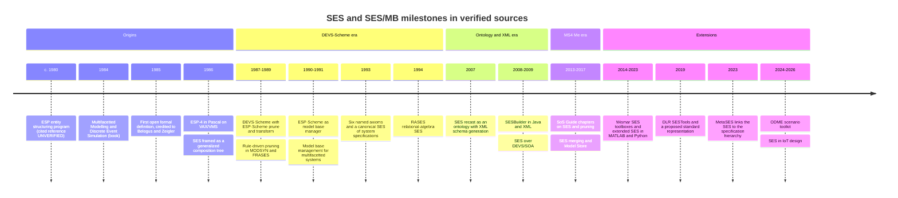

# History of the SES and SES/MB

Where the System Entity Structure came from and how it and its tools developed: a timeline of verified milestones, the main eras, how Zeigler's own framing of the SES shifted, and an implementation lineage table with verification status. Theory lives in `concepts.md` and `axioms.md`, the workflow in `sesmb-workflow.md`, and current tool details in `tools.md`. Current as of 2026-10-06.

Tags: [Z] Zeigler or coauthors, read directly · [T] third-party literature · [G] MS4 Me User's Guide (page) · [F] field observation from this repo's practice · [I] inference no source states.

## 1. Timeline of milestones

Only bibliographically verified milestones appear, except the c. 1980 ESP entry, which is known only from later citations.

## 2. Eras

### 2.1 Origins (late 1970s to 1986)

- [Z] The SES came out of Zeigler's multifacetted-modelling program. The canonical statement is *Multifacetted Modelling and Discrete Event Simulation* (Academic Press, 1984, ISBN 0-12-778450-0), with the companion essay "Multifaceted modeling methodology: Grappling with the irreducible complexity of systems," *Behavioral Science* 29(3):169–178, [DOI 10.1002/bs.3830290305](https://doi.org/10.1002/bs.3830290305). The book's text was not accessible.
- [Z] **Software came first.** A 1987 paper refers to "ESP4 - Entity Structuring Program (Zeigler et. al., 1980)" (Rozenblit & Huang 1987, WSC, p. 605, [DOI 10.1145/318371.318671](https://doi.org/10.1145/318371.318671)). The 1980 reference itself ("ESP – An Interactive Tool for System Structuring," European Meeting on Cybernetics and Systems Research) is **UNVERIFIED**. By 1986, ESP-4 was "a PASCAL system available for VAX under VMS and being ported to MS-DOS" (Zeigler 1986, WSC, p. 137, [PDF](https://www.informs-sim.org/wsc86papers/1986_0019.pdf)).
- [Z] **The first formal definition in open literature** reads: "Definition (Belogus [1], Zeigler [18]). A system entity structure is a labeled tree with attached variable types" (Rozenblit & Zeigler 1985, WSC, p. 225, [PDF](https://informs-sim.org/wsc85papers/1985_0048.pdf), [DOI 10.1145/21850.253157](https://doi.org/10.1145/21850.253157)). The Belogus source is a 1985 Weizmann Institute dissertation ([Mathematics Genealogy Project record](https://mathgenealogy.org/id.php?id=19314)). The archived 1985 PDF lacks its reference list, so references [1] and [18] cannot be resolved from it.
- [Z] **The problem it solved.** One representation for three relations: "decomposition, taxonomy, and coupling" (Rozenblit & Zeigler 1985, p. 224). Zeigler framed the SES as a generalization of the composition tree "so as to represent not just a single model, but a family of possible models" (Zeigler 1986, p. 135).
- [Z] The 1985 axiom list differs from the later six: "alternation entity/aspect, entity/specialization, strict hierarchy, inheritance: birth, life, multiple entity" (Rozenblit & Zeigler 1985, p. 225). See `axioms.md`.
- [I] So 1984 is best described as the canonical book statement, not the first appearance.
- Gap: a 1979 North-Holland chapter ("Structuring principles for multifaceted system modelling") and a 1978 *IJGS* paper are cited as antecedents but are **UNVERIFIED**.

### 2.2 DEVS-Scheme era (1987–1994)

- [Z] **DEVS-Scheme** realized DEVS in SCOOPS on PC-Scheme (Kim & Zeigler 1987, WSC, [DOI 10.1145/318371.318665](https://doi.org/10.1145/318371.318665)). Its object-oriented design "lends itself to model base organization using the entity structure knowledge representation" (Zeigler 1987, *SIMULATION* 49(5):219–230, [DOI 10.1177/003754978704900506](https://doi.org/10.1177/003754978704900506)).
- [Z] The 1988 software organization ran ESP-4 → ESP-SCHEME ("Structure, Prune") plus constraint-driven pruning → TRANSFORM ("Synthesis") → DEVS-SCHEME → a distributed simulation architecture. Rule-based pruning ran in MODSYN, a Turbo Prolog shell (Rozenblit, Kim & Zeigler 1988, WSC, Fig. 1, p. 227, [DOI 10.1109/wsc.1988.716149](https://doi.org/10.1109/wsc.1988.716149)).
- [Z] DEVS-Scheme had **four layers**: Layer 0, a Lisp object foundation; Layer 1, system model specification; Layer 2, System Entity Structure/Model Base; Layer 3, systems design with FRASES, goal-driven pruning, automatic experimental-frame generation, and multi-criteria ranking. It was "being commercialized by SIMEX" and used in a NASA Ames laboratory-automation project (Zeigler, Hu & Rozenblit 1989, WSC, pp. 84–89, [DOI 10.1145/76738.76749](https://doi.org/10.1145/76738.76749)).
- [Z] **ESP-Scheme as model base manager.** "ESP-Scheme acts as a model base management system in DEVS-Scheme" (Kim, Lee, Christensen & Zeigler 1990, *IEEE Trans. SMC* 20(5):1013–1024, [DOI 10.1109/21.59966](https://doi.org/10.1109/21.59966)). The 1990 book *Object-Oriented Simulation with Hierarchical, Modular Models* is the DEVS-Scheme compendium, with chapters "System Entity Structures" (pp. 145–168) and "Model Base Management and Endomorphic Systems" (pp. 299–323); chapter text was not read.
- [Z] **Design methodology.** The Knowledge-Based Design and Simulation Environment (KBDSE) appeared in *J. Operational Research Society* 41(6):475–489 (Rozenblit, Hu, Kim & Zeigler 1990; content not read). Rule-based generation of model structures appeared in Rozenblit & Huang 1991, *ORSA J. Computing* 3(4):330–344, [DOI 10.1287/ijoc.3.4.330](https://doi.org/10.1287/ijoc.3.4.330).
- [Z] **Model-base management for multifacetted systems** introduced context-sensitive pruning and partitioned entity structure bases (Zeigler, Luh & Kim 1990, AIHAS, [DOI 10.1109/aihas.1990.93938](https://doi.org/10.1109/aihas.1990.93938); journal version 1991, *ACM TOMACS* 1(3):195–218, [DOI 10.1145/140765.140791](https://doi.org/10.1145/140765.140791)).
- [Z] **1993.** Rozenblit & Zeigler name the six axioms ("uniformity, strict hierarchy, alternating mode, inheritance, valid siblings, and attached variables (Zeigler 1984)"), introduce a canonical SES of system-specification formalisms, and relax strict hierarchy for recursion (WSC, pp. 606–607, [PDF](https://informs-sim.org/wsc93papers/1993_0084.pdf), [DOI 10.1109/wsc.1993.718106](https://doi.org/10.1109/wsc.1993.718106)).
- [Z] **1994.** RASES represents the SES "in the form of relations which may be stored as tables in a relational database," with SES operations in relational algebra (Park, Lee & Kim 1994, WSC, pp. 649–656, [DOI 10.1109/wsc.1994.717403](https://doi.org/10.1109/wsc.1994.717403)). The same year, a "verb phrase" SES paper appeared (Simard, Zeigler & Couretas 1994, AIHAS, [DOI 10.1109/AIHAS.1994.390473](https://doi.org/10.1109/AIHAS.1994.390473); title, authors, and venue verified only).

### 2.3 Ontology and XML era (2007–2010)

- [Z] **SES as ontology.** Zeigler & Hammonds, *Modeling & Simulation-Based Data Engineering: Introducing Pragmatics into Ontologies for Net-Centric Information Exchange* (Academic Press, 2007, ISBN 978-0-12-372515-8). Chapter titles include "Basics of System Entity Structuring," "Representing the SES in XML," and "Using the SES-Java Tool Set." The publisher describes the SES as "an axiomatic formalism that enables automating the development of XML dtds and schemas." Content was not read. [G] The MS4 Me guide cites this book for the multi-aspect definition (p. 121, footnote 11).
- [Z] **SESBuilder.** "SES is implemented in XML Metadata using Java language and Sun's Document Object Models (DOM) specification. The SESBuilder software supports natural language input for an SES definition and XML instance generation of its PES" (Cheon, Kim & Zeigler 2008, IRI, [DOI 10.1109/iri.2008.4583078](https://doi.org/10.1109/iri.2008.4583078)).
- [Z] **DEVS/SOA.** DEVS over a service-oriented architecture with "run-time composability of coupled systems"; its abstract does not mention the SES (Mittal, Risco-Martín & Zeigler 2009, *SIMULATION* 85(7):419–450, [DOI 10.1177/0037549709340968](https://doi.org/10.1177/0037549709340968)). SES-based network-traffic analysis ran over it (Kim, Seo & Zeigler 2009, *SIMULATION* 86(3), [DOI 10.1177/0037549709354112](https://doi.org/10.1177/0037549709354112)).
- [Z] eUDEVS carried structure as SES/XML and behavior separately; a PES-synthesized model "doesn't contain the behavior specifications" (Risco-Martín, de la Cruz, Mittal & Zeigler 2009, *SIMULATION*, [DOI 10.1177/0037549709104727](https://doi.org/10.1177/0037549709104727)).
- [Z] Data fusion for command and control used novel pruning and transformation processes (Lee & Zeigler 2010, JDMS, [DOI 10.1177/1548512910365063](https://doi.org/10.1177/1548512910365063)).

### 2.4 MS4 Me era (2013 onward)

- [Z] **The SoS Guide.** Zeigler & Sarjoughian, *Guide to Modeling and Simulation of Systems of Systems* (Springer; 2013, [DOI 10.1007/978-0-85729-865-2](https://doi.org/10.1007/978-0-85729-865-2); 2nd ed. 2017, [DOI 10.1007/978-3-319-64134-8](https://doi.org/10.1007/978-3-319-64134-8)). Chapters include "System Entity Structure Basics," "Specialization and Pruning," "Aspects and Multi-aspects," "Managing Inheritance in Pruning," and "Automated and Rule-Based Pruning [and Experimental Execution]." A SpringerBriefs companion has chapters "System Entity Structure List" and "Pruning SES List" ([DOI 10.1007/978-1-4471-4570-7](https://doi.org/10.1007/978-1-4471-4570-7)). Chapter text was not read.
- [Z] **SES merging and Model Store.** Suites of models built by "merging of System Entity Structures," hosted on Model Store, "the cloud-based repository of models provided by MS4 systems" (Zeigler, Seo & Kim 2013, IJMSSC 4(3):1340006, [DOI 10.1142/s1793962313400060](https://doi.org/10.1142/s1793962313400060)).
- [G] **MS4 Me** provides a controlled-English SES editor, interactive pruning, `.pes` directives, Java generation, and SimViewer (pp. 17–19, 120–129, 164–178). The guide is undated; the local PDF was created 2021-10-19. See `ms4me-facts.md`.
- [Z] *Theory of Modeling and Simulation* is not where the SES is developed. The 3rd edition (Zeigler, Muzy & Kofman; Crossref year 2019) has no chapter titled after the SES ([DOI 10.1016/c2016-0-03987-6](https://doi.org/10.1016/c2016-0-03987-6)).

### 2.5 Extensions and recent work (2014–2026)

- [T] **Hochschule Wismar.** A MATLAB/Simulink SES toolbox (Pawletta, Pascheka, Schmidt & Pawletta 2014, SNE 24(2):59–68, [DOI 10.11128/sne.24.tn.10241](https://doi.org/10.11128/sne.24.tn.10241)); SES functions adding procedural knowledge, first proposed in 2016 ([DOI 10.22360/springsim.2016.anss.061](https://doi.org/10.22360/springsim.2016.anss.061)) and developed in SNE 28(1), 2018 ([DOI 10.11128/sne.28.tn.10402](https://doi.org/10.11128/sne.28.tn.10402)); NONE, merge, and flattening (SNE 27(4), 2017, [DOI 10.11128/sne.27.tn.10391](https://doi.org/10.11128/sne.27.tn.10391)); Python tools and FMI targets (SNE 29(4), [DOI 10.11128/sne.29.tn.10497](https://doi.org/10.11128/sne.29.tn.10497); SNE 31(1), [DOI 10.11128/sne.31.tn.10554](https://doi.org/10.11128/sne.31.tn.10554)); variant derivation from hierarchical multi-aspects (SNE 33, 2023, [DOI 10.11128/sne.33.tn.10633](https://doi.org/10.11128/sne.33.tn.10633)). Several of these papers have Zeigler as coauthor.
- [T] **DLR / TU Clausthal.** SESTools, an XML SES editor and pruner (Karmokar et al. 2019, AIAA, [DOI 10.2514/6.2019-1712](https://doi.org/10.2514/6.2019-1712)), and a proposed "standard computational representation" (SummerSim 2019, [DLR elib record](https://elib.dlr.de/130764), no DOI found). The successor ODME toolkit generates scenarios from an SES domain model (Naja, Gupta, Durak & Hartmann 2024, SNE 34(1):13–21, [DOI 10.11128/sne.34.tn.10672](https://doi.org/10.11128/sne.34.tn.10672)).
- [Z] **Zeigler-coauthored extensions.** Abstraction hierarchies and time granularity in DEVSimPy (Santucci, Capocchi & Zeigler 2016, *SIMULATION* 92(8):747–769, [DOI 10.1177/0037549716657168](https://doi.org/10.1177/0037549716657168)); SES/MB as metamodeling and model transformation (Durak, Pawletta, Oğuztüzün & Zeigler 2017, [DOI 10.22360/springsim.2017.mod4sim.001](https://doi.org/10.22360/springsim.2017.mod4sim.001)); UAV service design with DEVS and SES in MS4 Me (Zeigler & D. Kim 2019, [DOI 10.23919/springsim.2019.8732861](https://doi.org/10.23919/springsim.2019.8732861)).
- [Z] **MetaSES.** "An abstraction of the SES called the MetaSES that supports the construction of complex systems of systems with multiple components belonging to specified classes" (Zeigler 2023, *Information* 14(1):22, [DOI 10.3390/info14010022](https://doi.org/10.3390/info14010022)).
- [Z] **IoT design.** The SES organizes "models and generating alternative system configurations" (Capocchi, Zeigler & Santucci 2025, *Computers*, [DOI 10.3390/computers14070258](https://doi.org/10.3390/computers14070258)).
- [Z] Zeigler's other recent lines carry no SES in their abstracts: the published EFSUT paper (2026, [DOI 10.3390/systems14060691](https://doi.org/10.3390/systems14060691)), LLM work on DEVS models, and the ParaDEVS papers (2024). See `applications.md`.

## 3. How the framing evolved

| Period | How the SES is framed | Marker sources |
|---|---|---|
| 1984–1993 | Knowledge representation for design and model bases: a labeled tree with attached variable types, pruned to composition trees | [Z] Rozenblit & Zeigler 1985, 1993; Zeigler 1986; Kim et al. 1990 |
| 2007–2010 | Ontology for data engineering; SES to XML schema, PES to instance; pragmatics | [Z] Zeigler & Hammonds 2007; Cheon, Kim & Zeigler 2008 |
| 2013–2019 | Tool-level natural language in MS4 Me; suites of models by merging; multi-aspects with restructuring and inheritance management | [Z] Zeigler & Sarjoughian 2013/2017; Zeigler, Seo & Kim 2013; [G] |
| 2022–2026 | One model-family tool among several, alongside morphisms, experimental-frame orders, and the MetaSES | [Z] Zeigler 2023; Capocchi, Zeigler & Santucci 2025 |

[I] The definitional core (entity, aspect, specialization, multi-aspect, attached variables, axioms, pruning) is stable from 1985 to 2019. What changed is the axiom list (1985 versus 1993 and later), the vocabulary ("multiple aspect" to "multi-aspect", "composition tree" to "PES"), the framing above, and added operations (merging, multi-aspect restructuring, `inherit from`).

## 4. Implementation lineage

| System | Years | Language / platform | SES/MB contribution | Verification |
|---|---|---|---|---|
| ESP | c. 1980 | Not stated | Entity structuring | Known only from later citations; **UNVERIFIED** |
| ESP-4 | by 1986 | Pascal, VAX/VMS | "Entity Structure & Pruner, Large Entity Structure Management, Model Integration" | [Z] Zeigler 1986, p. 137; Rozenblit, Kim & Zeigler 1988, p. 227 |
| DEVS-Scheme | 1987–1990 | PC-Scheme, SCOOPS | Hierarchical modular DEVS; four layers; `transform` from PES to executable model | [Z] Kim & Zeigler 1987; Zeigler, Hu & Rozenblit 1989 |
| ESP-Scheme | 1988–1990 | Scheme | SES as model base management system; `prune`, `transform` | [Z] Rozenblit, Kim & Zeigler 1988; Kim et al. 1990 |
| MODSYN | 1987–1988 | Turbo Prolog, being ported to Scheme | Rule-based, generate-and-test pruning | [Z] Rozenblit, Kim & Zeigler 1988, p. 227; the 1987 M.S. thesis behind it is **UNVERIFIED** |
| FRASES | 1989 | DEVS-Scheme Layer 3 | Frames and rules on SES nodes; automatic EF generation; ranking | [Z] Zeigler, Hu & Rozenblit 1989; the 1989 dissertation behind it is **UNVERIFIED** |
| RASES | 1994, 1996 | Relational database | SES as relations; operations in relational algebra | [Z] Park, Lee & Kim 1994 |
| DEVS-C++ | 1996 | C++ | None documented; high-performance simulation | [Z] Zeigler, Moon, Kim & Kim 1996 abstract mentions no SES ([DOI 10.1109/hicss.1996.495481](https://doi.org/10.1109/hicss.1996.495481)) |
| DEVSJAVA | — | Java | None documented in any primary source found | Do **not** credit SES/MB features to it without a source |
| SESBuilder | 2008 | Java, XML DOM | Natural-language SES input; PES as XML instance; couplings for composition | [Z] Cheon, Kim & Zeigler 2008 |
| DEVS/SOA | 2009 | Java services | Runtime composition; SES analysis layered on top | [Z] Mittal, Risco-Martín & Zeigler 2009; Kim, Seo & Zeigler 2009 |
| CoSMoS | 2009 | Java (ASU) | Visual model families; generates DEVS-Suite code; replaced SESM | [T] Sarjoughian & Elamvazhuthi 2009, [DOI 10.4108/icst.simutools2009.5744](https://doi.org/10.4108/icst.simutools2009.5744) |
| MS4 Me | guide undated (PDF 2021) | MS4DEVSJava, SimViewer | Controlled-English `.ses`/`.pes`; restructuring; `inherit from`; merging; random completion | [G]; [Z] Zeigler & Sarjoughian 2013/2017 |
| SES Toolbox | 2014–2022 | MATLAB/Simulink | Extended SES, SES functions, experiment control loop | [T] Wismar SNE papers; repository last push 2022 |
| SESToPy / SESMoPy | 2019–2021 | Python | Extended SES in Python; Simulink, Dymola, OpenModelica, FMI targets | [T] Wismar SNE papers; repository last push 2021–2022 |
| SESTools | 2019–2023 | Java, XML Schema 1.1 | XML SES editor and pruner; XPath constraints; no coupling element | [T] Karmokar et al. 2019; repository last push 2023 |
| DEVSimPy SES extension | 2016 | Python | Abstraction hierarchies and time granularity | [Z] Santucci, Capocchi & Zeigler 2016 |
| ODME | 2023–2026 | Not stated in sources read | SES domain models for scenario generation and ODD coverage | [T] Naja et al. 2024; Gupta et al. 2025, 2026 |

[I] The division of labor has stayed stable from DEVS-Scheme to MS4 Me: an SES tool produces a PES, and a DEVS engine synthesizes and simulates it. The surface changed from Lisp frames to XML to restricted natural language, and constructs were added along the way.

## 5. Gaps

- The 1984, 1990, and 2007 books and the 2013/2017 *Guide* chapters were not readable, so Zeigler's own wording at each stage is known only from the WSC papers, abstracts, and chapter titles.
- The ESP (1980) reference, the 1978/1979 antecedents, "Cho (1993)", and the dissertations behind MODSYN and FRASES are **UNVERIFIED**.
- Repository maintenance dates come from the research task's check in October 2026 and will age. See `tools.md` for current status.
