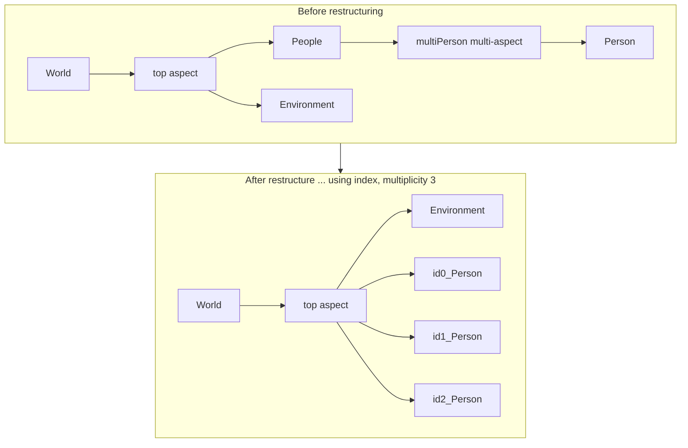

# MS4 Me: Verified SES/PES Behaviors

This file lists what the MS4 Me User's Guide says about writing, pruning, and running an SES, with page numbers checked against the guide text. It is the factual basis for the `ses-designer` skill's grammar files and validators. A closing section records field observations from this repo that the guide does not state. Current as of 2026-10-06.

Provenance tags: [Z] Zeigler or coauthors, read directly; [T] third-party literature; [G] MS4 Me User's Guide (page); [F] field observation from this repo's practice; [I] inference no source states.

## 1. The document

- *MS4 Me User's Guide*, MS4 Systems, Inc. The cover gives no date or version. The PDF metadata creation date is 2021-10-19 [G cover; PDF metadata].
- **Printed page number = PDF page number**, so "p. 176" can be opened directly as PDF page 176 [F].
- The SES language specification is Appendix 2, §§A–K, pp. 173–178 [G]. Multi-aspect material is §II.I, pp. 120–129 [G]. Pruning is §VI.G, pp. 168–169 [G].
- The repo copy is at `docs/ses/MS4_Me_Users_Guide.pdf` in `devs-skills-claude`. It is not bundled with this skill.

## 2. SES language (Appendix 2, pp. 173–178)

| Construct | Guide syntax | Notes |
|---|---|---|
| Identifier | Starts with a letter or `_`; letters, digits, dashes, underscores | "Unlike the Atomic DEVS language, it is permissible to use dashes in an identifier." `3strikes`, `Initial State`, `Initial.State` are invalid [G pp. 173–174] |
| Readability words | `a`, `an`, `the` before names; `is` may be `are` or `is (are)` | [G p. 174]; examples `a car is made of an engine, the transmission, and a chassis` [G p. 175] |
| Aspect | `from the ASPECT perspective, SYSTEM is made of SUBSYSTEM !` and the 2-, 3- and N-subsystem forms | A single subsystem is legal [G p. 174]; used as `AgentAndActor is made of Agent!` [G p. 115] |
| Comma rule | "When specifying more than 2 subsystems, there is not a comma after the subsystem before the word 'and'" | Yet the guide's own examples include the Oxford comma (`GeneratorOfJobs, Processors, and Transducer!` [G p. 127]; `an engine, the transmission, and a chassis` [G p. 175]). Same rule for `or` [G p. 176] and for variables [G p. 177] |
| Multi-aspect | `from the ASPECT perspective, SYSTEM is made of more than one SUBSYSTEM !` | "a system only has one type subsystem, but it can have any number of them" [G p. 175] |
| Specialization | `SYSTEM can be SUB_1, SUB_2 or SUB_3 in SPECIALIZATION!` | A single-option form `SYSTEM can be SUBSYSTEM in SPECIALIZATION !` exists [G p. 175] |
| Coupling | `from the ASPECT perspective, SENDING_SYSTEM sends MESSAGE to RECEIVING_SYSTEM !` | Scope rule in §5 below [G p. 176] |
| Renaming | `... sends SENT_MESSAGE to RECEIVING_SYSTEM as RECEIVED_MESSAGE !` | [G p. 176] |
| Multi-aspect coupling | `each X sends M to Y !`, `Y sends M to each X !`, `each X sends M to each Y [as N]!` | "The word 'all' can also be used for readability" [G pp. 176–177]. The each-to-each matching rule is in §5 |
| Variables | `SYSTEM has VAR_1, VAR_2 and VAR_3 !` | [G p. 177] |
| Ranges | `the range of SYSTEM's VARIABLE is TYPE !` (type only); `... with values V1, V2 and V3 !`; `... with values [-6.3,6] !`; `(-6.3,6)`, `(-6.3,6.3]`, `[-6.3,6.3)` | `'s` is required. `[`/`]` are inclusive and `(`/`)` exclusive. TYPE is an identifier "for example ... 'string', 'number', etc." [G pp. 177–178] |
| Similarities | Listed as an SES element ("a truck is like a car") | **No syntax given** in Appendix 2 [G p. 173] |
| Comments | `//` lines appear in guide SES examples | e.g. `//sharing of updates among enclaves` [G pp. 125–126]; not part of Appendix 2 |

## 3. Files, editor, and model generation

- **Files.** SES files go in the project's `ses` directory. SES file names "must start with a letter, contain only letters, numbers, or the '_' character, and be valid Java identifiers," with no spaces, periods, or Java reserved words [G p. 165].
- **First statement.** "You must add an aspect to the SES before any other elements can be added. This first aspect defines the 'root system'" [G p. 166].
- **Editor templates.** The editor offers templates (Ctrl+Space) for aspects, specializations, couplings (with or without renaming), variables, and ranges. The coupling template first asks for "the aspect under which both subsystems can be found" [G pp. 166–167].
- **Getting-started example** [G pp. 16–17]:
  ```
  from the Dialog perspective, HelloWorldSES is made of HelloWorld and BackAtYou!
  from the Dialog perspective, HelloWorld sends Hello to BackAtYou!
  from the Dialog perspective, BackAtYou sends Hi to HelloWorld!
  ```
  The guide footnote reads: "A PES is a pruned SES" [G p. 17].
- **Division of labor.** "A very powerful technique is to define model behavior with Atomic DEVS and then to define the relationships between models with SES" [G p. 165]. Behavior lives in `.dnl` atomic models.
- **Runtime structure change** (adding or removing child models and couplings) is Java code inside `.dnl` models, not SES statements [G pp. 115–117].
- **Sequence Diagram editor.** Its Entity Configuration Dialog offers entity types "Default, Specialization, Multi-Aspect, and Decomposition" [G p. 49].

## 4. Multi-aspect restructuring and copies (pp. 120–127)

- **Definition.** "A multi-aspect is a special case of an aspect except that it has only one child called its multi-entity – which can generate a specified number of copies." The guide credits Zeigler & Hammonds (2007) [G pp. 120–121].
- **Making copies.** "To expand a multi-entity (i.e., to generate copies) you add a specialization to it" (`Person can be id in index!`). The pruning file then says `restructure multiaspects using index!` and `set multiplicity of index as [3] for Person!` [G p. 121].
- **Copy names** are option + index + `_` + unit: `id0_Person`, `id1_Person`, `id2_Person` [G p. 121]. With a multi-option label such as `height`, pruned names carry the option as prefix (`tall_boy`) [G p. 124].
- **Hoisting.** "These new entities are added to the (ordinary) aspect under the grand-parent entity and the multi-aspect is removed from the SES." `Person`, formerly a grandchild of `World`, has copies that are now children of `World` (Figure G1) [G pp. 121–122].
- **Per-copy pruning.** Each copy inherits the multi-entity's sub-SES "and during pruning each these copies can be pruned independently," e.g. `select medium from height for id1_Person!` [G p. 122].
- **Random completion.** "As general is the case, selections not made explicitly in the pruning file are made randomly" [G p. 122].
- **Nested multi-aspects** (MultiEnclaveNet: Enclaves → Enclave → Clients → Client) can share one `index` label with separate multiplicities. "It is permissible, and desirable, to use the same specialization (here index) for different multi-aspects." With different labels, "a bottom-up order must be given": `restructure multiaspects using clientIndex then enclaveIndex!` [G p. 126].
- **Limitation.** "The number of clients in each enclave is the same since we can't specify them individually. This is a limitation on the expressiveness of the current version of MS4 Me which can be removed by supporting specification of multiplicity using context" [G p. 127].
- **Two specializations on one entity.** `Person` has both `id in index` and `short, medium, or tall in height` [G pp. 121–122]. `AA` has both `BB, CC, or DD in type` and `id in index` [G p. 129].



The diagram is adapted from Figure G1 [G p. 122].

## 5. Couplings, ports, and scope (pp. 122–125, 176)

- **Scope rule** [G p. 176]: "Messages can only be passed between a subsystem and its parent system or subsystems within the same aspect of a system (subsystems within the same aspect are known as siblings). The only exception to this rule is that the subsystem of a multi-aspect can send messages to siblings of its parent system." The exception matches hoisting: after restructuring, the copies sit in the grandparent's aspect [I from G p. 121].
- **Port naming.** `id0_Person sends Bye to id1_Person!` "creates a coupling from outBye of id0_Person to inBye of id1_Person" [G pp. 122–123]. Message names become `out<Msg>`/`in<Msg>` port pairs [I].
- **Uniform coupling.** `all Person sends Hello to all Person!` couples every copy to every copy, with "no self-coupling i.e., no output port of a component is coupled to any of its input ports" [G p. 123]. Uniform coupling also works between different restructured multi-aspects, e.g. `all Girl sends NiceToMeetYou to all Boy!` [G pp. 123–124].
- **Each-to-each matching.** `each Boy sends Invitation to each Girl!` couples copies "on the basis of having the same prefix in the pruned name of an entity (e.g., tall in tall_boy). Couplings are not added for matches that cannot be made – for example, if the numbers of boys and girls are not equal. Other coupling types, such as all-to-each, are supported" [G p. 124].
- **Matching-label caveat.** The DatingGame "will work in a straight forward manner provided you don't use height as the basis for identifying multi-entity copies (in other words, 'set multiplicity of height …' does not appear in the pruning file)" [G p. 124].
- **One-to-all and all-to-one.** `MatchMaker sends MakeInvitation to all Boy!` and `all Boy sends Preference to MatchMaker!` work "provided that the entity to be coupled is in the same coupled model as the multi-entities." The containing model can be the source: `DatingGame sends MakeInvitation to all Boy!` [G pp. 124–125].
- **Hierarchical coupling.** In MultiEnclaveNet:
  - `From the overall perspective, all Enclave sends DBUpdate to all Enclave!` couples copies one level up.
  - `From the enclave perspective, DBServer sends DBUpdate to Enclave!` couples a child to its parent [G pp. 125–126].

## 6. PES directives (pp. 26–27, 121–129, 157–158)

| Directive | Evidence | Meaning per the guide |
|---|---|---|
| `set name of model as X !` | [G pp. 27, 128, 157] | Name of the pruned model |
| `pruned from X.ses !` | [G pp. 27, 128, 157] | Source SES |
| `mergeAll from X.ses !` | [G pp. 27, 129] | Appears after `pruned from` in two examples; **not explained** |
| `restructure multiaspects using L !` / `... using A then B !` | [G pp. 121, 126, 128] | Expand multi-aspects on label L; list several labels bottom-up |
| `set multiplicity of L as [N] for U !` | [G pp. 121, 126, 128] | Number of copies of unit U |
| `select OPT from LABEL for ENTITY !` | [G pp. 122, 157–158] | Resolve a specialization. ENTITY may be a copy (`id1_Person`) or a selected option with its own specialization (`... for ConstantAcceleration`) |
| `inherit from OPT !` | [G pp. 26–27, 158] | "Without 'inherit from BetaChimpTwo! and inherit from AlphaChimpTwo!', the selected models have empty behaviors" [G p. 27]. PhysicsModelPM1 adds one after each `select` [G p. 158]. ZooChimpsTest puts both after the selects [G p. 27] |
| `don't select OPT under ENTITY!` | [G p. 129] | "10 instances of AAs do not select CC entities" |
| `write class files !` | [G pp. 128, 158] | Generate Java classes |

The guide never shows `select OPT for ENTITY!` without `from LABEL` [G]. It prints the restructure, multiplicity, and select lines for the World example but not a full `WorldTest.pes` [G pp. 121–123]. It does not print `DatingGame.pes` [G p. 124].

## 7. Pruning UI and running (pp. 168–169)

- "Unless there is only one aspect for each entity and there are no specializations, the SES describes a number of possible configurations of the system. A PES specifies one of those configurations" [G p. 168].
- **Prune SES into PES:** selections are made from a "Selections remaining" list or the tree. "For an entity containing more than one aspect, you must select the aspect that you will be using for the PES." For a specialization, one choice. A choice can be undone with "Unselect" [G p. 168].
- **Finish Pruning** saves the PES at any point. If choices remain, a *partially* pruned PES can be saved, and "When running a simulation from a partial PES, any unmade choices will be randomly selected" [G p. 168].
- **Prune SES starting from these choices** resumes from an existing PES. **Run PES file in SimViewer** simulates it [G pp. 168–169].
- **No text directive for choosing an aspect** appears anywhere in the guide. A hand-written PES therefore cannot pin the aspect choice for an entity with several aspects, and that choice falls to random selection [I from G pp. 122, 168].

## 8. Field observations and guide oddities

- **Trailing-s collective names [F].** In this repo's practice, MS4 Me's parser intermittently mishandles a trailing-`s` plural used as a collective parent name (`UAVs`, `Processors`), apparently by trying to singularize it. The `ses-designer` skill therefore defaults to `UAVGroup`, `ProcessorPool`, `TargetSet`. The guide states no such rule, and its own examples use plural parents freely (`Processors`, `People`, `Boys`, `Girls`, `Enclaves`, `Clients`) [G pp. 120–128]. The two facts are compatible: the guide documents what is legal, and an intermittent parser failure would not show in curated examples [I]. The guide itself also uses `CellGroup` [G p. 129].
- **Space before `!`.** Guide examples usually print a space before the terminator (`write class files !`) but also omit it (`restructure multiaspects using index!`) [G pp. 121, 128]. `ses-designer` emits no space and its validators require none [F].
- **`short_Boy` vs `shortish`.** The one-to-all example says `short_Boy sends Greeting to all Girl!`, but the DatingGame specialization options are `shortish, medium, or tall` [G pp. 123–124]. This is a guide inconsistency.
- **Missing files.** `DatingGame.pes` is referenced (footnote 13) but not printed [G p. 124]. Example SES/PES files live in the "EFPwithMultiAspect" and "ZooExample" projects [G pp. 27, 123–129 footnotes].
- **Dashes.** SES identifiers may contain dashes, but SES file names and Atomic DEVS identifiers may not [G pp. 165, 174]. Entities become Java classes, so a dashed entity name is likely to fail at code generation; the guide does not say so [I].
- **Undocumented vendor direction.** The vendor site (©2024) promotes an "MS4ME web version ... Integrated with GPT3.0 generative AI capabilities" and does not mention SES. Current web-version SES support is unknown [T: [ms4systems.com](https://ms4systems.com/)].
