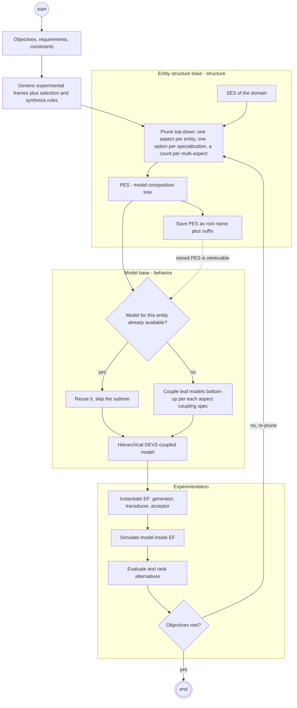

# SES/MB Workflow: Model Base, Pruning, and Synthesis

How the System Entity Structure (SES) and the model base (MB) work together. Covers the two-store knowledge base, the prune-and-transform loop and its named operations, why synthesis yields a valid DEVS model, how experimental frames steer pruning, the multifacetted-modelling rationale, reuse and design-space exploration, and the limitations the originators themselves reported. Formal node types and axioms live in `concepts.md` and `axioms.md`; tool lineage lives in `history.md` and `tools.md`. Current as of 2026-10-06.

Tags: [Z] Zeigler or coauthors, read directly · [T] third-party literature · [G] MS4 Me User's Guide (page) · [F] field observation from this repo's practice · [I] inference no source states.

## 1. The two halves: entity structure base and model base

The SES/MB knowledge base has a **declarative structure half** and a **procedural behavior half**.

- [Z] "The decomposition, taxonomic, and coupling relationships are combined in the system entity structure, a declarative scheme related to frame-theoretic and object-based representations. The model base contains models which are procedural in character" (Zeigler 1986, WSC, p. 137, [PDF](https://www.informs-sim.org/wsc86papers/1986_0019.pdf), [DOI 10.1145/318242.318280](https://doi.org/10.1145/318242.318280)).
- [Z] In DEVS-Scheme the KNOWLEDGE BASE had two stores. **ENBASE** held "entity structure" and "pruned entity structure" files; **MBASE** held "models defn files" and "state vars files" (Rozenblit, Kim & Zeigler 1988, WSC, Fig. 3, p. 228, [PDF](https://www.informs-sim.org/wsc88papers/1988_0033.pdf), [DOI 10.1109/wsc.1988.716149](https://doi.org/10.1109/wsc.1988.716149)).
- [Z] Kim's 1988 dissertation names the halves "a structural knowledge base called entity structure base and a behavioral knowledge base called model base" (Kim 1988, University of Arizona, [handle 10150/184380](http://hdl.handle.net/10150/184380)).
- [Z] The originators use the phrase "system entity structure/model base framework" themselves (Zeigler, Luh & Kim 1990, AIHAS, [DOI 10.1109/aihas.1990.93938](https://doi.org/10.1109/aihas.1990.93938)). "SES/MB" is not a later coinage.

**What the model base holds.**

- [Z] *Modular* models with explicit input and output ports. In 1986 these were file sets: `.io`, `.stat`, `.dyn` for an atomic model; `.io`, `.comp`, `.coup` for a coupled model; `.gen` files for model classes. "To construct a coupled model, the files associated with its components are retrieved from the model base and merged with the files describing the coupled model" (Zeigler 1986, pp. 133–135).
- [Z] Experimental-frame components: "Experimental frames are independently realized as models of special kinds: generators, transducers, acceptors. Having input/output ports, they can be coupled to models to which they are applicable" (Zeigler, Hu & Rozenblit 1989, WSC, p. 85, [PDF](https://www.informs-sim.org/wsc89papers/1989_0012.pdf), [DOI 10.1145/76738.76749](https://doi.org/10.1145/76738.76749)). Rozenblit's design methodology also shows a separate "Exp. Frame Base" (Rozenblit & Zeigler 1985, WSC, Fig. 1, p. 224, [PDF](https://informs-sim.org/wsc85papers/1985_0048.pdf), [DOI 10.1145/21850.253157](https://doi.org/10.1145/21850.253157)) and a "frame base" of basic frame components (Rozenblit, Kim & Zeigler 1988, p. 229).
- [Z] **Saved pruned structures, as named alternatives.** "Models can be saved on disk in the form of model definition files or as pruned entity structure files. The latter form is preferred." "Pruned entity structures are given the name of their root entity together with a user supplied suffix so that they can be identified as representing alternative models of the root entity." This "fosters accumulative growth of 'off-the-shelf' reusable components" (Zeigler, Hu & Rozenblit 1989, p. 86).
- [I] So the MB stores two kinds of model: primitive behavior files (atomic and hand-built coupled models) and recipes (PES files) that regenerate composite models on demand.

| Half | Holds | DEVS-Scheme store [Z] | MS4 Me location [G] |
|---|---|---|---|
| Structure | SES, pruned entity structures | ENBASE (ESP-Scheme) | `src/Models/ses`, `src/Models/pes` (p. 160) |
| Behavior | Atomic, coupled, and EF component models | MBASE (DEVS-Scheme) | `src/Models/dnl` (natural-language atomics), `src/Models/java` (generated code) (p. 160) |

[G] The guide's own summary of the split: "A very powerful technique is to define model behavior with Atomic DEVS and then to define the relationships between models with SES" (p. 165).

## 2. The loop: prune top-down, synthesize bottom-up

[Z] The workflow has kept one shape since 1985. Rozenblit & Zeigler (1985, pp. 223–224) state it as follows:

1. "The system entity structure is a basic means of organizing a family of possible configurations of the system being designed."
2. "The objectives and requirements of the design project induce appropriate generic experimental frames."
3. "The design entity structure is pruned with respect to the generic frames. This results in a family of design configurations that conform to the design objectives."
4. "The pruned substructures serve as skeletons for generating rules for synthesis of design models."
5. "Resulting models are evaluated in respective experimental frames and the best design models are chosen on the basis of such evaluations."

[Z] Zeigler's flexible-processor example names the two directions: "Having done top-down pruning of the entity structure to select the desired components in the model base, we now follow bottom-up synthesis to construct the new model" (Zeigler 1986, p. 136). [Z] In DEVS-Scheme, "a user prunes the entity structure obtaining a reduced structure that specifies a hierarchical composition tree. Upon invoking the transform procedure, the system searches the model base for model components specified in the model composition tree and synthesizes the desired model by coupling them together in a hierarchical manner" (Rozenblit, Kim & Zeigler 1988, p. 226). [Z] The Java/XML-era restatement keeps the same shape: the PES "is eventually synthesized into a simulation model by combining it with models in the model base" (Cheon, Kim & Zeigler 2008, IRI, [DOI 10.1109/iri.2008.4583078](https://doi.org/10.1109/iri.2008.4583078)). [G] MS4 Me calls it "the pruning and transformation process" (p. 132).

## 3. Operations

[Z] Rozenblit, Kim & Zeigler (1988, Fig. 3, p. 228) show the DEVS-Scheme operation set. [G] MS4 Me exposes the same steps as editor actions and `.pes` directives.

| Operation | Side | What it does | Source |
|---|---|---|---|
| `make-entstr`, `set-current-item`, `add-item` | ESP-Scheme | Build an entity structure | [Z] 1988 Fig. 3 |
| `prune` | ESP-Scheme | Reduce the SES to a composition tree | [Z] 1988 Fig. 3; 1986 p. 136 |
| `save-entstr`, `load-entstr` | ESP-Scheme | Store and reload SES and PES files in ENBASE | [Z] 1988 Fig. 3 |
| `transform` | Bridge | Traverse the PES, retrieve or synthesize each entity's model, couple bottom-up | [Z] 1988 pp. 226, 228 |
| `inv-transform` | Bridge | Shown in Fig. 3; semantics not described in accessible text (presumably model to PES, **not confirmed**) | [Z] 1988 Fig. 3 |
| `retrieve`, `store` | DEVS-Scheme | Fetch and store model definitions in MBASE | [Z] 1988 Fig. 3 |
| `save-state`, `resume-state` | DEVS-Scheme | Store and restore model state files | [Z] 1988 Fig. 3 |
| SES merging | Environment | Combine SESs into suites of models | [Z] Zeigler, Seo & Kim 2013 |

**How `transform` searches.** [Z] "As it traverses the pruned entity structure, transform calls upon a retrieval process to search for a model of the current entity. If one is found, it is used and transformation of the entity subtree is aborted. Retrieve looks for a model first in working memory, then in model definition files, and finally, provided that the entity is a leaf, in pruned-entity structure files." The last mode runs a nested `transform` "in a separate Scheme environment so as not to interfere with the parent environment" (Rozenblit, Kim & Zeigler 1988, p. 228). [I] This short-circuit is what makes stored models and stored PESs reusable building blocks.

**Rule-driven pruning.** [Z] Rule-based pruning ran in MODSYN (Turbo Prolog, "generate and test"), which used "aspect ordering" and "specialization-oriented pruning" to choose unique entities for composition trees (Rozenblit, Kim & Zeigler 1988, Fig. 1, p. 227).

**MS4 Me equivalents.** [G]

| MS4 Me action or directive | Role | Page |
|---|---|---|
| "Prune SES to PES" / "Prune SES into PES" | Interactive pruning; select an aspect for an entity with several, an option for each specialization | 17, 168 |
| "Finish Pruning", partial PES | Save selections; unmade choices are "randomly selected" at run time | 168 |
| "Prune SES starting from these choices" | Resume pruning from an existing PES | 168 |
| `select X from LABEL for E!`, `inherit from X!` | Specialization choice and behavior inheritance | 26–27, 122, 157–158 |
| `restructure multiaspects using L!`, `set multiplicity of L as [N] for U!` | Expand multi-aspects into copies | 121, 126, 128 |
| `mergeAll from X.ses!`, `don't select X under Y!` | Shown in examples; `mergeAll` is not explained | 27, 129 |
| `write class files!` | Generate Java classes for the pruned coupled model (the `transform` counterpart) | 128 |
| "Run PES file in SimViewer", "View animation for PES" | Build and run the model from the PES | 19, 44, 169 |

Exact `.pes` grammar: the `ses-designer` skill's `reference/pes-grammar.md` and this skill's `ms4me-facts.md`.

## 4. Why synthesis is sound

[Z] The argument is **modularity plus closure under coupling**. "Once placed into the model base, AB can itself be employed to construct yet larger models in the same manner used with A and B. This property, called closure under coupling enables hierarchical construction of models" (Zeigler 1986, p. 129).

[Z] DEVS-Scheme's Layer 1 lists the supporting properties (Zeigler, Hu & Rozenblit 1989, pp. 84–85):

- "Closure under Coupling: Models may be connected together by coupling of input and output ports to create larger, coupled models, having the same interface properties as the components."
- "Stand-alone and Bottom-up Testability: ... models are independently verifiable at every stage of hierarchical construction."
- "Isomorphic Replicatability: ... Systems isomorphism concepts provide the formal basis for correctness of model replication."

[Z] Synthesis "requires only that the lowest level atomic-models referenced by a pruned entity structure reside in the model base" (Zeigler, Hu & Rozenblit 1989, p. 86).

[I] The argument is constructive, not a separate theorem about pruning. Every interior PES node is an aspect with a coupling specification (external input, external output, internal coupling; Zeigler 1986, p. 130). Closure under coupling makes each interior node a well-formed DEVS, so induction from the leaves yields a well-formed root.

[Z] **Copies get a separate guarantee.** "For a copying method to be valid, a copy of a model must be isomorphic to the original as determined by the isomorphism test" (Rozenblit, Kim & Zeigler 1988, pp. 228–229). Kim & Zeigler (1987, WSC, [DOI 10.1145/318371.318665](https://doi.org/10.1145/318371.318665)) describe the isomorphism checks in DEVS-Scheme.

[Z] The coupled-system structure behind synthesis is N = <D, {S_a}, {I_a}, {Z_a}>: component names, component systems, influencer sets, and interface maps (Rozenblit & Zeigler 1993, WSC, pp. 605, 607, [PDF](https://informs-sim.org/wsc93papers/1993_0084.pdf), [DOI 10.1109/wsc.1993.718106](https://doi.org/10.1109/wsc.1993.718106)).

Gap: the formal closure-under-coupling proof lives in the *Theory of Modeling and Simulation* editions, which were not opened. No page-level citation is available here.

## 5. Experimental frames steer pruning, then run against the result

**Before pruning, frames are filters.** [Z] "The generic experimental frame is a structure that represents a set of design objectives in the form of standard variable types." The generic observation frame is GOF = {IG, OG}, sets of generic input and output variable types. Generic frames "automatically determine: a) the aspects that are selected for each entity, b) the depth of the pruning process, c) the descriptive variables of components" (Rozenblit & Zeigler 1985, pp. 223, 226).

**The Prune procedure.** [Z] "Procedure Prune(E_j, CV_GOF, V_GOF)" walks aspects and entities recursively and keeps the substructures that "accommodate the generic observation frame GOF." Its output is "a set of design model structures in the form of decomposition trees," each "a skeleton for a hierarchical model construction." The expert-environment architecture (Fig. 4) has two pruning flavors: generic observation frames feed **behavioral pruning**; synthesis rules feed **structural pruning** (Rozenblit & Zeigler 1985, pp. 226–228).

**Constraint taxonomy.** [Z] Rozenblit & Zeigler (1985, pp. 227–230) distinguish objectives-derived constraints, standards, resource constraints, natural constraints (laws of nature), and syntactic constraints. Constraints are either "convertable to active form" (rules) or "inherently passive" (tested, with backtracking). In their car example, pruning by a "Gasoline Consumption" frame removes the Service aspect and the electric and steam engines, a Department of Transportation standard removes 2-cycle engines, and the resulting PES is coupled with the refined frame for simulation.

**Rules.** [Z] "Selection constraints are associated with specializations of an entity." A selection rule set picks entities in specializations; a synthesis rule set then "ensure[s] proper configuration of the selected entities," with certainty factors (Rozenblit, Kim & Zeigler 1988, pp. 226–227). [Z] An expert-system shell "recommends a feasible configuration of design objects from the system entity structure, based on specific design objectives, constraints, and requirements" (Rozenblit & Huang 1991, *ORSA J. Computing* 3(4):330–344, [DOI 10.1287/ijoc.3.4.330](https://doi.org/10.1287/ijoc.3.4.330)). Precursors: Rozenblit, Sevinc & Zeigler 1986 (LAN design, [DOI 10.1145/318242.318532](https://doi.org/10.1145/318242.318532)) and Rozenblit & Huang 1987 (constraint-driven generation, [DOI 10.1145/318371.318671](https://doi.org/10.1145/318371.318671)).

**After pruning, frames are executable models.** [Z] Evaluation runs in EFs "generated by instantiating the generic frames used to prune the system entity structure" (Rozenblit & Zeigler 1985, p. 226).

**DEVS-Scheme Layer 3 (the most automated form).** [Z] Zeigler, Hu & Rozenblit (1989, pp. 86–89) list "Goal Driven Pruning" with selection rules on specializations and synthesis rules on decompositions; "Automatic Performance Modeling," where atomic frames are "extracted automatically" from "the algebraic expression of a defined performance index"; and "Automated Design Evaluation and Ranking ... according to multi-criteria decision methods." This layer was implemented in FRASES ("Frames and Rules Associated System Entity Structure").

**In MS4 Me.** [G] Frame components are ordinary entities in the same SES. The EFP example has an EF coupled model and a Proc atomic that "can be a special case between fast and slow processes" (pp. 53–54). SimpleWorkFlow puts GeneratorOfJobs, Processors, and Transducer in one SES (pp. 126–128). [I] The guide documents nothing comparable to Layer 3's automated frame generation and ranking.

**EFSUT.** [Z] The published EFSUT paper's abstract does not mention the SES (Zeigler 2026, *Systems* 14(6):691, [DOI 10.3390/systems14060691](https://doi.org/10.3390/systems14060691)). An unpublished local draft section prunes an SES with an EF aspect and a Model aspect into "ten PES instances" of EF/Model pairs; it is **UNVERIFIED / not peer reviewed** and expands EFSUT inconsistently with the main manuscript (repo file `docs/efsut/Three Complementary Uses of the EFSUT Methodology.docx`).

Gap: the 2017 *Guide* chapter "Automated and Rule-Based Pruning and Experimental Execution" (pp. 107–121) may revive Layer 3, but its content is paywalled and unverified ([DOI 10.1007/978-3-319-64134-8](https://doi.org/10.1007/978-3-319-64134-8)).

## 6. Multifacetted modelling: the rationale

[Z] "Multifacetted modelling methodology (Zeigler, 1984) signifies an approach to simulation modelling that recognizes the irreducible complexity of reality, while affirming that useful partial models can be constructed in the service of limited decision making objectives. Essential to the methodology is its support of an organized base of models whose partial perspectives can be integrated to achieve a coherent whole" (Zeigler & Ören 1986, WSC, pp. 708–709, [PDF](https://www.informs-sim.org/wsc86papers/1986_0108.pdf), [DOI 10.1145/318242.318513](https://doi.org/10.1145/318242.318513)). The facets are multiple objectives, levels of aggregation, levels of behavior and structure, formalisms, and programming paradigms.

[Z] Environment requirement: "models must be readily dissembled into components, and these must be able to be easily assembled into new combinations, i.e., the environment should support modular, hierarchical model construction" (Zeigler & Ören 1986, pp. 709–710). The same paper suggests object-oriented programming for the entity structures and logic programming for synthesis, "filtering out those that do not satisfy the coupling constraints."

[Z] The canonical book is Zeigler, *Multifacetted Modelling and Discrete Event Simulation* (Academic Press, 1984, ISBN 0-12-778450-0); its companion essay is Zeigler (1984), *Behavioral Science* 29(3):169–178, [DOI 10.1002/bs.3830290305](https://doi.org/10.1002/bs.3830290305). The book's text was not accessible.

| Multifacetted concept [Z] | SES/MB realization [I] |
|---|---|
| Organized base of models | Model base |
| Components, variations, interconnection | SES: aspects, specializations, couplings |
| Objectives | Generic and instantiated experimental frames |
| Synthesis | Pruning plus `transform` |

## 7. Reuse and design-space exploration

[Z] The knowledge base is "a compact representation scheme which can be unfolded to generate the family of all possible models synthesizable from components in the model base" (Rozenblit, Kim & Zeigler 1988, p. 228). "Typically, the SES is employed to specify families of design simulation models, generated by pruning a master SES" (Rozenblit & Zeigler 1993, p. 606).

[I] The design space has three axes: specializations give **qualitative** alternatives, multi-aspects give **cardinality** alternatives, and attached variables give **parametric** alternatives. [Z] Zeigler's flexible-processor example uses all three: a count variable `FPS.NUMBER` on the multiple entity, and specializations F-COMP (FULL, L-HALF, R-HALF, COMPILER) and COORD (MS, D&C, PL) (Zeigler 1986, pp. 135–136).

- [Z] Rules can correlate selections: constraints "can be of a global character where selections in various parts of the SES must be correlated" and "sensitive to the context in which the selection is being made" (Zeigler, Hu & Rozenblit 1989, p. 86).
- [Z] "The pruning process supports reuse of previously pruned structures"; context-sensitive pruning and partitioned entity structure bases "promote model base coherence and evolvability" (Zeigler, Luh & Kim 1990; journal version 1991, *ACM TOMACS* 1(3):195–218, [DOI 10.1145/140765.140791](https://doi.org/10.1145/140765.140791)).
- [Z] Suites of models are built by "merging of System Entity Structures" and can be hosted on Model Store, "the cloud-based repository of models provided by MS4 systems" (Zeigler, Seo & Kim 2013, IJMSSC 4(3):1340006, [DOI 10.1142/s1793962313400060](https://doi.org/10.1142/s1793962313400060)).
- [G] Multi-aspects address "the limitation of having to explicitly declare decompositions having different numbers of entities" (p. 120). It is "permissible, and desirable" to reuse one specialization label such as `index` across multi-aspects (p. 126).
- [G] Unmade choices in a partial PES "will be randomly selected" (p. 168; also p. 122). [I] This is a crude design-space sampler; Layer 3 offered ranking instead.

Gap: no source reports quantitative reuse metrics. Reuse benefits are asserted qualitatively.

## 8. Limitations the originators reported

| Limitation | Source |
|---|---|
| Modularity has a cost: "some work must be put into preparing model descriptions appropriately" | [Z] Zeigler 1986, p. 131 |
| A general design environment "may be a long way off" | [Z] Rozenblit & Zeigler 1985, p. 230 |
| Large bases threaten coherence and evolvability, motivating context-sensitive pruning and partitioned entity structure bases | [Z] Zeigler, Luh & Kim 1990 |
| Strict hierarchy must be relaxed for recursive structures (citing Cho 1993, **UNVERIFIED**) | [Z] Rozenblit & Zeigler 1993, p. 607 |
| Nested PES transforms need a separate Scheme environment | [Z] Rozenblit, Kim & Zeigler 1988, p. 228 |
| Bringing a model marketplace into common use needs further development | [Z] Zeigler, Seo & Kim 2013 |
| Selected models have "empty behaviors" without `inherit from` | [G] pp. 27, 158 |
| "Couplings are not added for matches that cannot be made" | [G] p. 124 |
| Different multi-aspect labels need a bottom-up restructure order | [G] p. 126 |
| Every copy of a nested multi-aspect gets the same count, "a limitation on the expressiveness of the current version" | [G] p. 127 |
| Unmade choices are filled at random | [G] p. 168 |

[I] The originators' limitations cluster around managing large, evolving bases and around expressiveness gaps (variable cardinality, behavior inheritance, recursion). Several MS4 Me items are usability issues (manual `.pes` edits) rather than conceptual ones.

Gaps: no Zeigler-group retrospective systematically assesses SES/MB limitations (pruning scalability, combinatorial explosion, model-base versioning) with evidence. No later source evaluates how well the late-1980s automated design ranking worked. See `open-problems.md` for practitioner critiques.
