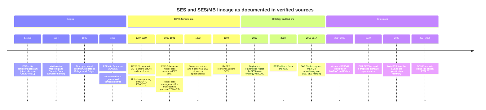
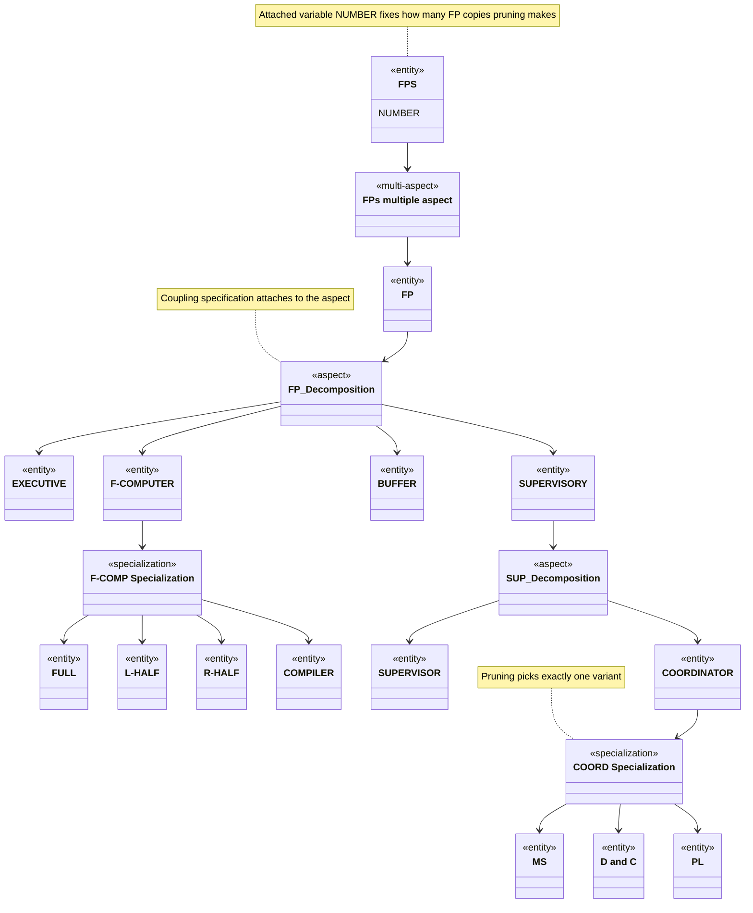
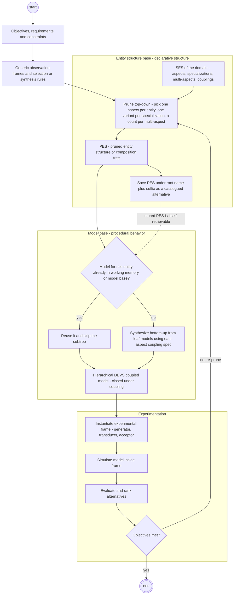

# Zeigler's SES/MB Prunes Design Spaces Into Models

> **Source copy.** This is the deep-research report produced on 2026-10-06 (repo path `reports/SES and model base methodology.md`), copied into the skill for verbatim lookup and lightly edited to remove personnel details. Relative links point into the `devs-skills-claude` repository. The curated files under `../reference/` take precedence over this text. The section "This repo's ses-designer references diverge from the sources in thirteen places" describes the `ses-designer` skill **before** commit `fa91953`, which fixed those discrepancies.

Bernard P. Zeigler's System Entity Structure / Model Base (SES/MB) methodology is a knowledge base in two halves. **The SES is the declarative half.** It is a labeled tree of entities, aspects (ways to decompose an entity), specializations (taxonomic variants) and multi-aspects (replication), with variables attached to nodes, couplings attached to aspects, and six well-formedness axioms. A single SES compactly describes a whole *family* of hierarchical DEVS models. **The model base (MB) is the procedural half**: a library of modular, port-based DEVS components. A modeler, or a rule engine driven by experimental frames, **prunes** the SES top-down into a pruned entity structure (PES). A **transform** step then pulls the matching components from the MB and couples them bottom-up into an executable coupled model. That synthesis is sound because DEVS is closed under coupling. The idea grew out of Zeigler's multifacetted-modelling program. Software existed by about 1980, the canonical book appeared in 1984, and the first formal definition in the open literature (1985) is credited jointly to Belogus and Zeigler. The tooling then passed through DEVS-Scheme/ESP-Scheme (1987–1991), an XML/ontology recasting (2007), MS4 Me's controlled-English `.ses`/`.pes` files, and third-party extensions, chiefly Wismar's procedural "extended SES" and DLR's XML SESTools. Applications cluster in about five research groups, and only one study reports a hard benefit figure (**up to 8% time and 23% cost savings**). Zeigler's newest work uses the SES as one model-family tool among several (MetaSES 2023, IoT design 2025). In the EFSUT line it appears only in an unpublished draft. The main open problems are the lack of a standard representation, coupling and multiplicity semantics that differ from tool to tool, automatic pruning of nested structures, variant explosion, and scarce empirical evidence. This repository's own `ses-designer` reference files also misstate several axioms and parts of the MS4 Me syntax (see the discrepancy section).

## A single tree for decomposition, taxonomy and coupling, dating from about 1980

The SES was built to solve a representation problem in Zeigler's **multifacetted modelling** methodology. That methodology, in Zeigler and Ören's words, "recognizes the irreducible complexity of reality, while affirming that useful partial models can be constructed in the service of limited decision making objectives," and depends on "an organized base of models whose partial perspectives can be integrated to achieve a coherent whole" ([Zeigler & Ören 1986, WSC](https://www.informs-sim.org/wsc86papers/1986_0108.pdf)). Organizing such a base needs three kinds of structural knowledge. Rozenblit and Zeigler name them explicitly: "decomposition, taxonomy, and coupling." Decomposition says how an object breaks into components. Taxonomy says "the kinds of variants that are possible for an object." Coupling is needed because "the components of a decomposition must be coupled together" ([Rozenblit & Zeigler 1985, WSC, p. 224](https://informs-sim.org/wsc85papers/1985_0048.pdf)). Zeigler framed the result as a generalization of something modelers already had: "By generalizing the composition tree concept so as to represent not just a single model, but a family of possible models, we arrive at the concept of system entity structure" ([Zeigler 1986, WSC, p. 135](https://informs-sim.org/wsc86papers/1986_0019.pdf)).

The 1984 book is usually cited as the starting point, but **the SES is older than the book**. The canonical statement is Zeigler's *Multifacetted Modelling and Discrete Event Simulation* (Academic Press, 1984) ([HathiTrust record](https://catalog.hathitrust.org/api/volumes/brief/isbn/0127784500.json)), alongside the methodological essay "Multifaceted modeling methodology: Grappling with the irreducible complexity of systems" ([Zeigler 1984, *Behavioral Science*](https://doi.org/10.1002/bs.3830290305)). Software came first, though. A 1987 paper refers to "ESP4 – Entity Structuring Program (Zeigler et. al., 1980)" ([Rozenblit & Huang 1987, p. 605](https://informs-sim.org/wsc87papers/1987_0086.pdf)); that 1980 reference itself is UNVERIFIED. By 1986 ESP-4 was "a PASCAL system available for VAX under VMS" ([Zeigler 1986, p. 137](https://informs-sim.org/wsc86papers/1986_0019.pdf)). The earliest formal definition found in open literature reads: "**Definition (Belogus [1], Zeigler [18]).** A system entity structure is a labeled tree with attached variable types" ([Rozenblit & Zeigler 1985, p. 225](https://informs-sim.org/wsc85papers/1985_0048.pdf)). The Belogus reference is a 1985 Weizmann Institute dissertation ([Mathematics Genealogy Project record](https://mathgenealogy.org/id.php?id=19314)). That record gives its title as "Methodology and Software Tools for Modeling and Simulating Multifaceted Systems...". Zeigler-group reference lists cite a different title, which is UNVERIFIED. The archived 1985 PDF is missing its reference list, so references [1] and [18] cannot be resolved from it. Two candidate antecedents are UNVERIFIED and are not relied on here: a 1979 North-Holland chapter and a 1978 *IJGS* paper ("Structuring the organization of partial models").

Two motives run side by side through the early papers. One is **model base management**: Zeigler's DEVS-Scheme environment "lends itself to model base organization using the entity structure knowledge representation" ([Zeigler 1987, *SIMULATION*](https://doi.org/10.1177/003754978704900506)). The other is **design-space representation for engineering design**: Rozenblit and Zeigler combined the three relations "as a step toward a unifying knowledge representation scheme for design support" ([Rozenblit & Zeigler 1993, p. 606](https://informs-sim.org/wsc93papers/1993_0084.pdf)). The timeline below covers only milestones whose sources are bibliographically verified, apart from the flagged 1980 entry.

## Four node types and six axioms make an SES well formed

### Entities, aspects, specializations and multi-aspects

An SES has **three structural node kinds plus a replication variant**. "Entities refer to conceptual components of reality for which models may reside in a library (model base)." An entity "may have several *aspects*, each denoting a decomposition," and "several *specializations*, each representing a classification of possible variants" ([Rozenblit & Zeigler 1993, p. 606](https://informs-sim.org/wsc93papers/1993_0084.pdf)). The vocabulary was chosen on purpose. "Entity" is used rather than "model" "since the entity may have several possible models to represent it," and "aspect" rather than "decomposition" "since there may be several possible decompositions for a given entity" ([Zeigler 1986, p. 135](https://informs-sim.org/wsc86papers/1986_0019.pdf)). The 1980s **multiple aspect**, later called the **multi-aspect**, decomposes a multiple entity into an indefinite number of copies of one entity. A variable such as `FPS.NUMBER` records how many copies to make ([Zeigler 1986, p. 136](https://informs-sim.org/wsc86papers/1986_0019.pdf)). The MS4 Me guide, citing Zeigler and Hammonds, defines it as "a special case of an aspect except that it has only one child called its multi-entity – which can generate a specified number of copies" ([MS4 Me User's Guide, pp. 120–121](../../../../docs/ses/MS4_Me_Users_Guide.pdf)). The guide is undated; the PDF was created on 2021-10-19.

Knowledge is attached to nodes in three ways. **Variables** attach to items: "a variable I.V may be used to describe the item occurrence I," written with a `~` prefix in figures ([Rozenblit & Zeigler 1985, p. 225](https://informs-sim.org/wsc85papers/1985_0048.pdf); [Rozenblit & Huang 1987, p. 607](https://informs-sim.org/wsc87papers/1987_0086.pdf)). **Coupling constraints attach to aspects** and **selection constraints attach to specializations**. Coupling constraints "restrict the way in which components ... can be joined together," and selection constraints "restrict the way in which [an entity's] subentities may replace it" ([Rozenblit & Huang 1987, p. 604](https://informs-sim.org/wsc87papers/1987_0086.pdf)). Couplings sit on aspects because a coupling belongs to one particular decomposition. Zeigler puts the coupling specification "with the line descending from AB before it splits into the components A and B" ([Zeigler 1986, p. 130](https://informs-sim.org/wsc86papers/1986_0019.pdf)). A constraint must attach to the **minimal aspect that scopes all entities it mentions** ([Rozenblit & Zeigler 1985, p. 225](https://informs-sim.org/wsc85papers/1985_0048.pdf)). The 1980s figures draw aspects as single lines, specializations as double vertical lines, and multiple aspects as triple vertical lines. Only the triple line is named in the text; the other two conventions were read from the figures.

The diagram below simplifies Zeigler's flexible-processor (FP) example ([Zeigler 1986, pp. 135–136](https://informs-sim.org/wsc86papers/1986_0019.pdf)). Entity, aspect and specialization labels follow the paper's text. The multi-aspect node's label is illustrative, since the text does not name it.

### The six axioms, stated precisely

From 1993 onward the Zeigler group names **six axioms**. The 1993 paper credits them to the 1984 book: "uniformity, strict hierarchy, alternating mode, inheritance, valid siblings, and attached variables (Zeigler 1984)" ([Rozenblit & Zeigler 1993, p. 606](https://informs-sim.org/wsc93papers/1993_0084.pdf)). The most precise accessible wording comes from a 2019 paper coauthored by Zeigler that cites the 2017 *Guide* ([Traoré, Zacharewicz, Duboz & Zeigler 2019, *SIMULATION*, accepted manuscript p. 6](http://agritrop.cirad.fr/588108/1/Valued-based-Healthcare-Simulation.pdf); [DOI](https://doi.org/10.1177/0037549718776765)). Zeigler's own verbatim wording in the 1984, 1990, 2007 and 2013/2017 books could not be opened.

| Axiom | Definition (Traoré et al. 2019) | What it forbids in practice |
|---|---|---|
| Uniformity | "any two nodes with the same labels have isomorphic subtrees" | Two `Engine` nodes anywhere in the tree with different substructure |
| Strict hierarchy | "prohibits a label from appearing more than once down any path of the tree" | Recursion (a system nested inside itself), unless the axiom is relaxed |
| Alternating mode | "if a node is an Entity, then the successor is either Aspect or Specialization, and vice versa" | Entity directly under entity, or aspect directly under aspect or specialization |
| Valid brothers (valid siblings) | "forbids having two brothers with the same label" | Duplicate labels among any node's children |
| Attached variables | "variable types attached to the same item shall have distinct names" | Two variables with the same name on one item |
| Inheritance | "Specialization inherits all variables and Aspects from the parent Entity to the children Entities" | A specialized variant losing its general entity's structure |

The axiom set did **not** start out stable. The 1985 list reads "alternation entity/aspect, entity/specialization, strict hierarchy, inheritance: birth, life, multiple entity" ([Rozenblit & Zeigler 1985, p. 225](https://informs-sim.org/wsc85papers/1985_0048.pdf)), and the accessible pages never explain "birth, life." Alternating mode limits how layers stack along a path. It does not stop one entity from carrying both aspects and specializations. The 1985 automotive example gives entity CAR "Physical Decomposition, Service Aspect, and Utility Specialization" ([p. 228](https://informs-sim.org/wsc85papers/1985_0048.pdf)), and aspects and specializations "each alternate with entities, but cannot be hung from each other" ([p. 225](https://informs-sim.org/wsc85papers/1985_0048.pdf)). **Strict hierarchy is the one axiom the Zeigler group itself has bent.** To build a recursive canonical SES of system specifications, "we must relax the strict hierarchy SES axiom as in Cho (1993)" ([Rozenblit & Zeigler 1993, p. 607](https://informs-sim.org/wsc93papers/1993_0084.pdf)); the Cho reference is UNVERIFIED.

### Pruning is a choice function that yields one PES

**Pruning** is defined procedurally. First "remove the specializations to obtain an entity structure containing only entities and aspects." Then synthesize models "by working our way down the entity structure selecting a single aspect for each entity and zero or more entities for each aspect" ([Rozenblit & Zeigler 1985, p. 225](https://informs-sim.org/wsc85papers/1985_0048.pdf)). The same paper gives a recursive `Procedure Prune(E_j, CV_GOF, V_GOF)` that keeps only the substructures that serve a "generic observation frame." Its output is "decomposition trees," each "a skeleton for a hierarchical model construction" ([pp. 226–227](https://informs-sim.org/wsc85papers/1985_0048.pdf)). In the FP example the walk is concrete. Start at the root, choose how many FPs (`FPS.NUMBER`), choose how they are coupled, select an F-COMPUTER variant for each FP, and then "follow bottom-up synthesis to construct the new model" ([Zeigler 1986, p. 136](https://informs-sim.org/wsc86papers/1986_0019.pdf)). Specializations require "a choice of a unique entity," and **constraint-driven pruning** automates the choice with two rule sets. Selection rules choose an entity within a specialization; synthesis rules, attached to aspects, "ensure proper configuration of the selected entities" ([Rozenblit & Huang 1987, pp. 604–607](https://informs-sim.org/wsc87papers/1987_0086.pdf); journal version [Rozenblit & Huang 1991, *ORSA J. Computing*](https://doi.org/10.1287/ijoc.3.4.330)).

The name of the result changed over time, from "decomposition tree" and **"model composition tree"**, a tree "whose leaf nodes are system specifications" ([Rozenblit & Zeigler 1993, pp. 606–607](https://informs-sim.org/wsc93papers/1993_0084.pdf)), to **pruned entity structure (PES)**. MS4 Me states it plainly: "A PES is a pruned SES ... A PES specifies one of those configurations that will be used to run a simulation" ([MS4 Me guide, pp. 17, 168](../../../../docs/ses/MS4_Me_Users_Guide.pdf)). Taken together, the sources describe pruning as a **choice function**: one aspect per entity, one child per specialization, and a multiplicity per multi-aspect, after which inheritance pushes the general entity's variables and aspects onto the chosen variant. That formulation is a synthesis of the sources; no single source states it as a definition. MS4 Me resolves multi-aspects with an idiom of its own. A specialization (`Person can be id in index!`) serves as a replica index. The PES then states `restructure multiaspects using index!` and `set multiplicity of index as [3] for Person!`, which generates `id0_Person`, `id1_Person` and `id2_Person`. "These new entities are added to the (ordinary) aspect under the grand-parent entity and the multi-aspect is removed from the SES," and each copy "can be pruned independently" ([MS4 Me guide, pp. 120–122](../../../../docs/ses/MS4_Me_Users_Guide.pdf)).

### Ontology, grammar and algebra readings

The Zeigler group has described the SES in several ways over the decades: as "a declarative scheme related to frame-theoretic and object-based representations" ([Zeigler 1986, p. 137](https://informs-sim.org/wsc86papers/1986_0019.pdf)), as "generative" ([Rozenblit & Zeigler 1993, p. 604](https://informs-sim.org/wsc93papers/1993_0084.pdf)), and from 2007 as an **ontology framework with "pragmatics."** The Zeigler–Hammonds book says the SES "enables automating the development of XML dtds and schemas" ([Zeigler & Hammonds 2007, Elsevier](https://shop.elsevier.com/books/modeling-and-simulation-based-data-engineering/zeigler/978-0-12-372515-8)). A 2008 abstract gives the mapping: "an SES is represented by a schema or DTD whose instance documents represent possible prunings" ([Cheon, Kim & Zeigler 2008, SEDE; OpenAlex record only, no DOI, PARTIALLY VERIFIED](https://api.openalex.org/works?search=System%20Entity%20Structure%20for%20XML%20Meta%20Data%20Modeling%20Climate%20Normals)). By 2019 the description is "a formal ontology framework, axiomatically defined" ([Traoré et al. 2019](http://agritrop.cirad.fr/588108/1/Valued-based-Healthcare-Simulation.pdf)). Two common readings are **inferences, not quotations**. The first is the AND-OR tree reading: an aspect keeps all its children (AND), a specialization or a choice among aspects is exclusive (OR), and a multi-aspect is AND over a chosen count. The second is the generative-grammar reading. No examined source claims the SES is formally more expressive than XML Schema.

Algebraic formalizations exist but are hard to reach. ESP-Scheme gave the "computer representation of SES and main operations on SES" ([Kim, Lee, Christensen & Zeigler 1990, *IEEE SMC*](https://doi.org/10.1109/21.59966)). The 1993 paper tied a canonical SES to the coupled-system structure N = <D, {S_a}, {I_a}, {Z_a}> ([Rozenblit & Zeigler 1993, pp. 605–607](https://informs-sim.org/wsc93papers/1993_0084.pdf)). **RASES** stores an SES as relations and expresses SES operations in relational algebra ([Park, Lee & Kim 1994, WSC](https://doi.org/10.1109/wsc.1994.717403); [1996 journal version](https://doi.org/10.1049/ip-cdt:19960166)). Traoré et al. report that Zeigler and Hammonds (2007) give "a formal set-theoretic characterization of the SES that shows how the axioms are satisfied," but that text was not seen. Notably, *Theory of Modeling and Simulation*, 3rd ed., has **no SES-titled chapter** ([Crossref listing](https://doi.org/10.1016/c2016-0-03987-6)). The SES lives mainly in the 1984, 1990, 2007 and 2013/2017 books, not in the TMS series.

## Prune top-down, synthesize bottom-up: the SES/MB loop

### What the model base holds and how it was managed

In DEVS-Scheme the knowledge base had two stores. **ENBASE** held entity-structure and pruned-entity-structure files. **MBASE** held model-definition files and state-variable files. ESP-Scheme operations (`make-entstr`, `add-item`, `prune`, `save-entstr`, `load-entstr`) worked on one side, DEVS-Scheme operations (`retrieve`, `store`, `save-state`) worked on the other, and **`transform`** (with an `inv-transform`) linked the two ([Rozenblit, Kim & Zeigler 1988, WSC, Fig. 3, p. 228](https://www.informs-sim.org/wsc88papers/1988_0033.pdf)). The semantics of `inv-transform` are not described in the accessible text. Kim's 1988 dissertation names the halves a "structural knowledge base called entity structure base" and a "behavioral knowledge base called model base" ([Kim 1988, University of Arizona](http://hdl.handle.net/10150/184380)). The MB stores **modular** models with explicit ports. In 1986 these were file sets: `.io`, `.stat` and `.dyn` for atomic models, and `.io`, `.comp` and `.coup` for coupled models ([Zeigler 1986, pp. 133–135](https://informs-sim.org/wsc86papers/1986_0019.pdf)). Experimental frames live there too, "realized as models of special kinds: generators, transducers, acceptors" ([Zeigler, Hu & Rozenblit 1989, WSC, p. 85](https://www.informs-sim.org/wsc89papers/1989_0012.pdf)). Pruned structures are **catalogued**: "Pruned entity structures are given the name of their root entity together with a user supplied suffix so that they can be identified as representing alternative models of the root entity." The authors preferred this form for archiving because it fosters "accumulative growth of 'off-the-shelf' reusable components" ([Zeigler, Hu & Rozenblit 1989, p. 86](https://www.informs-sim.org/wsc89papers/1989_0012.pdf)). The originators used the term "system entity structure/model base framework" themselves ([Zeigler, Luh & Kim 1990](https://doi.org/10.1109/aihas.1990.93938)). Coherence and evolvability of large bases led to **context-sensitive pruning** and **partitioned entity structure bases** ([same](https://doi.org/10.1109/aihas.1990.93938); journal version [Zeigler, Luh & Kim 1991, *ACM TOMACS*](https://doi.org/10.1145/140765.140791)). MS4 Me keeps the same split on disk: `dnl` and `java` hold behavior, and `ses` and `pes` hold structure ([MS4 Me guide, p. 160](../../../../docs/ses/MS4_Me_Users_Guide.pdf)).

### The steps, the operations, and why synthesis is sound

The workflow has been the same since 1985. "The objectives and requirements of the design project induce appropriate generic experimental frames." "The design entity structure is pruned with respect to the generic frames." "The pruned substructures serve as skeletons for generating rules for synthesis." Finally, "resulting models are evaluated in respective experimental frames and the best design models are chosen" ([Rozenblit & Zeigler 1985, pp. 223–224](https://informs-sim.org/wsc85papers/1985_0048.pdf)). Upon `transform`, "the system searches the model base for model components specified in the model composition tree and synthesizes the desired model by coupling them together in a hierarchical manner" ([Rozenblit, Kim & Zeigler 1988, p. 226](https://www.informs-sim.org/wsc88papers/1988_0033.pdf)). **Transform short-circuits.** It looks for a model of the current entity "first in working memory, then in model definition files, and finally, provided that the entity is a leaf, in pruned-entity structure files." If it finds one, "transformation of the entity subtree is aborted" ([p. 228](https://www.informs-sim.org/wsc88papers/1988_0033.pdf)). This lookup is what makes stored models and PESs reusable building blocks. Later restatements keep the same shape: the PES "is eventually synthesized into a simulation model by combining it with models in the model base" ([Cheon, Kim & Zeigler 2008, IRI](https://doi.org/10.1109/iri.2008.4583078)). MS4 Me renders the steps as "Prune SES to PES," `write class files!`, and "Run PES file in SimViewer" ([MS4 Me guide, pp. 17–19, 132](../../../../docs/ses/MS4_Me_Users_Guide.pdf)).

Soundness comes from **modularity plus closure under coupling**, not from a separate theorem about pruning. Coupled models have "the same interface properties as the components," so "hierarchical construction follows as a consequence of modularity and closure under coupling," and each stage is "independently verifiable" ([Zeigler, Hu & Rozenblit 1989, pp. 84–85](https://www.informs-sim.org/wsc89papers/1989_0012.pdf)). The argument is an induction from the leaves up: every interior PES node is an aspect with a coupling specification, so each one yields a well-formed DEVS. Synthesis therefore "requires only that the lowest level atomic-models referenced by a pruned entity structure reside in the model base" ([p. 86](https://www.informs-sim.org/wsc89papers/1989_0012.pdf)). Replicated copies get a separate guarantee. A copy "must be isomorphic to the original as determined by the isomorphism test" ([Rozenblit, Kim & Zeigler 1988, pp. 228–229](https://www.informs-sim.org/wsc88papers/1988_0033.pdf)).

### Experimental frames steer pruning, then run against the result

Experimental frames play **two roles**. Before pruning they are filters. "The generic experimental frame is a structure that represents a set of design objectives in the form of standard variable types," and it automatically determines "a) the aspects that are selected for each entity, b) the depth of the pruning process, c) the descriptive variables of components" ([Rozenblit & Zeigler 1985, pp. 223, 226](https://informs-sim.org/wsc85papers/1985_0048.pdf)). In the paper's car example, pruning by a "Gasoline Consumption" frame removes the Service aspect and the electric and steam engines. A Department of Transportation *standard* then prunes out two-cycle engines, and the resulting PES is coupled to the refined frame for simulation ([pp. 227–230](https://informs-sim.org/wsc85papers/1985_0048.pdf)). After pruning, the frames run as executable generator, transducer and acceptor models coupled to the synthesized model. DEVS-Scheme's "Layer 3" took this furthest. It used goal-driven pruning with selection and synthesis rules, generated experimental frames automatically from "the algebraic expression of a defined performance index," and ranked designs "according to multi-criteria decision methods," all through FRASES ([Zeigler, Hu & Rozenblit 1989, pp. 86–89](https://www.informs-sim.org/wsc89papers/1989_0012.pdf)). The MS4 Me guide documents nothing comparable to that automated ranking. Its frame components are ordinary entities in the same SES, as in the EFP example with a generator, processors and a transducer ([MS4 Me guide, pp. 53–54, 126–128](../../../../docs/ses/MS4_Me_Users_Guide.pdf)).

The resulting design space has three axes. **Specializations** give qualitative alternatives, **multi-aspects** give cardinality alternatives, and **attached variables** give parametric alternatives. The knowledge base is meant to be "a compact representation scheme which can be unfolded to generate the family of all possible models synthesizable from components in the model base" ([Rozenblit, Kim & Zeigler 1988, p. 228](https://www.informs-sim.org/wsc88papers/1988_0033.pdf)). Rules can correlate selections "in various parts of the SES" and be "sensitive to the context" ([Zeigler, Hu & Rozenblit 1989, p. 86](https://www.informs-sim.org/wsc89papers/1989_0012.pdf)). MS4 Me adds a crude sampler: "When running a simulation from a partial PES, any unmade choices will be randomly selected" ([MS4 Me guide, p. 168](../../../../docs/ses/MS4_Me_Users_Guide.pdf)). No source reports quantitative reuse metrics; the reuse benefits are asserted qualitatively.

## Every generation rebuilt the tools, and the tools now disagree

### From ESP-4 to MS4 Me

The implementation lineage is well documented. **ESP-4** (Pascal) provided "Entity Structure & Pruner, Large Entity Structure Management, Model Integration." **ESP-SCHEME** added structuring, pruning and constraint-driven pruning. **TRANSFORM** did synthesis, and **DEVS-SCHEME** handled simulation. Rule-based pruning ran in the Turbo Prolog shell **MODSYN** ([Rozenblit, Kim & Zeigler 1988, Fig. 1, p. 227](https://www.informs-sim.org/wsc88papers/1988_0033.pdf)). DEVS-Scheme was organized in four layers: Lisp objects, system specification, SES/MB, and systems design. It was being "commercialized by SIMEX" and used for NASA Ames laboratory robots ([Zeigler, Hu & Rozenblit 1989](https://www.informs-sim.org/wsc89papers/1989_0012.pdf)). Its compendium is Zeigler's 1990 *Object-Oriented Simulation with Hierarchical, Modular Models*, which includes a chapter titled "System Entity Structures" ([Open Library](https://openlibrary.org/isbn/9780127784526)). Later Java and XML work moved to **SESBuilder**, which offered "natural language input for an SES definition and XML instance generation of its PES" ([Cheon, Kim & Zeigler 2008](https://doi.org/10.1109/iri.2008.4583078)). An earlier "verb phrase" SES paper exists ([Simard, Zeigler & Couretas 1994](https://doi.org/10.1109/AIHAS.1994.390473)). SES analysis also ran over DEVS/SOA ([Kim, Seo & Zeigler 2009](https://doi.org/10.1177/0037549709354112)). **No primary source attributes specific SES/MB features to DEVSJAVA or DEVS-C++.** The DEVS-C++ abstract does not mention the SES at all ([Zeigler, Moon, Kim & Kim 1996](https://doi.org/10.1109/hicss.1996.495481)).

**MS4 Me** is the current Zeigler-lineage tool, and the *Guide* devotes chapters to "System Entity Structure Basics," "Specialization and Pruning," "Aspects and Multi-aspects," "Managing Inheritance in Pruning" and "Automated and Rule-Based Pruning [and Experimental Execution]" ([Zeigler & Sarjoughian 2017](https://doi.org/10.1007/978-3-319-64134-8); [2013 ed.](https://doi.org/10.1007/978-0-85729-865-2)). MS4 Me's SES is **controlled English with statements ending in `!`**. Aspects read `from the X perspective, Y is made of A, B and C!`, multi-aspects `... is made of more than one U!`, and specializations `E can be A or B in LABEL!`. Couplings read `A sends M to B [as N]!`, with `all`/`each` quantifiers over replicas. Port names are derived from message names (`outBye` → `inBye`), and all-to-all coupling omits self-couplings ([MS4 Me guide, App. 2 pp. 173–178, pp. 122–124](../../../../docs/ses/MS4_Me_Users_Guide.pdf)). The coupling scope rule is explicit: messages pass only between a subsystem and its parent or within one aspect, with "the only exception" that "the subsystem of a multi-aspect can send messages to siblings of its parent system" ([p. 176](../../../../docs/ses/MS4_Me_Users_Guide.pdf)). PES directives include `select X from SPEC for E!`, `inherit from X!`, `restructure multiaspects using A then B!`, `set multiplicity ...`, `mergeAll from X.ses!`, `don't select CC under AA!` and `write class files!` ([pp. 26, 121–129, 157–158](../../../../docs/ses/MS4_Me_Users_Guide.pdf)). Three conventions matter in practice. First, selected specializations get **empty behavior** unless the PES says `inherit from` ([p. 26](../../../../docs/ses/MS4_Me_Users_Guide.pdf)). Second, unmade choices are filled at random. Third, nested multi-aspects share one multiplicity, which the guide calls "a limitation on the expressiveness of the current version" ([p. 127](../../../../docs/ses/MS4_Me_Users_Guide.pdf)). MS4 Systems also provided a cloud "Model Store" for sharing model suites ([Zeigler, Seo & Kim 2013](https://doi.org/10.1142/s1793962313400060)). The current MS4 Systems site promotes a web version "Integrated with GPT3.0" and does not mention the SES ([ms4systems.com](https://ms4systems.com/)).

### Two XML traditions and the Wismar "extended SES"

Two incompatible XML mappings coexist, and **they should not be conflated**. In the Zeigler–Hammonds tradition, which Mittal and Risco-Martín reused, the SES *generates* a domain XML Schema. "Tools have been developed to transform SESs back and forth to XML ... SES structures are compact relative to equivalent Schema." Behavior travels separately in XFD-DEVS, and a model synthesized from a PES "doesn't contain the behavior specifications" ([Risco-Martín, de la Cruz, Mittal & Zeigler 2009, eUDEVS](https://doi.org/10.1177/0037549709104727); see also [Mittal & Risco Martín 2013](https://doi.org/10.1201/b13971)). In the DLR/TU Clausthal tradition, the SES is itself an *instance* of a fixed meta-schema. SESTools' `ses.xsd` (XML Schema 1.1) defines `entity`, `aspect`, `multiAspect`, `specialization` and `var`. Assertions check strict hierarchy, sibling uniqueness and variable uniqueness, but the schema has **no coupling element** and no uniformity check ([SESTools ses.xsd](https://github.com/aeronautical-informatics/SESTools/blob/HEAD/SESEditor/src/main/java/dlr/xml/schema/ses.xsd)). Selection constraints are written in XPath ([SESTools README](https://github.com/aeronautical-informatics/SESTools)).

The Hochschule Wismar group, working with DLR and with Zeigler, built the most substantial third-party extension, **eSES/MB**. It added global **SES variables** constrained by semantic conditions; **selection rules**, **aspect rules** and cross-tree **selection constraints**; `numRep` at multi-aspects; a leaf `mb` link to the model base; coupling 4-tuples `{'SrcEntity','FromPrt','SinkEntity','ToPrt'}`; and **SESFunctions**, which "extend the declarative specification defined by the baseline SES by procedural knowledge descriptions" and are evaluated during pruning ([Pawletta, Schmidt, Durak & Zeigler 2018, SNE 28(1)](https://doi.org/10.11128/sne.28.tn.10402); first proposed in [Pawletta, Schmidt, Zeigler & Durak 2016](https://doi.org/10.22360/springsim.2016.anss.061)). Further additions are a **NONE** element for optional features, **merge**, and **flattening** to an FPES ([Folkerts, Pawletta, Deatcu & Durak 2017, SNE 27(4)](https://doi.org/10.11128/sne.27.tn.10391)). An outer **Experiment Control / Execution Unit** loop "computes new settings for SESVariables" for reactive, automated generation of variants ([SNE 28(1)](https://doi.org/10.11128/sne.28.tn.10402); [book chapter, Pawletta, Durak & Schmidt 2019](https://doi.org/10.1016/B978-0-12-813543-3.00018-4)). The group treats Zeigler's axioms as constraints to respect. It claims "a complete solution without violation of the strict hierarchy axiom" for the recursion problem Rozenblit and Zeigler had solved by relaxation, and it renames replicas "to comply with the valid brothers axiom" ([SNE 28(1), pp. 14–16](https://doi.org/10.11128/sne.28.tn.10402)).

| Tool (lineage) | Representation | Couplings | Multiplicity | Pruning control | Status |
|---|---|---|---|---|---|
| ESP-4 / ESP-Scheme + DEVS-Scheme (Arizona) | Pascal, then Scheme frames | Coupling specification per aspect | Variable on multiple entity (e.g., `FPS.NUMBER`) | Interactive plus rule-driven (MODSYN, FRASES) | Historical (1986–1991) |
| SESBuilder (Arizona) | Java, XML DOM, restricted natural language | Natural-language coupling statements | Not documented in the sources reviewed | PES as XML instance | 2008 paper |
| MS4 Me (MS4 Systems) | Controlled-English `.ses`/`.pes` | Message-named, `out`/`in` ports, `all`/`each` | Index specialization plus `set multiplicity`; restructure flattens | Interactive or textual; random completion | Guide undated (PDF 2021); site now promotes a GPT web version |
| SES Toolbox (Wismar, MATLAB) | Toolbox internals | Computed 4-tuples via SESFunctions | `numRep`, SES variables | Rule- and function-driven, EC/EU loop | v1.7; last push 2022-06; currently Simulink-only ([README](https://github.com/cea-wismar/SES_Tbx_Matlab)) |
| SESToPy/SESMoPy (Wismar, Python) | Positional JSON plus Python files | Computed tuples | `numRep` | Rule-driven; README admits "selections constraints in pruning ignored" | Last push 2021–2022 ([README](https://github.com/hendrikfolkerts/sestopy)); targets Simulink, Dymola, OpenModelica, FMI ([SNE 29(4)](https://doi.org/10.11128/sne.29.tn.10497); [SNE 31(1)](https://doi.org/10.11128/sne.31.tn.10554)) |
| SESEditor/PESEditor (DLR / TU Clausthal) | XML instance of `ses.xsd` 1.1 | None in schema | Set during pruning, XPath constraint | Interactive | Last push 2023-06 ([repo](https://github.com/aeronautical-informatics/SESTools); [Karmokar et al. 2019](https://doi.org/10.2514/6.2019-1712)) |
| CoSMoS (ASU; replaced SESM) | Visual, families of models | Generates DEVS-Suite coupled code | Not documented in the sources reviewed | Model families | JRE 1.5–1.7 era ([ACIMS](https://acims.asu.edu/software/cosmos); [Sarjoughian & Elamvazhuthi 2009](https://doi.org/10.4108/icst.simutools2009.5744)) |

Read across, the table shows **where the tools split**. They agree on the four node types and on pruning in outline. They diverge on where couplings live and how ports are named, where multiplicity is specified and whether expansion restructures the tree, whether pruning is done by a person, at random, or by rules and functions, whether procedural code may sit inside the SES, and how the SES is serialized. Coupling semantics are the least standardized part. MS4 Me's message-named ports, eSES's computed tuples and SESTools' absent couplings cannot be translated into one another without losing information. A 2019 proposal for a "standard computational representation" ([Karmokar, Durak, Hartmann & Zeigler, SummerSim 2019 per the DLR elib record, no DOI found](https://elib.dlr.de/130764)) has not unified them. Other extensions include abstraction hierarchies and time granularity implemented in DEVSimPy ([Santucci, Capocchi & Zeigler 2016](https://doi.org/10.1177/0037549716657168)) and activity-metric selection among SES family models ([Capocchi et al. 2020](https://doi.org/10.1016/j.simpat.2020.102122)). No verified SES-to-OWL mapping paper turned up beyond one healthcare application, and no SysML import or export tool either. SES-X couples the SES with the X language, not with SysML ([Xie et al. 2023](https://doi.org/10.3390/info14010023)).

## Applications cluster in five research groups and report one hard number

Since 2010, SES/MB has been used mostly as a **design-space or configuration-space representation that is pruned into variants**. Uses as an information-exchange ontology and as a model-suite organizer are less common. The work clusters in five places: the University of Arizona and RTSync, Hochschule Wismar with DLR and TU Clausthal, Korean defense M&S groups, the University of Corsica, and Beihang University's X-language line. Most papers outside these groups are one-off uses. **Defense and C2** work includes Link-16 conformance test models written "in an XML-SES format" ([Mak, Mittal, Hwang & Nutaro 2010](https://doi.org/10.1177/1548512909358585)) and SES pruning to fuse data for commanders in an air-defense scenario ([Lee & Zeigler 2010, JDMS](https://doi.org/10.1177/1548512910365063)). It also includes Korean armored-vehicle vulnerability analysis ([H.K. Kim, Hwang & Lee 2015](https://doi.org/10.9709/jkss.2015.24.4.059)) and a federation-oriented SoSES/FB extension, motivated by the statement that "SES/MB is limited in simulating the system of systems using HLA/RTI" ([B.S. Kim, Choi & T.G. Kim 2013](https://doi.org/10.5555/2499986.2499990)). **Manufacturing and process industry**, led by Wismar, couples the SES with optimizers. Hagendorf et al. used evolutionary search over SES-derived structure parameters ([Hagendorf, Pawletta & Larek 2013](https://doi.org/10.1177/0037549713500066)), Rentsch et al. ran genetic algorithms over SES-structured countershaft process chains ([Rentsch, Heinzel & Brinksmeier 2015](https://doi.org/10.1016/j.procir.2015.06.026)), and Folkerts et al. derived variants automatically from hierarchical multi-aspects ([Folkerts, Pawletta & Durak 2023](https://doi.org/10.11128/sne.33.tn.10633)). One-off uses include floating LNG liquefaction-cycle generation ([Ha & Lee 2014](https://doi.org/10.2478/ijnaoe-2013-0200)), wafer-failure patterns ([Han et al. 2010](https://doi.org/10.1587/transinf.e93.d.2001)), counterfeit-PPE supply-chain structure calibration ([van Schilt et al. 2024](https://doi.org/10.1016/j.aei.2024.102926)), healthcare ontology linked to OWL ([Djitog & Kah 2020](https://doi.org/10.4018/ijphim.2020010105)), robot task controls ([Schwatinski, Pawletta & Pawletta 2012](https://doi.org/10.11128/sne.22.tn.10135)) and Q-learning within DEVS and SES ([Capocchi & Santucci 2022](https://doi.org/10.3390/info13030121)).

The **most active line since 2015 is aerospace scenario engineering** at DLR, TU Clausthal and Embry-Riddle. It began with SES-generated experimental frames for model-based testing of Simulink models ([Schmidt, Durak & Pawletta 2016](https://doi.org/10.1177/0037549716656791)). It moved on to SES metamodels of flight-simulator scenarios ([Durak et al. 2017](https://doi.org/10.2514/6.2017-1076)) and an aviation scenario language metamodeled in both SES and Ecore ([Jafer, Chhaya, Zeigler & Durak 2018](https://doi.org/10.58940/2374-6793.1248)). It now centers on the **ODME** toolkit, "a successor to the SES tools," in which expert knowledge goes into an SES domain model, pruning yields scenarios, and execution in MATLAB or Gazebo feeds assessment back into the model ([Naja, Gupta, Durak & Hartmann 2024, SNE 34(1)](https://doi.org/10.11128/sne.34.tn.10672)). Related work defines a scenario-coverage metric against an operational design domain ([Gupta, Sprockhoff & Durak 2025](https://doi.org/10.2514/6.2025-2326)) and uses the SES as a meta-level ontology for synthetic training data for an AI drogue detector ([Gupta, Durak, Ellis & Torens 2022](https://doi.org/10.2514/6.2022-2103)). Here the SES fills the "logical scenario" role that OpenSCENARIO-style standards leave open. No SES scenario paper from a mainstream automotive OEM was found.

**Quantified outcomes are rare.** The clearest number comes from a wireless-sensor-network framework reporting "up to 8% time savings and up to 23% cost savings as compared to the manual extra effort" ([Nam & H.J. Kim 2021, *Sensors*](https://doi.org/10.3390/s21020430)). Head-to-head comparisons are qualitative and each rests on one case. Against MATLAB/Simulink Variant Manager, "the Variant Manager interfaces of submodels are static, while the eSES/MB approach allows to define variable interfaces and couplings." Modeling effort did "not differ considerably," students found eSES/MB "a lot easier to get started with," and the authors concede "a final comparison is not possible on the basis of just one example" ([Deatcu, Pawletta & Folkerts 2019, SNE 29(1)](https://doi.org/10.11128/sne.29.sw.10466)). Against OWL/EMF, the two methods produced an identical sample scenario. SES/XML was framework-independent but "follows more rigid guidelines," and "an understanding of SES is required to comprehend and edit these files" ([Jafer, Chhaya, Updegrove & Durak 2018](https://doi.org/10.5281/zenodo.11114155)). **No published comparison of the SES with feature models, SysML v1/v2 variability, or design-space-exploration tools was found**, even though the Wismar group maps SES patterns onto feature-model relations. In that mapping, aspects give AND and specializations give XOR, while optional and OR features need the NONE extension ([Folkerts et al. 2017](https://doi.org/10.11128/sne.27.tn.10391)).

## Zeigler now treats the SES as one model-family tool among several

Zeigler's own SES work since 2013 has moved through four phases. **First, model suites (2013–2017).** He built "suites of models" by SES merging, with a healthcare example and hosting on the Model Store ([Zeigler, Seo & Kim 2013](https://doi.org/10.1142/s1793962313400060)), and wrote the *Guide*'s SES and pruning chapters ([Zeigler & Sarjoughian 2017](https://doi.org/10.1007/978-3-319-64134-8)). **Second, extensions and multiresolution families (2016–2019).** This phase covers abstraction hierarchies ([Santucci, Capocchi & Zeigler 2016](https://doi.org/10.1177/0037549716657168)); SES/MB positioned as metamodeling and model transformation ([Durak, Pawletta, Oğuztüzün & Zeigler 2017](https://doi.org/10.22360/springsim.2017.mod4sim.001)); an argument that MBSE lacks the "capability to develop multifaceted models" ([Zeigler, Mittal & Traoré 2018](https://doi.org/10.3390/systems6040040)); and UAV service-system design from "a collection of partial models, each oriented to one or more objectives," built with DEVS and SES in MS4 Me ([Zeigler & D. Kim 2019](https://doi.org/10.23919/springsim.2019.8732861)). **Third, the MetaSES (2023).** This step works "toward a unification of ... the hierarchy of system specifications and morphisms and the System Entity Structure," proposing "an abstraction of the SES called the MetaSES that supports the construction of complex systems of systems with multiple components belonging to specified classes" ([Zeigler 2023, *Information* 14(1):22](https://doi.org/10.3390/info14010022)). **Fourth, IoT and EFSUT (2025–2026).** The SES appears as a supporting element in IoT design, where it organizes "models and generating alternative system configurations" ([Capocchi, Zeigler & Santucci 2025, *Computers*](https://doi.org/10.3390/computers14070258)), and in EFSUT.

The EFSUT link is **thinner than it may look**. The published EFSUT paper's abstract does not mention the SES ([Zeigler 2026, *Systems* 14(6):691](https://doi.org/10.3390/systems14060691)). A local manuscript marked "Submitted to: Digital Engineering and Digital Twin" ([local draft](../../../../docs/efsut/Three%20Complementary%20Uses%20of%20the%20EFSUT%20Methodology.docx)) does not use the SES in its main text. An appended draft section prunes an SES with EF and Model aspects into "ten ... EF/Model pairings," claiming "Pruned SES ensures no over-modeling." That section is **unpublished and not peer reviewed**. It also expands EFSUT inconsistently ("Entities, Functions, Structure, Usage, Time"), so it should be treated as a draft idea, not a result. Zeigler's other recent lines carry no SES in their abstracts: homomorphism-based model families ([Zeigler, Koertje & Zanni 2024](https://doi.org/10.1177/00375497241264834)), the LLM assistant GEM DEVS Chat ([Graciano Neto et al. 2024](https://doi.org/10.5753/mssis.2024.3714)), and LLM "model seeds" completed by SAT/SMT synthesis ([Alshareef & Zeigler 2026, *Logics*](https://doi.org/10.3390/logics4030007)). The **ParaDEVS** (Paratemporal DEVS) papers do not discuss the SES either ([Zeigler 2024, *Systems* 12(3):80](https://doi.org/10.3390/systems12030080); [Zeigler, Koertje, Zanni, Yoon & Dutan 2024, WSC advanced tutorial](https://doi.org/10.1109/wsc63780.2024.10838748)). ParaDEVS is a tree-expansion method for fast stochastic simulation and is distinct from Parallel DEVS. The overall pattern is that the model family is now the organizing idea, and Zeigler builds families with morphisms, experimental-frame partial orders and the MetaSES as well as with the classic SES.

## Open problems: couplings, multiplicity, scale and evidence

The originators acknowledged real costs early. Modularity means "some work must be put into preparing model descriptions appropriately" ([Zeigler 1986, p. 131](https://informs-sim.org/wsc86papers/1986_0019.pdf)). A general design environment "may be a long way off" ([Rozenblit & Zeigler 1985, p. 230](https://informs-sim.org/wsc85papers/1985_0048.pdf)). Large bases threatened coherence and evolvability, which motivated context-sensitive pruning ([Zeigler, Luh & Kim 1990](https://doi.org/10.1109/aihas.1990.93938)), and recursion forced the strict-hierarchy relaxation ([Rozenblit & Zeigler 1993, p. 607](https://informs-sim.org/wsc93papers/1993_0084.pdf)). The originators reported no systematic retrospective assessment of these problems. The expressiveness gaps have each produced extensions. Variable cardinality produced multi-aspects ([MS4 Me guide, p. 120](../../../../docs/ses/MS4_Me_Users_Guide.pdf)). Levels of abstraction and time granularity produced the 2016 extension. Class-based, many-component systems of systems produced the MetaSES. Distributed federations produced SoSES/FB. Multi-simulator generation required FMI ([Folkerts, Pawletta & Deatcu 2021](https://doi.org/10.11128/sne.31.tn.10554)).

Practitioners raise sharper, operational complaints. **Automatic pruning of nested structures is hard.** "Especially for some types of nodes ... automatic pruning is a big challenge ... pruning SES containing hierarchies of multi-aspect and specialization nodes" ([SpringSim Mod4Sim 2020](https://doi.org/10.22360/springsim.2020.mod4sim.001)); Crossref verifies only the title of that paper, so its author list, attributed elsewhere to Folkerts, Pawletta, Deatcu and Zeigler, is UNVERIFIED. **Pruning yields too many variants.** "The number of scenarios generated can extend to a large number ... It requires a mechanism to organize scenarios by labelling and prioritizing them," and the tooling "is currently not scalable" ([Naja et al. 2024](https://doi.org/10.11128/sne.34.tn.10672)). Building SES models by hand to reach high coverage remains "a significant limitation" ([Gupta et al. 2026](https://doi.org/10.2514/6.2026-0208)). **There is no standard.** "There still exists a lack of standardized computational representation. This hinders the shareability of SES artifacts and interoperability of SES tools" ([Karmokar et al. 2019](https://elib.dlr.de/130764)). **Structure and behavior remain separate.** A PES-synthesized model "doesn't contain the behavior specifications" ([eUDEVS 2009](https://doi.org/10.1177/0037549709104727)), and MS4 Me needs `inherit from` to avoid empty behaviors. **Tools are fragile and dormant.** The Wismar repositories show no pushes after 2021–2022, SESToPy lists unresolved constraint bugs, and the MATLAB toolbox cannot prune "siblings of multi-aspect nodes ... on the second layer" ([README](https://github.com/cea-wismar/SES_Tbx_Matlab)).

**The evidence gaps matter as much as the stated limits.** This review found no independent critique from outside the DEVS community. It found no benchmark of how the number of PESs grows with SES size, and none of the cost of checking selection constraints. Nor did it find any systematic validation of SES-generated models against their referents, no systematic literature review of the SES, and only one quantified benefit. Practitioners have handled combinatorial structure spaces with metaheuristics rather than by analysis ([Hagendorf et al. 2013](https://doi.org/10.1177/0037549713500066)). Treating constrained pruning as a SAT/CSP problem looks like an unexploited bridge, and Zeigler's own 2026 SAT-based synthesis work sits next to it without touching the SES. That connection is an inference; no source makes it.

## This repo's ses-designer references diverge from the sources in thirteen places

These are findings only; the files have not been edited. The comparison sets three files under `skills/ses-designer/resources/reference/` against the primary sources and the MS4 Me guide. Row 8 is a comparison made for this report from the guide quotation and the file text. The other rows rest directly on the cited evidence.

| # | File | What the file says | What the sources say | Evidence |
|---|---|---|---|---|
| 1 | [ses-axioms.md](../../../../skills/ses-designer/resources/reference/ses-axioms.md) | "MS4 Me rejects SES files that violate these five axioms," citing guide pp. 164–169, 173–177 | A full-text search of the guide finds no "axiom," "uniformity," "alternating," "valid brother" or "strict hierarch." The guide does not discuss axioms | [MS4 Me guide](../../../../docs/ses/MS4_Me_Users_Guide.pdf) |
| 2 | ses-axioms.md | Five axioms | Six; the file omits **inheritance** (specialized entities inherit the general entity's variables and aspects) | [Rozenblit & Zeigler 1993, p. 606](https://informs-sim.org/wsc93papers/1993_0084.pdf); [Rozenblit & Huang 1987, p. 604](https://informs-sim.org/wsc87papers/1987_0086.pdf); [Traoré et al. 2019](http://agritrop.cirad.fr/588108/1/Valued-based-Healthcare-Simulation.pdf) |
| 3 | ses-axioms.md | Alternating mode: "an entity may have aspects *or* specializations as its immediate children, not both" | Alternation governs entity versus aspect/specialization layers along a path. One entity may carry both (CAR has two aspects and a specialization) | [Rozenblit & Zeigler 1985, pp. 225, 228](https://informs-sim.org/wsc85papers/1985_0048.pdf); [1993, p. 606](https://informs-sim.org/wsc93papers/1993_0084.pdf) |
| 4 | ses-axioms.md | Uniformity applies to same-name entities "in the same position" | Position-independent: "any two nodes with the same labels have isomorphic subtrees" | [Traoré et al. 2019](http://agritrop.cirad.fr/588108/1/Valued-based-Healthcare-Simulation.pdf) |
| 5 | ses-axioms.md | Strict hierarchy: "An entity cannot be its own ancestor" (cycle check) | Stronger and label-based: no label "more than once down any path." An acyclic tree can still violate it | [Traoré et al. 2019](http://agritrop.cirad.fr/588108/1/Valued-based-Healthcare-Simulation.pdf) |
| 6 | ses-axioms.md; also ses-grammar.md construct 6 | Attached variables: ancestor-to-descendant inheritance with local override | The axiom says only that variable types attached to the same item have distinct names | [Traoré et al. 2019](http://agritrop.cirad.fr/588108/1/Valued-based-Healthcare-Simulation.pdf) |
| 7 | ses-axioms.md | Valid brothers: "Sibling entities within a single aspect must be distinct" | Broader: no two brothers with the same label at any node, including several aspects or specializations under one entity | [Traoré et al. 2019](http://agritrop.cirad.fr/588108/1/Valued-based-Healthcare-Simulation.pdf) |
| 8 | ses-axioms.md "Coupling scope"; ses-grammar.md construct 4 | Legal couplings are parent-child, siblings in one aspect, and replicas in one multi-aspect; "Cross-aspect couplings ... are illegal" | The guide adds "the only exception": "the subsystem of a multi-aspect can send messages to siblings of its parent system." The skill's own example `all Processor sends outJob to Transducer` relies on that exception | [MS4 Me guide, p. 176](../../../../docs/ses/MS4_Me_Users_Guide.pdf) |
| 9 | [ses-grammar.md](../../../../skills/ses-designer/resources/reference/ses-grammar.md) | "Single-child aspects are flattened by MS4 Me; author at least 2 children" | The guide defines a single-subsystem aspect form and uses one (`AgentAndActor is made of Agent!`) | [MS4 Me guide, pp. 115, 174](../../../../docs/ses/MS4_Me_Users_Guide.pdf) |
| 10 | ses-grammar.md | No comma before "and" when "exactly two children" are listed | The guide states the rule for more than two subsystems, and the same page shows an Oxford-comma variant as acceptable | [MS4 Me guide, p. 174](../../../../docs/ses/MS4_Me_Users_Guide.pdf) |
| 11 | [pes-grammar.md](../../../../skills/ses-designer/resources/reference/pes-grammar.md) | `select {OPT} for {ENTITY}!` (the file itself flags this as unverified) | The guide's examples always use `select {OPT} from {SPEC_LABEL} for {ENTITY} !` | [MS4 Me guide, pp. 122, 157](../../../../docs/ses/MS4_Me_Users_Guide.pdf) |
| 12 | pes-grammar.md | DatingGame example: `restructure multiaspects using height!` with `set multiplicity of height as [3] for Boy!` | The guide says the example works "provided you don't use height as the basis for identifying multi-entity copies" | [MS4 Me guide, p. 124](../../../../docs/ses/MS4_Me_Users_Guide.pdf) |
| 13 | pes-grammar.md | Lists six directives | It omits `inherit from X!` (without which "the selected models have empty behaviors"), `mergeAll from X.ses!`, `don't select X under Y!` and `restructure ... using A then B!` | [MS4 Me guide, pp. 26, 126, 129, 158](../../../../docs/ses/MS4_Me_Users_Guide.pdf) |

Several points **agree** with the guide: the identifier regex, dashes allowed inside SES identifiers, Java-identifier rules for file names, the `all`/`each` coupling forms, and `write class files!`.

**Trailing-"s" collective names: two facts side by side.** The user has observed in practice that MS4 Me has trouble with collective entity names ending in a trailing "s," and the repo's [identifier-rules.md](../../../../skills/ses-designer/resources/reference/identifier-rules.md) encodes that experience. It recommends `UAVGroup`, `ProcessorPool` or `TargetSet` over `UAVs` or `Processors` because the parser "intermittently singularizes a trailing `s`." The MS4 Me User's Guide, for its part, states no such rule, and its own examples use plural collective names freely (`Processors`, `People`, `Boys`, `Enclaves`, `Clients`) ([MS4 Me guide, pp. 120–128](../../../../docs/ses/MS4_Me_Users_Guide.pdf)). The two facts are compatible: the guide documents what is legal, not every parser quirk in every version, and an intermittent failure would not show up in curated examples. Avoiding plural collective names costs nothing and sidesteps a failure seen in practice. One internal inconsistency follows: [ses-grammar.md](../../../../skills/ses-designer/resources/reference/ses-grammar.md) still uses `Processors are made of more than one Processor!` and `People are made of more than one Person!` as its multi-aspect examples, which identifier-rules.md advises against.

## Conclusion

The SES's durable contribution is architectural. It **separates a declarative specification of a model family from a procedural library of components, and links the two by a choice function (pruning) and a synthesis step whose soundness comes from closure under coupling**. That core has held steady from 1985 to 2023. Everything that has fractured the community sits at the edges of the core: how couplings name ports, where multiplicity lives, whether pruning may run arbitrary code, and how the tree is serialized. So a standard representation would have to settle ports versus messages and static versus computed couplings first. A cleaner XML schema would not be enough on its own. The literature's real deficit is evidence, not ideas. Forty years of tools and dozens of applications have produced a single study with a benefit figure, no pruning-scalability benchmarks, and no independent critique.

For this repository, three implications follow. First, generated `.pes` files should resolve every specialization and state every `inherit from` explicitly. MS4 Me's random completion and empty-behavior default make an under-specified PES non-reproducible, which matters for EFSUT-style studies. Second, the `ses-designer` validator should check the label-based axiom definitions, not the weaker paraphrases it uses now. Third, an LLM that proposes an SES while pruning and axiom validation enforce correctness fits closely with Zeigler's 2026 "model seeds completed by formal synthesis" architecture. Applying SAT/CSP techniques to constrained pruning, and measuring coverage of the pruning space, would turn that inference into a contribution the SES literature still lacks.
